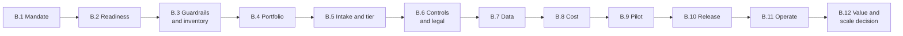
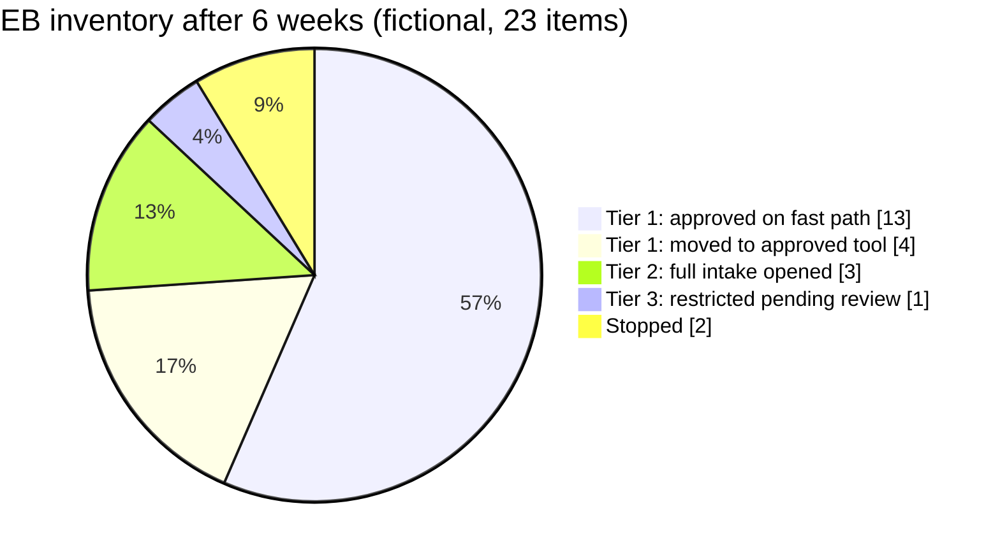
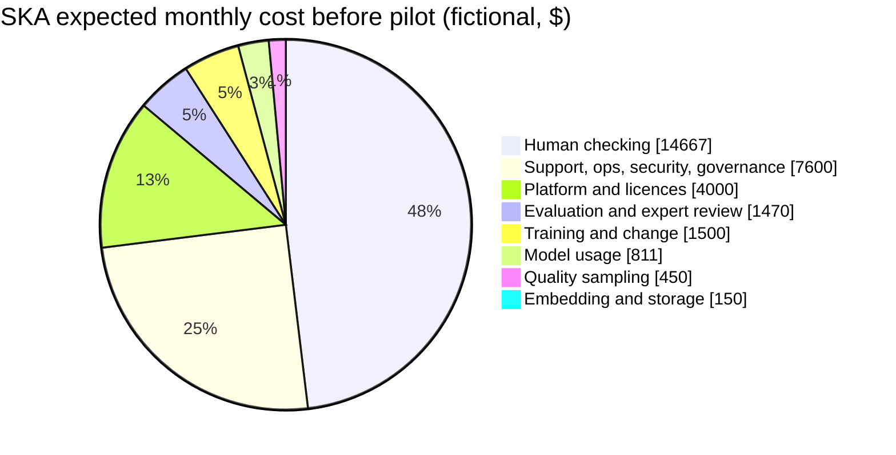
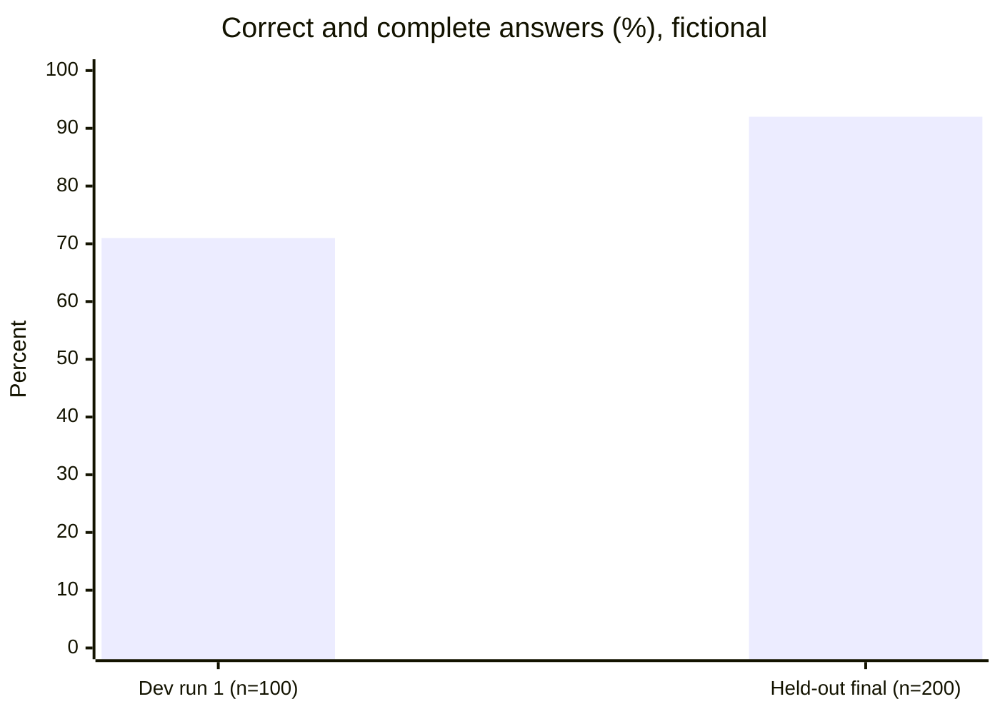
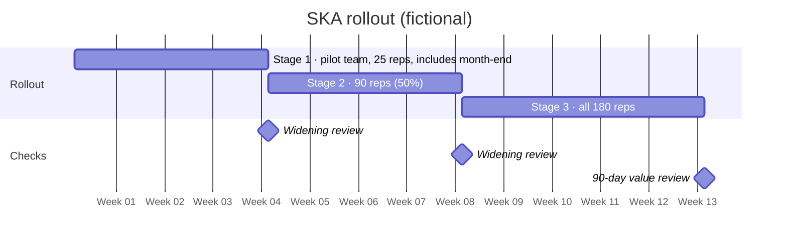

# Appendix B — Worked example: one use case from idea to scale decision

**Read this first.** *Example Brokerage* (EB) is a **fictional** mid-sized retail brokerage. Every name, volume, rate, price and result in this appendix is invented to show how the method and tools fit together and how the arithmetic works. None of it is a benchmark, a target or a statement about any real firm. Legal and regulatory content is kept as placeholders, because applicability depends on the actual entity, jurisdiction and activity (Chapter 4.6, tool C.4). The pattern of the use case, a staff knowledge assistant with cited sources, resembles documented cases in the collection (Schwab, LCH, Prudential, JPMC), but the details are not taken from them. [D11 ll. 44–79; D26 ll. 82–128; D29 pp. 14–19; D25 pp. 12–13.]

## B.1 Mandate (Chapter 1.2)

| Mandate element | EB’s entry |
|---|---|
| Business challenge and evidence | Complex client-service inquiries (corporate actions, transfers, fees, product rules) take long to answer and are often escalated. A two-week sample showed a 9.5-minute average handle time for complex inquiries against 4.1 minutes for simple ones, a 12% escalation rate and 8% re-contact within 7 days. **Confirmed** from telephony and CRM data. Rising volume is a **hypothesis** awaiting the next quarter’s figures. |
| Outcomes and owners | (1) Faster correct resolution of complex service inquiries — Head of Client Service. (2) Analyst time released from routine drafting — Head of Research. (3) Controlled staff use of general AI tools — COO. |
| Boundaries | In scope: internal staff tools, the service and research functions, the home jurisdiction. Out of scope for 12 months: client-facing generated content, personalized recommendations, order execution. Undecided: email channel. |
| Investment and authority | Discovery and two use cases funded for 6 months; further commitments need portfolio-authority approval at Gate 2. Stop if no use case passes Gate 3 by month 6. |
| Constraints to investigate | Client-data handling with external model providers; records retention for assisted communications; vendor concentration; service-team capacity during month-end peaks. |

## B.2 Readiness profile (tool C.1, abridged)

| Dimension | Observed capability and example | Label | Confidence / gap | Next required capability, owner, date |
|---|---|---|---|---|
| Strategy and executive alignment | Sponsor (COO) released two service team leads at 40% for 6 months | Emerging | High; no portfolio process yet | Portfolio authority charter — COO — week 6 |
| Layered AI infrastructure | Enterprise licence for one hosted assistant; no evaluation or monitoring tooling | Ad Hoc | Medium | Evaluation harness choice — CTO — week 8 |
| Data and content readiness | Product and procedure documents in three repositories; 30% lack an owner; no expiry dates | Ad Hoc | High (inspected) | Content ownership and expiry — Head of Client Service — week 10 |
| Governance and risk | Model risk policy covers credit models only; no AI inventory | Ad Hoc | High | Tier policy and inventory — CRO with Program Lead — week 6 |
| Adoption and transformation | Informal use of public chat tools reported in two teams | Ad Hoc | Low (self-reported) | AUP and approved tool — COO — week 3 |
| Use prioritization and portfolio | None | Unknown | — | First portfolio round — Program Lead — week 7 |

**Readiness decision:** ready for discovery and a bounded Tier-2 pilot once the content-ownership gap is closed for the pilot’s document set. **Blocking:** content owners for pilot documents; tier policy. The handbook advises against averaging the labels into one score (Chapter 1.3).

## B.3 Day-one guardrails and inventory (Chapter 4.2, tool C.13)

EB issued an interim acceptable-use policy in week 2. It approved the licensed assistant for public and internal data, opened a six-week registration window and asked procurement to check five major vendors for newly added AI features.

The Tier-3 item was an AI feature added to a vendor's CRM that summarized client calls. It was disabled until the data terms were reviewed. The two stopped items involved client data pasted into a public tool; both went through the incident route.

## B.4 Portfolio decision (Chapter 2, tool C.2 comparison)

Twenty-two problem statements were collected. Five passed eligibility and were scored on the anchored 1–5 scales, with equal weights.

| Candidate | Importance | Evidence | Feasibility | Adoption | Time to evidence | Economics | Risk burden | Total (of 35) | Tier |
|---|---|---|---|---|---|---|---|---|---|
| Service knowledge assistant (SKA) | 5 | 4 | 4 | 4 | 3 | 3 | 3 | 26 | 2 |
| Research note first drafts | 3 | 3 | 5 | 4 | 5 | 4 | 5 | 29 | 1 |
| Suitability pre-check | 5 | 3 | 2 | 2 | 1 | 2 | 1 | 16 | 3 |
| Trade-break triage | 4 | 3 | 3 | 3 | 3 | 3 | 3 | 22 | 2 |
| Marketing copy variants | 2 | 2 | 5 | 3 | 5 | 3 | 3 | 23 | 3 (public content) |

**Sensitivity check:** doubling the weight of business importance (the COO’s priority) puts the SKA first and the suitability pre-check third. Doubling time to evidence keeps research drafting first. **Decision:** fund research drafting on the Tier-1 fast path for a quick, low-risk win; fund the SKA as the main Tier-2 investment; prepare data prerequisites for trade-break triage; defer the suitability pre-check (Tier 3, needs legal determination and better data); stop marketing variants for now (low value, public-content tier).

**Tier-1 fast path (tool C.0) for research drafting, abridged:** all six Tier-1 conditions answered "yes"; 36 representative drafting tasks tried, no critical failures (supports ≤ about 8% critical-failure rate at 95%); typical problems: invented figures when the prompt lacked data → guidance "paste source tables; never ask the assistant for numbers"; 14 analysts trained; annual review set. Approved in week 9.

## B.5 Intake and tier for the SKA (tool C.2, abridged)

**Opportunity statement:** For client-service representatives, change *finding and interpreting product and procedure rules* so that *complex inquiries are resolved correctly faster*, while maintaining *answer accuracy, client-data confidentiality and records obligations*.

| Alternative | Disposition and reason |
|---|---|
| Current process | Rejected: baseline problem confirmed |
| Improve procedures and enterprise search | **Kept as part of the solution:** content ownership and expiry dates are needed anyway; search alone tested at 41% first-result relevance on 50 sample questions |
| Rules-based decision trees | Rejected for most topics: rules change frequently; kept for fee calculations, which are deterministic |
| Grounded assistant with citations (RAG) | **Selected for pilot** |
| Agent that updates client records | Out of scope: Tier 3, not needed for the outcome |

**Tier:** Tier 2. It uses confidential procedure content and may handle client-specific details typed by representatives, and it informs staff-to-client communication; representatives remain responsible for every answer and the assistant takes no actions. **Re-tier trigger:** any direct client exposure, or connection to account data.

## B.6 Controls and legal screen (tools C.3 and C.4, abridged)

| Failure / harm | Control and lifecycle point | Owner | Test evidence | Residual decision |
|---|---|---|---|---|
| Stale or wrong rule given to a client | Document expiry dates; content owners; cited answers; "no source → no answer" behavior | Head of Client Service | Stale-document cases in test set; citation-support check | Accepted within pilot scope by business owner |
| Client data sent outside approved boundary | Provider contract with no training on data, regional processing; input filter for account numbers | CISO | Data-flow test; negative tests with synthetic account numbers | Accepted by CISO |
| User sees content they are not entitled to | Retrieval filtered by the user’s existing document permissions, enforced in software [FINOS mi-16] | CTO | Permission-change and negative-access tests | Accepted by CISO |
| Uncontrolled spend | Per-user quotas; budget alerts [FINOS mi-9] | Service owner | Alert test | Accepted |

**C.4 summary (placeholders):** Jurisdiction [home]; activity [client service for a regulated broker]; questions reviewed: records retention for assisted communications [determination: answers sent to clients are retained through the existing CRM record — confirmed by Compliance]; outsourcing or third-party notification requirements [determination by Legal: (permitted / conditions / notification needed)]; personal-data processing basis with the provider [determination by Privacy]. **Disposition:** permitted with conditions; conditions block release, not the pilot.

## B.7 Data contract (tool C.9, abridged)

| Source | Meaning and limits | Owners | Permitted use | Quality and freshness | Flow and retention |
|---|---|---|---|---|---|
| Product rules library (1,240 documents) | Authoritative for product terms; excludes legacy products closed before [year] | Head of Products / content steward | Internal staff answers | 30% had no owner → assigned; expiry dates added; weekly sync | Indexed in the approved vector store; deleted documents purged from the index within 24 hours (tested) |
| Service procedures (410 documents) | Authoritative for process steps | Head of Client Service / ops steward | Internal | Monthly review cycle introduced | As above |
| Interaction logs | Prompts, answers and citations | Service owner | Quality review, incident investigation | — | Retained [period per records policy]; access limited to quality and incident roles |

## B.8 Run-cost estimate (tool C.14, expected scenario, before the pilot)

Assumptions (fictional): 24,000 assisted complex inquiries per month × 1.3 requests each = 31,200 requests; 6,000 input tokens (mostly retrieved passages) and 450 output tokens per request; assumed contracted rates of $3 and $15 per million tokens; 5% retry overhead; loaded representative cost $55 per hour; 40 seconds of extra checking per inquiry (estimated before measurement).

| Line | Expected per month |
|---|---|
| Model usage: (187.2M input × $3 + 14.0M output × $15) ÷ 1M × 1.05 | $811 |
| Embedding, indexing, storage | $150 |
| Hosting, platform and licences | $4,000 |
| Evaluation runs and expert review (16 h × $90) | $1,470 |
| Production quality sampling (50 items × 6 min × $90/h) | $450 |
| Human checking in the workflow (24,000 × 40 s × $55/h) | $14,667 |
| Support, operations, security, governance (80 h × $95) | $7,600 |
| Training, change, supplier management | $1,500 |
| **Total** | **$30,648** |

Low (12,000 inquiries) and high (36,000 inquiries) scenarios change the model line to about $405 and $1,216, and checking to about $7,333 and $22,000. **Reading the estimate:** model fees are under 3% of cost. Whether the use case pays depends on whether the time saved on each inquiry is larger than the checking time it adds, which only the pilot can measure.

## B.9 Pilot charter, evaluation and decision (tool C.5, abridged)

**Decision to inform:** fund production for the service team? **Users:** 25 representatives in one team. **Timebox:** 10 weeks (Tier-2 starting default 8–12). **Exposure:** supervised; representatives must check the cited source before using any answer.

**Test set:** 300 cases from real inquiries, with client details removed: 100 development and regression cases, and **200 held out** for final evaluation and never used for tuning. Composition follows the starting default: 60% common, 20% exceptions and stale or conflicting sources, 10% out of scope, 10% adversarial and permission cases. Fee-calculation questions form a separate slice of 40 cases.

**Thresholds set before results (signed week 2):**

| Measure | Threshold and rationale |
|---|---|
| Critical errors (wrong rule that could cause client detriment) | Zero in the 200 held-out cases → supports a rate ≤1.5% at 95% (rule of three) |
| Correct and complete answers | ≥90% observed, with a Wilson lower bound ≥85% |
| Citation supports the answer | ≥95% |
| Out-of-scope handled correctly (refuse or escalate) | ≥95% of that slice |
| Permission and leakage tests | 100% pass |
| Complex-inquiry handle time (supervised cohort vs. a comparable team) | At least 10% lower, with re-contact not higher |

**Results:**

- **Development run 1:** 71/100 correct; 3 critical errors, all from superseded fee documents still in the index. Failure classification: *source quality* (Chapter 6.6). Fix: the content steward retired 86 superseded documents, added expiry metadata and an ingestion check. Regression cases added.
- **Held-out final evaluation:** 184/200 correct (92%; Wilson 95% interval 87.4–95.0%); **0 critical errors** (supports ≤1.5%); citation support 194/200 (97%); out-of-scope 19/20; permission and leakage tests 100%. Fee-calculation slice: 36/40 correct, with 4 rounding errors → fee questions routed to the existing deterministic calculator instead of the model.
- **Workflow:** complex-inquiry handle time 9.5 → 7.8 minutes (−18%) in the pilot team, against 9.4 minutes in the comparison team over the same weeks; re-contact 8.1% vs 8.0% (no material change); escalations 12.0% → 10.5%. The measured handle time **already includes checking time**.

**Decision (week 10):** *Continue* to production readiness, with the fee slice excluded from model answers. Signed by the business owner; CISO and Compliance concurrence recorded.

## B.10 Release (tool C.6, abridged) and rollout

Conditional items at release: the records-retention configuration was verified in the production CRM (closed before Stage 1); on-call support for the first month-end was staffed (closed). The off-switch was tested and reverts representatives to enterprise search within 5 minutes.

**Abort triggers:** any confirmed critical error reaching a client; a permission failure; weekly sampled accuracy below 85%; re-contact more than 1 point above the comparison group.

## B.11 Operation and an incident (tool C.10, abridged)

**Incident (week 7 of operation):** a product terms update was published but failed to sync to the index; for about 3 hours the assistant cited the old fee schedule. **Detected by** a representative flag, then confirmed by the sync-failure alert, which had been routed to an unmonitored mailbox. **Contained** by disabling fee-related retrieval; 11 affected interactions were identified from logs and corrected through client follow-up by team leads. **Corrective actions:** alert routed to the on-call rota; the sync job fails closed (stale documents are withdrawn rather than served); a regression case was added. Restored after the regression and permission tests passed.

## B.12 Value review and scale decision at 90 days (tools C.7 and C.14)

**Successful outcome** is defined as an assisted complex inquiry resolved without re-contact within 7 days that passes the QA sample. Expected per month: 24,000 × (1 − 0.081) × 0.95 ≈ 20,950.

**Avoid double counting:** the pre-pilot estimate carried a separate $14,667 checking line because benefits were then estimated as gross time saved. The measured handle-time saving is **net** of checking, so the value review removes the separate checking line.

| Ledger line (fictional, per month) | Value | Evidence quality |
|---|---|---|
| Operating cost excluding workflow checking | $15,981 | Actual invoices and timesheets |
| Cost per successful outcome | $15,981 ÷ 20,950 ≈ **$0.76** | Derived; QA sample n = 200 per month |
| Capacity released | 24,000 × 1.7 min ≈ 680 hours (≈ $37,400 at loaded cost) | Comparison-team design over a full cycle; not cash |
| Management action on capacity | Absorbed 9% volume growth without filling 3 planned vacancies | Finance-validated |
| Finance-validated cash benefit | 3 avoided hires × $5,500 loaded = **$16,500** | Confirmed against approved hiring plan |
| Net operating benefit (cash only) | $16,500 − $15,981 ≈ **+$519** | Conservative; excludes service-quality value |
| Service quality | Escalations −1.5 points; re-contact unchanged; one incident (contained) | Operational data |
| One-time costs to date | $140,000 (build, integration, content remediation) | Actuals |

**Interpretation:** on cash terms alone, the use case covers its running cost but does not yet repay the build cost. The released capacity is real, but it is a benefit only to the extent that management uses it. Platform and operations costs are largely fixed, so wider use lowers cost per outcome.

**Decision (portfolio authority):** **Refine and expand within the same context.** (1) Extend to the 40 back-office staff who answer the same product questions. This is the same tier and data, but a new user group, so permissions and training are re-checked (Chapter 9.3). (2) Refine: reduce retrieved context per request and renegotiate the platform licence. (3) **Do not** extend to client email drafting yet: drafts sent to clients increase exposure, so the change triggers a re-tier review and a new C.4 determination. (4) Next value review at the Tier-2 six-month cadence.

**Traceability (tool C.12, one entry):** *Question:* "Will the saved time become a financial benefit?" → *Answer:* yes, through the hiring plan (finance, confirmed) → *Decision:* count only avoided hires as cash benefit → *If this changes* (for example, volume falls): treat the benefit as capacity only and re-evaluate expansion economics → *Review trigger:* the quarterly volume forecast.

**What the example teaches:** most of the work was content ownership, evaluation and workflow measurement, not model selection. The decisive numbers (handle time net of checking, and finance-validated use of the released capacity) came from the business, not the technology.
