<div dir="rtl" lang="fa">

# راهنمای راهبرد و پیاده‌سازی هوش مصنوعی در سازمان

## از هدف کسب‌وکار تا بهره‌برداری پایدار

**این راهنما برای چه کسانی است؟** هیئت‌مدیره و نهادهای راهبری، حامیان اجرایی، مدیران کسب‌وکار، تیم‌های محصول و تحویل، تیم‌های داده و فناوری، منابع انسانی، واحدهای حقوقی و انطباق، متخصصان ریسک و امنیت اطلاعات و مالکان عملیات. برای هر نقش، در بخش [شیوهٔ استفاده از این راهنما](#how-to-use) مسیر مطالعهٔ جداگانه‌ای پیشنهاد شده است.

این راهنما روشی عملی است تا سازمان بتواند قابلیت‌های هوش مصنوعی را انتخاب کند، بسازد، به کار بگیرد و به‌مرور بهتر کند. هدف این است که یک مسئلهٔ واقعی کسب‌وکار به تغییری مشخص در شیوهٔ کار تبدیل شود؛ تغییری که مالک دارد و نتیجه‌اش را می‌توان سنجید. دامنهٔ راهنما هم یادگیری ماشین متعارف را در بر می‌گیرد، هم هوش مصنوعی مولد و هم سامانه‌هایی که خودشان اقدامی را انتخاب و اجرا می‌کنند (موسوم به «عامل‌ها»). بیشتر مثال‌ها از صنعت کارگزاری آمده‌اند، اما فقط برای روشن‌شدن روش‌اند و دامنهٔ کاربرد آن را محدود نمی‌کنند.

پیام اصلی راهنما ساده است: راهبرد هوش مصنوعی وقتی به کار می‌آید که سه چیز را به هم وصل کند: یک چالش مهم کسب‌وکار، رویکردی که با توان و محدودیت‌های واقعی سازمان جور باشد، و مجموعه‌ای منسجم از اقدام‌ها که بودجه و مالک پاسخ‌گو دارند. خرید ابزار، ساختن نمونه‌های نمایشی و انتشار بیانیهٔ اصول ممکن است کمک کند، اما هیچ‌کدام به‌تنهایی نشان نمی‌دهد که سازمان واقعاً توان اجرای کار را به دست آورده است. مک‌میلان صریحاً بر همین تفاوت تأکید می‌کند، و تجربهٔ فیدلیتی، ونگارد و نمونه‌های اجرایی MindForge نشان می‌دهد که هر سازمان این توانمندی‌های پایه را به روش خودش ساخته است. [D19 pp. 2–6; D10 pp. 11–12; D14 ll. 55–82; D29 pp. 6–19.]

### فهرست مطالب

- [خلاصهٔ مدیریتی](#exec-summary)
- [شیوهٔ استفاده از این راهنما](#how-to-use)
- [فرایند را متناسب با ریسک تنظیم کنید: سطوح ریسک و مسیر سریع](#tiers)
- [شروع سریع: ۹۰ روز نخست](#quick-start)
- [۱. تعیین مأموریت و سنجش آمادگی](#ch1)
- [۲. ساختن و اولویت‌بندی سبد کاربردها](#ch2)
- [۳. طراحی مدل عملیاتی و برنامهٔ نیروی انسانی](#ch3)
- [۴. گنجاندن حاکمیت در فرایند تحویل](#ch4)
- [۵. آماده‌سازی داده و فناوری](#ch5)
- [۶. طراحی و ارزیابی پایلوت](#ch6)
- [۷. از پایلوت تا بهره‌برداری](#ch7)
- [۸. پشتیبانی از پذیرش و تغییر شیوهٔ کار](#ch8)
- [۹. سنجش نتایج و گسترش سنجیده](#ch9)
- [۱۰. تبدیل چارچوب به نقشهٔ راه سازمان](#ch10)
- [پیوست الف — کلید منابع](#appendix-a)
- [پیوست ب — یک مثال کامل: از ایده تا تصمیم گسترش](#appendix-b)
- [پیوست ج — ابزارهای آمادهٔ تکمیل](#appendix-c)
- [پیوست د — پیش‌فرض‌ها، منابع بیرونی و محدودیت‌ها](#appendix-d)

فهرست کامل ۱۹۷ پروندهٔ منبع، نقشهٔ شواهد و سوابق راستی‌آزمایی در فایل همراه انگلیسی، [handbook-evidence-companion.md](handbook-evidence-companion.md)، آمده است. ارجاع‌های داخل متن به همان شکل لاتینِ نسخهٔ اصلی نوشته شده‌اند، مثلاً `[D14 ll. 132–198]` یا `[FINOS mi-16]`، تا بتوان آن‌ها را مستقیماً با فهرست منابع تطبیق داد. معنای هر شناسه در [پیوست الف](#appendix-a) آمده است.

<a id="exec-summary"></a>

## خلاصهٔ مدیریتی

**این راهنما چه کاری می‌کند؟** کمک می‌کند سازمان از آزمایش‌های پراکنده با هوش مصنوعی به مجموعه‌ای از فرایندهای کاری برسد که مالک دارند، نتیجه‌شان سنجیده می‌شود و می‌توان به آن‌ها اتکا کرد. برای مدیران ارشد پنج تصمیم کلیدی را روشن می‌کند، به تیم‌ها روشی گام‌به‌گام می‌دهد و برای همه ابزارهای آمادهٔ تکمیل فراهم می‌کند. معیار آن شواهد است، نه هیجان بازار: هر سرمایه‌گذاری، پایلوت و عرضه باید به یک نتیجهٔ کسب‌وکاری، یک مالک مشخص و آزمونی وصل باشد که بتواند جواب «نه» بدهد.

**تصویر کلی.**

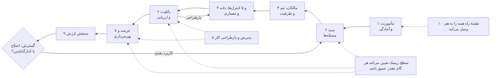

**ده قاعده‌ای که بیشترین اثر را دارند.**

۱. از یک نتیجهٔ کسب‌وکاری شروع کنید که مالک مشخص دارد، نه از ابزار. این امکان را هم باز بگذارید که بهترین راه‌حل اصلاً هوش مصنوعی نباشد. [D10 p. 11; D16 p. 9]  
۲. سخت‌گیری فرایند را با ریسک تنظیم کنید. دستیاری که فقط متن پیش‌نویس می‌کند نباید از همان مراحلی بگذرد که عاملی که پول جابه‌جا می‌کند. سه سطح ریسک این راهنما برای همین است. [D29 p. 14; D30 pp. 53–55]  
۳. پیش از آنکه ابزارها را ممنوع کنید یا نادیده بگیرید، حفاظ‌های اولیه را برقرار کنید: یک ابزار مجاز، یک خط‌مشی کوتاه برای استفاده و راهی برای ثبت استفاده‌هایی که همین حالا وجود دارد. [D30 p. 30; D08 ll. 519–530; E06]  
۴. برای گام‌های کوچک و مشخص در یک حوزهٔ کسب‌وکار بودجه بدهید و تعداد کارهای هم‌زمان را با تعداد متخصصانی که واقعاً دارید متناسب نگه دارید. [D21 pp. 3–4; D10 pp. 11–12]  
۵. معیار قبولی و ردّ را پیش از دیدن نتایج بنویسید و تعداد نمونه‌های آزمون را از نرخ خطایی که می‌خواهید کنار بگذارید محاسبه کنید. مثلاً برای اینکه بتوان گفت نرخ خطای جدی حداکثر ۱٪ است، حدود ۳۰۰ مورد بدون خطا لازم است. [D04 ll. 367–463; E07]  
۶. مجوزها و کارهایی را که سامانه اجازه دارد انجام دهد در خود نرم‌افزار و بیرون از مدل اعمال کنید. دستوری که در متن به مدل داده می‌شود، جای کنترل دسترسی را نمی‌گیرد. [FINOS mi-16; FINOS mi-18]  
۷. مرحله‌به‌مرحله عرضه کنید؛ کلید توقفی داشته باشید که آزموده شده و راهی برای انجام دستی کار در صورت نیاز. [D29 p. 8; D30 pp. 99–103; E12]  
۸. خودِ شیوهٔ کار را از نو طراحی کنید، نه فقط صفحهٔ نرم‌افزار را؛ و زمانی را که صرف بررسی و اصلاح خروجی می‌شود هم حساب کنید. [D12 pp. 2–4; D27 ll. 254–293]  
۹. هزینه را «به ازای هر نتیجهٔ موفق» بسنجید. زمانی که آزاد می‌شود فقط «ظرفیت» است، تا وقتی که مدیریت آن را به سود واقعی تبدیل کند. [D38 ll. 381–429]  
۱۰. دربارهٔ گسترش، اصلاح یا کنارگذاشتن، بر پایهٔ شواهدی تصمیم بگیرید که در طول زمان پایدار مانده‌اند، و پیش از هر گسترش شرایط تازه را دوباره بسنجید. [D30 pp. 63–64, 112–113]

**پنج تصمیمی که با مدیران ارشد است.** برای هر تصمیم، یک تصمیم‌گیرندهٔ پاسخ‌گو، حداقلی از شواهد و یک نتیجهٔ ثبت‌شده لازم است.

| مرحلهٔ تصمیم | تصمیم‌گیرندهٔ پاسخ‌گو (سازمان تعیین می‌کند) | حداقل شواهد | تصمیم‌های ممکن |
|---|---|---|---|
| مأموریت | حامی اجرایی / نهاد راهبری | نتایج کسب‌وکاری مورد انتظار، مرزها، ظرفیت و برآورد اولیهٔ آمادگی | اجازهٔ بررسی؛ بازنگری دامنه؛ تعویق |
| سرمایه‌گذاری در یک کاربرد | مرجع تصمیم‌گیری سبد، همراه با مالک کسب‌وکار | شواهد وجود مسئله، راه‌حل‌های جایگزین، سطح ریسک اولیه، امکان‌پذیری از نظر داده و هزینه | بودجه برای یک گام محدود؛ ابتدا فراهم‌کردن پیش‌نیازها؛ انتخاب راه ساده‌تر؛ توقف |
| آزمایش پایلوت با کاربران واقعی | مالک کسب‌وکار، با تأیید فنی و کنترلی لازم | منشور پایلوت، دادهٔ مجاز، محدودیت‌هایی که آزموده شده‌اند، برنامهٔ ارزیابی | اجرا در محدودهٔ تعیین‌شده؛ بازطراحی؛ رد |
| عرضه در محیط عملیاتی | مرجع مشخص تأیید عرضه | کیفیتی که پذیرفته شده، شواهد کنترل‌ها، آمادگی پشتیبانی و تصمیم دربارهٔ ریسکی که باقی می‌ماند | عرضه در دامنهٔ تعیین‌شده؛ عرضهٔ محدودتر؛ بازطراحی؛ توقف |
| گسترش یا ادامه | مالک کسب‌وکار و مرجع تصمیم‌گیری سبد | نتایج پایدار، هزینهٔ کامل، ریسک، ظرفیت و بررسی شرایط تازه | گسترش؛ ادامه؛ اصلاح؛ تعلیق؛ کنارگذاشتن |

این پنج مرحله به پنج کمیتهٔ تازه نیاز ندارد. همان مراجعی که امروز در سازمان تصمیم می‌گیرند می‌توانند این تصمیم‌ها را هم بگیرند، به شرط آنکه حدود اختیارشان، شواهدی که دیده‌اند و تصمیمی که گرفته‌اند ثبت شود. هر تأیید حقوقی یا نظارتی که لازم باشد، موضوعی جداگانه است و باید با قوانین محل فعالیت سازمان سنجیده شود.

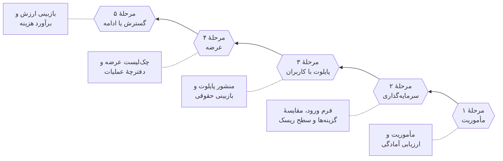

همهٔ این ابزارها در پیوست ج آمده‌اند.

**آنچه مدیران باید در همین سه‌ماهه تصمیم بگیرند.**

- حامی اجرایی کیست و چه کسی مدیر برنامهٔ هوش مصنوعی است، با اختیاراتی که مکتوب شده باشد؟ (بخش ۳.۲)
- کدام دو یا سه نتیجهٔ کسب‌وکاری ارزش سرمایه‌گذاری دارد و مالک هر کدام کیست؟ (بخش ۱.۲)
- کارکنان همین حالا از کدام ابزار هوش مصنوعی و با چه قواعدی می‌توانند استفاده کنند؟ (بخش ۴.۲؛ نمونهٔ خط‌مشی در پیوست ج)
- کدام کاربردهای فعلی هوش مصنوعی، از جمله قابلیت‌هایی که در نرم‌افزار تأمین‌کنندگان گنجانده شده، باید تا چه تاریخی ثبت و سطح‌بندی شوند؟ (بخش ۴.۲)
- چه ظرفیتی، یعنی چه افرادی و چه بودجه‌ای، برای ۹۰ روز نخست کنار گذاشته می‌شود؟ (بخش شروع سریع)

<a id="how-to-use"></a>

## شیوهٔ استفاده از این راهنما

### مسیر مطالعه برای هر نقش

| نقش | ابتدا بخوانید | سپس از این ابزارها (پیوست ج) استفاده کنید | زمان لازم |
|---|---|---|---|
| هیئت‌مدیره / نهاد راهبری | خلاصهٔ مدیریتی؛ سطوح ریسک؛ بخش‌های ۴.۱ و ۴.۲؛ بخش ۹.۳ | ماتریس اختیارات تصمیم؛ بازبینی ارزش | ۳۰ دقیقه |
| حامی اجرایی | خلاصهٔ مدیریتی؛ شروع سریع؛ فصل ۱؛ بخش‌های ۲.۴ و ۳.۲؛ فصل ۱۰ | ارزیابی آمادگی؛ خلاصهٔ فرم ورود؛ قالب نقشهٔ راه | ۱ تا ۲ ساعت |
| مدیر برنامهٔ هوش مصنوعی | کل راهنما، با شروع از مثال پیوست ب | همهٔ ابزارها، به‌ویژه جدول ردیابی | ۱ روز |
| مالک کسب‌وکار / مالک کاربرد | سطوح ریسک؛ فصل ۲؛ بخش ۶.۲؛ فصل‌های ۸ و ۹ | برگهٔ مسیر سریع یا فرم ورود؛ منشور پایلوت؛ بازبینی ارزش؛ برنامهٔ نیروی انسانی | ۲ تا ۳ ساعت |
| محصول، داده و مهندسی | فصل‌های ۵، ۶ و ۷؛ کنترل‌های بخش ۴.۴ | منشور پایلوت؛ چک‌لیست عرضه؛ برگهٔ داده و معماری؛ دفترچهٔ عملیات؛ برآوردگر هزینه | نیم روز |
| حقوقی، انطباق و ریسک | سطوح ریسک؛ فصل ۴؛ بخش‌های ۶.۴ و ۷.۲ | نسخهٔ کنترلی ماتریس اختیارات؛ کاربرگ بازبینی حقوقی؛ چک‌لیست عرضه | ۲ تا ۳ ساعت |
| امنیت اطلاعات | بخش‌های ۴.۲، ۴.۴، ۵.۳ تا ۵.۵، ۷.۵ و ۷.۶ | چک‌لیست عرضه؛ برگهٔ داده و معماری؛ دفترچهٔ عملیات؛ خط‌مشی استفادهٔ مجاز | ۲ ساعت |
| منابع انسانی و مدیران مستقیم | بخش ۳.۵؛ فصل ۸ | برنامهٔ نیروی انسانی؛ خط‌مشی استفادهٔ مجاز | ۱ ساعت |
| مالی / تدارکات | بخش‌های ۲.۴، ۵.۵ و ۵.۶؛ فصل ۹ | بخش اقتصادی فرم ورود؛ بازبینی ارزش؛ برآوردگر هزینه | ۱ ساعت |

### از کجا شروع کنید؟

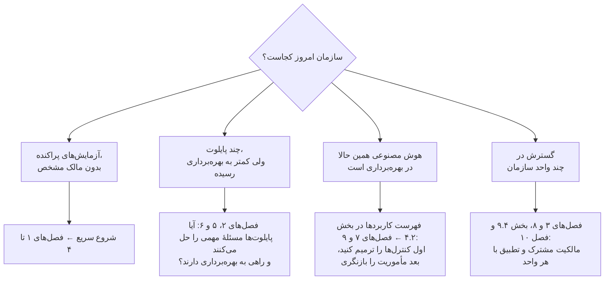

این نقطه‌های شروع فقط مسیر مطالعه را تعیین می‌کنند و شما را از شواهدی که مراحل قبلی لازم دارند معاف نمی‌کنند. اگر برای سامانه‌ای که همین حالا کار می‌کند مالک، حق استفاده از داده یا حفاظ‌های عملیاتی روشن نیست، ممکن است لازم شود آن سامانه پس از استقرار ارزیابی، محدود یا حتی متوقف شود. اینکه این ترمیم چقدر عمیق باشد و از کجا شروع شود، به سطح ریسک بستگی دارد. [جمع‌بندی راهنما بر پایهٔ D19 pp. 2–6; D30 pp. 63–64, 67–74, 112–113.]

### برچسب‌ها و شواهد را چطور بخوانید

در سراسر راهنما از شش برچسب استفاده شده است که هر کدام معنای متفاوتی دارد:

| برچسب | یعنی | با آن چه کنید |
|---|---|---|
| **رویهٔ مستند** | منبعی شرح داده که سازمانی کاری را انجام داده است | پیش از الگوبرداری، شرایط آن سازمان را با شرایط خودتان مقایسه کنید؛ مستند بودن یعنی گزارش شده، نه اینکه به‌طور مستقل تأیید شده باشد |
| **نتیجهٔ گزارش‌شده** | منبعی نتیجه‌ای را گزارش کرده است | معیار، مبنای محاسبه، دوره و میزان عدم‌قطعیت را همراه عدد نگه دارید؛ از آن رابطهٔ علت و معلولی نتیجه نگیرید و آن را هدفی تضمین‌شده ندانید |
| **توصیهٔ منبع** | نویسنده‌ای رویکردی را پیشنهاد کرده است | استدلال، دامنه و انگیزهٔ نویسنده را بسنجید و آن را با کاری که واقعاً اجرا شده یکی ندانید |
| **جمع‌بندی راهنما** | توصیه، ابزار یا ترتیبی که از مقایسهٔ منابع به دست آمده است | با احتیاط به کار ببرید، دلیل انتخابتان را ثبت کنید و اگر شواهد تغییر کرد، آن را هم تغییر دهید |
| **پیش‌فرض آغازین** | عدد، مدت یا تواتری مشخص که راهنما پیشنهاد می‌کند تا تیم‌ها بدون بحث طولانی شروع کنند | تا وقتی شواهد خودتان عدد دیگری را توجیه نکرده، همین را به کار ببرید؛ مبنای هر پیش‌فرض (آمار، استاندارد، نمونه‌ای از منابع یا داوری ویراستار) در [پیوست د](#appendix-d) آمده است |
| **پرسش باز** | شواهد موجود پاسخ روشنی نمی‌دهد | مشخص کنید چه کسی آن را بررسی می‌کند، چه شواهدی لازم است و تا چه تاریخی باید تصمیم گرفت؛ آن را بی‌سروصدا به یک فرض تبدیل نکنید |

دستورالعمل‌ها و ابزارها، اگر خلاف آن گفته نشده باشد، از نوع **جمع‌بندی راهنما** هستند. میزان الزام هر رویه در کارت هر فصل و در جدول سطوح ریسک مشخص شده است:

- **الزامی**: بدون آن، روش در آن سطح ریسک دیگر پاسخ‌گو و آزمون‌پذیر نیست.
- **مشروط**: فقط وقتی لازم است که شرط گفته‌شده برقرار باشد (مثلاً استفاده از دادهٔ شخصی، ارتباط مستقیم با مشتری یا اقدام‌هایی که عامل انجام می‌دهد).
- **اختیاری**: مفید است، اما پیش‌نیاز نیست.

**ارجاع‌ها.** `[D14 ll. 132–198]` یعنی سطرهای ۱۳۲ تا ۱۹۸ از منبع D14؛ `[D30 pp. 99–103]` یعنی صفحه‌های ۹۹ تا ۱۰۳ فایل PDF، با احتساب جلد؛ `[FINOS mi-16]` به یکی از پرونده‌های «کاهش ریسک» در چارچوب حاکمیت هوش مصنوعی FINOS اشاره دارد؛ و `[E07]` منبعی بیرونی است که در پیوست د معرفی شده است. هر فصل با یک **کارت فصل** شروع می‌شود که در یک نگاه نشان می‌دهد مالک کار کیست، چه زمانی شروع می‌شود، معمولاً چقدر طول می‌کشد، چه خروجی‌هایی دارد، از کدام ابزارها استفاده می‌کند و در هر سطح ریسک حداقل چه کارهایی لازم است.

<a id="tiers"></a>

## فرایند را متناسب با ریسک تنظیم کنید: سطوح ریسک و مسیر سریع

تناسب با ریسک، فرق روشی است که کار را پیش می‌برد با روشی که آن را زمین‌گیر می‌کند. پرودنشال برای سامانه‌های کم‌ریسک حاکمیتی سبک و برای سامانه‌های پرریسک‌تر الزامات کامل اعمال می‌کند. MindForge هم توصیه می‌کند که عمق بازبینی، اطلاعاتی که از تأمین‌کنندگان خواسته می‌شود و تواتر بازبینی پس از استقرار، همه به اهمیت ریسک بستگی داشته باشد. [D29 p. 14; D30 pp. 43, 53–55, 108.] این راهنما همین اصل را به سه سطح ریسک تبدیل کرده که برای هر کدام حداقل الزامات مشخصی تعریف شده است. این سطح‌بندی **جمع‌بندی راهنما** است: معیارها را با طبقه‌بندی ریسک سازمان خودتان و قوانین محلی تطبیق دهید، اما این قاعده را نگه دارید که هر جا پاسخی نامعلوم است، کاربرد یک سطح بالاتر قرار می‌گیرد تا وقتی که پاسخ روشن شود.

### تعیین سطح ریسک با پنج پرسش

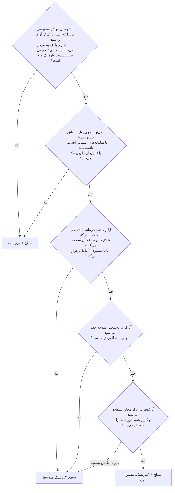

| سطح | نمونه‌های رایج | ویژگی‌های تعیین‌کننده |
|---|---|---|
| **سطح ۱: کم‌ریسک** | نوشتن و خلاصه‌کردن متن‌های داخلی یا عمومی با دستیار مجاز؛ دستیار برنامه‌نویسی، با همان بازبینی معمول کد؛ یادداشت جلسه که خود شرکت‌کننده ویرایش می‌کند | فقط کاربران داخلی؛ کاربر همهٔ خروجی‌ها را پیش از استفاده می‌بیند؛ فقط انواع داده‌ای که برای ابزار مجاز تعریف شده؛ هیچ اقدام خودکاری جز پیش‌نویس برای خود کاربر؛ خطاها به‌آسانی دیده و جبران می‌شوند |
| **سطح ۲: ریسک متوسط** | دستیار دانشی کارکنان روی اسناد خط‌مشی و محصول؛ آماده‌سازی پژوهش برای تحلیل‌گران؛ استخراج اطلاعات از اسناد با یک مرحلهٔ کنترل انسانی | از دادهٔ محرمانه یا شخصی استفاده می‌کند، یا کارکنان بر پایهٔ آن تصمیم می‌گیرند یا با مشتری ارتباط برقرار می‌کنند؛ تصمیم نهایی با انسان است؛ آسیب قابل تشخیص است اما جبرانش پرهزینه است |
| **سطح ۳: پرریسک** | پاسخ‌هایی که مستقیم به مشتری داده می‌شود؛ توصیه‌های شخصی‌سازی‌شده؛ پشتیبانی از تصمیم‌های مربوط به تناسب محصول، اعتبار یا صلاحیت افراد؛ عامل‌هایی که سفارش ثبت می‌کنند، پول جابه‌جا می‌کنند یا سوابق را تغییر می‌دهند | خروجی بدون بازبینی موردی به مشتری می‌رسد یا دربارهٔ افراد تصمیم می‌گیرد؛ اقدام‌هایی که پیامد واقعی دارند؛ قانون آن را پرریسک می‌داند یا تأیید نهاد ناظر لازم است؛ خطاهایی که به‌سختی دیده می‌شوند |

هر کاربرد در **بالاترین** سطحی قرار می‌گیرد که یکی از این ویژگی‌ها ایجاب کند. هر بار که چیز مهمی تغییر می‌کند، مثلاً مخاطب، نوع داده، اقدام‌های سامانه، حوزهٔ قضایی یا تأمین‌کننده، سطح ریسک را دوباره تعیین کنید.

### هر سطح چه الزاماتی دارد

| رویه | سطح ۱: مسیر سریع | سطح ۲ | سطح ۳ |
|---|---|---|---|
| ورود و ثبت | **الزامی:** برگهٔ یک‌صفحه‌ای مسیر سریع و ثبت در فهرست کاربردها | **الزامی:** فرم کامل ورود؛ ثبت در فهرست کاربردها | **الزامی:** فرم کامل ورود؛ ثبت در فهرست کاربردها؛ مقایسهٔ گزینه‌ها |
| اجازهٔ شروع | **الزامی:** مالک کسب‌وکار و مدیر مستقیم؛ امنیت اطلاعات تأیید می‌کند که ابزار مجاز است | **الزامی:** مرجع تصمیم‌گیری سبد؛ بازبینی امنیت و حریم خصوصی | **الزامی:** مرجع تصمیم‌گیری سبد؛ پذیرش ریسک در سطح مدیریت ارشد؛ روشن‌شدن وضعیت حقوقی و نظارتی (کاربرگ بازبینی حقوقی) |
| اختیارات تصمیم | **اختیاری:** ماتریس اختیارات تصمیم | **الزامی:** نسخهٔ کنترلی ماتریس اختیارات | **الزامی:** ماتریس کامل اختیارات و بازبینی مستقل |
| توافق‌نامهٔ داده | **مشروط:** فقط اگر دادهٔ تازه‌ای وصل شود | **الزامی:** برگهٔ داده و معماری برای هر منبع حیاتی | **الزامی:** برگهٔ داده و معماری، به‌علاوهٔ آزمودن حذف داده و تغییر مجوزها |
| ارزیابی (پیش‌فرض آغازین) | **الزامی:** دست‌کم ۳۰ کار نمونه از کار واقعی، بدون هیچ خطای جدی (با اطمینان ۹۵٪ یعنی نرخ خطای جدی حداکثر ۱۰٪) | **الزامی:** دست‌کم ۱۵۰ مورد که می‌تواند به خطای جدی منجر شود، بدون هیچ خطای جدی (حداکثر ۲٪)، به‌علاوهٔ یک مجموعهٔ آزمون کنارگذاشته و بررسی جداگانهٔ زیرگروه‌ها | **الزامی:** دست‌کم ۳۰۰ مورد بدون خطای جدی (حداکثر ۱٪)، یا بیشتر اگر پیامدها ایجاب کند؛ ارزیابی مستقل؛ برای عامل‌ها، آزمودن مسیر اقدام |
| شیوهٔ عرضه | **الزامی:** عرضهٔ مستقیم به کاربران مجاز، پس از آموزش خط‌مشی استفاده | **الزامی:** عرضه به گروه‌ها در چند مرحله؛ کلید توقفی که آزموده شده | **الزامی:** اجرای سایه‌ای یا موازی، سپس یک گروه تحت نظارت با معیارهای مشخص برای توقف |
| پایش | **الزامی:** راهی برای بازخورد؛ آمار استفاده | **الزامی:** نمونه‌گیری ماهانه از کیفیت؛ هشدار برای دسترسی‌ها و هزینه | **الزامی:** بازبینی هفتگی کیفیت در نخستین دورهٔ کاری؛ هشدار فوری برای کنترل‌های حیاتی |
| بازبینی دوره‌ای | **الزامی:** سالانه یا هر بار که چیزی تغییر کند | **الزامی:** هر ۶ ماه یا هر بار که چیزی تغییر کند | **الزامی:** هر سه ماه یا هر بار که چیزی تغییر کند |
| ابزارها (پیوست ج) | برگهٔ مسیر سریع؛ خط‌مشی استفادهٔ مجاز | فرم ورود؛ نسخهٔ کنترلی ماتریس اختیارات؛ منشور پایلوت؛ چک‌لیست عرضه؛ برگهٔ داده و معماری؛ دفترچهٔ عملیات؛ برآوردگر هزینه | همهٔ ابزارها |
| زمان تا نخستین تصمیم | ۲ تا ۴ هفته | ۸ تا ۱۲ هفته | ۳ تا ۶ ماه یا بیشتر |

اعداد ارزیابی از «قاعدهٔ سه» در آمار آمده‌اند: اگر در *n* مورد مستقل و نمونه‌نما هیچ خطایی دیده نشود، با اطمینان ۹۵٪ می‌توان گفت نرخ خطا حداکثر حدود ۳ تقسیم بر *n* است. [E07] بازه‌های زمانی و تواتر بازبینی‌ها **پیش‌فرض آغازین** هستند و بر داوری ویراستار و نمونه‌هایی از منابع تکیه دارند؛ مثلاً آزمون پذیرش کاربر در پرودنشال حدود چهار ماه طول کشید و پایلوت اولیهٔ مورگان استنلی، برای دستیاری که تقریباً در سطح ۳ قرار می‌گیرد، نُه ماه. [D29 pp. 16–19; D04 ll. 367–463; D30 p. 108.] مبنای هر پیش‌فرض در پیوست د آمده است.

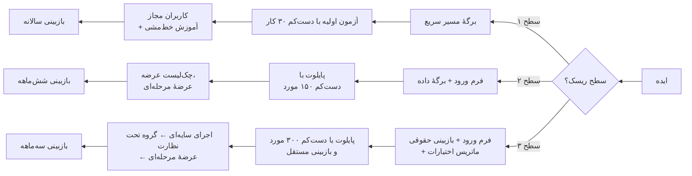

<a id="quick-start"></a>

## شروع سریع: ۹۰ روز نخست

این برنامه یک **پیش‌فرض آغازین** است برای سازمانی که هنوز در مرحلهٔ «آزمایش‌های پراکنده» یا «چند پایلوت» است. سه رشته کار هم‌زمان پیش می‌رود: رهبری و حفاظ‌ها؛ سبد کاربردها و نخستین تحویل؛ و نیروی انسانی. بسته به ظرفیت سازمان می‌توانید آن را فشرده‌تر یا طولانی‌تر کنید. تاریخ‌های واقعی را با برآوردهایی تنظیم کنید که خود مالکان کارها پذیرفته‌اند (از قالب نقشهٔ راه در پیوست ج و توضیح فصل ۱۰ کمک بگیرید). این ترتیب، **جمع‌بندی راهنما** و خلاصهٔ اجرایی فصل‌های ۱ تا ۶ است. [D19 pp. 2–6; D30 pp. 30, 67–74; D24 p. 4; D12 pp. 2–4.]

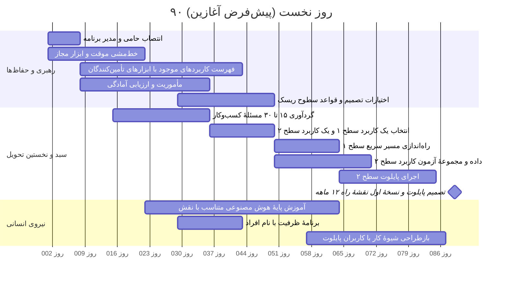

| بازهٔ زمانی | اقدام | مسئول | نشانهٔ انجام کار |
|---|---|---|---|
| روزهای ۱ تا ۷ | انتصاب حامی اجرایی و مدیر برنامهٔ هوش مصنوعی، با اختیارات، بودجه و مسیر ارجاع مکتوب | حامی اجرایی | شرح وظایف امضاشده (بخش ۳.۲) |
| روزهای ۱ تا ۲۱ | ابلاغ یک خط‌مشی موقت برای استفاده از هوش مصنوعی؛ تأیید یک ابزار عمومی و انواع داده‌ای که در آن مجاز است | مدیر برنامه، امنیت اطلاعات، واحد حقوقی | خط‌مشی ابلاغ‌شده (نمونه در پیوست ج)؛ اطلاعیهٔ ابزار مجاز |
| روزهای ۷ تا ۴۲ | تهیهٔ فهرست همهٔ کاربردهای فعلی هوش مصنوعی، از جمله ابزارهایی که خود کارکنان ساخته‌اند و قابلیت‌هایی که در نرم‌افزار تأمین‌کنندگان گنجانده شده؛ تعیین سطح ریسک هر کدام | مدیر برنامه، همراه با مالکان سامانه‌ها و واحد تدارکات | فهرستی که برای هر مورد مالک و سطح ریسک دارد (بخش ۴.۲) |
| روزهای ۷ تا ۳۵ | پیش‌نویس مأموریت؛ ارزیابی آمادگی بر پایهٔ شواهد | حامی، مدیران کسب‌وکار، مدیر برنامه | مأموریت و ارزیابی آمادگی، همراه با کمبودهایی که مانع کارند (فصل ۱) |
| روزهای ۱۴ تا ۳۵ | گردآوری ۱۵ تا ۳۰ مسئله از واحدهای کسب‌وکار؛ مشاهدهٔ کار واقعی در محل | مالکان کسب‌وکار، مدیر محصول | فهرست مسئله‌ها همراه با شواهد وضع موجود |
| روزهای ۲۸ تا ۴۹ | توافق بر اختیارات تصمیم و قواعد سطوح ریسک | حامی، ریسک، حقوقی، امنیت | ماتریس اختیارات تصمیم، تصویب‌شده |
| روزهای ۳۵ تا ۴۹ | انتخاب یک کاربرد سطح ۱ که سریع نتیجه بدهد و یک کاربرد سطح ۲ که ارزش واقعی کسب‌وکاری دارد | مرجع تصمیم‌گیری سبد | سوابق تصمیم در فرم ورود (فصل ۲) |
| روزهای ۴۹ تا ۶۳ | راه‌اندازی مسیر سریع برای کاربرد سطح ۱ | مالک کسب‌وکار | برگهٔ مسیر سریع؛ آزمون اولیه؛ آموزش کاربران |
| روزهای ۴۹ تا ۸۴ | آماده‌کردن داده و مجموعهٔ آزمون کاربرد سطح ۲؛ اجرای پایلوت | مالک کسب‌وکار، مسئول ارزیابی، مالک داده | برگهٔ داده و منشور پایلوت، همراه با نتایج (فصل‌های ۵ و ۶) |
| روزهای ۲۱ تا ۶۳ | آموزش پایهٔ هوش مصنوعی متناسب با نقش برای همهٔ کارکنان؛ آموزش عمیق‌تر برای کاربران پایلوت | مسئول آموزش، مدیران مستقیم | شواهد گذراندن دوره و کسب مهارت (بخش ۸.۳) |
| حدود روز ۸۸ | جلسهٔ تصمیم مدیریت: نتیجهٔ پایلوت، وضعیت فهرست کاربردها و نقشهٔ راه ۱۲ ماهه | حامی، مرجع تصمیم‌گیری سبد | تصمیم‌های امضاشده؛ نسخهٔ اول نقشهٔ راه (فصل ۱۰) |

**نشانه‌های اینکه در روز ۹۰ کار خوب پیش نرفته است:** مدیر برنامه اختیار روشنی ندارد؛ در فهرست کاربردها مواردی بدون مالک مانده است؛ پایلوت بدون معیار قبولیِ از پیش تعیین‌شده اجرا شده است؛ کارکنان هنوز از ابزارهای غیرمجاز استفاده می‌کنند، چون گزینهٔ مجازی در دسترس ندارند.

---

<a id="ch1"></a>

## ۱. تعیین مأموریت و سنجش آمادگی

| کارت فصل | |
|---|---|
| **مالک** | حامی اجرایی؛ مدیر برنامهٔ هوش مصنوعی شواهد را آماده می‌کند |
| **چه زمانی شروع کنیم** | پیش از آنکه برای کاری فراتر از ابزارهای سطح ۱ بودجه گذاشته شود، یا وقتی کارهای فعلی هوش مصنوعی هدف روشنی ندارند |
| **مدت معمول (پیش‌فرض آغازین)** | ۳ تا ۵ هفته برای مأموریت و ارزیابی آمادگی |
| **خروجی‌ها** | مأموریت دوصفحه‌ای؛ ارزیابی آمادگی؛ نخستین بررسی که بودجه گرفته است |
| **ابزارها (پیوست ج)** | ارزیابی آمادگی؛ جدول ردیابی |
| **میزان الزام** | برای هر سازمانی الزامی است؛ عمق کار به اندازهٔ سبد کاربردهای مورد نظر بستگی دارد، نه به سطح ریسک یک کاربرد |

### ۱.۱ هدف و نقطهٔ شروع

روشن کنید سازمان چرا در هوش مصنوعی سرمایه‌گذاری می‌کند، چه چیزی را می‌تواند مسئولانه تحویل دهد و چه کسانی می‌توانند تصمیم‌های لازم را بگیرند. کار را با حامی‌ای شروع کنید که حاضر باشد میان خواسته‌های متعارض داوری کند و افرادی را در دسترس بگذارد که کسب‌وکار، عملیات، داده، فناوری و الزامات کنترلی را می‌شناسند. اگر هنوز روشن نیست مسئلهٔ اصلی چیست، یک دورهٔ بررسی با خروجی مشخص و تاریخ بازبینی معین تعریف کنید. وقتی تشخیص مسئله قطعی نیست، باید اول بررسی کرد و بعد راه‌حل را انتخاب کرد.

**رویهٔ مستند:** گاردین کارهای هوش مصنوعی خود را حول سه محور سامان داد: تجربهٔ مشتری، کارایی عملیاتی و بهره‌وری کارکنان؛ و برای هر محور یک فرضیه، توجیه اقتصادی و برنامهٔ گسترش داشت. ایتال‌گاز هوش مصنوعی را به عملیات و نوسازی زیرساخت گره زد و حامیان اجرایی را مستقیماً در اجرا درگیر کرد. این دو نمونه نشان می‌دهند مأموریت هر سازمان از کسب‌وکار خودش می‌آید و می‌تواند کاملاً متفاوت باشد. [D22 ll. 104–128, 195–219.]

### ۱.۲ مأموریت را طوری بنویسید که بشود بر پایه‌اش تصمیم گرفت

حامی و مدیران کسب‌وکار باید مأموریت کوتاهی بنویسند که این موارد را روشن کند:

۱. چالش کسب‌وکار و شواهد آن: تقاضا، ضعف در خدمت، هزینه، کیفیت، ریسک، فرصت درآمدی یا کمبود ظرفیت. بنویسید این چالش ثابت شده است یا هنوز یک فرضیه است.  
۲. نتیجه‌ای که باید بهتر شود و کسی که پاسخ‌گوی آن است. شیوهٔ فعلی کار و افرادی را که تحت تأثیر قرار می‌گیرند شرح دهید.  
۳. مرزهای اولیه: کدام بخش‌های کسب‌وکار، کاربران، مکان‌ها، انواع داده و اقدام‌ها در دامنه‌اند، کدام بیرون از دامنه‌اند و دربارهٔ کدام هنوز تصمیمی گرفته نشده است.  
۴. سقف بودجه برای بررسی و آزمایش، کسی که تعهدات بعدی را تأیید می‌کند و شرایطی که در آن کار متوقف می‌شود.  
۵. محدودیت‌هایی که باید بررسی شوند: تعهدات قانونی، امنیت اطلاعات، دسترسی به داده، زیرساخت، وابستگی به تأمین‌کننده، اتصال شبکه، تداوم کسب‌وکار، ظرفیت نیروی انسانی و کارهایی که سازمان پیش‌تر به آن‌ها متعهد شده است.

**پیش‌فرض آغازین:** مأموریت را در دو صفحه نگه دارید و برای دوازده ماه نخست بیش از سه نتیجهٔ کسب‌وکاری هدف نگیرید. هدف‌های بیشتر معمولاً یعنی همان چند متخصص کمیاب میان تیم‌های زیادی پخش می‌شوند. نمونهٔ یک مأموریت تکمیل‌شده در پیوست ب.۱ آمده است.

مأموریت باید این امکان را باز بگذارد که راه‌حل اصلاً هوش مصنوعی نباشد. گاهی سازمان پیش از آنکه هوش مصنوعی از نظر اقتصادی یا عملیاتی معنا پیدا کند، به رویه‌های روشن‌تر، جست‌وجوی بهتر، خودکارسازی ساده یا دادهٔ بهتر نیاز دارد. فیدلیتی در سرویس توضیح‌پذیری خود یک مدل ساده‌تر را مبنای مقایسه گذاشت تا ببیند پیچیدگی بیشتر واقعاً ارزشی اضافه می‌کند یا نه. بلک‌راک هم توصیه می‌کند هر جا مدل‌های ساده‌تر و مخصوص همان کار کافی‌اند، از همان‌ها استفاده شود. [D10 p. 11; D16 p. 9.]

### ۱.۳ توانمندی‌ها را جدا جدا بسنجید، نه با یک میانگین گمراه‌کننده

شش بُعدی را که مک‌میلان پیشنهاد کرده، چارچوب گردآوری شواهد قرار دهید:

| بُعد | شواهدی که باید گردآوری شود | پرسشی که گام بعد را روشن می‌کند |
|---|---|---|
| راهبرد و همسویی مدیران ارشد | مأموریت، تصمیم‌های سرمایه‌گذاری، فعالیت حامی، مالکیت نتایج | آیا مدیران می‌توانند میان خواسته‌های رقیب داوری کنند و نیرو و بودجه اختصاص دهند؟ |
| زیرساخت هوش مصنوعی | دسترسی مجاز به مدل‌ها، یکپارچه‌سازی، بازیابی اطلاعات، هماهنگ‌سازی (در صورت نیاز)، ارزیابی و پایش | اگر این زیرساخت نباشد، هر تیم کدام قابلیت را از نو خواهد ساخت؟ |
| آمادگی داده و محتوا | مالکان مشخص، کیفیت منبع، تعریف روشن داده‌ها، مجوزها، به‌روز بودن، سابقهٔ مشکلات | آیا کاری که پیشنهاد شده می‌تواند از اطلاعات قابل‌اعتماد و مجاز استفاده کند؟ |
| حاکمیت و ریسک | فهرست کاربردها، بازبینی‌ها، آزمون کنترل‌ها، سوابق رخدادها و تغییرات | آیا کنترل‌ها در عمل روی شیوهٔ تحویل و بهره‌برداری اثر می‌گذارند؟ |
| پذیرش و تحول سازمانی | مهارت متناسب با نقش، تغییر در شیوهٔ کار، میزان استفادهٔ واقعی و بازخورد کاربران | آیا کار به شکلی مفید و قابل پشتیبانی تغییر می‌کند؟ |
| اولویت‌بندی کاربردها و مدیریت سبد | فرایند ورود، تصمیم‌های مقایسه‌ای، وضع موجود، ارزشی که واقعاً به دست آمده، تصمیم‌های کنارگذاشتن | آیا سازمان می‌تواند سرمایه‌گذاری‌های ضعیف را متوقف کند و موفق‌ها را گسترش دهد؟ |

این منبع چهار سطح تعریف می‌کند: **موردی** (کار به ابتکار افراد)، **نوپا** (خواست بیش از توان)، **مدیریت‌شده** (مستند، دارای مالک و قابل‌اتکا) و **فراگیر** (قابل‌اتکا در کل سازمان و رو به بهبود). این ارزیابی بر گفت‌وگو با مدیران و تجربهٔ مشاوره تکیه دارد؛ نه پیمایشی است که نمایندهٔ همهٔ سازمان‌ها باشد و نه ابزار امتیازدهی‌ای که به‌طور مستقل اعتبارسنجی شده باشد. این محدودیت را همیشه در نظر داشته باشید. [D19 pp. 2–6.]

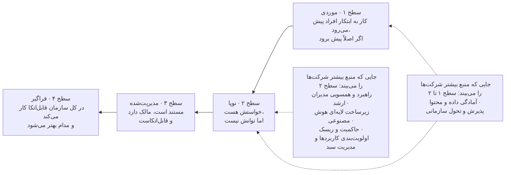

*چارچوب بلوغ سازمانی McMillanAI، بازترسیم‌شده از گزارش «Everyone Is Behind» (ویراست اول، اوت ۲۰۲۶): تعریف سطح‌ها از صفحهٔ ۲ و جایگاه معمول شرکت‌ها در هر بُعد از صفحه‌های ۳ تا ۶. این جایگاه‌ها الگوهایی است که نویسنده می‌گوید دیده، نه امتیاز یک نمونهٔ مشخص از شرکت‌ها. [D19 pp. 2–6.]*

برای هر بُعد با کارکنان مسئول گفت‌وگو کنید، دست‌کم یک سند یا خروجی واقعی را بررسی کنید و یک بار اجرای واقعی کار را ببینید. سطحی را که دیدید، میزان اطمینانتان، کمبود شواهد و توانمندی مشخصی را که سبد پیشنهادی لازم دارد ثبت کنید. هر توانمندی که آزموده نشده را **نامعلوم** بنویسید. امتیاز بالای فناوری را با کنترلی که وجود ندارد میانگین نگیرید تا به این نتیجه برسید که سازمان آماده است. فرم قابل‌ویرایش ارزیابی آمادگی و راهنمای تفسیر آن در پیوست ج آمده است.

### ۱.۴ مراحل MIT CISR را برای منظور دیگری به کار ببرید

MIT CISR چهار مرحله را از هم جدا می‌کند: **آزمایش و آماده‌سازی**، **ساختن پایلوت‌ها و توانمندی‌ها**، **توسعهٔ شیوه‌های کار مبتنی بر هوش مصنوعی** و **آمادگی برای آیندهٔ هوش مصنوعی**. نمودار این منبع، پاسخ‌دهندگان را بر اساس معیاری از اثربخشی هوش مصنوعی در سه حوزهٔ عملیات، تجربهٔ مشتری و زیست‌بوم‌ها (با وزن برابر) گروه‌بندی می‌کند. تفاوت‌هایی که در رشد و سود گزارش شده، فقط همبستگی با عملکرد مالی نسبت به میانگین صنعت است؛ یعنی نشان نمی‌دهد که رسیدن به یک مرحله خودبه‌خود سود مالی مشخصی می‌آورد. نمونه‌های پیمایش ۲۰۲۲ و ۲۰۲۵ هم با هم فرق دارند. [D22 ll. 59–83, 276–309; A02، نمودار و پانوشت روش‌شناسی.]

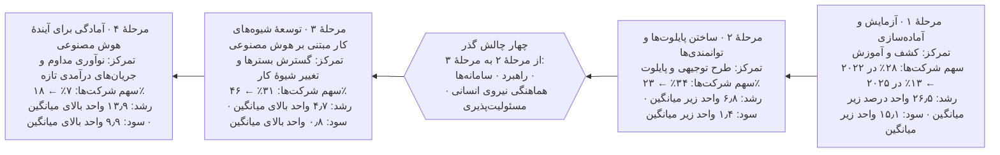

*بازترسیم‌شده از نمودار MIT CISR با عنوان «Four Stages of Enterprise AI Maturity, 2022–2025»، همراه با چهار چالش گسترش که در متن همان گزارش آمده (Strategy، Systems، Synchronization، Stewardship). مرزهای مراحل بر اساس «اثربخشی کل هوش مصنوعی» است (مرحلهٔ ۱: ۰ تا ۴۹٪؛ مرحلهٔ ۲: ۵۰ تا ۷۴٪؛ مرحلهٔ ۳: ۷۵ تا ۹۹٪؛ مرحلهٔ ۴: ۱۰۰٪). رشد و سود به واحد درصد بالاتر یا پایین‌تر از میانگین صنعت و برای سال ۲۰۲۴ است؛ این‌ها همبستگی‌اند، نه اثر رسیدن به یک مرحله. حجم نمونه: پیمایش ۲۰۲۲، ۷۲۱ شرکت؛ پیمایش ۲۰۲۵، ۱۵۲ شرکت. [D22 ll. 59–83; A02.]*

این مراحل را برای گفت‌وگو دربارهٔ مسیر کلی سازمان به کار ببرید: از یادگیری، به اثبات کاربردها، به تغییر کار در مقیاس بزرگ، و سپس به نوآوری پایدار. ابعاد مک‌میلان را برای پیدا کردن نقاط ضعف توانمندی‌ها به کار ببرید. **نام مراحل را عوض نکنید، مقیاس‌های این دو منبع را به هم تبدیل نکنید و ارزیابی این راهنما را «امتیاز MIT» ننامید.** ممکن است همهٔ کارکنان یک سازمان به ابزاری دسترسی داشته باشند، اما سازمان هنوز ارزیابی منظم یا مالک مشخص برای داده‌هایش نداشته باشد.

### ۱.۵ ارزیابی را با یک تصمیم عملی تمام کنید

| اقدام | مسئول | خروجی | شواهد لازم برای ادامه |
|---|---|---|---|
| تأیید چالش کسب‌وکار و دامنهٔ کار | حامی و مدیران کسب‌وکار | مأموریت و فرضیه‌های نتیجه | مسئله‌ای که بر سرش توافق هست، شیوهٔ کاری که تغییر می‌کند، مالک پاسخ‌گو |
| بررسی توانمندی‌های فعلی | مدیر برنامه، با کارکنان کسب‌وکار، کنترل و فناوری | ارزیابی آمادگی و یادداشت میزان اطمینان | اسناد و نمونه‌های واقعی کار، نه فقط ادعاهایی که در مصاحبه مطرح شده |
| سنجش ظرفیت نیروی انسانی و تحویل | مدیر برنامه، مدیران واحدها، مسئول منابع انسانی | فهرست ظرفیت با نام افراد و کمبود مهارت‌ها | ظرفیتی که واقعاً در دسترس است، پس از کسر تعهدات فعلی |
| تصمیم دربارهٔ نخستین بررسی با بودجهٔ مشخص | حامی / مرجع تصمیم‌گیری سبد | اجازهٔ بررسی یا اجرا | مرزها، بودجه، مالک، وابستگی‌های حل‌نشده و تاریخ تصمیم بعدی |

**نشانه‌های شکست:** مأموریتی که فقط می‌گوید «باید هوش‌مصنوعی‌محور شویم»، امتیاز بلوغی که شاهدی پشتش نیست، و حامی‌ای که نمی‌تواند کارکنان را برای این کار آزاد کند؛ همهٔ این‌ها یعنی ارزیابی به تعهدی که بشود اجرایش کرد نرسیده است. پیش از گسترش سبد، مأموریت یا تخصیص ظرفیت را اصلاح کنید. بررسی مسئله‌ها، فهرست‌برداری از کاربردها و ارزیابی اولیهٔ مهارت‌ها می‌توانند هم‌زمان انجام شوند، ولی انتخاب راه‌حل باید منتظر یافته‌های آن‌ها بماند. هر وقت راهبرد، محدودیت‌ها یا شواهد به‌طور جدی تغییر کرد، مأموریت را بازنگری کنید.

<a id="ch2"></a>

## ۲. ساختن و اولویت‌بندی سبد کاربردها

| کارت فصل | |
|---|---|
| **مالک** | مرجع تصمیم‌گیری سبد تصمیم می‌گیرد؛ مالکان کسب‌وکار پیشنهاد می‌دهند؛ مدیر برنامه مقایسه را انجام می‌دهد |
| **چه زمانی شروع کنیم** | مأموریت نوشته شده و به کاربران و مالک نتیجه دسترسی هست |
| **مدت معمول (پیش‌فرض آغازین)** | ۲ تا ۴ هفته برای نخستین دور؛ بازنگری هر سه ماه و پس از هر تصمیم پایلوت |
| **خروجی‌ها** | فرم‌های ورود، مقایسهٔ گزینه‌ها، فهرست اولویت‌بندی‌شده، سابقهٔ تصمیم |
| **ابزارها (پیوست ج)** | برگهٔ مسیر سریع (سطح ۱)؛ فرم ورود و اولویت‌بندی (سطح‌های ۲ و ۳)؛ جدول ردیابی |
| **میزان الزام** | سطح ۱: فقط برگهٔ مسیر سریع. سطح ۲: بخش‌های اصلی فرم ورود. سطح ۳: فرم کامل، همراه با مقایسهٔ گزینه‌ها و آزمون حساسیت |

### ۲.۱ هدف و پیش‌نیازها

چالش‌های کسب‌وکار را به چند انتخاب سرمایه‌گذاری تبدیل کنید که بشود مدیریتشان کرد. پیش‌نیازها: مأموریت، دسترسی به کسانی که کار را انجام می‌دهند، مالک نتیجه و مرجعی برای تصمیم‌گیری دربارهٔ سبد که بتواند منابع محدود را تخصیص دهد. خروجی این مرحله ترتیبی از تصمیم‌ها و وابستگی‌هاست، نه فهرستی بلند از ایده‌های هوش مصنوعی.

**رویهٔ مستند:** UOBAM از واحدهای کسب‌وکار خواست مسئله‌هایشان را شرح دهند، اثر کسب‌وکاری و امکان‌پذیری هر مسئله را سنجید، مسئله‌های مشابه را ادغام کرد و سپس راه‌حل‌ها را ساخت و آزمود. LPL از شورای مشاورهٔ هوش مصنوعی مشاورانش، همایش‌ها و پژوهش‌های صنعت کمک گرفت تا کارهایی را پیدا کند که بیشترین وقت را می‌گیرند. این تجربه‌ها نشان می‌دهند بهتر است پیش از هر انتخاب فنی، مسئله را همراه با کاربران و متخصصان آن حوزه بررسی کرد. [D34 p. 21; D27 ll. 297–321.]

### ۲.۲ کاری را پیدا کنید که ارزش تغییر دارد

مالک کسب‌وکار و مسئول محصول باید کار را از نزدیک ببینند، چند نمونهٔ واقعی از کار انجام‌شده را بررسی کنند و با گروه‌های مختلف کاربران حرف بزنند: کاربران باتجربه، تازه‌کارها، کسانی که از ابزارهای فعلی دوری می‌کنند و کسانی که در مراحل بعدی با خطاها سروکار دارند. نقشهٔ کار را بکشید: چه چیزی کار را شروع می‌کند، چه ورودی‌هایی دارد، کجا قضاوت لازم است، کار کجا از یک نفر یا یک سامانه به دیگری می‌رسد، خروجی چیست و موارد استثنا چطور رسیدگی می‌شوند. کار فعلی را اندازه بگیرید، از جمله زمان انتظار، بررسی و دوباره‌کاری.

فرصت را این‌طور بنویسید: **«برای [کاربر]، [این مرحله از کار] را تغییر دهید تا [نتیجه‌ای قابل‌اندازه‌گیری] بهتر شود، بی‌آنکه [کیفیت، حقوق افراد، ایمنی و سطح خدمت] آسیب ببیند.»** نتیجه را با خروجی اشتباه نگیرید. پاسخی که سامانه تولید می‌کند خروجی است؛ پرسشی که درست حل شده، نتیجه است. تماس کوتاه‌تر، ارجاع کمتر یا گفت‌وگویی که بسته شده، ممکن است نشانهٔ کارایی باشد یا نشانهٔ اینکه کاربر کار را رها کرده یا شکست خورده است. فقط با پیگیری و شواهد کیفیت می‌توان این دو را از هم تشخیص داد. این شیوهٔ سنجش، **جمع‌بندی راهنما** است و از تأکید منابع بر نتایج واقعی کار و هزینهٔ کامل هر نتیجهٔ موفق گرفته شده است. [D38 ll. 53–100, 381–429; D14 ll. 248–258.]

### ۲.۳ گزینه‌های واقعی را تعریف و مقایسه کنید

برای هر فرصت این گزینه‌ها را در نظر بگیرید: ادامهٔ روش فعلی، بهتر کردن رویه‌ها یا کیفیت اطلاعات، قواعد ساده، جست‌وجو یا خودکارسازی فرایند، مدل‌های پیش‌بینی متعارف، دستیار مولد و، اگر مرتبط است، خودکارسازی‌ای که خودش اقدام می‌کند. فقط گزینه‌های معقول را مقایسه کنید و همه را با یک تعریف کار و یک مجموعه شواهد ارزیابی بسنجید. یک بررسی فنی کوتاه می‌تواند امکان‌پذیری را نشان دهد، بی‌آنکه سازمان را به استقرار متعهد کند.

مسئول فنی باید توضیح دهد هوش مصنوعی دقیقاً چه چیزی اضافه می‌کند: پیش‌بینی، استخراج اطلاعات، فهم زبان طبیعی، ترکیب و جمع‌بندی، پیشنهاد یا انتخاب اقدام. مالک کسب‌وکار باید توضیح دهد این چیز اضافه چرا کار را بهتر می‌کند. اینکه روی چیزی برچسب «هوش مصنوعی» خورده باشد کافی نیست. در فرم ورود (پیوست ج) گزینه‌ها و دلیل کنار گذاشتن هر کدام ثبت می‌شود.

### ۲.۴ اول شرایط ورود، بعد مقایسه

در دو مرحله کار کنید. در مرحلهٔ اول، شرایط حتمی ورود را بسنجید: مسئله‌ای که اهمیت دارد، مالکی که پاسخ‌گوست، راهی قانونی و مجاز برای استفاده از داده‌ها و انجام اقدام‌های لازم، روشی عملی برای ارزیابی و راهی معتبر برای تأمین ظرفیت. اگر یکی از این شرایط برقرار نباشد، نامزد **تا رسیدن شواهد نگه داشته می‌شود** یا بازطراحی می‌شود؛ امتیاز تجاری بالا نمی‌تواند این کمبود را جبران کند.

در مرحلهٔ دوم، نامزدهایی را که شرایط را دارند از این جنبه‌ها مقایسه کنید: اهمیت برای کسب‌وکار، میزان بهبود مورد انتظار، اطمینان به شواهد، امکان‌پذیری فنی و داده‌ای، احتمال پذیرش در کار روزمره، هزینهٔ کامل، زمان لازم تا رسیدن به شواهد، وابستگی‌ها و ریسکی که باقی می‌ماند. اگر کمک می‌کند، شرح کوتاهی از شواهد را کنار یک مقیاس ساده بگذارید. مقیاس‌ها و وزن‌ها را پیش از رتبه‌بندی توافق کنید و نشان دهید اگر اولویت‌های مدیران فرق کند، رتبه‌ها چقدر جابه‌جا می‌شوند. چیزی را که نمی‌دانید «نامعلوم» بنویسید و بی‌سروصدا امتیاز متوسط به آن ندهید. برآوردهای نامطمئن را در هم ضرب نکنید تا به بازده سرمایه‌ای برسید که دقیق به نظر می‌رسد ولی نیست.

| وضعیت نامزد | سرمایه‌گذاری مناسب بعدی | شواهد لازم برای تصمیم |
|---|---|---|
| مسئلهٔ مهم، اما شواهد کمی دربارهٔ خود مسئله | بررسی بیشتر مسئله | نمونه‌های واقعی کار و اندازه‌گیری وضع موجود |
| مسئلهٔ تأییدشده، اما داده یا دسترسی ضعیف | کار محدود روی داده و آماده‌سازی | اصلاح مشخص منبع داده و دسترسی مجاز |
| کار ارزشمند، اما رویکرد فنی نامطمئن | آزمایش مقایسه‌ای | یک تعریف کار و یک آزمون مشترک برای همهٔ گزینه‌ها |
| فایدهٔ کار ثابت شده، اما یکپارچه‌سازی یا عملیات ضعیف | مهندسی برای بهره‌برداری | آمادگی برای عرضه و پشتیبانی |
| سامانهٔ مستقری که مفید است | ادامه، اصلاح یا گسترش | ارزش، هزینه و عملکرد پایدار کنترل‌ها |
| ارزش کم، ریسک غیرقابل‌قبول یا نبود مالک واقعی | توقف یا انتخاب رویکرد دیگر | دلیل ثبت‌شده و تعیین تکلیف داده‌ها و خروجی‌های کار |

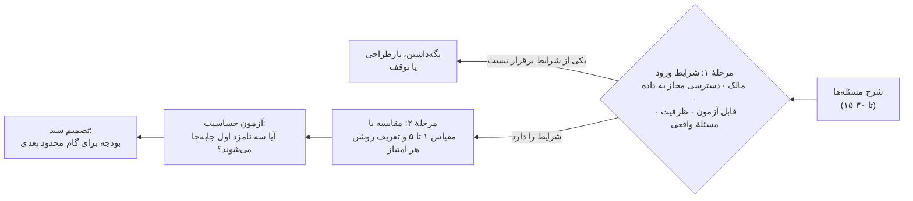

**معنای هر امتیاز (پیش‌فرض آغازین).** از این تعریف‌ها استفاده کنید تا امتیاز «۴» در همهٔ واحدها یک معنا داشته باشد. همهٔ ابعاد را هم‌وزن بگیرید، مگر اینکه مرجع تصمیم‌گیری سبد *پیش از* امتیازدهی روی وزن‌های دیگری توافق کند. بعد رتبه‌بندی را دوباره انجام دهید و هر بار وزن اولویت اصلی یکی از مدیران را دو برابر کنید. اگر سه نامزد اول جابه‌جا شدند، به‌جای میانگین گرفتن، این بده‌بستان را آشکارا به بحث بگذارید. این تعریف‌ها **جمع‌بندی راهنما** هستند.

| بُعد | ۱ | ۳ | ۵ |
|---|---|---|---|
| اهمیت برای کسب‌وکار | دردسری محلی | مهم برای اهداف یک واحد | مهم برای راهبرد سازمان یا یک تعهد قطعی |
| اطمینان به شواهد | حرف و حکایت | اندازه‌گیری وضع موجود روی نمونه‌ای از کار واقعی | اندازه‌گیری وضع موجود در یک دورهٔ کامل کسب‌وکار |
| امکان‌پذیری داده و فنی | داده در دسترس یا مجاز نیست | پس از یک اصلاح مشخص در دسترس می‌شود | در دسترس، دارای مالک، مجاز و آزموده |
| امکان پذیرش در کار روزمره | با کاربران مشورت نشده؛ ابزاری جدا از روال کار | کاربران درگیرند؛ یکپارچه‌سازی ناقص است | کاربران در طراحی شریک‌اند؛ در سامانه‌ای که همین حالا با آن کار می‌کنند جا می‌افتد |
| زمان تا رسیدن به شواهد مفید | بیش از ۶ ماه | ۲ تا ۳ ماه | کمتر از ۴ هفته |
| هزینهٔ کامل و اقتصاد طرح | هزینه نامعلوم است یا احتمالاً از فایده بیشتر است | با فرض‌های صریح برآورد شده | با برآوردگر هزینه (پیوست ج) محاسبه و از سوی واحد مالی تأیید شده |
| ریسک باقیمانده و بار کنترلی | سطح ۳ با الزامات حتمی که هنوز حل نشده‌اند | سطح ۲ با کنترل‌های شناخته‌شده | سطح ۱ |

نامزدهایی را که شرایط ورود را دارند روی دو محور ارزش و امکان‌پذیری نشان دهید تا بده‌بستان‌ها دیده شوند. نامزدهای زیر فقط برای نمونه‌اند.

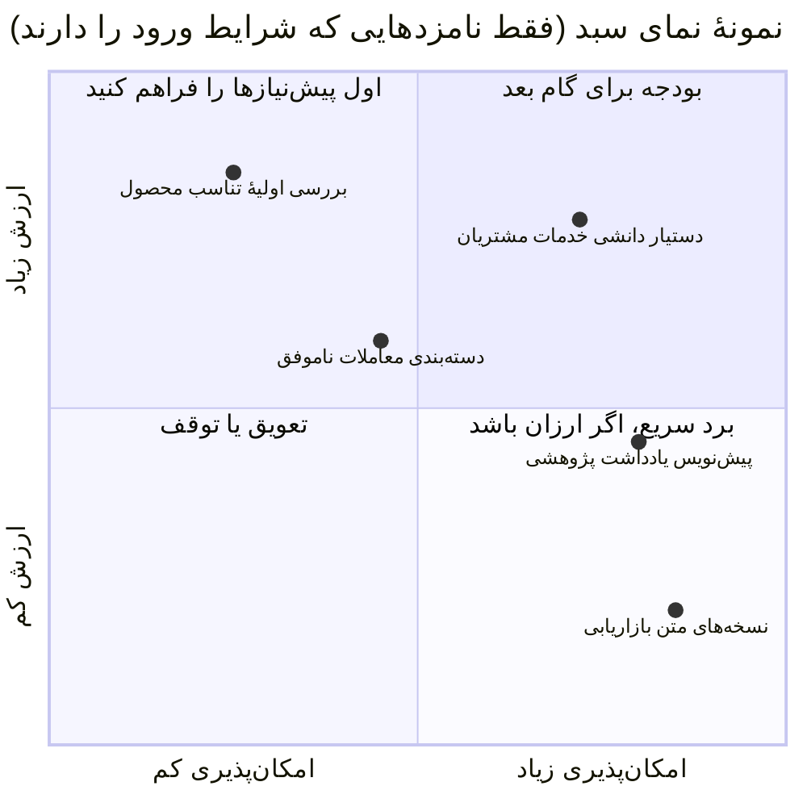

**پیش‌فرض آغازین برای کارهای هم‌زمان:** تعداد پایلوت‌هایی که هم‌زمان اجرا می‌شوند نباید از تعداد متخصصانی بیشتر باشد که با نام مشخص و با وقت آزاد برای برچسب‌زدن نمونه‌های آزمون و بازبینی نتایج در اختیار دارید. برای بیشتر سازمان‌ها در سال اول، این یعنی یک تا سه پایلوت.

### ۲.۵ میان تمرکز بر یک حوزه و گام‌های کوچک تعادل برقرار کنید

«حوزه» یک فعالیت یا زنجیرهٔ به‌هم‌پیوسته از کسب‌وکار است، مثل پشتیبانی مشتری یا فرایند پژوهش سرمایه‌گذاری. «کاربرد» یک استفادهٔ مشخص در دل آن حوزه است. حوزه‌ها را طوری انتخاب کنید که به ابزارهای پراکنده و جدا از هم نرسید، و در هر حوزه گام‌های کوچک بردارید تا یادگیری، هزینه و ریسک قابل مدیریت بماند. اجزای مشترک باید از نیازهایی ساخته شوند که بارها تکرار شده و ثابت شده‌اند.

**اختلاف نظر منابع:** مک‌کینزی از تحول کل یک حوزه دفاع می‌کند، در حالی که فیدلیتی توصیه می‌کند با یک کاربرد مشخص شروع کنید و پس از اثبات فایده گسترش دهید. JPMC هم تحول از بالا به پایین در سطح حوزه را شرح می‌دهد و هم دسترسی گستردهٔ کارکنان از پایین به بالا را. جمع‌بندی ما این است: برنامه‌ریزی را در سطح حوزه انجام دهید، برای گام‌های مشخص بودجه بگذارید، و برای آزمایش و یادگیری آزادانهٔ کارکنان بودجه‌ای جداگانه و مصوب در نظر بگیرید. [D21 pp. 3–4; D10 pp. 11–12; D24 p. 4.]

### ۲.۶ تصمیم بگیرید، ثبت کنید و دوباره بسنجید

مدیر برنامه مقایسه را آماده می‌کند؛ واحد مالی هزینه‌ها و شیوهٔ محاسبهٔ فایده‌ها را به چالش می‌کشد؛ مالکان فنی و داده امکان‌پذیری را می‌سنجند؛ بازبینان کنترلی محدودیت‌ها را مشخص می‌کنند؛ و مرجع تصمیم‌گیری سبد دربارهٔ سرمایه‌گذاری تصمیم می‌گیرد. مالک کسب‌وکار تعریف نتیجه را می‌پذیرد و کاربران و متخصصان را در اختیار تیم می‌گذارد.

**خروجی‌ها:** فرم ورود، اندازه‌گیری وضع موجود، مقایسهٔ گزینه‌ها، سابقهٔ اولیهٔ بررسی ریسک و حقوقی، نقشهٔ وابستگی‌ها، برآورد ظرفیت، فهرست اولویت‌بندی‌شده و سابقهٔ تصمیم. وقتی دامنهٔ محدودی بودجه گرفته، معیارهای قبولی روشن است، مالک مشخص است و برنامه‌ای برای وابستگی‌ها وجود دارد، **کار را ادامه دهید**. **نشانه‌های شکست:** چند ایدهٔ تأییدشده که همه به همان چند متخصصِ همیشه‌گرفتار وابسته‌اند، چند سامانهٔ جست‌وجوی تکراری، و پروژه‌هایی که فقط با درآمدهای خیالی رتبه گرفته‌اند. کارهای هم‌زمان را در حد ظرفیت تحویل و بازبینی نگه دارید. پس از نتایج هر پایلوت، رخدادهای مهم یا تغییر جهت کسب‌وکار، اولویت‌ها را به‌روز کنید؛ از پروژه‌ای فقط به این دلیل که ساختش شروع شده دفاع نکنید.

<a id="ch3"></a>

## ۳. طراحی مدل عملیاتی و برنامهٔ نیروی انسانی

| کارت فصل | |
|---|---|
| **مالک** | حامی اجرایی همراه با مدیر برنامهٔ هوش مصنوعی؛ مدیران واحدها ظرفیت را تأیید می‌کنند |
| **چه زمانی شروع کنیم** | وقتی فهرست نامزدها شکل گرفته است؛ هم‌زمان با فصل ۲ |
| **مدت معمول (پیش‌فرض آغازین)** | ۲ تا ۳ هفته برای شرح نقش‌ها و ماتریس اختیارات تصمیم |
| **خروجی‌ها** | شرح وظایف مدیر برنامه، ماتریس اختیارات تصمیم، برنامهٔ تیم و ظرفیت با نام افراد |
| **ابزارها (پیوست ج)** | ماتریس اختیارات تصمیم؛ برنامهٔ نیروی انسانی |
| **میزان الزام** | در همهٔ سطوح الزامی است که مالک نتیجه و مرجع تأیید عرضه مشخص باشد؛ اندازهٔ تیم به سطح ریسک بستگی دارد (بخش ۳.۳) |

### ۳.۱ هدف و پیش‌نیازها

روشن کنید چه کسی مالک نتایج است، چه کسی سامانه را می‌سازد و اداره می‌کند، چه کسی آن را به چالش می‌کشد و چه کسی می‌تواند کار را تأیید یا متوقف کند. از فهرست نامزدها و نقشه‌ای از واحدهای فعلی و اختیاراتی که به آن‌ها تفویض شده شروع کنید. پیش از اینکه دربارهٔ واحد یا عنوان شغلی تازه تصمیم بگیرید، مسئولیت‌ها را تقسیم کنید.

**رویهٔ مستند:** ونگارد مهندسان داده، تحلیل‌گران کسب‌وکار، واحدهای انطباق و امنیت و کاربران کسب‌وکار را کنار هم نشاند. فیدلیتی همکاری میان تیم‌های هوش مصنوعی، مهندسی، طراحی تجربهٔ کاربر، کسب‌وکار و انطباق را توصیف می‌کند. مؤسسهٔ CFA واحد نوآوری‌ای را شرح می‌دهد که سرمایه‌گذاری و فناوری را به هم وصل می‌کند و نقشش از «مترجم» میان این دو فراتر رفته و حالا جهت و اولویت‌ها را هم تعیین می‌کند. [D14 ll. 55–79; D10 p. 12; D34 pp. 9–11.]

### ۳.۲ مدیر برنامهٔ هوش مصنوعی را با اختیار واقعی منصوب کنید

**مدیر برنامهٔ هوش مصنوعی** نقش هماهنگ‌کننده‌ای است که این راهنما پیشنهاد می‌کند. این فرد سبد کاربردها را نگه‌داری می‌کند، همکاری میان واحدها را سازمان می‌دهد، وابستگی‌ها را آشکار می‌کند، شواهد لازم برای سرمایه‌گذاری و عرضه را آماده می‌کند، ارزش به‌دست‌آمده را پیگیری می‌کند و مطمئن می‌شود تصمیم‌ها اجرا می‌شوند. بسته به اختیار و ظرفیت سازمان، این نقش می‌تواند زیر نظر کسب‌وکار، تحول، عملیات، داده یا فناوری باشد. آنچه مهم است دسترسی مستقیم به حامی و سازوکاری برای حل اختلاف میان واحدهاست.

مدیر برنامه خودبه‌خود مالک همهٔ نتایج، همهٔ داده‌ها یا همهٔ ریسک‌های باقیمانده نمی‌شود. مدیر هر فرایند کسب‌وکار همچنان پاسخ‌گوی نتایج آن فرایند است. مرجع تأیید عرضه، امنیت اطلاعات، بازبینان حقوقی و انطباق و مالک عملیات، هر کدام تصمیم‌های حوزهٔ خود را نگه می‌دارند. حدود اختیار مدیر برنامه برای هزینه‌کرد، توانایی‌اش برای درخواست یا آزادکردن نیرو، مسیر ارجاع و تعهداتش را مکتوب کنید.

### ۳.۳ اختیارات تصمیم را میان واحدها تقسیم کنید

| نقش / توانمندی | مسئولیت | نشانهٔ صلاحیت |
|---|---|---|
| حامی اجرایی / نهاد راهبری | مأموریت، بودجه، بده‌بستان‌های راهبردی، میزان ریسک‌پذیری در چارچوب الزامات حاکم | می‌تواند منابع تخصیص دهد و مسائل میان واحدها را حل کند |
| مالک کسب‌وکار / مالک کاربرد | نتیجه، دامنهٔ کار، پذیرش کسب‌وکار، پذیرش کاربران و تحقق فایده‌ها | کار را می‌شناسد و تغییر در عملیات را در اختیار دارد |
| مدیر برنامه | سبد، هماهنگی تحویل، شواهد و پیگیری اجرای تصمیم‌ها | می‌تواند کسب‌وکار و کار فنی را به هم وصل کند، فرض‌ها را به چالش بکشد و تصمیم‌ها را روشن بنویسد |
| مسئول محصول | شواهد کاربران، طراحی شیوهٔ کار، نیازمندی‌ها و بازخورد | در همین حوزه، توان پژوهش و قضاوت محصولی خود را نشان داده است |
| متخصص حوزه / مالک محتوا | معنای کسب‌وکاری، محتوای معتبر، برچسب‌گذاری نمونه‌های آزمون، موارد استثنا | می‌تواند درستی، کاستی‌ها و پیامدهای عملی را داوری کند |
| مالک داده و متولی مهندسی داده | استفادهٔ مجاز، تعریف‌ها، کیفیت، به‌روز بودن، منشأ داده و اصلاح آن | می‌تواند منابع را توضیح دهد، دسترسی را مجاز کند و از استفاده‌های بعدی پشتیبانی کند |
| مسئول فنی / معماری | طراحی راه‌حل، تأمین، یکپارچه‌سازی، مهندسی و محدودیت‌های فنی | تجربهٔ تحویل با همین نوع رویکرد را دارد |
| متخصص ارزیابی و اطمینان | طراحی آزمون، کیفیت شواهد، بازبینی مستقل متناسب با اثر | می‌تواند کیفیت کار، امتیاز مدل و نتیجهٔ کسب‌وکاری را از هم تشخیص دهد |
| امنیت اطلاعات | ارزیابی تهدیدها، کنترل دسترسی و خروج داده، آزمون امنیتی و هماهنگی در رخدادها | استقرار واقعی و راه‌های حمله به آن را می‌شناسد |
| بازبینان حقوقی، انطباق، حریم خصوصی و ریسک | قوانین قابل اعمال در محل، استفادهٔ مجاز، کنترل‌های لازم و شواهد تأیید | اختیار تفسیر الزامات را دارد یا می‌تواند از مشاور صلاحیت‌دار کمک بگیرد |
| مالک عملیات / تیم خدمت | دسترس‌پذیری، پشتیبانی، پایش، پاسخ به رخداد، تغییر و کنارگذاشتن سامانه | دفترچهٔ عملیات، نیرو، دسترسی‌ها و بودجهٔ عملیاتی را می‌پذیرد |
| منابع انسانی / آموزش و مدیران مستقیم | ظرفیت، تغییر نقش‌ها، مهارت، پشتیبانی و پیامدها برای نیروی کار | می‌تواند وقت افراد را آزاد کند، مهارت‌ها را بسنجد و تغییرات کار را مدیریت کند |
| مالی / تدارکات | مقایسهٔ سرمایه‌گذاری‌ها، شیوهٔ محاسبهٔ هزینه، قراردادها، تعهدات تأمین‌کنندگان | می‌تواند هزینهٔ کامل و فرض‌های تجاری را راستی‌آزمایی کند |

در سازمان کوچک ممکن است یک نفر چند نقش داشته باشد؛ در این صورت بار کاری و هر تعارض منافع را ثبت کنید. باید کسی باشد که بتواند تصمیم‌های تیم سازنده را به‌طور جدی به چالش بکشد. اگر درون سازمان چنین کسی نیست، از بازبین مستقل داخلی یا بیرونی کمک بگیرید. حسابرسی داخلی را خودبه‌خود تأییدکنندهٔ عرضه قرار ندهید؛ نقش اطمینان‌بخشی آن را همان‌طور که در سازمان تعریف شده نگه دارید. بلک‌راک مالکیت عملیاتی، بازبینی ریسک و حسابرسی داخلی را سه لایهٔ جدا توصیف می‌کند. [D16 pp. 6–7; D30 pp. 60–63.]

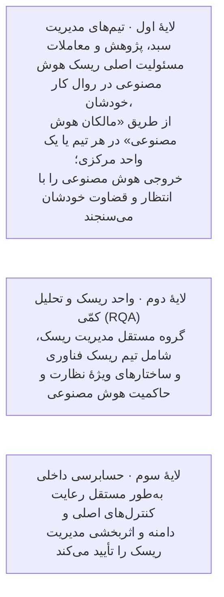

*سه لایهٔ دفاعی بلک‌راک برای هوش مصنوعی، بازترسیم‌شده از پاسخ این شرکت به نظرخواهی کمیسیون اروپا (اکتبر ۲۰۲۴). این شرح خود شرکت از چارچوبش است، نه یک الزام قانونی. [D16 pp. 6–7.]*

**حداقل تیم برای هر سطح ریسک (پیش‌فرض آغازین).** در سازمان کوچک ممکن است یک نفر چند نقش داشته باشد؛ بار کاری و هر تعارض منافع را ثبت کنید.

| سطح | نقش‌هایی که پیش از شروع کار باید با نام مشخص شوند |
|---|---|
| سطح ۱ | مالک کسب‌وکار؛ مدیر مستقیم؛ مسئول ابزار مجاز؛ تأیید امنیت اطلاعات دربارهٔ مجاز بودن ابزار و انواع داده |
| سطح ۲ | مالک کسب‌وکار؛ مسئول محصول یا تحویل؛ یک یا چند متخصص حوزه با وقت آزاد؛ مالک و متولی داده؛ یک یا چند مهندس؛ مسئول ارزیابی (می‌تواند همان مسئول محصول باشد)؛ بازبینان امنیت و حریم خصوصی؛ مالک عملیات |
| سطح ۳ | همهٔ نقش‌های سطح ۲، به‌علاوهٔ بازبین مستقل ارزیابی، بازبین حقوقی یا انطباق که در آن حوزهٔ قضایی صلاحیت دارد، مرجعی مشخص برای پذیرش ریسک و تیم پشتیبانی عملیاتی که نیرویش تأمین شده |

**چه کسی در هر یک از پنج مرحلهٔ تصمیم چه می‌کند.** R = آماده‌سازی و اجرا؛ A = تصمیم‌گیرندهٔ پاسخ‌گو؛ C = باید با او مشورت شود یا تأیید کند؛ I = در جریان قرار می‌گیرد.

| مرحلهٔ تصمیم | حامی | مرجع سبد | مالک کسب‌وکار | مدیر برنامه | مسئول فنی | بازبینان کنترلی | مالک عملیات | مالی |
|---|---|---|---|---|---|---|---|---|
| ۱ مأموریت | A | C | C | R | C | C | I | C |
| ۲ سرمایه‌گذاری | I | A | R | R | C | C | I | C |
| ۳ پایلوت با کاربران | I | I | A | R | R | C | C | I |
| ۴ عرضه | I | I | C | R | R | C | C | I |
| ۵ گسترش / ادامه | I | A | R | R | C | C | C | C |

تصمیم مرحلهٔ ۴ را مرجعی می‌گیرد که مشخصاً برای تأیید عرضه تعیین شده است؛ بسته به تفویض اختیار در سازمان، این مرجع می‌تواند مالک کسب‌وکار، مرجع تغییرات فناوری یا یک کمیته باشد. بازبینان کنترلی (امنیت، حقوقی و انطباق، ریسک) هر جا در حیطهٔ اختیارشان باشد، حق تأیید یا وتو دارند.

### ۳.۴ تصمیم بگیرید چه چیزی متمرکز باشد

| گزینه | چه زمانی مناسب است | بده‌بستانی که باید مدیریت شود |
|---|---|---|
| تیم مرکزی تحویل | متخصصان کمیاب‌اند، توان واحدها هنوز شکل نگرفته و نیازهای مشترک زیاد تکرار می‌شوند | فاصله از کاربران؛ صف مشترک کارها به گلوگاه تبدیل می‌شود |
| استانداردها و زیرساخت مرکزی، تحویل در واحدها | چند تیم توانمند در کسب‌وکار و کنترل‌ها و زیرساختی که می‌شود بارها از آن استفاده کرد | مالکیت نقاط اتصال، تأمین بودجه و یکسان بودن شواهد |
| تحویل به رهبری واحدها با پشتیبانی مرکزی | تخصص و ظرفیت قوی در واحدها؛ شیوه‌های کار بسیار متفاوت | هزینه‌های تکراری، کنترل‌های ناهمسان، استفادهٔ کم از کار دیگران |

برای هدایت راهبردی، استانداردها، اداره کردن زیرساخت و تحویل، جداگانه تصمیم بگیرید. یک شرکت می‌تواند امنیت، دسترسی به مدل و ابزارهای ارزیابی را متمرکز کند و در همان حال متخصصان حوزه و تیم‌های محصول را در واحدهای کسب‌وکار نگه دارد. پژوهش مک‌کینزی روی ۱۶ مؤسسه نشان می‌دهد هماهنگی مرکزی با رسیدن سریع‌تر به بهره‌برداری همراه است، اما ثابت نمی‌کند که یک ساختار سازمانی برای همه مناسب است. نمونهٔ JPMC متخصصانی را شرح می‌دهد که در واحدهای مختلف کار می‌کنند و از الگوهای مشترک بهره می‌برند. [D33 pp. 3–6; D25 pp. 6–8, 13.]

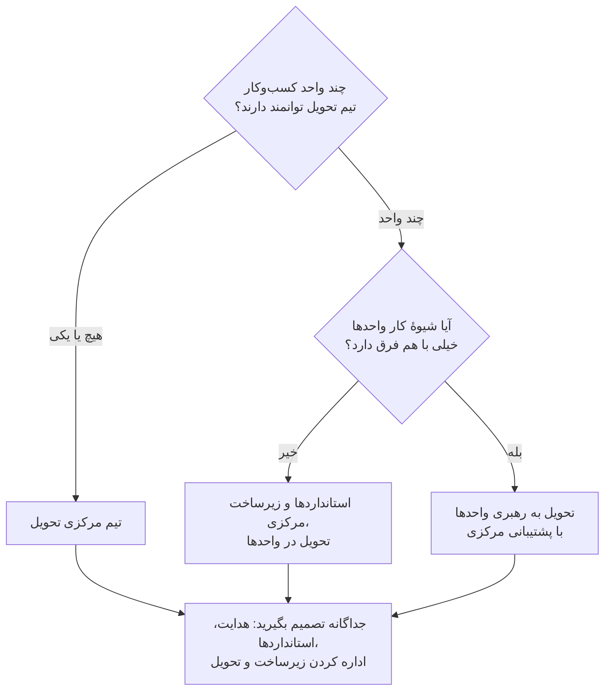

### ۳.۵ پیش از تعهد، ظرفیت واقعی را بسنجید

برای هر توانمندی لازم، این‌ها را فهرست کنید: افراد واقعی، نمونه‌هایی از کارهای مشابهی که تحویل داده‌اند، تعهدات فعلی‌شان، وقتی که واقعاً دارند، اختیار تصمیمشان و جانشینشان. از مدیرانشان بخواهید آزاد شدن این وقت را تأیید کنند. علاوه بر کار ساخت، حجم کار برچسب‌گذاری تخصصی، اصلاح محتوا، بازبینی امنیتی، عملیات و پذیرش را هم برآورد کنید. شمار کارکنان به‌تنهایی نشان نمی‌دهد سازمان واقعاً چقدر می‌تواند تحویل دهد.

برای هر کمبود، یکی از این راه‌ها را انتخاب کنید: جابه‌جایی نیرو در داخل، آموزش مهارت تازه، استخدام یا کمک بیرونی. هر جا دانش سازمانی، تصمیم‌های کسب‌وکاری یا پاسخ‌گویی دائمی در قبال خدمت اهمیت دارد، مالکیت را داخل سازمان نگه دارید. متخصصان بیرونی می‌توانند تخصص یا ظرفیت بیاورند، اما قرارداد با آن‌ها باید انتقال دانش، تحویل خروجی‌های قابل استفاده، مرزهای پشتیبانی و شرایط پایان همکاری را روشن کند. ونگارد استخدام افراد باتجربه، همکاری با شرکا و آموزش گستردهٔ کارکنان متناسب با نقششان را با هم به کار گرفت، اما نسبت ثابتی از این‌ها را برای دیگران تجویز نمی‌کند. [D36 ll. 118–151.]

**خروجی‌ها:** شرح نقش‌ها، ماتریس اختیارات تصمیم، برنامهٔ تیم و ظرفیت با نام افراد، تصمیم دربارهٔ هر کمبود مهارت و شیوهٔ تأمین آن، و توافق بر مدل عملیاتی. وقتی افراد مشخصی با وقت آزاد، مسئولیت نتیجه، تحویل، کنترل و عملیات را پذیرفته‌اند، **کار را ادامه دهید**. **نشانه‌های شکست:** مدیر برنامه‌ای که اختیاری ندارد، یک متخصص که به همهٔ پروژه‌ها گمارده شده، بازبینانی که فقط درست پیش از استقرار وارد کار می‌شوند، یا تأمین‌کننده‌ای بیرونی که همهٔ دانش اصلی را در دست دارد. بازنگری اولویت‌ها، استخدام و آموزش می‌توانند هم‌زمان پیش بروند، اما هیچ عرضه‌ای نباید به نقش عملیاتی‌ای تکیه کند که هنوز کسی برایش گمارده نشده است. با بزرگ‌تر شدن سبد و خدمات مشترک، این مدل را بازنگری کنید.

---

<a id="ch4"></a>

## ۴. گنجاندن حاکمیت در فرایند تحویل

| کارت فصل | |
|---|---|
| **مالک** | مالک کسب‌وکار اطلاعات زمینه‌ای را آماده می‌کند؛ متخصصان ارزیابی می‌کنند؛ مراجع صاحب اختیار تصمیم می‌گیرند؛ مدیر برنامه همهٔ شواهد را در یک بستهٔ واحد گرد می‌آورد |
| **چه زمانی شروع کنیم** | حفاظ‌های اولیه از همان روز اول (بخش ۴.۲)؛ برای هر کاربرد، از همان لحظه‌ای که ثبت می‌شود (بخش ۴.۳) |
| **مدت معمول (پیش‌فرض آغازین)** | خط‌مشی موقت استفاده ظرف ۳ هفته؛ فهرست کاربردها ظرف ۶ هفته؛ برای هر کاربرد، حاکمیت در دل همان زمان‌بندی تحویلِ سطح ریسکش انجام می‌شود |
| **خروجی‌ها** | خط‌مشی استفادهٔ مجاز، فهرست کاربردهای هوش مصنوعی، سابقهٔ سطح ریسک و کنترل‌ها، کاربرگ بازبینی حقوقی، دفتر ثبت تصمیم‌ها |
| **ابزارها (پیوست ج)** | برگهٔ مسیر سریع؛ ماتریس اختیارات تصمیم؛ کاربرگ بازبینی حقوقی؛ خط‌مشی استفادهٔ مجاز |
| **میزان الزام** | در همهٔ سطوح الزامی: ثبت در فهرست، تعیین سطح ریسک و مالک. سطح‌های ۲ و ۳: سابقهٔ کنترل‌ها. سطح ۳: روشن‌شدن وضعیت حقوقی با کاربرگ بازبینی حقوقی و بازبینی مستقل |

### ۴.۱ هدف و پیش‌نیازها

اصول کلی را به تصمیم‌هایی تبدیل کنید که واقعاً روی طراحی، آزمون، میزان دسترسی کاربران و بهره‌برداری اثر بگذارند. نقطهٔ شروع: اختیارات تصمیم روشن، یک مالک برای هر کاربرد و دسترسی به افرادی که مسئول موضوعات حقوقی، نظارتی، امنیتی و ریسک‌اند. هر جا فرایندهای حاکمیتی فعلی سازمان خوب کار می‌کنند، از همان‌ها استفاده کنید و فقط جایی کنترل ویژهٔ هوش مصنوعی اضافه کنید که سامانهٔ انتخاب‌شده ریسک تازه‌ای می‌آورد یا ریسک موجود را بزرگ‌تر می‌کند.

MindForge حاکمیت را متناسب با زمینهٔ کاربرد و اهمیت ریسک می‌داند و ریسک خود مدل را از ریسکی جدا می‌کند که وقتی یک مدل همه‌منظوره در یک کار مشخص به کار می‌رود پدید می‌آید. FINOS فهرستی از ریسک‌ها و راه‌های کاهش آن‌ها، یک ارزیابی تجربی و نمودارهای معماری فراهم می‌کند. این دو مکمل هم‌اند: اولی راهنمای چرخهٔ عمر و پاسخ‌گویی است و دومی منبعی برای انتخاب کنترل‌ها. هیچ‌کدام به‌تنهایی انطباق با قوانین را تضمین نمی‌کند. [D30 pp. 52–64؛ ارزیابی تجربی FINOS، بخش‌های A تا H؛ mi-5، راهنمای اجرا.]

### ۴.۲ حفاظ‌های روز اول: ابزار مجاز، قواعد استفاده و «هوش مصنوعی سایه»

کارکنان همین حالا از هوش مصنوعی استفاده می‌کنند، چه سازمان اجازه داده باشد چه نه. در پیمایش ۲۰۲۴ مایکروسافت و لینکدین، ۷۵٪ کارکنان دانشی گفتند در کارشان از هوش مصنوعی استفاده می‌کنند و ۷۸٪ از این گروه ابزارهای خودشان را به محیط کار آورده بودند؛ فقط ۳۹٪ از سوی شرکتشان آموزش دیده بودند. [E06] MindForge به هوش مصنوعی‌ای که سازمان هرگز شناسایی‌اش نکرده و در نتیجه ریسک‌هایش مدیریت نمی‌شود، «هوش مصنوعی سایه» می‌گوید. این منبع یادآوری می‌کند که رایج‌ترین راه شناسایی، اعلام خود مالکان سامانه‌هاست و اینکه تأمین‌کنندگان ممکن است به نرم‌افزارهایی که سازمان از قبل استفاده می‌کند، بی‌سروصدا قابلیت هوش مصنوعی اضافه کنند. [D30 pp. 30, 48.] مک‌میلان در پاسخ به پرسشی دربارهٔ هوش مصنوعی سایه می‌گوید خط‌مشی‌ها باید کاملاً روشن باشند و کارکنان آموزش ببینند؛ او راه‌حل‌هایی را که خود کارکنان می‌سازند، وقتی ابزار مناسب در دست متخصصان باشد، منبع ارزش می‌داند. [D08 ll. 519–530, 676–682.] JPMC و BNY هر دو به‌جای ممنوع‌کردن صرف، دسترسی گسترده اما کنترل‌شده به یک بستر داخلی را انتخاب کردند. [D24 p. 4; D12 pp. 2–4.]

**اقدام‌ها (برای هر سازمانی الزامی):**

۱. **یک گزینهٔ مجاز فراهم کنید.** دست‌کم یک ابزار همه‌منظورهٔ هوش مصنوعی را مجاز کنید و مشخص کنید چه نوع داده‌ای را می‌توان در آن وارد کرد و چه کسانی می‌توانند از آن استفاده کنند. ممنوعیت بدون جایگزین معمولاً فقط استفاده را پنهان می‌کند.  
۲. **یک خط‌مشی کوتاه برای استفاده منتشر کنید** (نمونه در پیوست ج). این خط‌مشی باید روشن کند کدام ابزارها مجازند، چه داده‌ای در کدام ابزار مجاز است، چه کاربردهایی ممنوع است، کاربر چه وظیفه‌ای در بررسی خروجی دارد، چه زمانی باید استفاده از هوش مصنوعی را اعلام کرد، ابزار یا کاربرد تازه را چطور می‌شود درخواست کرد، رخداد را چطور باید گزارش داد و تخلف چه پیامدی دارد.  
۳. **استفاده‌های فعلی را پیدا کنید.** چند روش را با هم به کار ببرید: اعلام خود مالکان سامانه‌ها و سازندگان؛ چک‌لیست حاکمیتی در هر مرحلهٔ توسعهٔ نرم‌افزار؛ پایش خریدها و شرایط قرارداد تأمین‌کنندگان برای یافتن قابلیت‌های تازهٔ هوش مصنوعی؛ و هر جا قانونی و متناسب است، بررسی هزینه‌ها، فهرست نرم‌افزارها و شناسایی سرویس‌های ابری و ترافیک شبکه. [D30 pp. 30, 48؛ سه روش آخر جمع‌بندی راهنماست.]  
۴. **یک دورهٔ ثبت بدون جریمه اعلام کنید.** برای مدتی مشخص، از همه بخواهید استفاده‌های فعلی‌شان را بدون ترس از جریمه ثبت کنند تا سطح ریسک هر کدام تعیین شود و بعد یا تأیید شود، یا به ابزار مجاز منتقل شود، یا متوقف شود.  
۵. **هر موردی را که پیدا شد** با پرسش‌های تعیین سطح ریسک **دسته‌بندی کنید** و همراه با نام مالکش در فهرست کاربردها ثبت کنید (بخش ۴.۳).  
۶. **سواد پایهٔ هوش مصنوعی را بالا ببرید.** در برخی کشورها این کار اکنون الزام قانونی است. مادهٔ ۴ قانون هوش مصنوعی اتحادیهٔ اروپا، از ۲ فوریهٔ ۲۰۲۵، ارائه‌دهندگان و استفاده‌کنندگان را ملزم کرده برای سواد هوش مصنوعی کارکنانشان اقدام کنند؛ این ماده بعدها با مقررات (EU) 2026/1744 اصلاح شد. متن فعلی و شمول آن بر سازمان خودتان را با مشاور حقوقی بررسی کنید. [E09]

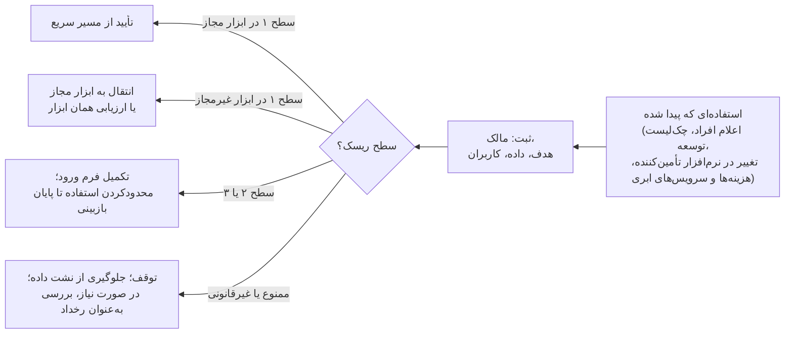

**نشانه‌های شکست:** ممنوعیت بدون ابزار مجاز؛ خط‌مشی‌ای که کسی نخوانده؛ فهرستی که فقط سامانه‌های ساخت واحد مرکزی را در بر دارد؛ و نبودن راهی برای اینکه کارکنان بهبودهایی را که خودشان ساخته‌اند پیشنهاد کنند.

### ۴.۳ هر کاربرد را ثبت کنید و اثرش را زود بسنجید

برای هر کاربرد یک سابقهٔ معتبر نگه دارید، یا چند سابقهٔ به‌هم‌پیوسته که روی هم همین کار را بکنند. در آن ثبت کنید: هدف، کاربران، مکان‌ها، مالک، نوع هوش مصنوعی، مدل‌ها و ارائه‌دهندگان، داده‌ها، اقدام‌هایی که سامانه انجام می‌دهد، وابستگی‌ها، مرحلهٔ چرخهٔ عمر، ریسک‌ها، مالک هر کنترل، تأییدها، محدودیت‌ها و تاریخ‌های بازبینی. اسناد تفصیلی را پیوند بدهید، نه اینکه در هر گزارش کمیته از نو کپی کنید. هوش مصنوعی‌ای که در نرم‌افزار شرکت‌های دیگر گنجانده شده، ابزارهایی که خود کارکنان ساخته‌اند و سامانه‌هایی که کنار گذاشته شده‌اند هم باید در این فهرست باشند. [توصیهٔ منبع: D30 pp. 67–74.]

مالک کسب‌وکار و بازبینان ریسک، **ریسک ذاتی** را پیش از کنترل‌ها و **ریسک باقیمانده** را پس از آزمودن کنترل‌های پیشنهادی ارزیابی می‌کنند. این موارد را در نظر بگیرید: اثر بر افراد، مشتریان، عملیات و بازار؛ حساسیت داده؛ پیامدهای مالی؛ اینکه سامانه چقدر مستقل عمل می‌کند؛ مقیاس؛ پیچیدگی؛ وابستگی‌ها؛ اینکه آسیب را چقدر می‌توان تشخیص داد و جبران کرد؛ و تعهدات قانونی محلی. وقتی همهٔ جزئیات هنوز روشن نیست، با یک طبقه‌بندی اولیه شروع کنید و هر چه در طراحی و آزمون تصویر روشن‌تر شد، آن را به‌روز کنید. اینکه یک مدل برای یک کار تأیید شده، به این معنا نیست که برای هر کاری تأیید شده است.

سطح‌هایی تعریف کنید که برای همه در سازمان قابل فهم باشد. برای پیش‌نویس‌های داخلی کم‌اثر که به‌خوبی بازبینی می‌شوند، فرایند سبک‌تری موجه است تا برای توصیهٔ شخصی به مشتری یا اقدامی که روی پول یا دسترسی به خدمات اثر می‌گذارد. «داخلی بودن» یا «عمومی بودن داده» به زمینه بستگی دارد و خودبه‌خود به معنای کم‌ریسک بودن نیست. سطح ریسک یک تصمیم مدیریتی درون سازمان است؛ اگر کاربردی در یکی از دسته‌های تعریف‌شده در قانون قرار می‌گیرد، آن موضوع باید جداگانه از سوی بازبین صاحب صلاحیت بررسی شود. [D30 pp. 53–55, 60–63; D29 pp. 16–18.]

### ۴.۴ ریسک‌ها را به کنترل‌هایی تبدیل کنید که بشود آزمود

برای هر شکست مهم، این‌ها را مشخص کنید: کنترلی که جلوی آن را می‌گیرد، کنترلی که آن را تشخیص می‌دهد، واکنش در صورت وقوع، مالک، شواهد آزمون، محدودیتی که باقی می‌ماند و کسی که تصمیم می‌گیرد. از فهرست FINOS به‌صورت گزینشی استفاده کنید:

| ریسک | کنترل‌هایی که ارزش بررسی دارند | شواهدی که باید خواست |
|---|---|---|
| دادهٔ حساس در دستورها، نتایج بازیابی، لاگ‌ها، حافظه‌های موقت یا بردارهای معنایی | طبقه‌بندی داده، طراحی مسیر مجاز داده، پالایش، رمزنگاری و رعایت مجوزهای منبع | آزمون مسیر داده، آزمون دسترسی (از جمله اینکه کسی که نباید، نتواند دسترسی پیدا کند)، شواهد نگه‌داری و حذف |
| پاسخ نادرست، ناقص یا بی‌پشتوانه | منابع گزینش‌شده، نشان‌دادن منبع پاسخ، ارزیابی کار، امتناع بجا و بازبینی انسانی | نتایجی که متخصصان برچسب زده‌اند، موارد کاستی، بررسی اینکه منبع واقعاً پاسخ را پشتیبانی می‌کند، فرایند اصلاح |
| تغییر در مدل یا محتوا | ثبت نسخه‌ها، به‌روزرسانی کنترل‌شده، آزمون مجدد و راه جایگزین | ردیابی نسخه تا عرضه، مقایسهٔ نتایج آزمون، امکان بازگشت که آزموده شده |
| قطع خدمت یا هزینهٔ بی‌حساب | سهمیه، سقف بودجه، هشدار، ظرفیت و برنامهٔ اضطراری | سناریوهای بار و هزینه، مسیر رسیدن هشدار و تمرین شرایط خرابی |
| اقدام‌های عامل و ابزارهای متصل به آن | کمترین دسترسی لازم، اعتبارسنجی پارامترها و ترتیب اقدام‌ها، اختیار محدود، تأیید انسانی برای اقدام‌های پیامددار | تلاش برای فراتر رفتن از اختیار، آزمون تکرار و اجرای دوبارهٔ اقدام، سوابق اقدام و تأیید |
| حافظهٔ عامل، اعتبارنامه‌ها و افزونه‌ها | جداسازی وضعیت، حفاظت از اعتبارنامه‌ها، منابع مطمئن برای ابزارها و مهارت‌ها، به‌روزرسانی کنترل‌شده | آزمون جداسازی، آزمون دسترسی به اطلاعات محرمانه، نسخه‌های تأییدشده، منشأ وابستگی‌ها |

[توصیه‌های منبع: FINOS mi-1، راهنمای اجرا؛ mi-4، راهنمای اجرا؛ mi-9، راهنمای اجرا؛ mi-10، راهنمای اجرا؛ mi-13، بخش‌های ۱ تا ۴؛ mi-16، بخش‌های ۱ تا ۴؛ mi-18، راهنمای اجرا؛ mi-19، راهنمای اجرا؛ mi-23، راهنمای اجرا؛ mi-24، بخش‌های ۱ تا ۷، **پیش‌نویس**؛ mi-25، رویکرد اجرای سطح‌بندی‌شده، **پیش‌نویس**.]

**فهرست‌های کنترلی دیگر.** دو فهرست OWASP، یعنی «ده ریسک اصلی کاربردهای مدل‌های زبانی بزرگ (۲۰۲۵)» و «ده ریسک اصلی کاربردهای عامل‌محور (۲۰۲۶)»، چک‌لیست‌های پرکاربردی برای شناسایی تهدیدها و آزمون امنیتی‌اند. این فهرست‌ها ریسک‌هایی مثل تزریق دستور، اختیار بیش از حد، افشای دستورهای پنهان سامانه، ضعف در بردارهای معنایی، مصرف بی‌حدوحصر منابع، سوءاستفاده از ابزارها و سوءاستفاده از هویت و دسترسی را پوشش می‌دهند. سند NIST AI 600-1 ریسک‌های هوش مصنوعی مولد را به بیش از ۲۰۰ اقدام پیشنهادی در چارچوب NIST AI RMF وصل می‌کند. سازمان‌هایی که سامانهٔ مدیریتی قابل گواهی می‌خواهند، می‌توانند از استاندارد ISO/IEC 42001:2023 استفاده کنند؛ این استاندارد خود سامانهٔ مدیریت را ممیزی می‌کند، نه یک مدل خاص را. از این فهرست‌ها برای اطمینان از کامل بودن پوشش استفاده کنید، نه به‌جای آزمودن سامانهٔ خودتان. [E01; E02; E03; E04; E05]

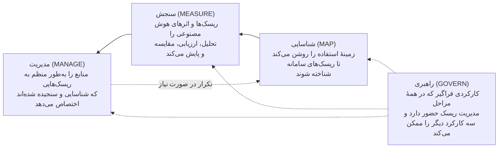

*کارکردهای اصلی چارچوب NIST AI RMF 1.0، بازترسیم‌شده از شکل ۵ و بخش ۵ این چارچوب. پس از آنکه سازوکارهای راهبری برقرار شد، بیشتر سازمان‌ها با «شناسایی» شروع می‌کنند و به «سنجش» یا «مدیریت» می‌رسند و در صورت نیاز میان کارکردها رفت‌وبرگشت دارند. [E01]*


این‌ها را گزینه‌هایی برای یک طراحی مهندسی‌شده بدانید، نه راه‌حل آماده. فرض نکنید یک دیوارهٔ آتش جلوی تزریق دستور را کاملاً می‌گیرد، یا اینکه آوردن منبع ثابت می‌کند پاسخ درست است، یا اینکه رمزنگاری جای کنترل دسترسی را می‌گیرد. اینکه در دستور از مدل بخواهید مجوزها را رعایت کند، سازوکار مجوزدهی نیست. FINOS در راهکار حفظ مجوزهای منبع صریحاً هشدار می‌دهد که کنترل دسترسی نباید فقط به دستورهای متنی تکیه کند. [FINOS mi-16، «پرهیز از میان‌برهای ناامن»؛ mi-17، «چالش‌ها و ملاحظات».]

### ۴.۵ یک چرخهٔ عمر واحد، با بازبینی‌های متناسب

| مرحله | کار حاکمیتی لازم | تصمیم / شواهد |
|---|---|---|
| ورود | مالک، هدف، بررسی اولیهٔ آسیب‌ها و موضوعات حقوقی، و ثبت | اجازهٔ بررسی و محدودیت‌ها |
| طراحی | مسیرهای داده، شیوهٔ تأمین، نقش انسان، راه‌های شکست و انتخاب کنترل‌ها | دامنهٔ تأییدشده و مالکان مشخص کنترل‌ها |
| پایلوت | ارزیابی کار و کنترل‌ها در محدوده‌ای که صریحاً تعیین شده | ادامه، بازطراحی یا توقف، بر اساس معیارهای توافق‌شده |
| عرضه | بازبینی مستقل در حد لازم، پذیرش کسب‌وکار، بازبینی‌های امنیتی و حقوقی، آمادگی عملیات | اجازهٔ بهره‌برداری در دامنه‌ای مشخص و تصمیم دربارهٔ ریسک باقیمانده |
| بهره‌برداری | پایش، بازخورد، رخدادها، دامنهٔ استفاده و بازبینی دوره‌ای | ادامه، محدودکردن، تغییر یا تعلیق |
| گسترش / تغییر مهم | ارزیابی دوبارهٔ مخاطب، مکان، داده، مدل، اختیارات و وابستگی‌هایی که تغییر کرده‌اند | اجازه برای دامنهٔ تازه؛ تأیید قبلی کافی فرض نمی‌شود |
| کنارگذاشتن | قطع دسترسی‌ها و اقدام‌ها، تعیین تکلیف داده‌ها و خروجی‌ها، اطلاع به مالکان سامانه‌های وابسته و به‌روزکردن سوابق | شواهد بستن کار و تعهداتی که باقی مانده |

جدول سطوح ریسک (در ابتدای راهنما) تعیین می‌کند هر مرحله دست‌کم چقدر عمیق باشد. پذیرش ریسک نمی‌تواند کاری را مجاز کند که بازبین حقوقی آن را غیرمجاز دانسته است. هر استثنا از خط‌مشی‌های داخلی باید این‌ها را روشن کند: مرجعی که اجازه داده، دلیل، کنترل‌های جایگزین، تاریخ انقضا، شیوهٔ پایش و شرط بستن. اگر اختلاف نظر پیش آمد، دیدگاه‌های متفاوت را ثبت کنید و به مرجعی که اختیارش را دارد ارجاع دهید؛ موضوع را بی‌سروصدا کنار نگذارید.

### ۴.۶ از تجربهٔ نظارتی دیگران بیاموزید، اما قواعد یک کشور را به کشور دیگر تعمیم ندهید

| نمونه | زمینه و اعتبار منبع | آنچه انجام شد / دشواری‌ها | درسی که قابل انتقال است | آنچه باید در محل خودتان بررسی شود |
|---|---|---|---|---|
| جولیوس بِر | D29 بازبینی این شرکت را در برابر قواعد حاکم، از جمله **قانون هوش مصنوعی اتحادیهٔ اروپا**، شرح می‌دهد؛ این روایت خود شرکت است، نه تفسیر حقوقی برای هر استقرار | بررسی اولیه کاربردهای ممنوع را کنار می‌گذارد و بعد هر کاربرد جداگانه اعتبارسنجی می‌شود؛ چت‌بات عمومی روی سرورهای خود شرکت اجرا می‌شود؛ آموزش و هشدار به کاربران. تأیید پیشاپیش مدل، به‌روزرسانی‌ها را آسان‌تر می‌کند، اما هر کاربرد همچنان جداگانه بررسی می‌شود | پیش از سرمایه‌گذاری بزرگ در ساخت، مجاز بودن کار را بررسی کنید؛ تأیید مدل را، که می‌شود دوباره از آن استفاده کرد، از تأیید هر کاربرد جدا کنید | نهادهای مرتبط، دامنهٔ جغرافیایی قانون، تعریف قانونی سامانه، الزاماتی که لازم‌الاجرا شده‌اند و فعالیت واقعی سازمان |
| پرودنشال PRUShield | خط‌مشی‌های گروه و خط‌مشی‌های محلی در چند کشور، از جمله سنگاپور؛ کمیته‌های طراحی و عرضه، **سازوکار داخلی شرکت**‌اند | یک بستر پیام‌رسانی غیرمعمول، بازبینی معماری در سطح گروه را لازم کرد؛ پاسخ‌ها به محتوای عمومی و تأییدشدهٔ محصول محدود شد؛ هیچ پاسخی دربارهٔ حساب شخصی یا توصیهٔ شخصی داده نمی‌شود؛ تفاوت در تفسیرها و پرسش‌های تکراری، بازبینی‌ها را کند کرد | دامنه را محدود کنید، وابستگی‌های غیرمعمول را زود مطرح کنید، شواهد را یکجا آماده کنید و برای بازبینی تخصصی زمان بگذارید | قواعد محلی دربارهٔ اطلاعات محصول و توصیه، کانال‌های ارتباطی، حریم خصوصی، نگه‌داری سوابق و تأییدهای لازم |
| UOBAM | سنگاپور؛ گزارش، بررسی در برابر **اصول FEAT بانک مرکزی سنگاپور (MAS)** و اعتبارسنجی مستقل داخلی را شرح می‌دهد | پیش از آنکه کمیتهٔ فناوری (به ریاست مدیریت) اجازهٔ بهره‌برداری بدهد، یک تیم مستقل کار را بررسی کرد؛ جابه‌جایی زیاد در سبد سرمایه‌گذاری، بازطراحی را لازم کرد | بازبینی مستقل و محدودیت‌های کسب‌وکار را پیش از استقرار در کار بگنجانید | تکالیف قانونی حاکم بر سرمایه‌گذاری، انتظارات اعتبارسنجی، محدودیت‌های معاملاتی و مرجع تأیید؛ بدون این فرض که در کشور دیگری هم همان کمیته لازم است |
| مشاهدات FINRA | شرکت‌های عضو FINRA در آمریکا؛ گزارش ۲۰۲۶ تعهدات موجود و رویه‌هایی را که دیده شده شرح می‌دهد و صریحاً **هیچ الزام تازه‌ای** ایجاد نمی‌کند | گزارش به نظارت، آزمون، پایش، مستندسازی و کنترل دامنه و اختیار عامل‌ها اشاره می‌کند | بررسی کنید تکالیف فعلی شما چطور در همهٔ مراحل تحویل بر فناوری تازه اعمال می‌شود | قواعد محلی و تفسیر حقوقی آن‌ها؛ رویه‌هایی که دیده شده خودبه‌خود الزامی نیستند |
| بلک‌راک | پاسخ شرکت به **نظرخواهی عمومی اتحادیهٔ اروپا**، اکتبر ۲۰۲۴؛ این‌ها مواضع شرکت است، نه جمع‌بندی کمیسیون | چارچوب فعلی ریسک و کنترل، مالکیت کسب‌وکار، بازبینی ریسک، حسابرسی و پذیرش میان‌رشته‌ای را شرح می‌دهد | کنترل‌هایی را که خوب کار می‌کنند گسترش دهید و سه نقش جدای مالکیت، بازبینی و اطمینان‌بخشی را حفظ کنید | تکالیف خاص مؤسسه و فعالیت واقعی آن، میزان کافی توضیح‌پذیری و استفادهٔ مجاز از داده |
| یک شرکت سرمایه‌گذاری بی‌نام | روایت شرکت از **تنوع مقررات در کشورهای مختلف**، از جمله تفاوت‌های اروپا و آمریکا | بازبینی‌های متعدد حقوقی، امنیتی و مهندسی؛ تعریف‌ها و استانداردهای ناهمسان اجرا را پیچیده‌تر می‌کند | کنترل‌های داخلی مشترک، به‌علاوهٔ الزامات محلی که بررسی شده‌اند، و ثبت تعارض‌ها | برای هر نهاد، کشور، گروه مشتریان، ارائه‌دهنده و مسیر داده؛ تعارض الزامات را پیش از عرضه به کاربران حل کنید |

[D29 pp. 11–12, 14–19, 21–23; D34 pp. 22–23; D01 pp. 5, 25–28; D16 pp. 6–9.]

این منابع یک مسیر تأیید نظارتی واحد که برای همهٔ سازمان‌ها صادق باشد معرفی نمی‌کنند و ثابت هم نمی‌کنند که همهٔ این کنترل‌ها را نهادی بیرونی الزامی کرده است. فرق میان تعهد قانونی، راهنمای نهاد ناظر، خط‌مشی شرکت و تفسیری که هنوز قطعی نشده را حفظ کنید. کاربرگ بازبینی حقوقی (پیوست ج) برای ثبت همین موارد است: حوزهٔ قضایی، فعالیت، مرجع دقیق، وضعیت، بازبین، شواهد و کنترلی که تحت تأثیر قرار می‌گیرد. اگر در چند کشور فعالیت می‌کنید، برای هر سامانه یک سابقهٔ مشترک نگه دارید و تصمیم دربارهٔ شمول قوانین هر کشور را جداگانه ثبت کنید؛ اگر الزامات کشورها با هم قابل جمع نیست، دامنه‌ها یا استقرارهای جداگانه را در نظر بگیرید.

### ۴.۷ پایان کار و نشانه‌های شکست

**خروجی‌ها:** سابقهٔ به‌روز در فهرست کاربردها، ماتریس ریسک و کنترل، کاربرگ بازبینی حقوقی، دفتر ثبت تصمیم‌ها، برنامهٔ بازبینی و سوابق استثناها. **مسئولان:** مالک کسب‌وکار اطلاعات زمینه‌ای را آماده می‌کند؛ هر متخصص حوزهٔ خودش را ارزیابی می‌کند؛ مدیر برنامه همهٔ شواهد را در یک بسته گرد می‌آورد؛ هر مرجع صاحب اختیار تصمیم‌های حوزهٔ خودش را می‌گیرد. وقتی کنترل‌های لازم آزموده شده‌اند و پرسش‌های مهمی که برای این میزان دسترسی کاربران باز مانده بود پاسخ گرفته‌اند، **کار را ادامه دهید**. **نشانه‌های شکست:** تأییدی که هیچ سندی پشتش نیست؛ پرسش‌های تکراری بازبینی که کسی مسئول پاسخ‌دادن به آن‌ها نیست؛ سطح ریسکی که فقط بر اساس نام تجاری مدل تعیین شده؛ یا پایلوتی که برای دور زدن مسئولیت‌های عادی به کار رفته است. بازبینی‌های اولیه می‌توانند هم‌زمان پیش بروند، اما عرضه باید منتظر تصمیم‌های لازم بماند. پس از هر تغییر مهم، رخداد، سوءاستفاده یا تغییر در قوانین محلی، ارزیابی را تکرار کنید.

<a id="ch5"></a>

## ۵. آماده‌سازی داده و فناوری

| کارت فصل | |
|---|---|
| **مالک** | مسئول فنی کار را یکپارچه می‌کند؛ مالک دادهٔ کسب‌وکار و متولی مهندسی داده معنا و حق استفاده از داده را تأیید می‌کنند؛ امنیت اطلاعات و عملیات بخش‌های مربوط به خودشان را می‌پذیرند |
| **چه زمانی شروع کنیم** | کاربرد انتخاب شده و نمونه‌های واقعی از پرسش‌ها یا کارها در دست است |
| **مدت معمول (پیش‌فرض آغازین)** | سطح ۲: ۳ تا ۶ هفته برای توافق‌نامهٔ داده و سابقهٔ معماری، هم‌زمان با ساختن مجموعهٔ آزمون |
| **خروجی‌ها** | توافق‌نامهٔ داده، نمودار مسیر داده، تصمیم دربارهٔ فناوری و شیوهٔ تأمین، ارزیابی تأمین‌کننده، برآورد هزینهٔ اجرا |
| **ابزارها (پیوست ج)** | برگهٔ داده و معماری؛ برآوردگر هزینه و ارزش |
| **میزان الزام** | سطح ۱: مشروط (فقط اگر دادهٔ تازه‌ای وصل شود). سطح‌های ۲ و ۳: برای هر منبع حیاتی الزامی؛ در سطح ۳ آزمودن حذف داده و تغییر مجوزها هم اضافه می‌شود |

### ۵.۱ هدف و پیش‌نیازها

اطلاعات و فناوری را برای یک کار مشخص آماده کنید و در همان حال قابلیت‌هایی را که ارزش دارد میان چند کاربرد مشترک باشد شناسایی کنید. نقطهٔ شروع: کاربردی که تعریف شده، نمونه‌های واقعی از پرسش‌ها یا کارها، مالکان داده، محدودیت‌های اولیه و یک مسئول فنی. کار روی داده‌های سازمان می‌تواند گام‌به‌گام پیش برود؛ پیش از آنکه نتیجه بگیرید کل داده‌های سازمان باید از نو ساخته شود، نشان دهید داده برای همین کاربرد آماده است.

**رویهٔ مستند:** «تحلیل‌گر مجازی» ونگارد به پرسش‌های مالی پیچیده پاسخ می‌داد و برای این کار مالکیت کسب‌وکاری و فنی، فراداده، تعریف روشن مفاهیم، نمونه‌ها، کنترل کیفیت، مجوزها و ارزیابی مداوم را با هم ترکیب کرد. طرح معماری آن نشان می‌دهد این عناصر چطور با رابط کاربری، مدل و بستر داده در ارتباط‌اند. متن همراه آن، معماری را «نمونه‌وار» می‌نامد و گراف دانش و RAG را موضوع بررسی‌های آینده می‌داند. اگر از این طرح الگو می‌گیرید، این تفاوت‌ها را در نظر داشته باشید. [D14 ll. 55–119, 132–258, 288–295; A01، «طرح دادهٔ آماده برای هوش مصنوعی».]

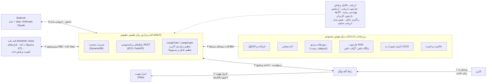

*بازترسیم‌شده از نمودار ونگارد با عنوان «AI-Ready Data Blueprint: Virtual Analyst Architecture»؛ شماره‌ها همان ترتیب جریان کار در نمودار اصلی است. نام محصولات انتخاب ونگارد است، نه توصیهٔ این راهنما. [A01]*

### ۵.۲ برای هر کاربرد، توافق‌نامهٔ داده بنویسید

مالک دادهٔ کسب‌وکار و متولی مهندسی داده، برای هر منبع حیاتی، این موارد را با هم مستند می‌کنند:

۱. **هدف و معنا:** منبع چه چیزی را نشان می‌دهد، چه جمعیتی را در بر می‌گیرد، تعریف‌های رسمی، واحدها، مبنای زمانی، قواعد محاسبه و ابهام‌هایی که از آن‌ها خبر داریم.  
۲. **مالکیت و حق استفاده:** مالک کسب‌وکاری پاسخ‌گو، متولی فنی، اهدافی که استفاده برایشان مجاز است، محدودیت‌های مجوز یا قرارداد و کاربران و سرویس‌هایی که اجازهٔ دسترسی دارند.  
۳. **کیفیت و پوشش:** کامل بودن، درستی، به‌روز بودن، نمایندگی از کل، سازگاری با منابع دیگر، منشأ داده و کمبودهای شناخته‌شده؛ همه در نسبت با کار واقعی.  
۴. **دسترسی و پردازش:** داده کجا نگه‌داری می‌شود، به کجا مجاز است برود، چه تبدیل‌هایی روی آن انجام می‌شود، چه نسخه‌های فرعی از آن ساخته می‌شود، لاگ‌ها، حافظه‌های موقت، پشتیبان‌ها، دسترسی ارائه‌دهنده و الزامات حذف و نگه‌داری.  
۵. **توافق عملیاتی:** هر چند وقت یک بار به‌روز می‌شود، حد قابل قبول کیفیت، مسیر گزارش مشکلات، پشتیبانی، تغییر در منبع و اطلاع‌رسانی به سامانه‌هایی که از آن استفاده می‌کنند.

اگر تعریف‌های کسب‌وکاری با هم تعارض دارند، متخصصان آن حوزه باید تکلیفشان را روشن کنند. اتصال جدول‌ها، تطبیق رکوردهای مربوط به یک موجودیت و تفسیر زمان را روی نمونه‌هایی که جوابشان را می‌دانید بیازمایید. هر جا ابهام در معنای داده روی درستی پاسخ اثر دارد، آن را مانعی جدی ثبت کنید. ونگارد فرادادهٔ فنی را از زمینهٔ کسب‌وکاری جدا نگه می‌دارد و با یک لایهٔ معنایی، تعریف‌های توافق‌شده را به منطق قابل اجرا تبدیل می‌کند. درسی که از این تجربه گرفته می‌شود یکسان بودن معناست، نه لزوم خرید یک نرم‌افزار کاتالوگ یا انبار دادهٔ خاص. [D14 ll. 132–198, 217–245.]

### ۵.۳ فناوری را بر اساس نوع کار انتخاب کنید

| نوع کار / شرایط | رویکردی که باید سنجید | آنچه باید نشان داده شود |
|---|---|---|
| قواعد ثابت، محاسبات دقیق یا روال کاری شناخته‌شده | برنامه‌نویسی معمولی، جست‌وجو یا خودکارسازی فرایند با قواعد مشخص | قواعد درست، منابعی که نگه‌داری می‌شوند، یکپارچگی قابل استفاده |
| پیش‌بینی یا رتبه‌بندی بر پایهٔ داده‌های گذشته یا داده‌های برچسب‌خورده | مدل‌های متعارف یادگیری ماشین یا آماری، در مقایسه با روش‌های ساده‌تر | رفتار درست روی داده‌هایی که مدل ندیده، سلامت داده، محدودیت‌های عملی و پایش |
| نوشتن یا ایده‌پردازی عمومی که پاسخ رسمی سازمانی ندارد | دستیار عمومی مجاز | دادهٔ مجاز، توانایی کاربر در بازبینی، دامنهٔ استفاده و امنیت |
| پاسخ‌هایی که به اسناد در حال تغییر تکیه دارند | جست‌وجو یا «تولید همراه با بازیابی» (RAG) | پوشش منابع، کیفیت بازیابی، مجوزها، به‌روز بودن و درستی پاسخ و منبع آن |
| پرسیدن از دادهٔ ساختاریافته به زبان عادی | تبدیل کنترل‌شدهٔ پرسش متنی به پرس‌وجوی پایگاه داده | تعریف روشن مفاهیم کسب‌وکار، مجوزدهی، محدودیت پرس‌وجو و نتایج درست روی نمونه‌های واقعی |
| رفتار یا سبکی پایدار که با تنظیمات ساده‌تر به دست نمی‌آید | تنظیم دقیق مدل (Fine-tuning)، اگر موجه باشد | کیفیت بهتر، حق استفاده از داده، ارزیابی روی داده‌ای که در آموزش نبوده و امکان نگه‌داری |
| کار چندمرحله‌ای و متغیر که باید ابزار مناسب را انتخاب کند | فرایند عامل‌محور با اختیارات محدود، اگر موجه باشد | عملکرد کار و درستی مسیر اقدام‌ها، مجوز ابزارها، سالم ماندن وضعیت، مهار و بازیابی |

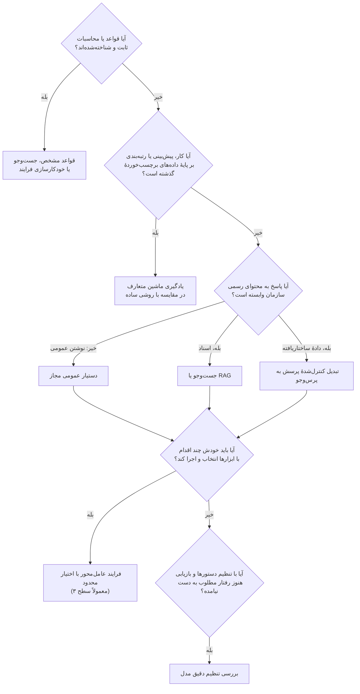

RAG محتوای مرتبط را از منابع پیدا می‌کند و در اختیار مدل می‌گذارد. تنظیم دقیق، خود مدل را با نمونه‌های آموزشی تغییر می‌دهد. این دو مسائل متفاوتی را حل می‌کنند و می‌توان آن‌ها را با هم به کار برد، اما هیچ‌کدام برای همهٔ کاربردها لازم نیست. چت‌بات عمومی جولیوس بِر از یک مدل متن‌باز استفاده می‌کند که روی سرورهای خود شرکت اجرا می‌شود و از هیچ‌یک از این دو روش بهره نمی‌برد. LCH پس از سنجیدن زحمت سفارشی‌سازی و نشان‌دادن منبع پاسخ‌ها، یک محصول آمادهٔ بازیابی را انتخاب کرد. راهبرد فیدلیتی هم چند قابلیت را در بر می‌گیرد که اصلاً بر مدل‌های زبانی بزرگ تکیه ندارند. [D29 p. 12; D26 ll. 90–107; D10 pp. 1–4.]

در سامانه‌های بازیابی، شناسهٔ منبع، نسخه، تاریخ اعتبار و مجوزها را در همان سطحی نگه دارید که طراحی لازم دارد، یعنی برای هر سند یا هر بخش از آن. حذف یک سند و تغییر مجوزها را تا آخر مسیر، یعنی در نمایه‌ها و حافظه‌های موقت هم، بیازمایید. پیش از آنکه محتوای محدود به مدل برسد، آن را بر اساس مجوز واقعی کاربر پالایش کنید. در پرس‌وجو از دادهٔ ساختاریافته، از هویت‌های کنترل‌شده استفاده کنید، داده‌ها و اقدام‌های مجاز را در خود نرم‌افزار اعمال کنید، پرس‌وجوهایی را که مدل ساخته پیش از اجرا بررسی کنید و برای مصرف منابع سقف بگذارید. در فرایندهای عامل‌محور، اقدام‌های مجاز و محدودیت پارامترها را بیرون از مدل اعمال کنید، هر جا ممکن است اطلاعات محرمانه (مثل رمزها و کلیدها) را از دید مدل دور نگه دارید و خروجی ابزارها و دستورهایی را که از منابع بازیابی شده‌اند ورودی غیرقابل‌اعتماد بدانید. [جمع‌بندی راهنما بر پایهٔ D14 ll. 149–155, 201–245; FINOS mi-16، راهنمای اجرا؛ mi-18، بخش‌های ۳ تا ۷؛ mi-19، بخش‌های ۱ تا ۳؛ mi-23، بخش‌های ۱ تا ۳.]

### ۵.۴ تصمیم بگیرید پردازش کجا انجام شود و کنترلش با چه کسی باشد

گزینه‌ها را با الزامات واقعی بسنجید: سرویس‌های ابری آماده، محیط‌های اختصاصی که ارائه‌دهنده اداره می‌کند، مدل‌های متن‌بازی که خود سازمان اجرا می‌کند و ترکیبی از این‌ها. برای هر گزینه روشن کنید چه داده‌ای فرستاده یا دیده می‌شود، چه کسی به آن دسترسی دارد، پردازش و لاگ‌ها و پشتیبان‌ها کجا نگه‌داری می‌شوند، کدام تغییرات در اختیار ارائه‌دهنده است و اگر خدمت قطع شد یا خواستید ارائه‌دهنده را عوض کنید چه می‌شود.

اینکه دادهٔ حساس در پایگاه دادهٔ سازمان می‌ماند، به‌تنهایی ثابت نمی‌کند که سرویس هوش مصنوعی آن را نمی‌بیند. دستورها، بخش‌های بازیابی‌شده، پاسخ‌های تولیدشده، بردارهای معنایی، داده‌های پایش و دسترسی تیم پشتیبانی ارائه‌دهنده، همه باید در بررسی مسیر داده دیده شوند. از آن طرف، پردازش در محیط کنترل‌شدهٔ سازمان لزوماً به این معنا نیست که مدل باید درون خود پایگاه داده اجرا شود. مرز مجاز را تعریف کنید و کل مسیر را بیازمایید. این جمع‌بندی از نمودارهای RAG در FINOS گرفته شده که مراحل آماده‌سازی، اجرا و نقاط دسترسی به مدل را از هم جدا می‌کنند، و نیز از شرح ریسک نشت داده و کنترل‌های آن. [FINOS F13 و F15، مرز آماده‌سازی و اجرا؛ کدهای PlantUML آن‌ها؛ ri-2، خلاصه / شرح تهدید؛ mi-1، راهنمای اجرا.]

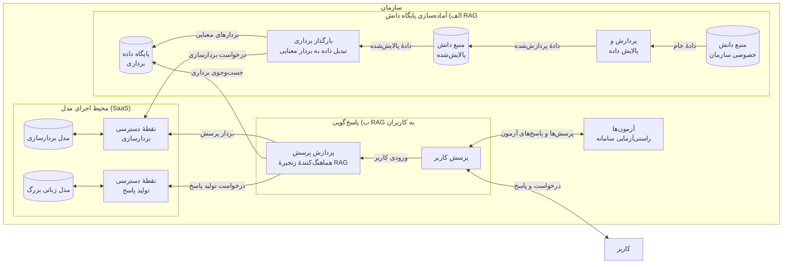

*بازترسیم‌شده از نمودار «RAG System Architecture» در چارچوب حاکمیت هوش مصنوعی FINOS (نسخهٔ v0، بدون نمایش ریسک‌ها). این نمودار سه محیط را از هم جدا می‌کند: آماده‌سازی پایگاه دانش (محیط پردازش داده) و پاسخ‌گویی به کاربران (محیط اجرا و پایش)، که هر دو روی سرورهای خود سازمان یا ابر سازمان قرار دارند، و محیط SaaS که مدل‌های بردارسازی و زبانی را میزبانی می‌کند. [FINOS F13]*

اگر پردازش بیرون از سازمان ممنوع است، هر مسیری را که از این مرز می‌گذرد کنار بگذارید، از جمله سرویس‌های ارزیابی و پایش. گزینهٔ میزبانی داخلی هم ظرفیت، مجوز استفاده، امنیت، به‌روزرسانی، ارزیابی و نیروی عملیاتی کافی لازم دارد. اگر اتصال اینترنت یا در دسترس بودن ارائه‌دهنده قطعی نیست، برنامهٔ اضطراری مشخصی داشته باشید و آن را بیازمایید: انجام دستی کار، صف کارها، کم‌کردن تدریجی قابلیت‌ها یا یک جایگزین تأییدشده. مدل جایگزین هم باید جداگانه نشان دهد که سازگار است و کیفیت کافی دارد؛ صرف تعویض ارائه‌دهنده یک مسیر جایگزین امن نیست.

### ۵.۵ تأمین‌کنندگان و اجزای مشترک را ارزیابی کنید

از تأمین‌کنندگان یک «کارت هوش مصنوعی» برای همین کاربرد بخواهید که این موارد را روشن کند: کاربرد مورد نظر و محدودیت‌ها، اجزا، مسیر داده‌ها، روش ارزیابی، ریسک‌های شناخته‌شده، کنترل‌های امنیتی، شرایط پردازش، نگه‌داری داده و استفاده از آن برای آموزش مدل، تغییر نسخه‌ها، پشتیبانی، اطلاع‌رسانی رخدادها، ظرفیت، و امکان گرفتن خروجی از داده‌ها، حذف آن‌ها و پایان همکاری. هر جا ممکن است، ادعاها را از نظر فنی و قراردادی راستی‌آزمایی کنید. هر چیزی که تأمین‌کننده اعلام نکرده، شکافی در شواهد است؛ تصمیم بگیرید آزمون‌ها و محدودیت‌های جبرانی کافی است یا باید این گزینه را کنار گذاشت. قالب کارت هوش مصنوعی MindForge نقطهٔ شروع خوبی است؛ این قالب چارچوبی برای اطلاع‌رسانی است، نه گواهی تأیید. [D30 pp. 152–153; FINOS mi-7، راهنمای اجرا.]

قابلیت‌هایی را که قرار است چند کاربرد از آن‌ها استفاده کنند، با این مشخصات طراحی کنید: مالک خدمت، نقطهٔ اتصال، نسخه‌های پشتیبانی‌شده، مجوزها، تعهد کیفیت، تقسیم هزینه و قواعد تغییر. دسترسی به مدل، مدیریت هویت، ورود اسناد، بسترهای ارزیابی و پایش از نامزدهای خوب برای اشتراک‌اند. فقط چیزی را بسازید که سبد کاربردها واقعاً توجیهش می‌کند. ساختار ماژولار فیدلیتی اجازه می‌دهد هر بخش مستقل از بقیه تکامل یابد و الگوهای مشترک JPMC پراکندگی را کم کرد. اما خدمات مشترک هم وابستگی می‌آورند و کنترل‌های عملیاتی خودشان را لازم دارند. [D10 pp. 11–12; D25 pp. 6–8.]

### ۵.۶ پیش از تعهد، هزینهٔ اجرا را برآورد کنید

هزینهٔ مدل معمولاً فقط بخشی از هزینهٔ هر نتیجهٔ موفق است. پس پیش از بودجه دادن به پایلوت همهٔ اجزای هزینه را برآورد کنید، و پیش از عرضه، با اعدادی که در پایلوت اندازه گرفته شده، برآورد را تکرار کنید (برآوردگر هزینه و ارزش در پیوست ج). ساختار زیر **جمع‌بندی راهنما** است و از تأکید منابع بر هزینهٔ کامل هر نتیجهٔ موفق گرفته شده است. [D38 ll. 381–429; D10 pp. 11–12.]

**هزینهٔ ماهانهٔ استفاده از مدل:**

> تعداد درخواست‌ها × [(توکن‌های ورودی × قیمت ورودی) + (توکن‌های خروجی × قیمت خروجی)] ÷ ۱٬۰۰۰٬۰۰۰ × (۱ + نرخ تکرار و سرباری که اندازه گرفته‌اید)

- سرویس‌های ابری مدل معمولاً برای توکن‌های ورودی و خروجی، به ازای هر یک میلیون توکن، قیمت جداگانه دارند و ممکن است برای پردازش دسته‌ای یا بخش‌های تکراری دستور که در حافظهٔ موقت نگه داشته می‌شود تخفیف بدهند. از نرخ‌های قرارداد خودتان استفاده کنید، نه از قیمت‌هایی که از جایی به خاطر دارید. [E11]
- در متن انگلیسی هر توکن تقریباً چهار حرف یا حدود سه‌چهارم یک واژه است. زبان‌های دیگر، از جمله فارسی، ممکن است برای همان متن توکن‌های خیلی بیشتری لازم داشته باشند؛ پس تعداد توکن‌ها را با ابزار شمارش ارائه‌دهنده و روی متن‌های خودتان اندازه بگیرید. [E10]
- در سامانه‌های RAG معمولاً بیشتر توکن‌های ورودی از متن‌های بازیابی‌شده است، و عامل‌ها برای هر کار چندین بار مدل را فراخوانی می‌کنند. تعداد توکن هر درخواست را در پایلوت اندازه بگیرید، نه در نمایش آزمایشی.

**باقی اجزای هزینه:** ساختن بردارهای معنایی و نمایه‌ها؛ هزینهٔ میزبانی یا بستر؛ اجرای ارزیابی‌ها (تعداد نمونه‌های آزمون × تعداد تکرار × هزینهٔ هر فراخوانی، به‌علاوهٔ ساعت‌هایی که متخصصان برای بازبینی می‌گذارند)؛ نمونه‌گیری کیفیت در دورهٔ بهره‌برداری؛ وقتی که کارکنان برای بازبینی خروجی‌ها در روال کارشان صرف می‌کنند؛ پشتیبانی و عملیات؛ کار امنیتی و حاکمیتی؛ آموزش و مدیریت تغییر؛ مدیریت تأمین‌کننده؛ و هزینهٔ کنارگذاشتن سامانه.

**یک محاسبهٔ نمونه (قیمت‌ها و حجم‌ها فرضی‌اند، نه معیار).** فرض کنید ماهی ۲۰٬۰۰۰ درخواست داریم، هر درخواست ۶٬۰۰۰ توکن ورودی با قیمت فرضی ۳ دلار برای هر میلیون توکن، و ۵۰۰ توکن خروجی با قیمت فرضی ۱۵ دلار برای هر میلیون. ورودی می‌شود ۱۲۰ میلیون توکن یعنی ۳۶۰ دلار؛ خروجی ۱۰ میلیون توکن یعنی ۱۵۰ دلار؛ پس هزینهٔ مدل پیش از سربار حدود ۵۱۰ دلار در ماه است. حالا اگر کارکنان برای بررسی هر پاسخ ۳۰ ثانیه وقت بگذارند و هزینهٔ کامل هر ساعت کارشان ۶۰ دلار باشد، بررسی پاسخ‌ها ماهانه ۱۰٬۰۰۰ دلار خرج دارد؛ یعنی حدود بیست برابر هزینهٔ مدل. در این مثال، آنچه هزینه را تعیین می‌کند کیفیت پاسخ و زحمت بررسی آن است، نه قیمت توکن. محاسبهٔ کامل یک نمونه در پیوست ب.۸ آمده است.

برآورد را برای سه حالت حجم کم، حجم مورد انتظار و حجم زیاد انجام دهید و همهٔ فرض‌ها را صریح بنویسید. وقتی پایلوت میزان استفادهٔ واقعی را نشان داد، هزینهٔ هر نتیجهٔ موفق را (بخش ۹.۲) دوباره حساب کنید.

### ۵.۷ پایان کار و نشانه‌های شکست

**خروجی‌ها:** توافق‌نامهٔ داده و سابقهٔ آمادگی، نمودارهای معماری و مسیر داده، مقایسهٔ گزینه‌های تأمین، ارزیابی تأمین‌کننده، طراحی کنترل‌ها، توافق‌نامه‌های خدمات مشترک و سابقهٔ تصمیم‌های معماری. **مسئولان:** مسئول فنی طراحی را یکپارچه می‌کند؛ مالکان کسب‌وکار و داده معنا و حق استفاده را تأیید می‌کنند؛ امنیت اطلاعات و بازبینان حقوقی حوزهٔ خود را ارزیابی می‌کنند؛ عملیات بار پشتیبانی را می‌پذیرد. وقتی داده‌ای که نمایندهٔ کار واقعی است مناسب و مجاز است، کنترل‌های اصلی قابل نمایش‌اند و معماری با رعایت محدودیت‌ها قابل بهره‌برداری است، **کار را ادامه دهید**. **نشانه‌های شکست:** پیشنهاد تنظیم دقیق مدل برای جبران اطلاعاتی که اصلاً در منابع نیست؛ کنترل مجوزها فقط از طریق دستور به مدل؛ اینکه داشتن انبار داده دلیل آمادگی داده فرض شود؛ یا بستری که هیچ کاربردِ بودجه‌داری از آن استفاده نمی‌کند. اصلاح داده، تأمین و طراحی رابط کاربری می‌توانند هم‌زمان پیش بروند، اما دسترسی به دادهٔ حساس و آغاز پایلوت با کاربران باید منتظر تأییدهای لازم بماند.

---

<a id="ch6"></a>

## ۶. طراحی و ارزیابی پایلوت

| کارت فصل | |
|---|---|
| **مالک** | مالک کسب‌وکار همراه با مسئول ارزیابی؛ بازبینان کنترلی و عملیات، میزان دسترسی کاربران به سامانه را می‌پذیرند |
| **چه زمانی شروع کنیم** | وضع موجود اندازه‌گیری شده، دادهٔ مجاز آماده است، کاربران و دامنه مشخص‌اند و راه مهار مشکلات طراحی شده |
| **مدت معمول (پیش‌فرض آغازین)** | سطح ۱: ۲ تا ۴ هفته · سطح ۲: ۸ تا ۱۲ هفته · سطح ۳: ۳ تا ۶ ماه یا بیشتر، بسته به شواهدی که لازم است |
| **خروجی‌ها** | منشور امضاشده، مجموعهٔ آزمون و معیار داوری با شمارهٔ نسخه، نتایج به تفکیک زیرگروه و شدت خطا، فهرست شکست‌ها، تصمیم |
| **ابزارها (پیوست ج)** | برگهٔ مسیر سریع (آزمون اولیهٔ سطح ۱)؛ منشور پایلوت و برنامهٔ ارزیابی؛ برآوردگر هزینه و ارزش |
| **میزان الزام** | در سطح‌های ۲ و ۳ الزامی: تعیین حد قبولی پیش از دیدن نتایج؛ مجموعهٔ آزمون کنارگذاشته؛ قاعدهٔ خطای جدی. سطح ۱: آزمون اولیه بدون هیچ خطای جدی |

### ۶.۱ هدف و پیش‌نیازها

پایلوت برای این است که ابهامی را برطرف کند که روی تصمیم سرمایه‌گذاری یا عرضه اثر دارد. باید از پیش روشن باشد چه چیزی آزموده می‌شود، چه نتیجه‌ای تصمیم را عوض می‌کند و بعد از پایلوت چه اتفاقی می‌افتد. نقطهٔ شروع: اندازه‌گیری وضع موجود، کاربران و دامنهٔ کار مشخص، دادهٔ مجاز، یک مالک و طراحی‌ای که راه مهار مشکلات را هم در بر دارد. پایلوتی که با کاربران واقعی، دادهٔ واقعی یا اقدام‌های واقعی سروکار دارد، همچنان به مجوزی متناسب با همین میزان دسترسی نیاز دارد.

**رویهٔ مستند:** یکی از دست‌اندرکاران مورگان استنلی از پایلوت نُه‌ماههٔ اولیه می‌گوید، از اینکه ارزیابی مبتنی بر شباهت متنی (cosine similarity) جواب نداد، از یک مجموعهٔ ۵۰۰ پرسشی برای آزمون مجدد پس از هر تغییر، و از یک طبقه‌بندی مشترک برای آزمون‌ها. JPMC از متخصصان موضوعی خواست درستی و کامل بودن پاسخ‌ها را بازبینی کنند و کاستی‌هایی پیدا کرد که ریشه‌شان در اسناد قدیمی بود. این نمونه‌ها نشان می‌دهند ارزیابی باید مخصوص همان کار باشد و پس از هر تغییر تکرار شود؛ نه اینکه پایلوت طول یا تعداد پرسش ثابتی داشته باشد. [D04 ll. 367–463; D25 pp. 12–13.]

### ۶.۲ پیش از آنکه کاربران بیشتری درگیر شوند، منشور پایلوت را بنویسید

مالک کسب‌وکار و مسئول ارزیابی بر سر این موارد توافق می‌کنند:

- فرضیه‌ای که پایلوت باید دربارهٔ آن تصمیم بگیرد، شیوهٔ فعلی کار و گزینه‌هایی که مقایسه می‌شوند.
- کاربران، انواع کار، زبان‌ها، حجم کار، دادهٔ مجاز و مرز اقدام‌هایی که سامانه اجازه دارد انجام دهد.
- نتیجهٔ اصلی، الزامات کیفیت و ایمنی، معیارهای عملیاتی و همهٔ هزینه‌هایی که باید ثبت شوند.
- روش ارزیابی، شیوهٔ ساختن مجموعهٔ آزمون، معیار داوری، بازبینی مستقل و مدتی که برای رسیدن به شواهد کافی لازم است.
- معیارهای ادامه، بازطراحی و توقف، از جمله شرایطی که باید فوراً کار را متوقف کرد.
- افراد مسئول، وقتی که برایشان آزاد شده، مسیر بازخورد و گزارش رخداد، راه جایگزین، و تاریخ و مرجع تصمیم.

حد قبولی را پیش از دیدن نتایج اعلام کنید و هر تغییری را که بعداً در آن می‌دهید با دلیلش ثبت کنید. **مدت‌های پیش‌فرض** در کارت فصل آمده است. برای مقایسه: آزمون پذیرش کاربر در پرودنشال حدود چهار ماه طول کشید و پایلوت اولیهٔ مورگان استنلی نُه ماه. پایلوت با یک تصمیم تمام می‌شود، نه با تمدید خودکار. [D29 pp. 16–19; D04 ll. 367–463.] حد قبولی را از نیاز کسب‌وکار، پیامد شکست، عملکرد وضع موجود و کنترل‌های عملی به دست آورید؛ درصدی که در نمونهٔ یک شرکت دیگر آمده، حد پیش‌فرض شما نیست. قالب منشور پایلوت و برنامهٔ ارزیابی در پیوست ج آمده است.

### ۶.۳ مجموعهٔ آزمونی بسازید که شبیه کار واقعی باشد

هر جا اجازه دارید، از نمونه‌های واقعی استفاده کنید که کار واقعی را نمایندگی می‌کنند: کارهای رایج، استثناهای پرهزینه، موارد مبهم، داده‌های ناقص، منابع قدیمی یا متناقض، کاربرانی با مجوزهای متفاوت، درخواست‌هایی که بیرون از دامنه‌اند و، اگر مرتبط است، ورودی‌های آسیب‌زا یا مخرب. برای پر کردن جاهای خالی می‌توانید نمونه‌های ساختگی بسازید، اما روی آن‌ها برچسب بزنید و بررسی کنید که واقع‌نما باشند. فرض نکنید نمونه‌های ساختگی تمام تنوع کار واقعی را بازسازی می‌کنند.

نمونه‌هایی را که برای نوشتن دستورها، تنظیم رفتار سامانه یا رفع اشکال به کار می‌برید، از نمونه‌هایی که برای ارزیابی نهایی کنار گذاشته‌اید جدا نگه دارید. دو مجموعه داشته باشید: یکی برای آزمون مجدد خطاهای شناخته‌شده پس از هر تغییر، و یکی که کنار گذاشته شده تا بسنجد سامانه روی موارد تازه هم درست کار می‌کند یا نه. هر نمونه را بر اساس نوع کار، پیامد، گروه کاربران و وضعیت منبع و مجوز برچسب بزنید تا عملکرد خوب در کل نتواند شکستی جدی در یک زیرگروه را پنهان کند. متخصصان حوزه باید تعریف کنند چه پاسخ یا اقدامی قابل قبول است، چه اطلاعاتی حتماً باید در پاسخ باشد و چه کاستی‌ای باعث رد پاسخ می‌شود. اختلاف نظرها را ثبت کنید و بر اساس معیار داوری حل کنید.

**چند نمونهٔ آزمون لازم است؟ تعداد را از ادعایی که باید ثابت کنید به دست آورید.**

دو نکتهٔ آماری نقطهٔ شروعی قابل دفاع به دست می‌دهد:

- **برای رد کردن خطاهای جدی (قاعدهٔ سه).** اگر در *n* نمونهٔ مستقل و واقعی هیچ خطای جدی دیده نشود، با حدود ۹۵٪ اطمینان می‌توان گفت نرخ واقعی خطای جدی حداکثر ۳ تقسیم بر *n* است. [E07] پس برای اینکه بگویید نرخ خطای جدی ۱٪ یا کمتر است، حدود ۳۰۰ نمونهٔ بدون خطا لازم دارید؛ برای ۲٪ حدود ۱۵۰ و برای ۵٪ حدود ۶۰. اگر حتی یک خطای جدی دیده شود، برای همان ادعا یا نمونه‌های بیشتری لازم است یا بازطراحی.
- **برای برآورد نرخ قبولی.** به‌جای فرمول سادهٔ ±۱٫۹۶√(p(1−p)/n)، که در نمونه‌های کوچک و نرخ‌های خیلی بالا یا خیلی پایین خوب کار نمی‌کند، از فاصلهٔ اطمینان ویلسون استفاده کنید. [E08] مثلاً اگر ۹۰٪ نمونه‌ها قبول شوند، فاصلهٔ اطمینان ۹۵٪ با ۱۰۰ نمونه تقریباً ۸۲٫۶ تا ۹۴٫۵٪ است، با ۲۰۰ نمونه تقریباً ۸۵٫۱ تا ۹۳٫۴٪ و با ۴۰۰ نمونه تقریباً ۸۶٫۷ تا ۹۲٫۶٪.

| حداکثر نرخ خطای جدی که می‌خواهید ثابت کنید (اطمینان ۹۵٪) | تعداد نمونهٔ بدون خطای لازم (≈ ۳ ÷ نرخ) |
|---|---|
| ۱۰٪ | ۳۰ |
| ۵٪ | ۶۰ |
| ۲٪ | ۱۵۰ |
| ۱٪ | ۳۰۰ |
| ۰٫۵٪ | ۶۰۰ |

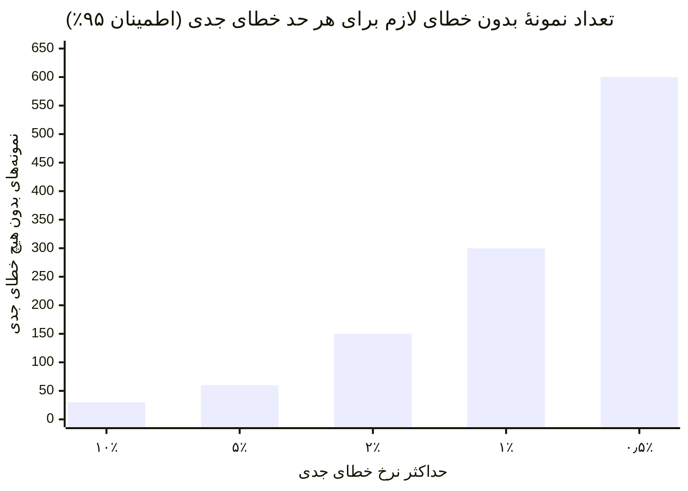

این اعداد فقط وقتی معتبرند که نمونه‌ها واقعی و مستقل از هم باشند؛ ۳۰۰ نمونهٔ تقریباً تکراری چیز زیادی را ثابت نمی‌کند. همچنین این حدها **برای هر زیرگروه مهم** جداگانه صدق می‌کند، مثلاً برای هر خط محصول، هر زبان یا هر گروه مجوز. اگر بیشتر پیامدهای جدی در یک زیرگروه متمرکز است، تعداد نمونه‌های همان زیرگروه را جداگانه تعیین کنید.

**ترکیب پیش‌فرض مجموعهٔ آزمون** (آن را با ترکیب واقعی کارها تطبیق دهید): حدود ۶۰٪ درخواست‌های رایج واقعی؛ ۲۰٪ استثناهای پرهزینه، موارد مبهم و منابع قدیمی یا متناقض؛ ۱۰٪ درخواست‌های بیرون از دامنه که سامانه باید رد یا ارجاع دهد؛ ۱۰٪ موارد مخرب، آزمون مرز مجوزها و نشت داده. دست‌کم یک‌سوم نمونه‌ها را برای ارزیابی نهایی کنار بگذارید و هرگز برای تنظیم دستورها، بازیابی یا مدل از آن‌ها استفاده نکنید. این ترکیب **جمع‌بندی راهنما** است.

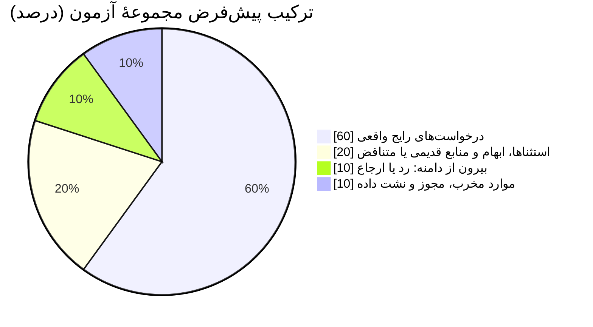

ونگارد از نمونه‌های «پرسش و کد SQL متناظر» هم برای راهنمایی مدل در دستور، هم برای ارزیابی و هم برای آزمون مجدد پس از تغییرات استفاده کرد؛ LCH حدود ۱۰۰ جفت پرسش و پاسخ مرجع از کارشناسان خدمات گردآوری کرد. این‌ها کارهایی است که واقعاً انجام شده. این راهنما یک نکته به آن اضافه می‌کند: جدا نگه‌داشتن نمونه‌های توسعه از نمونه‌های ارزیابی نهایی، تا اصلاح‌های پشت‌سرهم به اشتباه نشانهٔ قابل‌اتکا بودن در شرایط واقعی تلقی نشود. [D14 ll. 201–214; D26 ll. 216–246؛ **جداسازی نمونه‌ها: جمع‌بندی راهنما**.]

### ۶.۴ سامانه را در چند لایه ارزیابی کنید

| لایه | چه چیزی را بیازمایید | چرا روی تصمیم اثر دارد |
|---|---|---|
| داده و بازیابی | پوشش، به‌روز بودن، پیدا کردن منبع درست، مجوزها و حذف | پاسخی که روان و قانع‌کننده است می‌تواند خطای منبع یا دسترسی را پنهان کند |
| پاسخ و مدل | درستی، کامل بودن، تکیه بر منبع، اینکه منبع واقعاً پاسخ را پشتیبانی کند، امتناع بجا، ثبات | میانگین خوب، اطلاعات نادرست جدی یا کاستی‌ها را توجیه نمی‌کند |
| کار و فرایند | انجام کامل کار، زحمت بررسی و اصلاح، تحویل کار میان افراد، توان کاربر | خروجی‌ای که از نظر فنی درست است ممکن است بیش از آنچه کار را کم می‌کند، کار اضافه کند |
| کنترل‌ها | دسترسی غیرمجاز، نشت داده، اقدام‌های ممنوع، ارجاع و راه جایگزین | نشان می‌دهد سامانه در شرایط خرابی و سوءاستفاده چه می‌کند، نه فقط با درخواست‌های عادی |
| خدمت و اقتصاد | سرعت پاسخ در بار واقعی، در دسترس بودن، هزینهٔ بازبینی، هزینهٔ کامل هر نتیجهٔ موفق | نشان می‌دهد کار در عمل قابل انجام و پایدار است یا نه |
| گروه‌های تحت تأثیر | تفاوت‌های معنادار در دسترسی، کیفیت، خطا یا اثر | ضعف‌هایی را که در میانگین پنهان می‌ماند آشکار می‌کند؛ گردآوری داده دربارهٔ گروه‌ها و شیوهٔ گروه‌بندی باید از نظر حقوقی بررسی شود |

برای مدل‌های پیش‌بینی متعارف، ارزیابی را روی داده‌هایی انجام دهید که مدل ندیده است و نشت اطلاعات از آینده، اثرهای زمانی، محدودیت‌های عملی و رفتار در زیرگروه‌های مهم را بیازمایید. در کاربردهای سرمایه‌گذاری باید خود تصمیم و محدودیت‌های عملیاتی سنجیده شود، از جمله در صورت لزوم اثر هزینه‌های معاملاتی؛ اینکه مدل روی داده‌ها خوب جواب بدهد کافی نیست. پایلوت UOBAM به جابه‌جایی‌های زیادی در سبد سرمایه‌گذاری منجر شد که در عمل شدنی نبود، و پیش از بهره‌برداری بازنگری‌ای به رهبری کسب‌وکار لازم شد. [D34 pp. 22–23.]

در سامانه‌های مولد، آزمون‌ها را چند بار تکرار کنید تا ببینید پاسخ‌ها چقدر تغییر می‌کنند، کاستی‌ها را بسنجید و بررسی کنید که منابعی که سامانه نشان می‌دهد واقعاً پاسخ را تأیید می‌کنند. امتناعِ درست را از ناتوانی بی‌دلیل در پاسخ به پرسشی که باید پاسخ داده می‌شد جدا کنید. در سامانه‌هایی که اقدام انجام می‌دهند، کل مسیر را ارزیابی کنید: انتخاب ابزار، درستی پارامترها، مجوزها، داده‌ها و وضعیت در مراحل میانی، نتیجهٔ نهایی، رفتار در تکرار و اجرای دوباره، و امکان دخالت انسان و بازیابی. پاسخ نهایی خوب، اقدام‌های ناامن در میانهٔ راه را توجیه نمی‌کند. نمودار عامل در FINOS نشان می‌دهد که دسترسی‌های زمان اجرا، ابزارها، وضعیت، فراخوانی‌های مدل و بسته‌های مهارت چطور راه‌های حملهٔ به‌هم‌پیوسته‌ای می‌سازند؛ این نمودار نمونه‌ای برای شناخت ریسک است، نه طرحی برای کپی در محیط واقعی. [FINOS ri-6، چالش‌های آزمون و ارزیابی؛ F11 و کد PlantUML آن؛ mi-19، بخش‌های ۱ تا ۳؛ mi-24، بخش‌های ۱ تا ۷، پیش‌نویس.]

### ۶.۵ داوری متخصصان و ارزیابی خودکار را درست ترکیب کنید

ارزیابی خودکار می‌تواند نمونه‌های بیشتری را پوشش دهد و افت کیفیت پس از تغییرات را تشخیص دهد. اگر از یک مدل زبانی برای داوری خروجی‌ها استفاده می‌کنید، اول داوری آن را روی نمونه‌های واقعی با داوری متخصصان مقایسه کنید؛ اختلاف‌ها، سوگیری‌ها و انواع خطاهایش را بررسی کنید؛ و موارد پرپیامد یا نامطمئن را همچنان به انسان بسپارید. مدل داور، دستور آن و معیار داوری را با شمارهٔ نسخه نگه دارید و عملکرد و هزینهٔ خود داور را هم پایش کنید. **پیش‌فرض آغازین:** داور را دست‌کم روی ۱۰۰ نمونه که متخصصان برچسب زده‌اند و همهٔ انواع کار و همهٔ الگوهای شناخته‌شدهٔ خطای جدی را در بر می‌گیرند، تنظیم و سنجش کنید. در هر دسته‌ای که داور خطاهای جدی را که متخصصان دیده‌اند تشخیص نمی‌دهد، به آن تکیه نکنید و آن دسته را به انسان بسپارید. LCH امتیازدهی با مدل همراه با بازبینی مدیر را شرح می‌دهد. FINOS هم صریحاً «مدل زبانی در نقش داور» را مکمل نظارت انسانی می‌داند، نه جایگزین آن، و سنجش آن در برابر داوری متخصصان را لازم می‌داند. [D26 ll. 210–246; FINOS mi-15، بخش‌های ۴ تا ۶ و «چالش‌ها و ملاحظات».]

تعداد نمونه‌های آزمون را به این دلیل که شرکت دیگری ۱۰۰، ۵۰۰ یا چند هزار پرسش به کار برده انتخاب نکنید. آن را از تنوع کار، شدت پیامد خطا، میزان تغییر پاسخ‌ها، اطمینانی که لازم دارید و ظرفیت بازبینان به دست آورید. تعداد نمونه‌ها، شیوهٔ نمونه‌گیری، نمونه‌هایی که کنار گذاشته شدند، خطاها و میزان عدم‌قطعیت را گزارش کنید. یک نمونهٔ کوچک که فقط از سر دسترسی جمع شده، نتیجه‌گیری محدودتری را پشتیبانی می‌کند تا ارزیابی‌ای که نمایندهٔ کار واقعی است و به‌طور مستقل بازبینی شده.

### ۶.۶ علت شکست‌ها را پیدا کنید و تصمیم بگیرید

هر شکست مهم را در یکی از این دسته‌ها قرار دهید: تعریف مسئله، کیفیت منبع، محتوای ناموجود، بازیابی، معنای داده، دستور یا تنظیمات، رفتار مدل، مجوزها یا کنترل‌ها، یکپارچه‌سازی، بازبینی انسانی یا طراحی شیوهٔ کار. اصلاح را به مالک همان بخش بسپارید و آزمون‌هایی را که تحت تأثیر قرار می‌گیرند، همراه با آزمون مجدد خطاهای قبلی، دوباره اجرا کنید. تغییر مدل فقط یکی از چند راه‌حل است.

پرودنشال گزارش می‌کند که نرخ قبولی در آزمون‌ها ابتدا ۴۱٪ بود و پس از چند دور کار روی محتوا و ارزیابی، روی بیش از ۵۰۰ پرسش و با معیارهایی که خود شرکت تعریف کرده بود، به ۹۹٪ رسید. آزمون پذیرش کاربر حدود چهار ماه طول کشید و نگه‌داری مداوم محتوا همچنان لازم بود. این‌ها **نتایج گزارش‌شدهٔ آزمون** است؛ نه ثابت می‌کند سامانه در همه‌جا دقیق است، نه معیاری است که بشود به جای دیگر برد، و نه اثر واقعی آن بر کسب‌وکار را نشان می‌دهد. [D29 pp. 16–19.]

وقتی فایدهٔ کار و کنترل‌های لازم با شواهد نشان داده شده، محدودیت‌های باقیمانده با دامنهٔ تأییدشده جور است و بهره‌برداری مالک و برنامهٔ هزینهٔ معتبر دارد، **ادامه دهید**. وقتی مسئله هنوز مهم است اما داده، شیوهٔ کار، کیفیت یا اقتصاد طرح به دلیلی قابل اصلاح شکست خورده، **بازطراحی کنید** و آزمایش بعدی و سقف بودجه‌اش را مشخص کنید. وقتی ارزشی دیده نمی‌شود، محدودیت‌ها رعایت‌شدنی نیستند، آسیب قابل مهار نیست یا هزینهٔ فرصت قابل قبول نیست، **متوقف کنید**. شرایط توقف فوری همیشه بر میانگین خوب مقدم است.

```mermaid
flowchart TD
    R["نتایج به تفکیک زیرگروه و شدت خطا"] --> C1{"آیا یکی از شرایط<br/>توقف فوری پیش آمده؟"}
    C1 -- بله --> SUS["تعلیق؛ مهار؛ بررسی"]
    C1 -- خیر --> C2{"آیا حدهای از پیش تعیین‌شده،<br/>از جمله قاعدهٔ خطای جدی، رعایت شده‌اند؟"}
    C2 -- بله --> C3{"آیا بهره‌برداری مالک<br/>و برنامهٔ هزینهٔ معتبر دارد؟"}
    C3 -- بله --> GO["ادامه: آماده‌سازی برای بهره‌برداری"]
    C3 -- خیر --> RD
    C2 -- خیر --> C4{"آیا مشکل قابل اصلاح است<br/>و مسئله هنوز مهم است؟"}
    C4 -- بله --> RD["بازطراحی: اصلاح مشخص، مالک،<br/>سقف هزینه، تاریخ آزمون دوباره"]
    C4 -- خیر --> ST["توقف؛ ثبت درس‌ها؛<br/>بستن دسترسی و تعیین تکلیف داده"]
```

**خروجی‌ها:** منشور تکمیل‌شده، مجموعهٔ ارزیابی و معیار داوری با شمارهٔ نسخه، نتایج به تفکیک کار و شدت خطا، فهرست شکست‌ها، شواهد کنترل‌ها، یافته‌های کاربران، سابقهٔ هزینه و تصمیم امضاشده. **نشانه‌های شکست:** نمایشی پرزرق‌وبرق بدون اندازه‌گیری وضع موجود؛ تغییر معیار قبولی پس از دیدن نتایج؛ گزارش‌کردن فقط نمونه‌های خوب؛ یا پایلوتی که بدون هیچ تصمیمی ادامه پیدا می‌کند. ساخت، ارزیابی و گرفتن بازخورد از کاربران چند بار پشت سر هم تکرار می‌شوند، اما درگیر کردن کاربران بیشتر باید منتظر شواهد و تصمیمی بماند که از پیش توافق شده است.

<a id="ch7"></a>

## ۷. از پایلوت تا بهره‌برداری

| کارت فصل | |
|---|---|
| **مالک** | مسئول فنی و مالک عملیات آماده می‌کنند؛ مالک کسب‌وکار کفایت سامانه را می‌پذیرد؛ مرجع تأیید عرضه تصمیم می‌گیرد |
| **چه زمانی شروع کنیم** | تصمیم پایلوت «ادامه» بوده و دامنه، مالک و بودجهٔ بهره‌برداری تأمین شده است |
| **مدت معمول (پیش‌فرض آغازین)** | سطح ۲: ۴ تا ۸ هفته تا نخستین گروه کاربران؛ سطح ۳: بسته به طول اجرای سایه‌ای و مراحل عرضه |
| **خروجی‌ها** | بستهٔ شواهد عرضه، چک‌لیست امضاشده، دفترچهٔ عملیات، برنامهٔ پایش، کلید توقف و راه جایگزینی که آزموده شده |
| **ابزارها (پیوست ج)** | چک‌لیست آمادگی عرضه؛ دفترچهٔ عملیات، رخداد و تغییر |
| **میزان الزام** | در سطح‌های ۲ و ۳ الزامی: امکان خاموش‌کردن که آزموده شده، مسئولان مشخص برای واکنش، سابقهٔ عرضه با شمارهٔ نسخه. سطح ۱: تنظیم ابزار مجاز و راهی برای بازخورد |

### ۷.۱ هدف و پیش‌نیازها

هدف این است که قابلیت در دل یک خدمت واقعی و با همهٔ مسئولیت‌هایش قابل‌اتکا شود. پایلوت موفق شواهدی برای تصمیم عرضه فراهم می‌کند، اما ثابت نمی‌کند که یکپارچه‌سازی، امنیت، پشتیبانی و تداوم خدمت آماده‌اند. پیش‌نیازها: شواهد پایلوت که پذیرفته شده، دامنهٔ مشخص برای بهره‌برداری، مالک عملیاتی که بودجه دارد و بازبینی‌هایی که برای این میزان دسترسی کاربران تمام شده‌اند.

MindForge توصیه می‌کند این‌ها را داشته باشید: برنامهٔ پایش، مسئولان مشخص برای واکنش، اقدام‌های اضطراری، عرضه‌ای متناسب با ریسک، آموزش هدفمند کاربران و بررسی‌های مستند پیش از عرضه. نمونهٔ CodeBuddy در بانک DBS بازبینی کد توسط کاربر، مدل‌های تأییدشده، آزمون عملکرد، امکان خاموش‌کردن، عرضهٔ مرحله‌ای، آموزش و آزمودن تغییرات را شرح می‌دهد. [D30 pp. 99–103; D29 p. 8.]

### ۷.۲ بستهٔ شواهد عرضه را آماده کنید

مسئول فنی و مالک عملیات بسته‌ای آماده می‌کنند که این موارد را یکجا داشته باشد:

۱. دامنهٔ تأییدشدهٔ کاربرد، مالک، کاربران، مکان‌ها، داده‌ها و اقدام‌ها، همراه با محدودیت‌هایی که صریح نوشته شده‌اند.  
۲. معماری و مسیر داده‌ها، و نسخهٔ دقیق مدل‌ها، دستورها، تنظیمات بازیابی، منابع و نمایه‌ها، ابزارها و کدهای مرتبط.  
۳. آزمون‌های کار، کنترل‌ها و امنیت؛ نقص‌هایی که هنوز حل نشده؛ تصمیم‌های حقوقی و انطباق؛ بازبینی مستقل و پذیرش کسب‌وکار.  
۴. شواهد مربوط به هویت کاربران، مجوزها، مدیریت رمزها و کلیدها، نگه‌داری و حذف داده و دسترسی تیم پشتیبانی.  
۵. شواهد بار، سرعت پاسخ، در دسترس بودن و هزینه برای تعداد کاربرانی که برنامه‌ریزی شده؛ وابستگی به شرکت‌های دیگر و خدمات مشترک.  
۶. پایش، هشدارها، مسیر ارجاع، کشیک و پشتیبانی، به‌روزرسانی محتوا، رویه‌های تغییر و تاریخ‌های بازبینی.  
۷. امکان خاموش‌کردن و بازگشت به نسخهٔ قبل (یا هر روش امن دیگر) که آزموده شده، و روال ادامهٔ کار به‌صورت دستی.  
۸. آموزش کاربران، ظرفیت نظارت، اطلاع‌رسانی و هر اعلام یا تأییدی که قوانین محلی لازم می‌داند.

به همهٔ بازبینان همان شواهد پایه را بدهید، همراه با خلاصه‌ای روشن از تغییراتی که از آخرین بازبینی‌شان پیش آمده. پرودنشال شرح می‌دهد که پیش از تأیید نهایی، نتایج آزمون، اثر حفاظ‌ها و اسناد معماری را بایگانی کرد، و همچنین از تأخیرهایی می‌گوید که بازبینی‌های هم‌پوشان ایجاد کردند. درسی که می‌شود گرفت، یکجا کردن شواهد و روشن بودن شرایط است، نه کپی کردن نام کمیته‌های آن‌ها. [D29 pp. 17–18.]

### ۷.۳ سامانه را در روال کار و نقش انسان جا بیندازید

مشخص کنید کاربر کجا با قابلیت روبه‌رو می‌شود، چه اطلاعاتی می‌بیند، چطور خروجی را بررسی، قبول، رد یا ویرایش می‌کند، چه چیزی در سوابق یا سامانه‌های دیگر ثبت می‌شود و وقتی سامانه نمی‌تواند کمک کند چه اتفاقی می‌افتد. هر جا سامانه‌های فعلی کار را پشتیبانی می‌کنند از همان‌ها استفاده کنید؛ کاربران را مجبور نکنید اطلاعات زمینه‌ای را در چند ابزار جدا از نو وارد کنند. مدیر اجرایی LPL می‌گوید بینش‌ها باید درون ClientWorks (سامانهٔ کاری مشاوران) نمایش داده شوند و بخشی از این یکپارچه‌سازی هنوز در حال ساخت بود. JPMC در دستیار Coach چند پنجرهٔ گفت‌وگوی موضوعی را که مشاوران را سردرگم کرده بود، در یک پنجره یکی کرد. [D27 ll. 254–293; D25 p. 13.]

نظارت انسانی را یک کار عملیاتی مشخص تعریف کنید: چه کسی، در کدام مرحله، با دیدن کدام منابع، با چه حجم کاری و با چه اختیاری برای رد یا ارجاع، بازبینی می‌کند. بسته به ریسک و امکان عملی، یکی از این‌ها را انتخاب کنید: تأیید پیش از هر اقدام، رسیدگی فقط به موارد استثنا، یا نظارت پس از اقدام (نمونه‌ای یا پیوسته). هر جا انسان نمی‌تواند خطای جدی را به‌طور قابل‌اتکا تشخیص دهد، اختیار سامانه را کم کنید یا کنترل را از نو طراحی کنید؛ فرض نکنید یک دکمهٔ «بازبینی» مشکل را حل می‌کند. MindForge سه حالت را از هم جدا می‌کند: انسان درون چرخهٔ تصمیم، انسان ناظر بر چرخه، و انسان بیرون از چرخه؛ و بر مهارت و اختیار واقعی فرد ناظر تأکید می‌کند. [D30 pp. 77–78, 109–110.]

```mermaid
flowchart RL
    R["در مرحلهٔ طراحی تصمیم بگیرید و در طول عمر سامانه بازنگری کنید،<br/>بر اساس اهمیت ذاتی ریسک، شیوهٔ کار سامانه<br/>و اینکه نظارت انسانی عملاً شدنی هست یا نه"]
    R --> H1["انسان درون چرخه<br/>کارمند کنترل کامل دارد و در مراحل حساس<br/>اقدام‌ها را تأیید یا خودش اجرا می‌کند<br/>مثال: بازبینی ایمیل‌هایی که هوش مصنوعی برای مشتری نوشته، پیش از ارسال"]
    R --> H2["انسان ناظر بر چرخه<br/>کارمند می‌تواند خروجی را تغییر دهد، رد کند یا دخالت کند،<br/>اما در روال عادی لازم نیست کاری انجام دهد<br/>مثال: بررسی موارد غیرعادی که سامانه ارجاع داده، یا بازبینی پس از اقدام"]
    R --> H3["انسان بیرون از چرخه<br/>خروجی بدون دخالت مستقیم کارمند تولید می‌شود<br/>مثال: چت‌بات خودکار؛ نظارت از راه آزمون پس از استقرار،<br/>پایش و بازبینی ادامه دارد"]
```

*شکل‌های نظارت انسانی، بازترسیم‌شده از MindForge که این دسته‌بندی را از چارچوب الگوی حاکمیت هوش مصنوعی IMDA/PDPC سنگاپور گرفته است. [D30 pp. 77–78]*

### ۷.۴ با دامنهٔ مشخص و مرحله‌به‌مرحله عرضه کنید

بسته به کار، یکی از این شیوه‌ها را انتخاب کنید: اجرای سایه‌ای یا موازی، یک گروه تحت نظارت، دامنهٔ محدود در محیط واقعی یا عرضهٔ مرحله‌ای. اجرای سایه‌ای نباید روی تصمیم‌های واقعی اثر بگذارد، مگر اینکه اجازه‌اش داده شده باشد. گروه کاربران، اقدام‌های مجاز، مدت، شدت پایش و معیارهای گسترش یا عقب‌نشینی را تعریف کنید. حتی در عرضهٔ محدود، مطمئن شوید که استفاده از دادهٔ واقعی و کاربران واقعی مجوزهای لازم را دارد.

مرجع تأیید عرضه، با تکیه بر تصمیم‌های کسب‌وکار، فنی، عملیاتی و کنترلی، دامنهٔ مجاز، شرایط و تاریخ انقضا یا بازبینی را تعیین می‌کند. عرضهٔ مشروط باید اقدام‌ها و محدودیت‌هایی را که باقی مانده نام ببرد و نمی‌تواند الزامات حتمی حل‌نشده را پنهان کند. امکان بازگشت به روش قبلی کار را حفظ کنید.

**شیوهٔ پیش‌فرض عرضه.** راهنمای مهندسی پایداری سایت (SRE) گوگل «قناری» را استقراری جزئی و موقت تعریف می‌کند که با یک گروه کنترل مقایسه می‌شود. این راهنما توصیه می‌کند تعداد کاربران و مدت آن آن‌قدر باشد که نمایندهٔ کل باشد، از جمله ساعت‌های اوج بار را پوشش دهد، و در هر زمان فقط یک قناری اجرا شود. مثال خود این راهنما ۵٪ ترافیک است. [E12] کاربرد این روش در هوش مصنوعی:

```mermaid
flowchart RL
    S0["مرحلهٔ ۰ · فقط سطح ۳<br/>اجرای سایه‌ای یا موازی؛<br/>بدون اثر بر تصمیم‌های واقعی"] --> S1["مرحلهٔ ۱<br/>گروه تحت نظارت: یک تیم<br/>یا حدود ۵٪ کاربران مجاز"]
    S1 --> S2["مرحلهٔ ۲<br/>گروه بزرگ‌تر:<br/>حدود ۲۵ تا ۵۰٪"]
    S2 --> S3["مرحلهٔ ۳<br/>همهٔ کاربران مجاز<br/>در دامنهٔ تأییدشده"]
    S1 -. "شرط توقف" .-> B["بازگشت به<br/>روش قبلی"]
    S2 -. "شرط توقف" .-> B
    S3 -. "شرط توقف" .-> B
```

هر مرحله را دست‌کم به اندازهٔ یک دورهٔ کامل کسب‌وکار ادامه دهید، طوری که اوج کار یا کارهای پایان دوره را هم شامل شود. فقط وقتی معیارهای هر مرحله برآورده شد، دامنه را گسترش دهید. در هر زمان فقط یک چیز را تغییر دهید تا اگر مشکلی پیش آمد، بتوان علتش را پیدا کرد. این درصدها **پیش‌فرض آغازین** هستند، نه قاعدهٔ قطعی.

### ۷.۵ بهره‌برداری با پایشی که به اقدام منجر می‌شود

| آنچه پایش می‌شود | مسئول | شرط و واکنشی که سازمان باید تعریف کند |
|---|---|---|
| کیفیت کار و خطاهای جدی | مالک کسب‌وکار / مسئول ارزیابی | بررسی، محدودکردن پاسخ‌ها یا اقدام‌ها، اصلاح داده یا تعلیق |
| به‌روز بودن منابع، ورود و بازیابی داده و تغییر معنای داده‌ها | مالک محتوا / داده | به‌روزرسانی، کنار گذاشتن موقت منابع آسیب‌دیده، آزمون دوباره و اطلاع به استفاده‌کنندگان |
| مجوزها، نشت داده و سوءاستفاده از ابزار یا اعتبارنامه | امنیت اطلاعات همراه با تیم خدمت | مهار، قطع دسترسی، حفظ شواهد و اجرای رویه‌های رخداد |
| در دسترس بودن، سرعت پاسخ، خطاها و وابستگی‌ها | مالک عملیات | ارجاع به پشتیبانی، کاستن امن از قابلیت‌ها یا اجرای برنامهٔ تداوم |
| میزان استفاده، نادیده‌گرفتن خروجی، کارهای نیمه‌کاره و شکایت‌ها | مالک کسب‌وکار / محصول | بررسی اینکه مشکل از شیوهٔ کار است، سوءاستفاده است یا نیاز به آموزش |
| هزینه و مصرف منابع | مالک خدمت و واحد مالی | هشدار، محدودکردن مصرف بر اساس اولویت‌های تأییدشده، بررسی و پیش‌بینی دوباره |

برای هر معیار این‌ها لازم است: تعریف، منبع داده، حد هشدار، تواتر بازبینی، مسئول مشخص برای واکنش، اختیار واکنش و شواهد بسته شدن موضوع.

**تواتر پیش‌فرض.** سطح ۱: بازبینی ماهانهٔ میزان استفاده و بازخوردها. سطح ۲: هر ماه دست‌کم ۵۰ مورد از کار واقعی را انسان بازبینی کند، به‌علاوهٔ هشدار فوری برای دسترسی، نشت داده و هزینه. سطح ۳: در نخستین دورهٔ کسب‌وکار هر هفته دست‌کم ۵۰ مورد، سپس بر اساس ریسک؛ هشدار فوری برای همهٔ کنترل‌های حیاتی. نمونهٔ ۵۰تایی بدون خطا فقط نشان می‌دهد نرخ خطای جدی بالاتر از حدود ۶٪ نیست؛ پس نمونه‌گیری را با گزارش‌های کاربران، پیگیری مواردی که کاربران خروجی را نادیده گرفته‌اند و بررسی هدفمند موارد پرپیامد تکمیل کنید. [E07; D30 p. 108]

آن‌قدر لاگ ثبت کنید که بشود هر رویداد مهم را بررسی کرد، و در همان حال قواعد سازمان دربارهٔ حداقل‌سازی داده، دسترسی و مدت نگه‌داری را رعایت کنید. هر جا لازم است، نسخهٔ مدل، تنظیمات، منابع و اقدام‌ها را ردیابی کنید؛ نگه‌داشتن همهٔ دستورهای خام برای همیشه الزامی همگانی نیست. [FINOS mi-4، بخش‌های ۱ تا ۶؛ mi-9، رویه‌های هشدار و واکنش؛ D30 pp. 100, 109–113.]

### ۷.۶ به رخدادها واکنش نشان دهید و تغییرات را کنترل کنید

وقتی یکی از شرایط هشدار فعال می‌شود، مسئول رخداد باید اثر را ارزیابی کند، قابلیت یا دسترسی آسیب‌دیده را مهار کند، کار را به راه جایگزین تأییدشده منتقل کند، شواهد را حفظ کند، به مالکان مرتبط در سازمان اطلاع دهد و دربارهٔ هر تعهدی برای اطلاع‌رسانی بیرونی یا جبران خسارت، مشورت حقوقی بگیرد. تغییرات اخیر در مدل، منابع، دستورها، ابزارها، یکپارچه‌سازی، کاربران و ارائه‌دهنده را بررسی کنید. اقدام‌های اصلاحی را ثبت کنید و پیش از راه‌اندازی دوبارهٔ خدمت، ارزیابی متناسبی انجام دهید.

```mermaid
flowchart TB
    subgraph R1[" "]
      direction RL
      T["هشدار، گزارش کاربر،<br/>شکایت، اطلاعیهٔ تأمین‌کننده"] --> A["ارزیابی اثر<br/>و دامنه"] --> C["مهار: محدودکردن،<br/>خاموش‌کردن، قطع دسترسی"]
    end
    subgraph R2[" "]
      direction RL
      F["انتقال کار به<br/>راه جایگزین تأییدشده"] --> N["حفظ شواهد؛ اطلاع به مالکان؛<br/>مشورت دربارهٔ اطلاع‌رسانی بیرونی"] --> I["بررسی تغییرات: مدل، منابع،<br/>دستورها، ابزارها، یکپارچه‌سازی،<br/>کاربران و ارائه‌دهنده"]
    end
    subgraph R3[" "]
      direction RL
      X["اصلاح و<br/>ارزیابی دوباره"] --> RS{"راه‌اندازی دوباره؟"}
      RS -- "شواهد کافی است" --> OK["راه‌اندازی دوباره<br/>همراه با پایش"]
      RS -- "هنوز نه" --> X
    end
    R1 --> R2 --> R3
    style R1 fill:none,stroke:none
    style R2 fill:none,stroke:none
    style R3 fill:none,stroke:none
```

تغییرات را بر اساس اثرشان طبقه‌بندی کنید، نه بر اساس اینکه چند خط کد عوض شده. مخاطب تازه، منبع تازه، ارائه‌دهندهٔ تازه، مجوز تازه برای اقدام یا خط‌مشی تازه برای اسناد می‌تواند ریسک را به‌شدت تغییر دهد. تغییر را ثبت کنید، آزمون‌های مجدد و آزمون‌های کنترلی مرتبط را اجرا کنید، تأیید لازم را بگیرید و فهرست کاربردها را به‌روز کنید. به‌روزرسانی‌هایی که تأمین‌کننده خودش اعمال می‌کند، اگر نشود پیشاپیش آزمودشان، ممکن است پایش یا محدودیت بیشتری لازم داشته باشند. ثابت نگه‌داشتن نسخهٔ مدل، اگر ارائه‌دهنده اجازه بدهد، به کنترل تغییرات کمک می‌کند؛ اما تغییر تدریجی داده‌ها را از بین نمی‌برد و دلیلی نیست که یک نسخهٔ بدون پشتیبانی را برای همیشه نگه دارید. [D30 pp. 112–113; FINOS mi-10، راهنمای اجرا.]

**خروجی‌ها:** چک‌لیست آمادگی امضاشده، سابقهٔ عرضه با شمارهٔ نسخه، دفترچهٔ عملیات، برنامهٔ پشتیبانی و پایش، شواهد آموزش، برنامهٔ اضطراری آزموده و سوابق تغییرات و رخدادها. وقتی تیم عملیاتیِ پاسخ‌گو می‌تواند قابلیت را اجرا کند، آن را زیر نظر داشته باشد و متوقفش کند، و دامنهٔ بهره‌برداری تأییدهای لازم را گرفته، **کار را ادامه دهید**. **نشانه‌های شکست:** هشدارها به دست هیچ‌کس نمی‌رسد؛ محتوا کسی را ندارد که به‌روزش کند؛ نمی‌شود قابلیت هوش مصنوعی را خاموش کرد بی‌آنکه فرایند اصلی از کار بیفتد؛ یا تغییرات تأمین‌کننده بدون آزمون وارد سامانه می‌شود. یکپارچه‌سازی و نوشتن دفترچهٔ عملیات می‌تواند هم‌زمان با آخرین ارزیابی‌های پایلوت پیش برود، اما دسترسی کاربران واقعی باید منتظر تکمیل شرایط عرضه بماند.

---

<a id="ch8"></a>

## ۸. پشتیبانی از پذیرش و تغییر شیوهٔ کار

| کارت فصل | |
|---|---|
| **مالک** | مالک کسب‌وکار مسئول تغییر و فایدهٔ آن است؛ مدیران مستقیم وقت کارکنان را آزاد می‌کنند؛ منابع انسانی و آموزش پشتیبانی می‌کنند |
| **چه زمانی شروع کنیم** | از همان مرحلهٔ بررسی مسئله، و بعد به‌طور مداوم در طول بهره‌برداری |
| **مدت معمول (پیش‌فرض آغازین)** | آموزش متناسب با نقش پیش از هر مرحلهٔ عرضه تمام شود؛ بازبینی پذیرش در روزهای ۳۰، ۶۰ و ۹۰ پس از عرضه |
| **خروجی‌ها** | شرح شیوهٔ کار جدید، تغییرات نقش‌ها، شواهد مهارت، فهرست بازخوردها، بازبینی پذیرش |
| **ابزارها (پیوست ج)** | برنامهٔ نیروی انسانی، ظرفیت و پذیرش؛ خط‌مشی استفادهٔ مجاز |
| **میزان الزام** | در همهٔ سطوح الزامی: آموزش خط‌مشی استفاده و راهی برای بازخورد. سطح‌های ۲ و ۳: سنجش مهارت متناسب با نقش روی کارهای واقعی |

### ۸.۱ هدف و پیش‌نیازها

شیوهٔ کار جدید را برای کسانی که انجامش می‌دهند مفید، قابل فهم و پایدار کنید. از همان مرحلهٔ بررسی مسئله شروع کنید: کاربران را مشارکت دهید، مدیران مستقیم را درگیر کنید و برای یادگیری وقت بگذارید. بعد از عرضه هم ادامه دهید، چون استفادهٔ واقعی موارد استثنا و نیازهای پشتیبانی تازه‌ای را آشکار می‌کند.

BNY مسیری را شرح می‌دهد که با دسترسی و آشنایی شروع می‌شود و به مهارت‌های متناسب با نقش، ساختن عملی و پشتیبانی از سوی جامعهٔ کاربران می‌رسد. ونگارد استخدام افراد باتجربه، کمک شرکا، آموزش متناسب با نقش و رویدادهای یادگیری مکرر را شرح می‌دهد. این‌ها رویکردهایی است که سازمان‌ها واقعاً اجرا کرده‌اند، نه شاهدی بر اینکه یک شیوهٔ آموزشی خاص به‌تنهایی پذیرش یا ارزش ایجاد می‌کند. کمبود آموزش رایج است: در پیمایش ۲۰۲۴ مایکروسافت و لینکدین، فقط ۳۹٪ کسانی که در کارشان از هوش مصنوعی استفاده می‌کردند از شرکتشان آموزش دیده بودند. [E06] [D12 pp. 2–4; D36 ll. 118–151.]

### ۸.۲ کار را حول نتیجهٔ مطلوب از نو طراحی کنید

برای هر نقشی که تحت تأثیر قرار می‌گیرد، مالک کسب‌وکار و مدیر مستقیم شرح می‌دهند که کار پیش و پس از استقرار چه شکلی دارد: چه چیزی حذف می‌شود، چه چیزی می‌ماند، چه چیزی اضافه می‌شود و چه چیزی ارجاع داده می‌شود؛ هوش مصنوعی چه چیزی تولید می‌کند؛ فرد چه چیزی را باید بررسی کند؛ و موارد استثنا چطور به دست کسی می‌رسد که صلاحیت رسیدگی دارد. وقت بررسی، اصلاح، مستندسازی و نظارت را هم در شیوهٔ کار جدید حساب کنید. با کارکنانی که این کارها را انجام خواهند داد و تیم‌هایی که خروجی کارشان را می‌گیرند مشورت کنید.

```mermaid
flowchart RL
    subgraph Before["پیش از تغییر"]
      B1["دریافت پرسش"] --> B2["جست‌وجو در چند سامانه"] --> B3["خواندن و تفسیر"] --> B4["نوشتن پاسخ"] --> B5["ارجاع در صورت تردید"]
    end
    subgraph After["پس از تغییر"]
      A1["دریافت پرسش"] --> A2["پرسیدن از دستیار"] --> A3["بررسی منابعی که دستیار آورده<br/>(کاری تازه و مشخص)"] --> A4["ویرایش و ارسال"]
      A3 -- "نادرست یا بدون منبع" --> A5["گزارش و ارجاع<br/>(کار تازهٔ بازخورد)"]
    end
```

این نمودار نشان می‌دهد چرا بازطراحی مهم است: بررسی منابع و گزارش‌دادن خطا کارهای تازه‌ای هستند که باید آموزش داده شوند، زمانشان سنجیده شود و در محاسبه‌ها بیایند.

تصمیم بگیرید سازمان با وقتی که آزاد می‌شود چه می‌خواهد بکند: خدمت بهتر، پاسخ به تقاضای بیشتر، کم‌کردن کارهای عقب‌افتاده، تغییر ترکیب نقش‌ها یا صرفه‌جویی مالی. کاری را که مدیریت باید انجام دهد تا این فایده واقعاً به دست آید ثبت کنید. صرفه‌جویی چند دقیقه‌ای خودبه‌خود درآمد نمی‌آورد یا هزینه را کم نمی‌کند. پیامدهای این تغییر برای کارکنان را صادقانه بگویید؛ دربارهٔ امنیت شغلی یا تعدیل نیرویی که مدیران هنوز دربارهٔ آن تصمیم نگرفته‌اند وعده ندهید.

### ۸.۳ مهارت متناسب با هر نقش بسازید

| مخاطب | آنچه باید عملاً بتواند انجام دهد | نشانهٔ مهارت |
|---|---|---|
| مدیران ارشد و میانی | انتخاب مسئله، تفسیر شواهد، تخصیص ظرفیت و تصمیم‌گیری دربارهٔ ریسک و ارزش | بازبینی یک پیشنهاد واقعی و توضیح تصمیم و محدودیت‌هایش |
| کاربران کسب‌وکار | استفاده از ابزار در دامنهٔ مجاز، بررسی خروجی و رسیدگی به استثناها | انجام چند کار واقعی، از جمله کاری که خروجی آن نادرست یا بیرون از دامنه است |
| متخصصان حوزه و محتوا | نگه‌داری منابع، برچسب‌گذاری نمونه‌ها و شناسایی کاستی‌های پرپیامد | به‌کارگیری یکسان معیار داوری و رفع کمبودهای محتوا |
| سازندگان سامانه | اجرای روش‌های تأییدشده برای داده، کنترل، ارزیابی و تغییر | نشان‌دادن آزمون‌ها و شیوهٔ رسیدگی به خطا در معماری انتخاب‌شده |
| بازبینان و تیم عملیات | به چالش کشیدن شواهد، پایش، بررسی، و توقف و بازیابی امن | انجام یک بازبینی یا تمرین رخداد و بازگشت به نسخهٔ قبل |

آموزش عمومی زبان مشترک می‌سازد، اما آمادگی برای استفاده از یک سامانهٔ مشخص فقط با تمرین روی همان کار به دست می‌آید. عمق آموزش را متناسب با نقش و میزان سروکار فرد با سامانه تعیین کنید. هر جا قانون وظیفه‌ای برای سواد هوش مصنوعی تعیین کرده، شواهد اقدام‌هایتان را نگه دارید (بخش ۴.۲، [E09]). جولیوس بِر آموزش الکترونیکی عمومی و اجباری، نمایش آشکار محدودیت‌های سامانه به کاربران و یک گروه اولیهٔ آموزش‌دیده را شرح می‌دهد. این تجربه نشان می‌دهد ترکیب آموزش و دسترسی کنترل‌شده مفید است، اما ثابت نمی‌کند که آموزش به‌تنهایی برای تصمیم‌های خودکار پرپیامد کافی باشد. [D29 p. 12; D30 pp. 102, 104.]

### ۸.۴ بازخوردی راه بیندازید که واقعاً محصول را تغییر دهد

راهی ساده فراهم کنید تا کاربران رفتار نادرست، ناقص، ناامن یا غیرقابل استفادهٔ سامانه را گزارش کنند و در صورت لزوم با یک انسان حرف بزنند. آن‌قدر از جزئیات را ثبت کنید که بشود مشکل را بازسازی و بررسی کرد، بی‌آنکه اطلاعات حساس بی‌جهت در دسترس قرار گیرد. برای هر گزارش اولویت، شدت، مالک و وضعیت بسته شدن تعیین کنید. هر جا ممکن است، به کاربران بگویید چه چیزی تغییر کرد. بازخورد مستقیم را کنار داده‌های دیگر بگذارید: میزان انجام کامل کار، دوباره‌کاری، مواردی که خروجی نادیده گرفته شده و گزارش‌های پشتیبانی. تعریف و تمجیدهای پرشور و تعداد ورود به سامانه کافی نیست.

جامعه‌های کاربری، کاربران پیشرو، ساعت‌های مشاوره، جلسه‌های نمایش و کتابخانه‌های دستور می‌توانند روش‌های خوب را میان کارکنان پخش کنند. این‌ها را ابزارهای کمکی و اختیاری بدانید که روش‌ها و محتوای مشترکشان زیر نظر است. یک روال کاری که کارکنان ساخته‌اند و دیگران هم از آن استفاده می‌کنند، وقتی با اجزای دیگر ترکیب شود، ممکن است مسیرهای دادهٔ تازه یا اقدام‌های تازه‌ای ایجاد کند؛ تأیید هر جزء به‌تنهایی، نیاز به ارزیابی ترکیب آن‌ها را از بین نمی‌برد.

روایت‌های مورگان استنلی بر مشارکت کاربران و نقش روشن انسان تأکید دارند، و BNY از جامعه‌های کاربری و آموزش متناسب با نقش بهره می‌گیرد. توجه کنید که D09 تفسیر یک مدرس دانشگاه از تجربهٔ مورگان استنلی است، در حالی که D05 و D08 روایت کسانی است که خودشان در کار بوده‌اند. هنگام استفاده از درس‌های این منابع، این تفاوت را در نظر داشته باشید. [D09 ll. 69–164; D05 ll. 43–85; D12 pp. 3–4; FINOS mi-11، بخش‌های ۱ تا ۳ و ۶.]

### ۸.۵ پذیرش را با تغییر در شیوهٔ کار بسنجید

این‌ها را پیگیری کنید: تعداد کاربران مجاز، استفادهٔ مکرر برای کارهای مورد نظر، انجام کامل و کیفیت کار، زحمت اصلاح، الگوی نادیده‌گرفتن خروجی و ارجاع، و بار کاری کاربران. نتایج را به تفکیک نقش و شرایط مهم ببینید. پذیرش کم ممکن است نشانهٔ کم‌فایده بودن سامانه، یکپارچگی ضعیف با روال کار، بی‌اعتمادی، مهارت ناکافی، زیرساخت نامناسب یا مسئله‌ای باشد که از اول درست انتخاب نشده. پیش از اینکه آموزش بیشتر تجویز کنید یا استفاده را اجباری کنید، علت را پیدا کنید.

**خروجی‌ها:** شرح شیوهٔ کار جدید، تغییرات نقش‌ها و ظرفیت، برنامهٔ آموزش و شواهد مهارت، اطلاع‌رسانی، فهرست بازخوردها و بازبینی پذیرش. **مسئولان:** مالک کسب‌وکار مسئول تغییر و فایدهٔ آن است؛ مدیران مستقیم وقت کارکنان را آزاد می‌کنند؛ منابع انسانی، آموزش و تیم محصول پشتیبانی می‌کنند؛ متخصصان حفاظ‌ها را نگه می‌دارند. وقتی کاربران می‌توانند کار را با مهارت انجام دهند، پشتیبانی در دسترس است و شواهد نشان می‌دهد شیوهٔ جدید مفید است، **سراغ پذیرش گسترده‌تر بروید**. **نشانه‌های شکست:** شرکت در کلاس به‌جای توانایی واقعی شمرده شود؛ تشویق‌هایی برای استفادهٔ بیشتر که باعث شود خروجی‌ها بدون بررسی پذیرفته شوند؛ یا ادعاهای افزایش بهره‌وری که هزینهٔ بررسی را حساب نکرده‌اند. کار روی نیروی انسانی هم‌زمان با طراحی و ساخت پیش می‌رود و در دورهٔ بهره‌برداری و گسترش هم ادامه دارد.

<a id="ch9"></a>

## ۹. سنجش نتایج و گسترش سنجیده

| کارت فصل | |
|---|---|
| **مالک** | مالک کسب‌وکار و واحد مالی فایده‌ها و هزینه‌ها را تأیید می‌کنند؛ مالکان عملیات و کنترل تأیید می‌کنند که ادامهٔ کار مناسب است؛ مرجع تصمیم‌گیری سبد برای گسترش بودجه می‌گذارد |
| **چه زمانی شروع کنیم** | پیش از عرضه (برای اندازه‌گیری وضع موجود) و سپس در هر بازبینی |
| **مدت معمول (پیش‌فرض آغازین)** | نخستین بازبینی ارزش ۹۰ روز پس از عرضهٔ کامل؛ سپس بسته به سطح ریسک: سطح ۱ سالانه، سطح ۲ هر ۶ ماه، سطح ۳ هر سه ماه، و پس از هر تغییر مهم |
| **خروجی‌ها** | دفتر نتایج و هزینه‌ها، ارزیابی کیفیت شواهد، تصمیم گسترش، اصلاح، ادامه یا کنارگذاشتن |
| **ابزارها (پیوست ج)** | بازبینی ارزش و راهنمای تصمیم؛ برآوردگر هزینه و ارزش |
| **میزان الزام** | در سطح‌های ۲ و ۳ الزامی؛ در سطح ۱ میزان استفاده و ارزشی که خود کاربران گزارش می‌کنند پیگیری می‌شود |

### ۹.۱ هدف و پیش‌نیازها

روشن کنید که آیا سامانه، با هزینه و اثری قابل قبول، آن‌قدر ارزش ایجاد می‌کند که ادامه یا گسترشش موجه باشد. نقطهٔ شروع: اندازه‌گیری توافق‌شدهٔ وضع موجود، داده‌های عملیاتی، شواهد کیفیت، هزینه‌ها و مالک کسب‌وکاری که بتواند شیوهٔ کار یا سرمایه‌گذاری را تغییر دهد.

منابع نتایج متفاوتی گزارش می‌کنند: شوآب می‌گوید دستیارش ممکن است در تماس‌های پیچیده تا دو دقیقه وقت صرفه‌جویی کند؛ ونگارد برای زمان کدنویسی و بهره‌وری کل فرایند توسعهٔ نرم‌افزار اعداد متفاوتی گزارش می‌کند؛ و LPL فایده‌هایی را که از ابزارهای بیرونی نقل شده از معیارهای دقیق‌تر ابزارهای داخلی جدا می‌کند. این نمونه‌ها خوب نشان می‌دهند چرا باید تعریف هر معیار و کیفیت شواهد آن را همیشه صریح نوشت. [D11 ll. 109–113; D36 ll. 285–293; D27 ll. 345–374.]

### ۹.۲ دفتر نتایج و هزینه‌ها را نگه دارید

| لایهٔ سنجش | پرسش نمونه | نکتهٔ تفسیر |
|---|---|---|
| نتیجهٔ کسب‌وکار | آیا پرسش‌ها درست حل می‌شوند، پرونده‌ها کامل می‌شوند، صف‌ها کوتاه‌تر می‌شوند یا خدمت بهتر می‌شود؟ | کار مشابه را با کار مشابه مقایسه کنید و تغییرات دیگری را که ممکن است نتایج را توضیح دهند ثبت کنید |
| کیفیت و اثر | چه خطاها، کاستی‌ها، اثرهای ناخواسته یا شکایت‌هایی پیش می‌آید؟ | خطاهای جدی و گروه‌های مهم را جداگانه نشان دهید، نه فقط میانگین‌ها را |
| شیوهٔ کار و ظرفیت | کل زحمت لازم، با احتساب بررسی و دوباره‌کاری، چقدر است؟ | وقتی که آزاد شده فقط ظرفیت است، تا وقتی مدیریت آن را به فایدهٔ دیگری تبدیل کند |
| مالی | چه درآمد اضافه یا تغییر واقعی در هزینه را می‌توان با شواهد نشان داد؟ | درآمد با سود یکی نیست؛ کاری که دیگر لازم نیست انجام شود خودبه‌خود صرفه‌جویی نقدی نیست |
| پذیرش | آیا کاربران مجاز کارهای مورد نظر را بارها و به‌طور کامل انجام می‌دهند؟ | دسترسی، آموزش و ورود به سامانه فایده را ثابت نمی‌کند |
| هزینهٔ عملیاتی | هر نتیجهٔ موفق و کامل چقدر خرج دارد؟ | تلاش‌های ناموفق، بازبینی، پشتیبانی و هزینه‌های مشترک را بدون دوبار شمردن حساب کنید |

یک روش مقایسهٔ معتبر انتخاب کنید: تقسیم کنترل‌شده (هر جا مناسب و مجاز است)؛ گروه‌های مشابه که در مراحل مختلف وارد می‌شوند؛ اجرای موازی یا سایه‌ای؛ یا مقایسهٔ پیش و پس که تغییر در ترکیب کارها، فصل، نیروی انسانی و فرایند را هم ثبت کند. محدودیت‌های روش را گزارش کنید و بیش از آنچه طراحی اجازه می‌دهد از رابطهٔ علت و معلول حرف نزنید. مالک کسب‌وکار مفید بودن را تأیید می‌کند؛ واحد مالی شیوهٔ محاسبهٔ پول و ظرفیت را تأیید می‌کند؛ مسئول ارزیابی مقایسه را به چالش می‌کشد. MindForge توصیه می‌کند تواتر بازبینی پس از استقرار به اهمیت ریسک بستگی داشته باشد و رویدادهایی مثل تغییرات بزرگ، عبور از حد شاخص‌های کلیدی یا بازخورد ذی‌نفعان هم بازبینی را به جریان بیندازد؛ تواترهایی که در کارت فصل آمده بر همین اصل است. [D30 p. 108]

هزینهٔ کامل را برای یک دورهٔ مشخص حساب کنید: ساخت و یکپارچه‌سازی، کار روی داده و محتوا، مدل و زیرساخت یا مجوزها، ارزیابی و بازبینی انسانی، پشتیبانی عملیاتی، کار امنیتی و حاکمیتی، آموزش و مدیریت تغییر، مدیریت تأمین‌کننده و هزینه‌های جابه‌جایی و کنارگذاشتن. توضیح دهید هزینه‌های مشترک چطور تقسیم شده و مراقب باشید هیچ هزینه‌ای دوبار شمرده نشود.

**فرمول‌ها (جمع‌بندی راهنما):**

- هزینهٔ هر نتیجهٔ موفق = کل هزینه‌ای که در یک دوره به این کاربرد مربوط است ÷ تعداد نتایجی که در همان دوره کامل شده و به استاندارد کیفیت توافق‌شده رسیده‌اند.
- فایدهٔ عملیاتی خالص = فایدهٔ اقتصادی اضافه‌ای که با شواهد نشان داده شده − هزینهٔ عملیاتی اضافه، بر اساس قواعد مالی سازمان.
- طرح توجیهی سرمایه‌گذاری = همان نمای عملیاتی بالا، به‌علاوهٔ هزینه‌های یک‌باره، زمان‌بندی، عدم‌قطعیت، گزینه‌های جایگزین و معیارهای سازمان برای تخصیص سرمایه.

اگر هیچ نتیجهٔ موفقی وجود ندارد (یعنی مخرج کسر صفر است)، همین را گزارش کنید و عددی به‌عنوان هزینهٔ واحد ارائه ندهید. سناریوهای کم، مورد انتظار و زیاد برای تقاضا و هزینه را با فرض‌های صریح نشان دهید. D38 الهام‌بخش این چارچوب هزینهٔ کامل و نتیجه است، اما سندی توصیه‌ای و بی‌نام است، نه معیاری که راستی‌آزمایی شده باشد. [D38 ll. 1–49, 381–429, 550–577; D10 pp. 11–12.]

### ۹.۳ گام بعدی را بر پایهٔ شواهد پایدار انتخاب کنید

| شواهد | تصمیم | کار بعدی |
|---|---|---|
| فایده و کنترل‌ها با شواهد نشان داده شده؛ عملیات پایدار است؛ تقاضای پاسخ‌داده‌نشده وجود دارد | بررسی گسترش | ارزیابی دوبارهٔ شرایط تازه، ظرفیت و اقتصاد طرح |
| کار مفید است، اما هزینه یا کندی زیاد است یا دردسرهای قابل‌اجتنابی دارد | اصلاح | بودجه برای یک بهبود محدود با هدف و تاریخ بازبینی مشخص |
| کیفیت یا میزان استفاده پس از یک تغییر یا دادهٔ تازه افت کرده | محدودکردن یا تعلیق بخش آسیب‌دیده | پیدا کردن علت، بازگرداندن کنترل‌ها و آزمون دوباره پیش از راه‌اندازی |
| ارزش کافی نیست یا گزینهٔ بهتری هست | کنارگذاشتن یا جایگزینی | مدیریت تداوم کار، داده‌ها، دسترسی‌ها، وابستگی‌ها و سوابق |
| شواهد هنوز کافی نیست | محدودکردن دسترسی و گردآوری شواهد مشخص، یا توقف | روشن کردن پرسشی که بی‌پاسخ مانده، مالک، سقف هزینه و مهلت |

```mermaid
flowchart TD
    E["شواهد بازبینی ارزش"] --> Q1{"آیا کنترل‌ها شکست خورده‌اند<br/>یا کیفیت افت کرده است؟"}
    Q1 -- بله --> RS["محدودکردن یا تعلیق بخش آسیب‌دیده؛<br/>پیدا کردن علت و آزمون دوباره"]
    Q1 -- خیر --> Q2{"آیا فایده در یک دورهٔ کامل<br/>با شواهد نشان داده شده؟"}
    Q2 -- "خیر / شواهد کافی نیست" --> Q3{"آیا کمبود شواهد مشخصی هست<br/>که ارزش برطرف‌کردن دارد؟"}
    Q3 -- بله --> L["محدودکردن دسترسی؛ گردآوری شواهد<br/>با مهلت و سقف هزینه"]
    Q3 -- خیر --> RT["کنارگذاشتن یا جایگزینی"]
    Q2 -- بله --> Q4{"آیا هزینه، کندی<br/>یا دردسرها زیاد است؟"}
    Q4 -- بله --> RF["اصلاح: یک بهبود محدود"]
    Q4 -- خیر --> Q5{"آیا تقاضای پاسخ‌داده‌نشده<br/>و ظرفیت پذیرش شرایط تازه هست؟"}
    Q5 -- بله --> EX["گسترش، پس از بررسی شرایط تازه"]
    Q5 -- خیر --> MT["ادامه با وضع فعلی"]
```

فقط به این دلیل که پایلوتی موفق بوده یا شرکت دیگری از موفقیت خبر داده، گسترش ندهید. گسترش یعنی تغییر در ترکیب کارها، مخاطبان، زبان‌ها، مجوزهای منابع، حجم کار، کشورها، یکپارچه‌سازی‌ها یا اختیار اقدام. هر چیزی را که تغییر کرده و وابستگی‌هایش را دوباره ارزیابی کنید. آزمون‌های قبلی یک جزء مشترک می‌تواند به استفادهٔ دوباره از آن کمک کند، اما خودبه‌خود مجوز استفاده در شرایط تازه نیست.

### ۹.۴ اجزای قابل استفادهٔ دوباره را با دقت گسترش دهید

این‌ها را در قالب یک بسته آماده کنید: نقطهٔ اتصال، توافق‌نامهٔ داده، تنظیمات کنترل‌ها، بستر ارزیابی، نمونه‌های آزمون، دفترچهٔ عملیات و توافق دربارهٔ مالکیت و پشتیبانی. مشخص کنید کدام بخش‌ها بدون تغییر منتقل می‌شوند و کدام‌ها باید با شرایط تازه تطبیق داده شوند. پیش از اضافه کردن استفاده‌کنندگان تازه، ظرفیت خدمت مشترک را بیازمایید و ببینید اگر از کار بیفتد چند کاربرد هم‌زمان آسیب می‌بینند. هزینه‌های راه‌اندازی و آموزش را بخشی از هزینهٔ گسترش بدانید.

فیدلیتی خدمات ماژولاری را شرح می‌دهد که از ابتدا برای استفادهٔ دوباره طراحی شده‌اند؛ JPMC از بیرون کشیدن الگوهای مشترک از دل آزمایش‌های پراکنده می‌گوید. نمونهٔ EBRD در گزارش مجمع جهانی اقتصاد، گسترش مرحله‌ای یک سامانهٔ مبتنی بر اسناد را به کاربران بیشتر و مؤسسه‌های همکار، همراه با افزایش بهره‌وری که گزارش شده، شرح می‌دهد. این تجربه‌ها بررسی قابلیت‌های قابل استفادهٔ دوباره را توجیه می‌کنند، اما ثابت نمی‌کنند که درصد ثابتی از کد یا کار عملیاتی در هر سازمانی قابل استفادهٔ دوباره است. [D10 pp. 11–12; D25 pp. 6–8; D37 p. 31.]

### ۹.۵ کنارگذاشتن را هم به همان دقت عرضه انجام دهید

مالک کسب‌وکار و مالک عملیات بر سر روش جایگزین یا دستی، اطلاع‌رسانی و تعهدات خدمت توافق می‌کنند. مسیر هوش مصنوعی و دسترسی‌های ابزارهایش را قطع کنید، اعتبارنامه‌ها و دسترسی تأمین‌کننده را باطل کنید، کارهای زمان‌بندی‌شده را متوقف کنید، تکلیف وابستگی‌های مشترک را روشن کنید و قواعد سازمان دربارهٔ نگه‌داری و حذف را برای منابع، نمایه‌ها، لاگ‌ها، حافظه‌های موقت، پشتیبان‌ها و دیگر خروجی‌ها اجرا کنید. فهرست کاربردها و سوابق مالی را به‌روز کنید و تصمیم و درس‌هایی را که برای بررسی‌های آینده لازم است نگه دارید. مطمئن شوید کار واقعاً تمام شده؛ فرض نکنید پنهان کردن رابط کاربری یعنی سامانه از کار افتاده است. چرخهٔ عمری که UOBAM تعریف کرده، صریحاً اجازه می‌دهد راه‌حل‌هایی که دیگر نیاز کسب‌وکار را برآورده نمی‌کنند بهبود یابند یا کنار گذاشته شوند. [D34 p. 22; D30 pp. 53, 63–64, 68.]

**خروجی‌ها:** دفتر ارزش و هزینه، ارزیابی کیفیت شواهد، بازبینی عملیات و ریسک، تصمیم گسترش یا کنارگذاشتن و، در صورت لزوم، بستهٔ خدمت قابل استفادهٔ دوباره. **مسئولان:** مالک کسب‌وکار و واحد مالی فایده‌ها و هزینه‌ها را تأیید می‌کنند؛ مالکان عملیات و کنترل تأیید می‌کنند که ادامهٔ کار مناسب است؛ مرجع تصمیم‌گیری سبد برای گسترش بودجه می‌گذارد. فقط وقتی **کار را گسترش دهید** که شواهد پایدار و متناسب با این میزان دسترسی وجود دارد و برای شرایط تازه برنامه‌ای بررسی‌شده در دست است. **نشانه‌های شکست:** ثبت صرفه‌جویی‌هایی که گزارش‌های صنعت پیش‌بینی کرده‌اند به‌جای فایدهٔ واقعی؛ دوبار شمردن ظرفیت؛ نسبت دادن رشد به هوش مصنوعی بدون مقایسه؛ یا بالا رفتن استفاده و هزینه در حالی که تعداد نتایج موفق ثابت مانده است. هر چه نتایج بیشتری جمع می‌شود، سبد را بازنگری کنید.

<a id="ch10"></a>

## ۱۰. تبدیل چارچوب به نقشهٔ راه سازمان

| کارت فصل | |
|---|---|
| **مالک** | مدیر برنامه نقشه را گرد می‌آورد؛ مالکان کسب‌وکار، فنی، کنترل، نیروی انسانی و مالی تعهدات خود را تأیید می‌کنند؛ مدیران صاحب اختیار تصویب می‌کنند |
| **چه زمانی شروع کنیم** | پس از نخستین دور انتخاب کاربردها؛ بازنگری در هر مرحلهٔ تصمیم و دست‌کم هر سه ماه |
| **مدت معمول (پیش‌فرض آغازین)** | نسخهٔ اول نقشهٔ راه تا روز ۹۰ (بخش شروع سریع)؛ افق ۱۲ ماهه با بازبرنامه‌ریزی هر سه ماه |
| **خروجی‌ها** | فهرست دانسته‌ها و نادانسته‌ها، نقشهٔ راه مبتنی بر وابستگی‌ها، طرح‌های توجیهی، بستهٔ تصمیم مدیریت |
| **ابزارها (پیوست ج)** | قالب نقشهٔ راه مبتنی بر وابستگی‌ها؛ جدول ردیابی پرسش تا تصمیم |
| **میزان الزام** | برای هر سبدی که بیش از یک کاربرد سطح ۱ دارد الزامی است |

### ۱۰.۱ هدف و پیش‌نیازها

این راهنما را به برنامه‌ای از تعهدات خود سازمانتان تبدیل کنید. اینجا جایی است که بررسی‌های داخلی، انتخاب‌های مدیران و شواهد به راهبرد شرکت تبدیل می‌شوند. این راهنما اولویت‌ها، ساختار گزارش‌دهی، تاریخ‌های تحویل، نیرو یا بودجهٔ هیچ شرکتی را از پیش تعیین نمی‌کند. نقطهٔ شروع: مأموریت و ارزیابی آمادگی، شواهد سبد کاربردها، محدودیت‌های شناخته‌شده و ظرفیت واقعی تحویل و بازبینی.

### ۱۰.۲ کار را با یک فرایند منظم پیش ببرید

مدیر برنامه باید چند جلسهٔ کاری متمرکز برگزار کند و در فاصلهٔ آن‌ها شواهد گردآوری کند:

۱. **تشخیص و نتایج:** مدیران و مالکان فرایندهای کاری چالش اصلی، افرادی که تحت تأثیر قرار می‌گیرند، اهمیت راهبردی و وضع موجود را تأیید می‌کنند. آنچه ثابت شده، آنچه فرضیه است و آنچه نمی‌دانیم را از هم جدا کنید.  
۲. **توانمندی‌ها و محدودیت‌ها:** متخصصان کسب‌وکار، داده، فناوری، عملیات، نیروی انسانی و کنترل، آمادگی سازمان را برای هر کاربرد نامزد می‌سنجند. شمول قوانین و مقررات محلی و راه‌های مجاز استفاده از داده را بررسی کنید.  
۳. **انتخاب‌های سرمایه‌گذاری:** گزینه‌های واقعی را مقایسه کنید، نخستین سبد را انتخاب کنید و پیش‌نیازهای مشترک را مشخص کنید. گزینه‌هایی را که رد یا به تعویق افتاده‌اند و شواهدی را که می‌تواند این انتخاب را عوض کند ثبت کنید.  
۴. **تعهدات تحویل:** بر دامنه، مالکان مشخص، وقتی که برای کار آزاد می‌شود، شیوهٔ تأمین، هزینه‌ها، نقاط تصمیم و شواهد لازم برای پایلوت و عرضه توافق کنید.  
۵. **تصمیم مدیریت:** پیشنهادی منسجم ارائه دهید که چالش، رویکرد انتخاب‌شده، اقدام‌ها، اقتصاد طرح، ریسک‌ها، گزینه‌ها و تصمیم‌های باقیمانده را نشان دهد، و از مرجع صاحب اختیار سازمان تصویب بگیرید.

این‌ها هدف جلسه‌هاست، نه تعداد اجباری جلسه یا برنامهٔ زمانی ثابت. در هر جلسه چند پرسش مشخص مطرح کنید و از پاسخ‌ها و شواهد برای تعیین بررسی بعدی استفاده کنید. ارتباط میان هر پرسش مهم و پاسخ‌ها، شواهد، فرض‌ها، تصمیم‌ها، گزینه‌ها و شرایط بازبینی را قابل ردیابی نگه دارید. وقتی مدیران با هم اختلاف نظر دارند، گزینه‌ها را کنار هم نگه دارید و توافقی ساختگی نسازید.

### ۱۰.۳ نقشهٔ راه را با میزان بلوغ و ظرفیت تحویل تطبیق دهید

| وضعیت فعلی | تمرکز مناسب نقشهٔ راه | شواهد لازم پیش از تعهد بعدی |
|---|---|---|
| آزمایش‌های فردی، مالکیت کم | فهرست کاربردها، ابزار مجاز، بررسی مسئله‌های کسب‌وکار، تعیین نقش‌ها و ارزیابی پایه | مالک مشخص، یک کاربرد محدود، اندازه‌گیری وضع موجود و کنترل‌هایی که کار می‌کنند |
| پایلوت‌های زیاد، خدمات قابل‌اتکای کم | تمرکز سبد، اصلاح داده، مهندسی برای بهره‌برداری و مالکیت عملیاتی | فایدهٔ کار، به‌علاوهٔ شواهد آمادگی عرضه و اجرا |
| چند سامانه در حال بهره‌برداری، با کنترل و پذیرش ناهمسان | استانداردهای مشترک، نظم در مدیریت رخداد و تغییر، مهارت‌ها و یکپارچگی با روال کار | نتیجهٔ پایدار، قابلیت ردیابی و شواهد پشتیبانی |
| کاربردهای قابل‌اتکا در چند واحد | خدمات مشترک، تطبیق با هر واحد، بررسی شرایط تازه و نوآوری گزینشی | اقتصاد طرح، ظرفیت، ریسک وابستگی همه به یک جزء و شمول قوانین محلی برای گسترش |

در سازمان‌های کوچک‌تر، توانمندی‌ها را در یک تیم کوچک جمع کنید و اگر ابزارهای فعلی برای فهرست‌برداری، پیگیری مسائل و حاکمیت کافی‌اند، از همان‌ها استفاده کنید. در سازمان‌های بزرگ‌تر، مالکیت حوزه‌ها و تحویل را میان واحدها پخش کنید و در همان حال استانداردهای مشترک، توافق‌نامه‌های خدمات مشترک و دید کلی بر سبد را حفظ کنید. مراحل بلوغی که در منابع آمده به گفت‌وگو کمک می‌کند، اما جای این تشخیص شواهدمحور را نمی‌گیرد. [D19 pp. 2–6; D22 ll. 59–83, 119–170, 210–247; D30 pp. 67–74.]

### ۱۰.۴ نقشهٔ راهی بسازید که وابستگی‌ها را نشان دهد

هر ردیف نقشهٔ راه باید این‌ها را به هم وصل کند: یک نتیجه، مالک پاسخ‌گو، پیش‌نیازها، نیرو و هزینه، خروجی، نقطهٔ تصمیم و معیار سنجش. وابستگی به داده، امنیت، بازبینی حقوقی، یکپارچه‌سازی، انتخاب تأمین‌کننده، ارزیابی و پشتیبانی عملیاتی را نشان دهید. تاریخ‌ها را از برآورد کار و ظرفیت موجود به دست آورید و هر چه در بررسی‌ها ابهام کمتر شد، به‌روزشان کنید.

سه افق برنامه‌ریزی به کار ببرید که طول هر کدام را خود سازمان تعیین می‌کند:

- **پایه‌گذاری:** روشن کردن مأموریت، مالکیت، بررسی مسئله‌ها، مجوزها و حداقل توانمندی‌های لازم برای جمع‌آوری شواهد.
- **اثبات و بهره‌برداری:** آزمودن کاربردهای اولویت‌دار، آماده‌سازی داده، جا انداختن سامانه در روال کار و عرضهٔ کاربردهایی که معیارها را برآورده می‌کنند.
- **گسترش و نوسازی:** سنجش ارزش پایدار، بسته‌بندی خدمات قابل استفادهٔ دوباره، تطبیق با شرایط تازه و کنار گذاشتن کاربردهای ضعیف.

این‌ها افق‌های برنامه‌ریزی است که برای این راهنما تعریف شده، نه سطوح تازهٔ بلوغ.

```mermaid
gantt
    title نمونهٔ نقشهٔ راه ۱۲ ماهه (مدت‌ها را سازمان تعیین می‌کند)
    dateFormat  YYYY-MM-DD
    axisFormat  ماه %m
    section پایه‌گذاری
    مأموریت، حفاظ‌ها، فهرست کاربردها، اختیارات تصمیم :e1, 2000-01-01, 90d
    section اثبات و بهره‌برداری
    راه‌اندازی مسیر سریع سطح ۱                    :p1, 2000-02-15, 30d
    پایلوت و عرضهٔ کاربرد الف (سطح ۲)             :p2, 2000-02-20, 150d
    بستر مشترک ارزیابی و پایش                    :p3, 2000-04-01, 120d
    بررسی و پایلوت کاربرد ب (سطح ۲)               :p4, 2000-06-01, 150d
    section گسترش و نوسازی
    بازبینی ارزش و تصمیم گسترش یا اصلاح کاربرد الف :x1, 2000-08-15, 45d
    بازبینی حقوقی و اجرای سایه‌ای یک نامزد سطح ۳   :x2, 2000-09-01, 120d
    بازنگری سالانهٔ سبد و خط‌مشی                  :milestone, x3, 2000-12-20, 0d
```

هر جا وابستگی‌ها اجازه دهند، کارها می‌توانند هم‌زمان پیش بروند. مثلاً آموزش متناسب با نقش و بررسی کاربرد دوم می‌تواند هم‌زمان با یک پایلوت انجام شود، در حالی که عرضه‌ای که از دادهٔ حساس استفاده می‌کند باید منتظر شواهد لازم دربارهٔ دسترسی و کنترل‌ها بماند. یک بستر فناوری که برای آیندهٔ نامعلوم طراحی شده نباید جلوی بهبودی مفید و مستقل را بگیرد، مگر اینکه واقعاً به آن وابسته باشد.

### ۱۰.۵ کاربرد در کارگزاری: نمونه، نه توصیه برای شرکتی خاص

سازمانی که به سرمایه‌گذاران خدمت می‌دهد ممکن است این کاربردها را بررسی کند: دستیار دانشی برای کارکنان، آماده‌سازی پژوهش برای تحلیل‌گران، پشتیبانی از روال کار مشتریان، یا کاربردی که روی تصمیم‌های سرمایه‌گذاری اثر می‌گذارد. شواهدی که هر کدام لازم دارد متفاوت است. نمونه‌های زیر **کاربردهای فرضی** هستند؛ نه ادعا می‌کنند که کارگزاری خاصی واقعاً به آن‌ها نیاز دارد و نه اینکه از نظر قانونی مجازند. پیوست ب نخستین نامزد را از ایده تا تصمیم گسترش، با همهٔ ابزارهای تکمیل‌شده، دنبال می‌کند.

| نامزد | پرسشی که باید بررسی شود | وضع موجود / گزینه‌های ممکن | تصمیم‌های کلیدی که هر سازمان خودش باید بگیرد |
|---|---|---|---|
| دسترسی به دانش پشتیبانی | کدام پرسش‌ها زحمت زیادی دارند یا بی‌پاسخ می‌مانند و چرا؟ | جست‌وجوی فعلی، رویه‌های بهتر، دستیار کارکنان | مالکیت محتوا، معیار حل‌شدن مسئله، دادهٔ شخصی، ارجاع و پاسخ‌گویی در قبال خدمت |
| آماده‌سازی اخبار و پژوهش برای تحلیل‌گران | کدام مراحل گردآوری و خلاصه‌سازی، وقت تحلیل را می‌گیرد؟ | خوراک‌های خبری، جست‌وجو و قالب‌ها، کمک به بازیابی و نوشتن | مجوز داده‌ها، به‌روز بودن، منشأ منبع، بازبینی متخصص و فایدهٔ واقعی برای تحلیل |
| غربالگری، هشدار و روال کار سرمایه‌گذاران | گروه‌های مختلف کاربران در انجام چه کاری مشکل دارند؟ | نمودارها، قواعد و هشدارهای فعلی، بهبود کاربری، کمک هوش مصنوعی که ارزیابی شده | شواهد کاربران، حق استفاده از دادهٔ بازار، مرز میان اطلاع‌رسانی و توصیه، کانال ارائه و کیفیت نتیجه |
| توصیه یا اجرای شخصی‌سازی‌شده | کدام تصمیم یا اقدام مجاز تغییر می‌کند و اگر اشتباه شود چه کسی آسیب می‌بیند؟ | فرایند انسانی یا قاعده‌محور، و کمک محدود هوش مصنوعی | تکالیف قانونی محلی، سنجش تناسب محصول با مشتری (در صورت شمول)، مجوزها، کنترل‌های مالی، اختیار انسان و ارزیابی مستقل |

منابع دربارهٔ دسترسی به دانش، پشتیبانی از مشاوران، داده و پرس‌وجو و ابزارهای داخلی کنترل‌شده جزئیات اجرایی بیشتری دارند تا دربارهٔ اجرای خودکار معاملات در کارگزاری که به‌طور مستقل تأیید شده باشد. کاربرد «مدیریت ثروت خودکار» در FINOS یک **طرح پیش‌نویس** است، نه نمونه‌ای که در یک کارگزاری مستقر شده باشد، و طبقه‌بندی‌های حقوقی آن هم باید بررسی شود. آن را دلیلی بر اثربخشی اثبات‌شده یا مجوزی برای خودکارسازی ندانید. [D11 ll. 44–79; D14 ll. 132–258; D25 pp. 12–13; FINOS uc-2، مقدمه، شرح و ملاحظات نظارتی.]

### ۱۰.۶ یک پیشنهاد قابل اجرا برای شرکت آماده کنید

سند نهایی شرکت باید چالش اصلی، رویکرد انتخاب‌شده و اقدام‌های منسجم را به زبان ساده توضیح دهد. این سند باید تصمیم‌هایی که مدیران باید بگیرند، مالکان پاسخ‌گو، خروجی‌ها، ظرفیت، پیش‌نیازها، هزینه‌ها، نقاط عطف، معیارها، شرایط عرضه و گسترش و گزینه‌های جایگزین را در بر گیرد. پیوست‌های آن باید فرض‌ها و مسیر هر پرسش مهم تا تصمیم را نگه دارند تا وقتی شواهد تازه‌ای به دست مدیران رسید، بشود برنامه را تغییر داد بی‌آنکه دلیل تصمیم‌های قبلی گم شود.

**خروجی‌ها:** فهرست دانسته‌ها و نادانسته‌های شرکت، ابزارهای تکمیل‌شده، سبد انتخاب‌شده، برنامهٔ ظرفیت و تأمین، نقشهٔ راه همراه با وابستگی‌ها، طرح‌های توجیهی و بستهٔ تصمیم مدیریت. **مسئولان:** مدیر برنامه نقشه را گرد می‌آورد؛ مالکان کسب‌وکار، فنی، کنترل، نیروی انسانی و مالی تعهدات خود را تأیید می‌کنند؛ مدیران صاحب اختیار تصویب می‌کنند. **آماده برای اجرا** یعنی هر مدیر بتواند بگوید گام بعدی‌اش چیست، چه اختیاری دارد، به چه چیزی وابسته است، چه خروجی‌ای باید تحویل دهد و بر اساس چه شواهدی تصمیم می‌گیرد. **نشانه‌های شکست:** تاریخ‌هایی که ظرفیتی پشتشان نیست؛ اولویت‌هایی که از شرکت‌های دیگر کپی شده؛ فرض اینکه کار از نظر قانونی مجاز است بدون بررسی محلی؛ یا انتخاب‌هایی که مدیران هنوز درباره‌شان تصمیم نگرفته‌اند ولی حل‌شده نشان داده می‌شوند. نقشهٔ راه را در نقاط مهم تصمیم و پس از تغییرات جدی بازبینی کنید؛ وقتی شواهد پایه تغییر می‌کند، تعهدها را هم تغییر دهید.

---

<a id="appendix-a"></a>

# پیوست الف — کلید منابع

این پیوست معنای شناسه‌های کوتاهی را که در ارجاع‌های متن آمده توضیح می‌دهد. عنوان منابع به زبان اصلی آمده است. به نوع هر منبع توجه کنید: روایت خود شرکت‌ها، تحلیل مشاوران، فهرست‌هایی که جامعهٔ متخصصان تهیه کرده و گزارش نهادهای ناظر، وزن یکسانی ندارند (برچسب‌های شواهد در بخش [شیوهٔ استفاده از این راهنما](#how-to-use) را ببینید). نام کامل پرونده‌ها، میزان بررسی هر کدام، نشانی‌هایی که بررسی شده، محدودیت‌ها و اثرانگشت SHA-256 هر ۱۹۷ پرونده در بخش ۱ فایل همراه انگلیسی، [handbook-evidence-companion.md](handbook-evidence-companion.md)، آمده است. منابع بیرونی (شناسه‌های E01 تا E12) در [پیوست د.۲](#appendix-d) معرفی شده‌اند.

## الف.۱ اسناد اصلی

| شناسه | عنوان | سازمان / گوینده؛ تاریخ | نوع منبع |
|---|---|---|---|
| D01 | 2026 Annual Regulatory Oversight Report | FINRA; December 2025; 2026 edition | report, article or framework |
| D02 | Global Wealth Report 2026: The Great Reordering | Boston Consulting Group; May 2026 | report, article or framework |
| D03 | Agentic AI in Finance: Jeff McMillan, Morgan Stanley at TechXchange 2025 | Jeff McMillan; event identified by filename; 2025 in filename/event context; exact date unavailable | practitioner transcript |
| D04 | How Morgan Stanley deploys AI that actually works | Human in the Loop interview; Morgan Stanley practitioner; Publication date unavailable | practitioner transcript |
| D05 | Morgan Stanley reshapes the future of financial services with AI | Jeff McMillan and Caitlyn Elliott, as identified in transcript; Publication date unavailable | practitioner transcript |
| D06 | Morgan Stanley’s David Chen on the AI shift that’s keeping Wall Street up at night | CNBC interview with David Chen; March 5 stated; year not established | secondary discussion/compilation |
| D07 | Scaling Agentic AI in a Bank: Morgan Stanley’s Strategy, Risk Playbook & AI at Work | Morgan Stanley practitioner interview; speaker spelling uncertain; Publication date unavailable | practitioner transcript |
| D08 | The Human Side of Machine Intelligence: Jeff McMillan on AI at Morgan Stanley | RegulatingAI podcast; Sanjay Puri and Jeff McMillan; Publication year/date unavailable | practitioner transcript |
| D09 | Using AI at Work: Morgan Stanley’s Success Story | Columbia Business School discussion; Stephan Meier and Todd Jick; Publication date unavailable | secondary discussion/compilation |
| D10 | Open-source AI at scale: Establishing an enterprise AI strategy through modular frameworks | Serdar Kadıoğlu; Fidelity Investments AI Center of Excellence / Brown University; AI Magazine; 2025; accepted September 2, 2025 | report, article or framework |
| D11 | AI on the other end of the line (but you’re not talking to a computer) | Charles Schwab; Author/date not preserved in reviewed text | report, article or framework |
| D12 | AI in the Next Phase: Driving Adoption | BNY; named contributors in PDF; October 20, 2025 | report, article or framework |
| D13 | Artificial Intelligence (AI) in the Securities Industry | FINRA; June 2020 | report, article or framework |
| D14 | Building AI-ready data: Vanguard’s Virtual Analyst journey | Vanguard / AWS case article; Author/date not established in saved text | report, article or framework |
| D15 | DBS: Transforming a banking leader into a technology leader | McKinsey, Rewired in Action; DBS case; Publication date unavailable | report, article or framework |
| D16 | Response to European Commission targeted consultation on AI in the financial sector | BlackRock; Simona Paravani-Mellinghoff and Joanna Cound; October 17, 2024 | report, article or framework |
| D17 | Emerging Risks and Opportunities of Generative AI for Banks — A Singapore Perspective | MindForge consortium / MAS-led initiative; May 2024 publication, explicitly identified in D28 PDF p. 3; exact day unavailable | report, article or framework |
| D18 | Engineering Transformation and AI Strategy — Innovation Forum transcript | LSEG; Irfan Hussain and Emily Prince; November 10, 2025 | practitioner transcript |
| D19 | Everyone Is Behind: State of AI in Corporations Globally | Jeffrey McMillan / McMillanAI; First edition, August 2026 | report, article or framework |
| D20 | Executive Summary: Emerging Risks and Opportunities of Generative AI for Banks — A Singapore Perspective | MindForge consortium; Publication date unavailable; text anticipates a full whitepaper in early 2024 | report, article or framework |
| D21 | Extracting value from AI in banking: Rewiring the enterprise | McKinsey Financial Services Practice; December 2024 | report, article or framework |
| D22 | Grow Enterprise AI Maturity for Bottom-Line Impact | MIT CISR; Woerner, Sebastian, Weill and Káganer (copyright attribution); 2025; saved URL encodes August 1 | report, article or framework |
| D23 | How AI could reshape the economics of the asset management industry | McKinsey; Jonathan Godsall, Philipp Koch, Piyush Sharma, Raj Bector, Todd Pingaro, with Alena Fedorenko; July 2025 | report, article or framework |
| D24 | JPMorgan Chase’s Derek Waldron on building an AI-first bank culture | McKinsey interview; Derek Waldron, Kevin Buehler and Matt Cooke; October 2025 | practitioner transcript |
| D25 | JPMorganChase: Leadership in the Age of GenAI | Harvard Business School; Iavor I. Bojinov, Karim R. Lakhani and David Lane; Revised April 28, 2025 | report, article or framework |
| D26 | London Stock Exchange Group uses Amazon Q Business to enhance post-trade client services | AWS / LSEG; Ben Doughton, Iulia Midus and Maurizio Morabito; Publication date not established in saved text | report, article or framework |
| D27 | LPL case — WealthTech Today interview with Kristie Edling-Day | Craig Iskowitz / WealthTech Today; LPL executive interview; June 13, 2025 from saved source URL | practitioner transcript |
| D28 | AI Risk Management: Executive Handbook | MindForge consortium / MAS-led initiative; November 2025 | report, article or framework |
| D29 | AI Risk Management: Implementation Examples | MindForge consortium; DBS, Julius Baer, Prudential and an unnamed investment firm; January 2026 (PDF cover) | report, article or framework |
| D30 | AI Risk Management: Operationalisation Handbook | MindForge consortium / MAS-led initiative; January 2026 (PDF cover) | report, article or framework |
| D31 | Composite: Building Trust in AI; AI in Morgan Stanley: Reshaping the Future of Financial Services with AI | Columbia Business School and CTO Magazine; saved compilation; Publication dates unavailable | secondary discussion/compilation |
| D32 | Rewired to outcompete | McKinsey; Eric Lamarre, Kate Smaje and Rodney Zemmel; June 2023 | report, article or framework |
| D33 | Scaling gen AI in banking: Choosing the best operating model | McKinsey; Kevin Buehler, Alison Corsi, Mina Jurisic, Larry Lerner, Andrea Siani and Brian Weintraub; March 2024 | report, article or framework |
| D34 | T-Shaped Teams: Organizing to Adopt AI and Big Data at Investment Firms | CFA Institute; Larry Cao; 2021 | report, article or framework |
| D35 | For Today’s Bank CIO, It’s Not Just About Technology | Boston Consulting Group; 2026 appears in saved source URL; exact date/byline not established | report, article or framework |
| D36 | Vanguard’s skills strategy for tech transformation | Harvard Business School, Managing the Future of Work; Joe Fuller and Nitin Tandon; Conversation explicitly recorded in late April 2025; publication date unavailable | practitioner transcript |
| D37 | The AI Playbook for Financial Services | World Economic Forum in collaboration with Accenture; June 2026 | report, article or framework |
| D38 | Practical AI Investment Decision Framework for Product Managers | Not stated; Not stated; references purported events of 29-30 October 2026 | report, article or framework |

## الف.۲ تصاویر و نمودارهای ارجاع‌شده

| شناسه | محتوا | منبع مادر / رابطه |
|---|---|---|
| F11 | agentic-skill-system_v1-with-risks.png | F12; risk/mitigation catalogue |
| F12 | agentic-skill-system_v1-with-risks.puml |  |
| F13 | rag-system_v0-no-risks.png | F14; risk/mitigation catalogue |
| F14 | rag-system_v0-no-risks.puml |  |
| F15 | rag-system_v1-with-risks.png | F16; risk/mitigation catalogue |
| F16 | rag-system_v1-with-risks.puml |  |
| A01 | Vanguard Virtual Analyst architecture | D14 |
| A02 | Enterprise AI maturity and financial performance | D22 |
| A03 | LSEG / Amazon Q Business architecture | D26 |
| A04 | AI accelerates Through Clients’ Eyes strategy — slide 13 | Schwab slide deck absent; related D11 only |
| A05 | AI initiatives across strategic priorities — slide 14 | Schwab slide deck absent; related D11 only |
| A06 | CIO mandate — Exhibit 1 | D35 |
| A07 | AI platform foundations — Exhibit 2 | D35 |
| A08 | Human, deterministic and agentic workflow — Exhibit 3 | D35 |
| A09 | Work, workers and workforce — Exhibit 4 | D35 |
| A10 | AI roles and skills — Exhibit 5 | D35 |

## الف.۳ پرونده‌های ارجاع‌شده از چارچوب حاکمیت هوش مصنوعی FINOS

برگرفته از نسخهٔ مخزن در `ai-governance-framework-main/`. «Draft» و «Approved-Specification» وضعیت‌های درون پروژه‌اند، نه وضعیت حقوقی.

| ارجاع | عنوان | شناسهٔ فهرست | وضعیت در پروژه |
|---|---|---|---|
| FINOS mi-1 | AI Data Leakage Prevention and Detection | F62 | Approved-Specification |
| FINOS mi-4 | AI System Observability | F71 | Approved-Specification |
| FINOS mi-5 | System Acceptance Testing | F72 | Approved-Specification |
| FINOS mi-7 | Legal and Contractual Frameworks for AI Systems | F74 | Approved-Specification |
| FINOS mi-9 | AI System Alerting and Denial of Wallet (DoW) / Spend Monitoring | F76 | Approved-Specification |
| FINOS mi-10 | AI Model Version Pinning | F52 | Approved-Specification |
| FINOS mi-11 | Human Feedback Loop for AI Systems | F53 | Approved-Specification |
| FINOS mi-13 | Providing Citations and Source Traceability for AI-Generated Information | F55 | Approved-Specification |
| FINOS mi-15 | Using Large Language Models for Automated Evaluation (LLM-as-a-Judge) | F57 | Approved-Specification |
| FINOS mi-16 | Preserving Source Data Access Controls in AI Systems | F58 | Approved-Specification |
| FINOS mi-17 | AI Firewall Implementation and Management | F59 | Approved-Specification |
| FINOS mi-18 | Agent Authority Least Privilege Framework | F60 | Approved-Specification |
| FINOS mi-19 | Tool Chain Validation and Sanitization | F61 | Approved-Specification |
| FINOS mi-23 | Agentic System Credential Protection Framework | F66 | Approved-Specification |
| FINOS mi-24 | Human-in-the-Loop Action Approval Gate | F67 | Draft |
| FINOS mi-25 | Skill/Plugin Integrity and Governance | F68 | Draft |
| FINOS ri-2 | Information Leaked to Vector Store | F93 | Approved-Specification |
| FINOS ri-6 | Non-Deterministic Behaviour | F97 | Approved-Specification |
| FINOS ri-23 | Intellectual Property (IP) and Copyright | F86 | Approved-Specification |
| FINOS uc-2 | Autonomous Wealth Management | F102 | not stated |
| FINOS heuristic assessment | Heuristic assessment guide (`docs/heuristic-assessment.md`) | F110 | not stated |

---

<a id="appendix-b"></a>

# پیوست ب — یک مثال کامل: از ایده تا تصمیم گسترش

**پیش از هر چیز.** «کارگزاری نمونه» یک کارگزاری خرد **فرضی** با اندازهٔ متوسط است. همهٔ نام‌ها، حجم‌ها، نرخ‌ها، قیمت‌ها و نتایج این پیوست ساختگی‌اند و فقط نشان می‌دهند روش و ابزارها در عمل چطور کنار هم قرار می‌گیرند و محاسبه‌ها چطور انجام می‌شود. هیچ‌کدام معیار، هدف یا ادعایی دربارهٔ یک شرکت واقعی نیست. بخش‌های حقوقی و نظارتی با جای خالی آمده‌اند، چون پاسخ آن‌ها به نهاد، کشور و فعالیت واقعی هر سازمان بستگی دارد (بخش ۴.۶ و کاربرگ بازبینی حقوقی در پیوست ج). الگوی این کاربرد، یعنی دستیار دانشی کارکنان که منبع پاسخ‌هایش را نشان می‌دهد، شبیه نمونه‌های مستند در منابع است (شوآب، LCH، پرودنشال، JPMC)، اما جزئیاتش از آن‌ها گرفته نشده است. [D11 ll. 44–79; D26 ll. 82–128; D29 pp. 14–19; D25 pp. 12–13.]

```mermaid
flowchart TB
    subgraph R1[" "]
      direction RL
      B1["ب.۱ مأموریت"] --> B2["ب.۲ آمادگی"] --> B3["ب.۳ حفاظ‌ها<br/>و فهرست کاربردها"] --> B4["ب.۴ انتخاب<br/>کاربردها"]
    end
    subgraph R2[" "]
      direction RL
      B5["ب.۵ ورود و<br/>سطح ریسک"] --> B6["ب.۶ کنترل‌ها<br/>و بررسی حقوقی"] --> B7["ب.۷ داده"] --> B8["ب.۸ هزینه"]
    end
    subgraph R3[" "]
      direction RL
      B9["ب.۹ پایلوت"] --> B10["ب.۱۰ عرضه"] --> B11["ب.۱۱ بهره‌برداری"] --> B12["ب.۱۲ ارزش و<br/>تصمیم گسترش"]
    end
    R1 --> R2 --> R3
    style R1 fill:none,stroke:none
    style R2 fill:none,stroke:none
    style R3 fill:none,stroke:none
```

## ب.۱ مأموریت (بخش ۱.۲)

| بخش مأموریت | آنچه کارگزاری نمونه نوشت |
|---|---|
| چالش کسب‌وکار و شواهد آن | پاسخ به پرسش‌های پیچیدهٔ مشتریان (رویدادهای شرکتی، انتقال سهام، کارمزدها، قواعد محصولات) طول می‌کشد و اغلب به همکار دیگری ارجاع داده می‌شود. نمونه‌گیری دوهفته‌ای نشان داد میانگین زمان رسیدگی به پرسش‌های پیچیده ۹٫۵ دقیقه است، در برابر ۴٫۱ دقیقه برای پرسش‌های ساده؛ ۱۲٪ پرسش‌ها ارجاع داده می‌شوند و ۸٪ مشتریان ظرف ۷ روز دوباره تماس می‌گیرند. این مسئله با داده‌های مرکز تماس و سامانهٔ مدیریت ارتباط با مشتری (CRM) **تأیید شده** است. اینکه حجم پرسش‌ها رو به افزایش است فعلاً یک **فرضیه** است و منتظر آمار فصل بعد. |
| نتایج و مالکان | (۱) حل سریع‌تر و درست پرسش‌های پیچیدهٔ مشتریان؛ مالک: مدیر خدمات مشتریان. (۲) آزاد شدن وقت تحلیل‌گران از نوشتن گزارش‌های تکراری؛ مالک: مدیر پژوهش. (۳) استفادهٔ کنترل‌شدهٔ کارکنان از ابزارهای عمومی هوش مصنوعی؛ مالک: مدیر ارشد عملیات. |
| مرزها | در دامنه: ابزارهای داخلی کارکنان، واحدهای خدمات و پژوهش، کشور اصلی فعالیت. تا ۱۲ ماه بیرون از دامنه: محتوایی که مستقیم به مشتری داده می‌شود، توصیهٔ شخصی، اجرای سفارش. هنوز تصمیم‌گیری نشده: کانال ایمیل. |
| بودجه و اختیار | بودجهٔ بررسی و دو کاربرد برای ۶ ماه تأمین شده است؛ هر تعهد بیشتر در مرحلهٔ تصمیم ۲ به تأیید مرجع تصمیم‌گیری سبد نیاز دارد. اگر تا ماه ششم هیچ کاربردی به مرحلهٔ ۳ (پایلوت با کاربران) نرسد، کار متوقف می‌شود. |
| محدودیت‌هایی که باید بررسی شوند | پردازش دادهٔ مشتری نزد ارائه‌دهندگان بیرونی مدل؛ نگه‌داری سوابق مکاتباتی که با کمک هوش مصنوعی انجام می‌شود؛ وابستگی به یک تأمین‌کننده؛ ظرفیت تیم خدمات در اوج کار پایان ماه. |

## ب.۲ ارزیابی آمادگی (خلاصهٔ فرم پیوست ج)

| بُعد | آنچه دیده شد و نمونهٔ آن | سطح | اطمینان / کمبود | توانمندی لازم بعدی، مالک، موعد |
|---|---|---|---|---|
| راهبرد و همسویی مدیران ارشد | حامی (مدیر ارشد عملیات) دو سرپرست تیم خدمات را برای ۶ ماه با ۴۰٪ وقتشان آزاد کرد | نوپا | زیاد؛ هنوز فرایندی برای مدیریت سبد وجود ندارد | شرح وظایف مرجع تصمیم‌گیری سبد؛ مدیر ارشد عملیات؛ هفتهٔ ۶ |
| زیرساخت هوش مصنوعی | مجوز سازمانی برای یک دستیار ابری؛ هیچ ابزاری برای ارزیابی یا پایش وجود ندارد | موردی | متوسط | انتخاب بستر ارزیابی؛ مدیر ارشد فناوری؛ هفتهٔ ۸ |
| آمادگی داده و محتوا | اسناد محصولات و رویه‌ها در سه مخزن پراکنده‌اند؛ ۳۰٪ مالک ندارند؛ هیچ‌کدام تاریخ انقضا ندارند | موردی | زیاد (بررسی شده) | تعیین مالک و تاریخ انقضا برای محتوا؛ مدیر خدمات مشتریان؛ هفتهٔ ۱۰ |
| حاکمیت و ریسک | خط‌مشی ریسک مدل فقط مدل‌های اعتباری را پوشش می‌دهد؛ فهرستی از کاربردهای هوش مصنوعی وجود ندارد | موردی | زیاد | قواعد سطوح ریسک و فهرست کاربردها؛ مدیر ارشد ریسک همراه با مدیر برنامه؛ هفتهٔ ۶ |
| پذیرش و تحول | گزارش‌هایی از استفادهٔ غیررسمی از ابزارهای گفت‌وگوی عمومی در دو تیم | موردی | کم (فقط گفتهٔ خود افراد) | خط‌مشی استفادهٔ مجاز و ابزار مجاز؛ مدیر ارشد عملیات؛ هفتهٔ ۳ |
| اولویت‌بندی کاربردها و مدیریت سبد | وجود ندارد | نامعلوم | — | نخستین دور انتخاب کاربردها؛ مدیر برنامه؛ هفتهٔ ۷ |

**نتیجهٔ ارزیابی آمادگی:** سازمان برای بررسی مسئله‌ها و یک پایلوت محدود سطح ۲ آماده است، به شرط آنکه اول برای اسناد مورد استفاده در پایلوت مالک تعیین شود. **موانع:** نبود مالک برای اسناد پایلوت؛ نبود قواعد سطوح ریسک. همان‌طور که در بخش ۱.۳ گفته شد، از این سطح‌ها میانگین گرفته نمی‌شود.

## ب.۳ حفاظ‌های روز اول و فهرست کاربردها (بخش ۴.۲؛ خط‌مشی استفادهٔ مجاز در پیوست ج)

کارگزاری نمونه در هفتهٔ دوم یک خط‌مشی موقت برای استفاده از هوش مصنوعی ابلاغ کرد. دستیاری را که مجوز سازمانی داشت برای داده‌های عمومی و داخلی مجاز کرد، یک دورهٔ شش‌هفته‌ای برای ثبت بدون جریمهٔ استفاده‌های فعلی اعلام کرد و از واحد تدارکات خواست بررسی کند که پنج تأمین‌کنندهٔ اصلی اخیراً قابلیت هوش مصنوعی به نرم‌افزارهایشان اضافه کرده‌اند یا نه.

```mermaid
pie showData
    title فهرست کاربردهای کارگزاری نمونه پس از ۶ هفته (فرضی، ۲۳ مورد)
    "سطح ۱: تأییدشده از مسیر سریع" : 13
    "سطح ۱: منتقل‌شده به ابزار مجاز" : 4
    "سطح ۲: فرم ورود کامل آغاز شد" : 3
    "سطح ۳: محدودشده تا پایان بازبینی" : 1
    "متوقف‌شده" : 2
```

مورد سطح ۳، قابلیتی بود که یک تأمین‌کننده به سامانهٔ مدیریت ارتباط با مشتری اضافه کرده بود و تماس‌های مشتریان را خلاصه می‌کرد. این قابلیت تا بررسی شرایط داده خاموش شد. دو موردی که متوقف شدند، وارد کردن دادهٔ مشتری در یک ابزار عمومی بود و هر دو به‌عنوان رخداد بررسی شدند.

## ب.۴ انتخاب کاربردها (فصل ۲؛ بخش مقایسهٔ فرم ورود)

بیست‌ودو مسئله از واحدها گردآوری شد. پنج مورد شرایط ورود را داشتند و با مقیاس ۱ تا ۵ (با تعریف روشن هر امتیاز) و وزن‌های برابر امتیاز گرفتند.

| نامزد | اهمیت | شواهد | امکان‌پذیری | پذیرش | زمان تا شواهد | اقتصاد | ریسک | جمع (از ۳۵) | سطح |
|---|---|---|---|---|---|---|---|---|---|
| دستیار دانشی خدمات مشتریان | ۵ | ۴ | ۴ | ۴ | ۳ | ۳ | ۳ | ۲۶ | ۲ |
| پیش‌نویس یادداشت پژوهشی | ۳ | ۳ | ۵ | ۴ | ۵ | ۴ | ۵ | ۲۹ | ۱ |
| بررسی اولیهٔ تناسب محصول با مشتری | ۵ | ۳ | ۲ | ۲ | ۱ | ۲ | ۱ | ۱۶ | ۳ |
| دسته‌بندی معاملات ناموفق | ۴ | ۳ | ۳ | ۳ | ۳ | ۳ | ۳ | ۲۲ | ۲ |
| نسخه‌های متن تبلیغاتی | ۲ | ۲ | ۵ | ۳ | ۵ | ۳ | ۳ | ۲۳ | ۳ (محتوای عمومی) |

**آزمون حساسیت:** اگر وزن «اهمیت برای کسب‌وکار» (اولویت مدیر ارشد عملیات) دو برابر شود، دستیار دانشی خدمات به رتبهٔ اول و بررسی تناسب محصول به رتبهٔ سوم می‌رسد. اگر وزن «زمان تا شواهد» دو برابر شود، پیش‌نویس پژوهشی همچنان اول می‌ماند. **تصمیم:** پیش‌نویس پژوهشی از مسیر سریع سطح ۱ به‌عنوان یک برد سریع و کم‌ریسک بودجه بگیرد؛ دستیار دانشی خدمات سرمایه‌گذاری اصلی سطح ۲ باشد؛ پیش‌نیازهای داده‌ای دسته‌بندی معاملات ناموفق آماده شود؛ بررسی تناسب محصول به تعویق بیفتد (سطح ۳ است و هم بررسی حقوقی می‌خواهد و هم دادهٔ بهتر)؛ و نسخه‌های متن تبلیغاتی فعلاً کنار گذاشته شود (ارزش کم، و چون برای عموم منتشر می‌شود سطح ریسکش بالاست).

**خلاصهٔ برگهٔ مسیر سریع سطح ۱ برای پیش‌نویس پژوهشی:** پاسخ هر شش شرط سطح ۱ «بله» بود. ۳۶ کار نوشتاری واقعی آزموده شد و هیچ خطای جدی دیده نشد (یعنی با اطمینان ۹۵٪، نرخ خطای جدی حداکثر حدود ۸٪ است). مشکل رایج این بود که وقتی داده‌ای در دستور نبود، دستیار عدد از خودش می‌ساخت؛ راهنمایی که به کاربران داده شد: «جدول‌های منبع را در دستور بگذارید؛ هرگز عدد را از دستیار نخواهید». ۱۴ تحلیل‌گر آموزش دیدند و بازبینی سالانه تعیین شد. در هفتهٔ نهم تأیید شد.

## ب.۵ ورود و سطح ریسک دستیار دانشی خدمات (خلاصهٔ فرم ورود)

**شرح فرصت:** برای کارشناسان خدمات مشتریان، *پیدا کردن و تفسیر قواعد محصولات و رویه‌ها* را تغییر دهید تا *پرسش‌های پیچیده سریع‌تر و درست حل شوند*، بی‌آنکه *درستی پاسخ، محرمانگی دادهٔ مشتری و تعهدات نگه‌داری سوابق* آسیب ببیند.

| گزینه | نتیجه و دلیل |
|---|---|
| ادامهٔ روش فعلی | رد شد: مشکل وضع موجود تأیید شده است |
| بهبود رویه‌ها و جست‌وجوی سازمانی | **به‌عنوان بخشی از راه‌حل حفظ شد:** تعیین مالک و تاریخ انقضا برای محتوا در هر حال لازم است؛ جست‌وجو به‌تنهایی روی ۵۰ پرسش نمونه فقط در ۴۱٪ موارد نتیجهٔ اول را مرتبط نشان داد |
| درخت تصمیم مبتنی بر قواعد | برای بیشتر موضوع‌ها رد شد، چون قواعد مدام تغییر می‌کنند؛ برای محاسبهٔ کارمزد که قاعدهٔ ثابتی دارد حفظ شد |
| دستیار مبتنی بر منبع که منبع پاسخ را نشان می‌دهد (RAG) | **برای پایلوت انتخاب شد** |
| عاملی که خودش سوابق مشتری را به‌روز کند | بیرون از دامنه: سطح ۳ است و برای رسیدن به نتیجه لازم نیست |

**سطح ریسک:** سطح ۲. از محتوای محرمانهٔ رویه‌ها استفاده می‌کند، ممکن است جزئیاتی از مشتری را که کارشناس تایپ می‌کند دریافت کند و کارشناسان بر پایهٔ آن با مشتری حرف می‌زنند؛ اما مسئولیت هر پاسخ با خود کارشناس است و دستیار هیچ اقدامی انجام نمی‌دهد. **چه چیزی باعث تعیین دوبارهٔ سطح می‌شود:** هر نوع دسترسی مستقیم مشتری به دستیار یا اتصال آن به اطلاعات حساب مشتریان.

## ب.۶ کنترل‌ها و بررسی حقوقی (خلاصهٔ ماتریس اختیارات و کاربرگ بازبینی حقوقی)

| شکست / آسیب | کنترل و مرحلهٔ اجرای آن | مالک | شواهد آزمون | تصمیم دربارهٔ ریسک باقیمانده |
|---|---|---|---|---|
| ارائهٔ قاعدهٔ قدیمی یا نادرست به مشتری | تاریخ انقضا برای اسناد؛ مالک برای محتوا؛ پاسخ همراه با منبع؛ قاعدهٔ «منبع نداری، پاسخ نده» | مدیر خدمات مشتریان | نمونه‌های اسناد قدیمی در مجموعهٔ آزمون؛ بررسی اینکه منبع واقعاً پاسخ را تأیید می‌کند | مالک کسب‌وکار آن را در دامنهٔ پایلوت پذیرفت |
| ارسال دادهٔ مشتری به بیرون از مرز مجاز | قرارداد با ارائه‌دهنده که استفاده از داده برای آموزش مدل را ممنوع می‌کند و پردازش را در منطقهٔ مشخصی نگه می‌دارد؛ پالایش ورودی برای حذف شمارهٔ حساب | مدیر ارشد امنیت اطلاعات | آزمون مسیر داده؛ آزمون با شماره‌حساب‌های ساختگی برای اطمینان از اینکه رد می‌شوند | مدیر ارشد امنیت اطلاعات پذیرفت |
| دیدن محتوایی که کاربر اجازهٔ دیدنش را ندارد | پالایش نتایج بازیابی بر اساس مجوزهای فعلی کاربر روی اسناد، که در خود نرم‌افزار اعمال می‌شود [FINOS mi-16] | مدیر ارشد فناوری | آزمون تغییر مجوز و آزمون اینکه کاربر غیرمجاز دسترسی پیدا نکند | مدیر ارشد امنیت اطلاعات پذیرفت |
| هزینهٔ بی‌حساب | سهمیه برای هر کاربر؛ هشدار بودجه [FINOS mi-9] | مالک خدمت | آزمون هشدار | پذیرفته شد |

**خلاصهٔ کاربرگ بازبینی حقوقی (با جای خالی):** کشور [کشور اصلی فعالیت]؛ فعالیت [خدمات مشتریان برای کارگزاری تحت نظارت]. پرسش‌هایی که بررسی شد: نگه‌داری سوابق مکاتباتی که با کمک هوش مصنوعی انجام می‌شود [نتیجه: پاسخ‌هایی که به مشتری فرستاده می‌شود در همان سوابق فعلی CRM نگه‌داری می‌شود؛ واحد انطباق تأیید کرد]؛ الزامات برون‌سپاری یا اطلاع‌رسانی دربارهٔ استفاده از شرکت‌های دیگر [نتیجه از سوی واحد حقوقی: (مجاز / مشروط / نیاز به اطلاع‌رسانی)]؛ مبنای قانونی پردازش دادهٔ شخصی نزد ارائه‌دهنده [نتیجه از سوی واحد حریم خصوصی]. **جمع‌بندی:** مجاز، با شرایط؛ این شرایط پیش از عرضه باید برآورده شوند، اما مانع پایلوت نیستند.

## ب.۷ توافق‌نامهٔ داده (خلاصهٔ برگهٔ داده و معماری)

| منبع | معنا و محدودیت‌ها | مالکان | استفادهٔ مجاز | کیفیت و به‌روز بودن | مسیر داده و نگه‌داری |
|---|---|---|---|---|---|
| کتابخانهٔ قواعد محصولات (۱٬۲۴۰ سند) | مرجع رسمی شرایط محصولات است؛ محصولات قدیمی که پیش از [سال] بسته شده‌اند در آن نیست | مدیر محصولات / متولی محتوا | پاسخ‌های داخلی کارکنان | ۳۰٪ مالک نداشتند ← مالک تعیین شد؛ تاریخ انقضا اضافه شد؛ همگام‌سازی هفتگی | در پایگاه برداری مجاز نمایه می‌شود؛ اسناد حذف‌شده ظرف ۲۴ ساعت از نمایه پاک می‌شوند (آزموده شده) |
| رویه‌های خدمات (۴۱۰ سند) | مرجع رسمی مراحل کار است | مدیر خدمات مشتریان / متولی عملیات | داخلی | چرخهٔ بازبینی ماهانه برقرار شد | مانند ردیف بالا |
| لاگ گفت‌وگوها | دستورها، پاسخ‌ها و منابعی که نشان داده شده | مالک خدمت | بازبینی کیفیت، بررسی رخداد | — | مدت نگه‌داری [طبق خط‌مشی سوابق]؛ دسترسی فقط برای نقش‌های کیفیت و رخداد |

## ب.۸ برآورد هزینهٔ اجرا (برآوردگر هزینه، حالت مورد انتظار، پیش از پایلوت)

فرض‌ها (ساختگی): ماهانه ۲۴٬۰۰۰ پرسش پیچیده با کمک دستیار؛ برای هر پرسش به‌طور میانگین ۱٫۳ درخواست، یعنی ۳۱٬۲۰۰ درخواست؛ هر درخواست ۶٬۰۰۰ توکن ورودی (بیشترش متن‌های بازیابی‌شده) و ۴۵۰ توکن خروجی؛ نرخ قراردادی فرضی ۳ دلار برای هر میلیون توکن ورودی و ۱۵ دلار برای هر میلیون توکن خروجی؛ ۵٪ سربار تکرار؛ هزینهٔ کامل هر ساعت کار کارشناس ۵۵ دلار؛ و ۴۰ ثانیه وقت اضافه برای بررسی هر پاسخ (برآورد اولیه، پیش از اندازه‌گیری).

| ردیف | ماهانه، حالت مورد انتظار |
|---|---|
| استفاده از مدل: (۱۸۷٫۲ میلیون توکن ورودی × ۳ دلار + ۱۴٫۰ میلیون توکن خروجی × ۱۵ دلار) ÷ ۱ میلیون × ۱٫۰۵ | ۸۱۱ دلار |
| ساخت بردارها، نمایه و ذخیره‌سازی | ۱۵۰ دلار |
| میزبانی، بستر و مجوزها | ۴٬۰۰۰ دلار |
| اجرای ارزیابی و بازبینی متخصص (۱۶ ساعت × ۹۰ دلار) | ۱٬۴۷۰ دلار |
| نمونه‌گیری کیفیت در دورهٔ بهره‌برداری (۵۰ مورد × ۶ دقیقه × ساعتی ۹۰ دلار) | ۴۵۰ دلار |
| بررسی پاسخ‌ها توسط کارشناسان (۲۴٬۰۰۰ × ۴۰ ثانیه × ساعتی ۵۵ دلار) | ۱۴٬۶۶۷ دلار |
| پشتیبانی، عملیات، امنیت و حاکمیت (۸۰ ساعت × ۹۵ دلار) | ۷٬۶۰۰ دلار |
| آموزش، مدیریت تغییر و مدیریت تأمین‌کننده | ۱٬۵۰۰ دلار |
| **جمع** | **۳۰٬۶۴۸ دلار** |

در حالت حجم کم (۱۲٬۰۰۰ پرسش) و حجم زیاد (۳۶٬۰۰۰ پرسش)، هزینهٔ مدل به ترتیب حدود ۴۰۵ و ۱٬۲۱۶ دلار و هزینهٔ بررسی حدود ۷٬۳۳۳ و ۲۲٬۰۰۰ دلار می‌شود. **این برآورد چه می‌گوید:** هزینهٔ مدل کمتر از ۳٪ کل هزینه است. اینکه این کاربرد به‌صرفه هست یا نه، به این بستگی دارد که وقتی در هر پرسش صرفه‌جویی می‌شود از وقتی که برای بررسی اضافه می‌شود بیشتر باشد؛ و این را فقط پایلوت می‌تواند اندازه بگیرد.

```mermaid
pie showData
    title هزینهٔ ماهانهٔ مورد انتظار دستیار، پیش از پایلوت (فرضی، دلار)
    "بررسی پاسخ‌ها توسط کارشناسان" : 14667
    "پشتیبانی، عملیات، امنیت، حاکمیت" : 7600
    "بستر و مجوزها" : 4000
    "ارزیابی و بازبینی متخصص" : 1470
    "آموزش و مدیریت تغییر" : 1500
    "استفاده از مدل" : 811
    "نمونه‌گیری کیفیت" : 450
    "بردارها و ذخیره‌سازی" : 150
```

## ب.۹ منشور پایلوت، ارزیابی و تصمیم (خلاصهٔ منشور پایلوت)

**پایلوت باید به چه تصمیمی کمک کند:** آیا برای بهره‌برداری در تیم خدمات بودجه گذاشته شود؟ **کاربران:** ۲۵ کارشناس در یک تیم. **مدت:** ۱۰ هفته (پیش‌فرض سطح ۲: ۸ تا ۱۲ هفته). **میزان دسترسی:** تحت نظارت؛ کارشناسان باید پیش از استفاده از هر پاسخ، منبعی را که دستیار نشان داده بررسی کنند.

**مجموعهٔ آزمون:** ۳۰۰ پرسش واقعی که جزئیات مشتری از آن‌ها حذف شده: ۱۰۰ مورد برای توسعه و آزمون مجدد، و **۲۰۰ مورد کنارگذاشته** برای ارزیابی نهایی که هرگز در تنظیم سامانه به کار نرفت. ترکیب نمونه‌ها همان ترکیب پیش‌فرض است: ۶۰٪ پرسش‌های رایج، ۲۰٪ استثناها و منابع قدیمی یا متناقض، ۱۰٪ پرسش‌های بیرون از دامنه، ۱۰٪ موارد مخرب و آزمون مجوز. پرسش‌های محاسبهٔ کارمزد یک زیرگروه جداگانهٔ ۴۰ موردی را تشکیل می‌دهند.

**حدهای قبولی که پیش از دیدن نتایج تعیین شد (امضاشده در هفتهٔ ۲):**

| معیار | حد قبولی و دلیل آن |
|---|---|
| خطای جدی (قاعدهٔ نادرستی که می‌تواند به مشتری زیان بزند) | صفر خطا در ۲۰۰ مورد کنارگذاشته ← با اطمینان ۹۵٪ یعنی نرخ خطای جدی حداکثر ۱٫۵٪ (قاعدهٔ سه) |
| پاسخ‌های درست و کامل | دست‌کم ۹۰٪، و حد پایین فاصلهٔ اطمینان ویلسون دست‌کم ۸۵٪ |
| منبعی که نشان داده شده واقعاً پاسخ را تأیید کند | دست‌کم ۹۵٪ |
| برخورد درست با پرسش‌های بیرون از دامنه (رد یا ارجاع) | دست‌کم ۹۵٪ همان زیرگروه |
| آزمون‌های مجوز و نشت داده | همه قبول |
| زمان رسیدگی به پرسش‌های پیچیده (گروه پایلوت در مقایسه با یک تیم مشابه) | دست‌کم ۱۰٪ کمتر، بدون افزایش تماس دوبارهٔ مشتریان |

**نتایج:**

```mermaid
xychart-beta
    title "پاسخ‌های درست و کامل (درصد، فرضی)"
    x-axis ["دور اول توسعه (n=۱۰۰)", "ارزیابی نهایی (n=۲۰۰)"]
    y-axis "درصد" 0 --> 100
    bar [71, 92]
```

- **دور اول توسعه:** ۷۱ پاسخ درست از ۱۰۰؛ ۳ خطای جدی که همه از اسناد کارمزد منسوخی بود که هنوز در نمایه مانده بودند. دستهٔ مشکل: *کیفیت منبع* (بخش ۶.۶). اصلاح: متولی محتوا ۸۶ سند منسوخ را کنار گذاشت و برای اسناد تاریخ انقضا و بررسی هنگام ورود اضافه کرد. همین موارد به مجموعهٔ آزمون مجدد اضافه شد.
- **ارزیابی نهایی روی مجموعهٔ کنارگذاشته:** ۱۸۴ پاسخ درست از ۲۰۰ (۹۲٪؛ فاصلهٔ اطمینان ۹۵٪ ویلسون: ۸۷٫۴ تا ۹۵٫۰٪)؛ **هیچ خطای جدی** (یعنی حداکثر ۱٫۵٪)؛ منبع در ۱۹۴ مورد از ۲۰۰ پاسخ را تأیید می‌کرد (۹۷٪)؛ ۱۹ از ۲۰ پرسش بیرون از دامنه درست رد یا ارجاع شد؛ همهٔ آزمون‌های مجوز و نشت داده قبول شد. در زیرگروه محاسبهٔ کارمزد، ۳۶ از ۴۰ درست بود و ۴ مورد خطای گرد کردن داشت ← پرسش‌های کارمزد از این پس به‌جای مدل به ماشین‌حساب قاعده‌محور موجود فرستاده می‌شود.
- **روال کار:** در تیم پایلوت، زمان رسیدگی به پرسش‌های پیچیده از ۹٫۵ به ۷٫۸ دقیقه رسید (۱۸٪ کاهش)، در حالی که تیم مقایسه در همان هفته‌ها ۹٫۴ دقیقه بود. تماس دوباره ۸٫۱٪ در برابر ۸٫۰٪ بود (تفاوت معناداری ندارد) و ارجاع‌ها از ۱۲٫۰٪ به ۱۰٫۵٪ رسید. زمان رسیدگی که اندازه گرفته شد **وقت بررسی منابع را هم در بر دارد**.

**تصمیم (هفتهٔ ۱۰):** *ادامه* و آماده‌سازی برای بهره‌برداری، به این شرط که مدل دیگر به پرسش‌های کارمزد پاسخ ندهد. مالک کسب‌وکار امضا کرد و تأیید مدیر ارشد امنیت اطلاعات و واحد انطباق ثبت شد.

## ب.۱۰ عرضه (خلاصهٔ چک‌لیست عرضه) و اجرای مرحله‌ای

مواردی که هنگام عرضه هنوز مشروط بودند: تنظیمات نگه‌داری سوابق در CRM اصلی بررسی و تأیید شد (پیش از مرحلهٔ ۱ بسته شد)؛ برای نخستین پایان ماه کشیک پشتیبانی تعیین شد (بسته شد). کلید توقف آزموده شد و کارشناسان را ظرف ۵ دقیقه به جست‌وجوی سازمانی قبلی برمی‌گرداند.

```mermaid
gantt
    title اجرای مرحله‌ای دستیار (فرضی)
    dateFormat  YYYY-MM-DD
    axisFormat  هفتهٔ %W
    section اجرای مرحله‌ای
    مرحلهٔ ۱ · تیم پایلوت، ۲۵ کارشناس، شامل پایان ماه :s1, 2000-01-03, 28d
    مرحلهٔ ۲ · ۹۰ کارشناس (۵۰٪)                      :s2, after s1, 28d
    مرحلهٔ ۳ · همهٔ ۱۸۰ کارشناس                       :s3, after s2, 35d
    section بازبینی‌ها
    بازبینی گسترش                                     :milestone, m1, 2000-01-31, 0d
    بازبینی گسترش                                     :milestone, m2, 2000-02-28, 0d
    بازبینی ارزش ۹۰ روزه                              :milestone, m3, 2000-04-03, 0d
```

**شرایط توقف:** هر خطای جدی تأییدشده که به مشتری برسد؛ هر شکست در کنترل مجوزها؛ دقت کمتر از ۸۵٪ در نمونهٔ هفتگی؛ تماس دوبارهٔ مشتریان بیش از ۱ واحد درصد بالاتر از گروه مقایسه.

## ب.۱۱ بهره‌برداری و یک رخداد (خلاصهٔ دفترچهٔ عملیات)

**رخداد (هفتهٔ هفتم بهره‌برداری):** شرایط یکی از محصولات به‌روز شد، اما به‌روزرسانی به نمایهٔ دستیار نرسید و حدود ۳ ساعت دستیار به جدول کارمزد قدیمی استناد کرد. **تشخیص:** یکی از کارشناسان گزارش داد و بعد معلوم شد هشدار خطای همگام‌سازی صادر شده بود، اما به صندوق ایمیلی می‌رفت که کسی آن را نمی‌دید. **مهار:** بازیابی اسناد مربوط به کارمزد خاموش شد؛ ۱۱ گفت‌وگوی آسیب‌دیده از روی لاگ‌ها پیدا شد و سرپرستان تیم با مشتریان تماس گرفتند و پاسخ را اصلاح کردند. **اقدام‌های اصلاحی:** هشدار به کشیک وصل شد؛ همگام‌سازی طوری تنظیم شد که اگر خطا بدهد، اسناد قدیمی را کنار بگذارد نه اینکه همچنان نشانشان دهد؛ یک مورد تازه به مجموعهٔ آزمون مجدد اضافه شد. پس از قبولی آزمون‌های مجدد و آزمون مجوزها، خدمت دوباره راه‌اندازی شد.

## ب.۱۲ بازبینی ارزش و تصمیم گسترش در روز ۹۰ (بازبینی ارزش و برآوردگر هزینه)

**نتیجهٔ موفق** این‌طور تعریف شده است: پرسش پیچیده‌ای که با کمک دستیار حل شده، مشتری ظرف ۷ روز دوباره تماس نگرفته و در نمونه‌گیری کیفیت هم قبول شده است. تعداد مورد انتظار در ماه: ۲۴٬۰۰۰ × (۱ − ۰٫۰۸۱) × ۰٫۹۵ ≈ ۲۰٬۹۵۰.

**مراقب دوبار شمردن باشید:** برآورد پیش از پایلوت یک ردیف جداگانهٔ ۱۴٬۶۶۷ دلاری برای بررسی پاسخ‌ها داشت، چون آن موقع فایده به‌صورت وقت صرفه‌جویی‌شدهٔ ناخالص برآورد شده بود. اما کاهش زمان رسیدگی که در پایلوت اندازه گرفته شد **خالص** است، یعنی وقت بررسی از قبل در آن کسر شده؛ پس در بازبینی ارزش، ردیف جداگانهٔ بررسی حذف می‌شود.

| ردیف (فرضی، ماهانه) | مقدار | کیفیت شواهد |
|---|---|---|
| هزینهٔ عملیاتی، بدون هزینهٔ بررسی در روال کار | ۱۵٬۹۸۱ دلار | صورت‌حساب‌ها و برگه‌های ساعت کار واقعی |
| هزینهٔ هر نتیجهٔ موفق | ۱۵٬۹۸۱ ÷ ۲۰٬۹۵۰ ≈ **۰٫۷۶ دلار** | محاسبه‌شده؛ نمونهٔ کیفیت ماهانه ۲۰۰ مورد |
| ظرفیت آزادشده | ۲۴٬۰۰۰ × ۱٫۷ دقیقه ≈ ۶۸۰ ساعت (≈ ۳۷٬۴۰۰ دلار با هزینهٔ کامل) | مقایسه با تیم شاهد در یک دورهٔ کامل؛ پول نقد نیست |
| استفادهٔ مدیریت از این ظرفیت | پاسخ به ۹٪ رشد حجم پرسش‌ها بدون پر کردن ۳ جای خالی که قرار بود استخدام شود | تأییدشده از سوی واحد مالی |
| فایدهٔ نقدی که واحد مالی تأیید کرده | ۳ استخدام که لازم نشد × ۵٬۵۰۰ دلار هزینهٔ کامل = **۱۶٬۵۰۰ دلار** | تطبیق‌داده‌شده با برنامهٔ مصوب استخدام |
| فایدهٔ عملیاتی خالص (فقط نقدی) | ۱۶٬۵۰۰ − ۱۵٬۹۸۱ ≈ **۵۱۹+ دلار** | محافظه‌کارانه؛ ارزش بهتر شدن خدمت را حساب نمی‌کند |
| کیفیت خدمت | ارجاع‌ها ۱٫۵ واحد درصد کمتر؛ تماس دوباره بدون تغییر؛ یک رخداد (مهارشده) | داده‌های عملیاتی |
| هزینه‌های یک‌بارهٔ تا امروز | ۱۴۰٬۰۰۰ دلار (ساخت، یکپارچه‌سازی، اصلاح محتوا) | ارقام واقعی |

**تفسیر:** از نظر نقدی، این کاربرد هزینهٔ جاری‌اش را پوشش می‌دهد، اما هنوز هزینهٔ ساخت را برنگردانده است. ظرفیت آزادشده واقعی است، اما فقط به اندازه‌ای که مدیریت از آن استفاده کند فایده به حساب می‌آید. بیشتر هزینه‌های بستر و عملیات ثابت‌اند، پس اگر کاربران بیشتری از دستیار استفاده کنند، هزینهٔ هر نتیجه کمتر می‌شود.

**تصمیم مرجع تصمیم‌گیری سبد:** **اصلاح، و گسترش در همان شرایط.** (۱) گسترش به ۴۰ کارمند پشتیبانی که به همان پرسش‌های محصولات پاسخ می‌دهند. سطح ریسک و داده‌ها همان است، اما گروه کاربران تازه است؛ پس مجوزها و آموزش دوباره بررسی می‌شود (بخش ۹.۳). (۲) اصلاح: کم کردن حجم متن بازیابی‌شده در هر درخواست و مذاکرهٔ دوباره بر سر هزینهٔ مجوز بستر. (۳) **فعلاً** از دستیار برای پیش‌نویس ایمیل به مشتریان استفاده نشود: پیش‌نویسی که برای مشتری فرستاده می‌شود ریسک را بالا می‌برد، پس این تغییر هم تعیین دوبارهٔ سطح ریسک و هم بازبینی حقوقی تازه لازم دارد. (۴) بازبینی ارزش بعدی شش ماه دیگر، طبق تواتر سطح ۲.

**یک ردیف از جدول ردیابی (پیوست ج):** *پرسش:* «آیا وقتی که صرفه‌جویی می‌شود به فایدهٔ مالی تبدیل می‌شود؟» ← *پاسخ:* بله، از راه برنامهٔ استخدام (واحد مالی تأیید کرد) ← *تصمیم:* فقط استخدام‌هایی که لازم نشد فایدهٔ نقدی شمرده شود ← *اگر این شرایط تغییر کند* (مثلاً حجم پرسش‌ها کم شود): فایده فقط ظرفیت شمرده شود و اقتصاد گسترش دوباره ارزیابی شود ← *زمان بازبینی:* پیش‌بینی سه‌ماههٔ حجم پرسش‌ها.

**درس این مثال:** بیشتر کار صرف مالکیت محتوا، ارزیابی و سنجش روال کار شد، نه انتخاب مدل. اعدادی که تصمیم را تعیین کردند، یعنی زمان رسیدگی خالص پس از بررسی و استفادهٔ تأییدشده از ظرفیت آزادشده، از دل کسب‌وکار آمدند، نه از فناوری.

---

<a id="appendix-c"></a>

# پیوست ج — ابزارهای آمادهٔ تکمیل

همهٔ ابزارهای این پیوست **جمع‌بندی راهنما** هستند. ارجاع‌ها نشان می‌دهند هر ابزار از کدام رویه‌ها و استدلال‌های منابع الهام گرفته است؛ معنایش این نیست که منبعی دقیقاً همین قالب را به کار برده. هر ابزار را در سامانهٔ کاری سازمانتان کپی کنید، جاهای داخل کروشه را پر کنید، نام افراد را بنویسید و شواهد را پیوست یا پیوند کنید. هر جایی که پاسخی ندارد، خالی بماند. فرم تکمیل‌شده جای آزمون، بازبینی تخصصی یا تصمیم مرجع صاحب اختیار را نمی‌گیرد.

برای هر کاربرد یک شناسهٔ ثابت تعیین کنید و همهٔ فرم‌های آن کاربرد را با همین شناسه به هم وصل کنید. آخرین نسخهٔ تأییدشده، مالک، تاریخچهٔ تغییرات و سابقهٔ تصمیم‌ها را نگه دارید. اگر سامانه‌های فعلی سازمان می‌توانند این سوابق و ارتباطشان را نگه دارند، از همان‌ها استفاده کنید؛ لازم نیست فقط برای یک فرم، سامانهٔ تازه‌ای بسازید.

**کدام ابزار در کدام سطح ریسک لازم است.**

| ابزار | سطح ۱ | سطح ۲ | سطح ۳ |
|---|---|---|---|
| ج.۰ برگهٔ مسیر سریع | الزامی | — | — |
| ج.۱ ارزیابی آمادگی | یک بار برای کل سازمان | یک بار برای کل سازمان | یک بار برای کل سازمان |
| ج.۲ فرم ورود و اولویت‌بندی | — | الزامی | الزامی |
| ج.۳ ماتریس اختیارات تصمیم و سابقهٔ کنترل‌ها | اختیاری | الزامی | الزامی |
| ج.۴ کاربرگ بازبینی حقوقی و نظارتی | — | مشروط | الزامی |
| ج.۵ منشور پایلوت و برنامهٔ ارزیابی | — | الزامی | الزامی |
| ج.۶ چک‌لیست آمادگی عرضه | — | الزامی | الزامی |
| ج.۷ بازبینی ارزش | اختیاری | الزامی | الزامی |
| ج.۸ قالب نقشهٔ راه | برای کل سبد | برای کل سبد | برای کل سبد |
| ج.۹ برگهٔ داده، معماری و تأمین‌کننده | مشروط | الزامی | الزامی |
| ج.۱۰ دفترچهٔ عملیات، رخداد و تغییر | فقط راه بازخورد | الزامی | الزامی |
| ج.۱۱ برنامهٔ نیروی انسانی، ظرفیت و پذیرش | بخشی از آن | الزامی | الزامی |
| ج.۱۲ جدول ردیابی پرسش تا تصمیم | برای کل برنامه | برای کل برنامه | برای کل برنامه |
| ج.۱۳ خط‌مشی استفادهٔ مجاز | یک بار برای کل سازمان | یک بار برای کل سازمان | یک بار برای کل سازمان |
| ج.۱۴ برآوردگر هزینه و ارزش | اختیاری | الزامی | الزامی |

در پیوست ب همهٔ این ابزارها برای یک کاربرد فرضی پر شده‌اند.

## ج.۰ برگهٔ مسیر سریع برای کاربردهای سطح ۱

**به چه کاری می‌آید:** تأیید یک کاربرد کم‌ریسک در ابزار مجاز، بدون پر کردن فرم کامل ورود. **کجا لازم است:** فقط سطح ۱. اگر پاسخ حتی یکی از پرسش‌های زیر «خیر» یا «مطمئن نیستم» است، به‌جای این برگه از فرم ورود (ج.۲) استفاده کنید. **مسئول:** مالک کسب‌وکار؛ مدیر مستقیم تأیید می‌کند؛ امنیت اطلاعات مجاز بودن ابزار را تأیید می‌کند. **پشتوانه:** حاکمیت متناسب با ریسک در D29 p. 14 و D30 pp. 53–55؛ معیارهای سطح ریسک جمع‌بندی راهنماست.

نام کاربرد / شناسه / مالک / تاریخ: [ ]  
تیم و تعداد تقریبی کاربران: [ ]  
هوش مصنوعی به چه کاری کمک می‌کند و چه نتیجه‌ای باید بهتر شود: [ ]  
ابزار مجاز و نسخه یا تنظیمات آن: [ ]  
انواع داده‌ای که استفاده می‌شود (باید طبق خط‌مشی استفادهٔ مجاز، ج.۱۳، برای این ابزار مجاز باشد): [ ]

| شرط سطح ۱ | بله / خیر / مطمئن نیستم | توضیح |
|---|---|---|
| فقط کاربران داخلی؛ هیچ خروجی‌ای بدون بازبینی و مسئولیت کاربر به مشتری یا عموم نمی‌رسد | [ ] | [ ] |
| کاربر پیش از استفاده همهٔ خروجی‌ها را می‌بیند و بررسی می‌کند | [ ] | [ ] |
| هیچ اقدام خودکاری جز پیش‌نویس برای خود کاربر انجام نمی‌شود | [ ] | [ ] |
| هیچ تصمیمی دربارهٔ امور مالی، صلاحیت، تناسب محصول یا استخدام افراد گرفته نمی‌شود | [ ] | [ ] |
| کاربر خطاها را به‌آسانی می‌بیند و جبرانشان ارزان است | [ ] | [ ] |
| فقط از انواع داده‌ای استفاده می‌شود که برای این ابزار مجاز است | [ ] | [ ] |

**آزمون اولیه (پیش‌فرض: دست‌کم ۳۰ کار واقعی، بدون هیچ خطای جدی):** تعداد کارهای آزموده‌شده [n]؛ تعداد خطاهای جدی [n]؛ مشکلات رایجی که دیده شد [ ]؛ راه‌حل یا راهنمایی که به کاربران داده شد [ ].  
آموزش کاربران دربارهٔ خط‌مشی استفاده و محدودیت‌های این کار: [تاریخ / شواهد]  
راه بازخورد و گزارش رخداد: [ ]  
نشانه‌ای که در بازبینی سالانه موفقیت را نشان می‌دهد: [ ]  
تأیید مدیر مستقیم، تأیید امنیت و ثبت در فهرست کاربردها: [نام‌ها / تاریخ‌ها / پیوند]

## ج.۱ ارزیابی آمادگی

**به چه کاری می‌آید:** تصمیم دربارهٔ مأموریت، دامنهٔ سرمایه‌گذاری و رفع کمبودهای آمادگی. **کجا لازم است:** یک بار برای کل سازمان، در هر دورهٔ تعیین مأموریت. **مسئول:** مدیر برنامه؛ مالک هر توانمندی شواهد آن را تأیید می‌کند؛ حامی برنامهٔ اقدامی را که از آن به دست می‌آید می‌پذیرد. **پشتوانه:** D19 pp. 2–6؛ D22 ll. 59–83 و 276–284؛ نمودار بلوغ A02.

دامنهٔ ارزیابی: [نهاد / واحدهای کسب‌وکار / کاربردها]  
تاریخ ارزیابی و ارزیابان: [ ]  
نتیجهٔ راهبردی مورد نظر: [ ]  
فهرست سامانه‌ها و آزمایش‌هایی که بررسی شد: [پیوند]  
نقطهٔ شروع در این راهنما و دلیل انتخاب آن: [ ]

| بُعد | آنچه دیده شد و یک نمونهٔ واقعی | اسنادی که دیده شد / افرادی که با آن‌ها صحبت شد | سطح (یا نامعلوم) | میزان اطمینان و محدودیت‌ها | توانمندی لازم بعدی، مالک و تاریخ تصمیم |
|---|---|---|---|---|---|
| راهبرد و همسویی مدیران ارشد | [ ] | [ ] | [ ] | [ ] | [ ] |
| زیرساخت هوش مصنوعی | [ ] | [ ] | [ ] | [ ] | [ ] |
| آمادگی داده و محتوا | [ ] | [ ] | [ ] | [ ] | [ ] |
| حاکمیت و ریسک | [ ] | [ ] | [ ] | [ ] | [ ] |
| پذیرش و تحول سازمانی | [ ] | [ ] | [ ] | [ ] | [ ] |
| اولویت‌بندی کاربردها و مدیریت سبد | [ ] | [ ] | [ ] | [ ] | [ ] |

**هر سطح را با چه شواهدی تعیین کنیم (جمع‌بندی راهنما برای سطوح مک‌میلان):**

- **موردی:** نشان دهید کارها به ابتکار افراد و وابسته به چند نفر خاص است؛ آنچه وجود ندارد یا نامعلوم است را ثبت کنید.
- **نوپا:** نشان دهید خواست، ابتکارهای تعریف‌شده یا ابزارهای نیمه‌کاره وجود دارد و مشخص کنید کدام توانمندی‌ها هنوز ثابت نشده‌اند.
- **مدیریت‌شده:** مالکیت مکتوب و رویه‌های تکرارپذیر را بررسی کنید و بعد یک نمونهٔ واقعی از تحویل، بازبینی یا رخداد را ببینید که نشان دهد این رویه‌ها در دامنهٔ ارزیابی‌شده واقعاً کار می‌کنند.
- **فراگیر:** استفاده در واحدهای مرتبط، سنجش مداوم، مالکیت مشترک و بهبود در طول زمان را بررسی کنید؛ این سطح را فقط به این دلیل که همه به ابزار دسترسی دارند ندهید.

این‌ها راهنمای کیفی برای شواهد است، نه یک نظام امتیازدهی عددی که اعتبارش سنجیده شده. از آن‌ها میانگین وزنی نگیرید و مرحلهٔ MIT CISR را از آن‌ها بیرون نکشید. مرحلهٔ MIT را جداگانه بحث کنید: [آزمایش و آماده‌سازی؛ پایلوت‌ها و توانمندی‌ها؛ شیوه‌های کار در مقیاس بزرگ؛ نوآوری آینده‌نگر]، با [شواهد] و با ذکر [نادانسته‌ها].

نتیجهٔ ارزیابی برای دامنهٔ مورد نظر: [آماده برای بررسی مسئله / آزمایش محدود / پایلوت / ترمیم سامانه‌های در حال کار / ارزیابی گسترش]  
توانمندی‌هایی که مانع کارند: [ ]  
کارهایی که تا رفع این موانع مجاز است: [ ]  
تصمیم حامی، شرایط، مالک و زمان بازبینی: [ ]

## ج.۲ فرم ورود و اولویت‌بندی کاربرد

**به چه کاری می‌آید:** بررسی مسئله، انتخاب گزینه و تصمیم سرمایه‌گذاری در سبد. **کجا لازم است:** در سطح‌های ۲ و ۳ الزامی است (برای سطح ۱ از برگهٔ مسیر سریع، ج.۰، استفاده کنید). **مسئول:** مالک کسب‌وکار؛ مدیر برنامه مقایسه را نگه‌داری می‌کند؛ بازبینان مالی، فنی، داده و کنترل هر کدام بخش خود را به چالش می‌کشند. **پشتوانه:** D34 pp. 21–23؛ D27 ll. 297–321؛ D24 p. 4؛ D38 ll. 18–49 و 95–100، که به‌عنوان یک چارچوب پیشنهادی در نظر گرفته شده.

نام کاربرد / نسخه / وضعیت: [ ]  
حوزهٔ کسب‌وکار و مالک پاسخ‌گو: [ ]  
کاربران، و کسانی که کاربر نیستند اما تحت تأثیر قرار می‌گیرند: [ ]  
مسئله، تعداد دفعات، پیامد و شواهد: [ ]  
روال فعلی کار و شیوهٔ رسیدگی به استثناها: [پیوند]  
دورهٔ اندازه‌گیری وضع موجود، جمعیت، نمونه و محدودیت‌ها: [ ]  
نتیجهٔ مطلوب و حدود قابل قبول کیفیت و اثر: [ ]  
هوش مصنوعی قرار است چه چیزی اضافه کند: [ ]  
دامنهٔ مجاز: [کاربران، کارها، داده‌ها، مکان‌ها، اقدام‌ها]  
آنچه بیرون از دامنه است یا هنوز تصمیمی درباره‌اش گرفته نشده: [ ]

| گزینه | چطور مسئله را حل می‌کند | شواهد دربارهٔ کار / نتیجه | هزینهٔ کامل و ظرفیت لازم | محدودیت‌ها / ریسک‌ها | نتیجه و دلیل |
|---|---|---|---|---|---|
| روش فعلی / بدون تغییر | [ ] | [ ] | [ ] | [ ] | [ ] |
| رویه، جست‌وجو یا خودکارسازی با قواعد مشخص | [ ] | [ ] | [ ] | [ ] | [ ] |
| یادگیری ماشین متعارف / تحلیل داده (اگر مرتبط است) | [ ] | [ ] | [ ] | [ ] | [ ] |
| هوش مصنوعی مولد / عامل‌محور (اگر مرتبط است) | [ ] | [ ] | [ ] | [ ] | [ ] |

گزینه‌های بی‌ربط را با ذکر دلیل حذف کنید و اگر گزینهٔ معقول دیگری هست، اضافه‌اش کنید.

**شرایط ورود:** وجود مسئله با شواهد تأیید شده [ ]؛ مالک پاسخ‌گو مسئولیت را پذیرفته [ ]؛ راهی معقول و مجاز برای داده و اقدام‌ها وجود دارد [ ]؛ ارزیابی شدنی است [ ]؛ ظرفیت لازم با نام افراد مشخص است [ ]. شرطی که برقرار نیست و شواهدی که لازم است: [ ]. نتیجه: [واجد شرایط / نگه‌داشتن / بازطراحی / توقف].

| معیار مقایسه | شواهد / عدم‌قطعیت | امتیاز بر مقیاس توافق‌شده | اهمیت / وزن (اگر وزن‌دهی می‌کنید) | چه چیزی امتیاز را تغییر می‌دهد؟ |
|---|---|---|---|---|
| اهمیت راهبردی / کسب‌وکاری | [ ] | [ ] | [ ] | [ ] |
| بهبود نتیجه و میزان اطمینان به آن | [ ] | [ ] | [ ] | [ ] |
| امکان‌پذیری داده و فنی | [ ] | [ ] | [ ] | [ ] |
| امکان پذیرش در روال کار | [ ] | [ ] | [ ] | [ ] |
| هزینهٔ کامل / اقتصاد طرح | [ ] | [ ] | [ ] | [ ] |
| زمان تا رسیدن به شواهد مفید | [ ] | [ ] | [ ] | [ ] |
| وابستگی‌ها / نیاز به افراد کمیاب | [ ] | [ ] | [ ] | [ ] |
| ریسک باقیمانده و بار کنترلی | [ ] | [ ] | [ ] | [ ] |

همهٔ نامزدها را با تعریف‌های یکسان مقایسه کنید. وزن‌ها را پیش از رتبه‌بندی توافق کنید و نشان دهید آیا تغییرات معقول در اولویت‌ها ترتیب را عوض می‌کند یا نه. شرایط حتمی را وارد امتیازدهی نکنید تا امتیاز بالا در جای دیگر نتواند کمبودشان را جبران کند.

تصمیم سبد: [بررسی مسئله / فراهم کردن پیش‌نیاز داده / آزمایش مقایسه‌ای / پایلوت / آماده‌سازی برای بهره‌برداری / ادامه یا اصلاح / تعویق / توقف]  
دامنه‌ای که بودجه گرفته، سقف هزینه و ظرفیتی که آزاد شده: [ ]  
پیش‌نیازها و مالکانشان: [ ]  
تصمیم‌گیرنده، تاریخ، شرایط و زمان بازبینی بعدی: [ ]

## ج.۳ ماتریس اختیارات تصمیم و سابقهٔ کنترل‌ها

**به چه کاری می‌آید:** روشن کردن اینکه در هر مرحله چه کسی چه اختیاری دارد. **کجا لازم است:** ماتریس، یک بار برای کل سازمان؛ سابقهٔ کنترل‌ها، برای هر کاربرد سطح ۲ و ۳. **مسئول:** حامی و مدیر برنامه، با تأیید هر واحد. **پشتوانه:** D16 pp. 6–7؛ D29 pp. 7–8, 17–18؛ D30 pp. 60–63, 75–78, 99–103.

به‌جای عنوان نقش‌ها، نام افراد و اختیاری را که به آن‌ها تفویض شده بنویسید. برای هر تصمیم یک تصمیم‌گیرندهٔ پاسخ‌گو تعیین کنید و تأییدهای تخصصی لازم را جداگانه بنویسید. بعضی تصمیم‌ها در اختیار مراجع مختلفی‌اند و نباید در یک امضا با هم یکی شوند.

| تصمیم / مسئولیت | تصمیم‌گیرندهٔ پاسخ‌گو | آماده‌سازی / اجرا | بازبینی یا تأیید لازم | شواهد لازم برای تصمیم | ارجاع / اختیار توقف |
|---|---|---|---|---|---|
| مأموریت و بودجه | [حامی / نهاد راهبری] | [مدیران کسب‌وکار / مدیر برنامه] | [مالی، مدیران مرتبط] | [مأموریت، ارزیابی آمادگی، ظرفیت] | [ ] |
| نتیجهٔ کسب‌وکار و روال کار | [مالک کسب‌وکار] | [تیم محصول / متخصصان حوزه] | [عملیات و کاربرانی که تحت تأثیرند] | [وضع موجود، دامنه، پذیرش] | [ ] |
| سرمایه‌گذاری در سبد | [مرجع تصمیم‌گیری سبد] | [مدیر برنامه / مالک] | [مالی، فنی و داده، نظر کنترلی] | [فرم ورود] | [ ] |
| استفادهٔ مجاز از داده و معنای کسب‌وکاری آن | [مالک داده / مرجع صاحب اختیار] | [متولی داده / متخصص حوزه] | [حقوقی و حریم خصوصی، و در صورت نیاز امنیت] | [کاربرگ بازبینی حقوقی / برگهٔ داده] | [ ] |
| معماری و تأمین | [مرجع فنی] | [مسئول فنی / تدارکات] | [امنیت، عملیات، داده، بازبینان حقوقی] | [سابقهٔ تصمیم، مسیر داده، هزینه] | [ ] |
| آزمایش پایلوت با کاربران | [مرجعی که اختیار پایلوت را دارد] | [مسئولان کسب‌وکار و فنی] | [بازبینی‌های کنترلی و عملیاتی لازم] | [منشور پایلوت، شواهد امکان مهار مشکلات] | [ ] |
| پذیرش نتایج ارزیابی | [مالک کسب‌وکار، برای کفایت] | [متخصصان ارزیابی و حوزه] | [بازبینی مستقل متناسب] | [معیار داوری، نتایج، شکست‌ها] | [ ] |
| تأیید امنیتی | [مرجع امنیت اطلاعات] | [متخصصان امنیت / تیم تحویل] | [مالکان ریسک و فنی مرتبط] | [شواهد آزمون تهدیدها و کنترل‌ها] | [ ] |
| وضعیت حقوقی و نظارتی | [بازبین حقوقی / انطباق مجاز] | [بازبین صاحب صلاحیت] | [دیگر متخصصان صاحب صلاحیت] | [کاربرگ بازبینی حقوقی] | [ ] |
| پذیرش ریسک باقیمانده | [مرجعی که اختیار پذیرش ریسک را دارد] | [مالک و متخصصان ریسک] | [مالکان کنترل‌های لازم] | [کنترل‌های آزموده، ریسکی که باقی مانده] | [ ] |
| عرضه به بهره‌برداری | [مرجع تأیید عرضه] | [مالکان فنی و عملیاتی] | [تصمیم‌های لازم کسب‌وکار و کنترل] | [چک‌لیست عرضه] | [ ] |
| اجرا، پایش و واکنش | [مالک عملیات] | [تیم خدمت، مالکان داده و محتوا] | [امنیت / کسب‌وکار در صورت لزوم] | [دفترچهٔ عملیات، هشدارها، رخدادها] | [ ] |
| تغییر مهم / گسترش | [مراجع دامنه، بودجه و عرضه] | [مالک / مدیر برنامه / مسئول فنی] | [مالکان حقوقی، کنترلی و عملیاتی که تحت تأثیرند] | [بازبینی ارزش و شواهد تغییرات] | [ ] |
| کنارگذاشتن | [مالک کسب‌وکار] | [عملیات / داده / تدارکات] | [سوابق، حریم خصوصی، امنیت و سامانه‌های وابسته] | [چک‌لیست بستن] | [ ] |
| اطمینان‌بخشی مستقل | [مرجع اطمینان‌بخشی که سازمان تعیین کرده] | [بازبینان مستقل / حسابرسی] | [طبق شرح وظایف همان مرجع] | [دامنه و یافته‌های بازبینی] | [ ] |

راه‌های جلوگیری از تعارض منافع: [ ]  
اگر سازمان کوچک است، کدام نقش‌ها با هم یکی شده‌اند و بار کاری هر نفر: [ ]  
چه کسی سابقهٔ هر کاربرد و تقویم بازبینی را نگه می‌دارد: [ ]  
حداکثر اختیاری که تفویض شده و مسیر ارجاع تصمیم‌هایی که به نتیجه نرسیده‌اند: [ ]

**سابقهٔ کنترل‌های یک کاربرد:**

| شکست یا آسیب، و کسی که آسیب می‌بیند | ریسک ذاتی | کنترل و مرحلهٔ اجرای آن | مالک کنترل | شواهد آزمون / محدودیت | ریسک باقیمانده و تصمیم مرجع صاحب اختیار |
|---|---|---|---|---|---|
| [ ] | [ ] | [ ] | [ ] | [ ] | [ ] |

استثنا از خط‌مشی، اگر وجود دارد: [قاعده، مرجعی که اجازه داده، دلیل، کنترل‌های جایگزین، تاریخ انقضا، شیوهٔ پایش و شرط بستن]. هیچ استثنایی از خط‌مشی داخلی نمی‌تواند محدودیتی را که قانون تعیین کرده لغو کند.

## ج.۴ کاربرگ بازبینی حقوقی و نظارتی

**به چه کاری می‌آید:** اطمینان از اینکه طراحی، پایلوت، عرضه، بهره‌برداری و گسترش در هر کشور مرتبط مجاز است. **کجا لازم است:** در سطح ۳ الزامی؛ در سطح ۲ مشروط (اگر پای دادهٔ شخصی، ارتباط با مشتری، فعالیت تحت نظارت یا کشور تازه در میان باشد). **مسئول:** بازبین حقوقی یا انطباق صاحب صلاحیت؛ مالک کسب‌وکار همهٔ اطلاعات زمینه‌ای استفاده را فراهم می‌کند. **پشتوانه:** D01 pp. 5, 25–28؛ D29 pp. 11, 14–18, 22؛ D30 pp. 75–78. **این کاربرگ برای هیچ کشور خاصی نوشته نشده است.**

نهاد / خدمت / نسخهٔ کاربرد: [ ]  
بخش و فعالیت تحت نظارت، اگر هست: [ ]  
کشورهای فعالیت، محل مشتریان و افراد تحت تأثیر، و مسیر ارائه‌دهندگان و داده‌ها: [ ]  
هدف، کاربران، خروجی، مرز میان اطلاع‌رسانی / توصیه / تصمیم / اقدام، و نقش انسان: [ ]  
بازبین، صلاحیت یا اختیار او و تاریخ: [ ]

| کشور / بخش / نهاد | الزام یا پرسش باز | منبع اصلی، نشانی دقیق، مرجع صادرکننده و نسخه یا تاریخ | نوع الزام و دلیل شمول | بازبین مسئول | شواهد لازم | تصمیم، کنترل یا مرحله‌ای که تحت تأثیر است | نتیجه، شرایط و تاریخ بازبینی |
|---|---|---|---|---|---|---|---|
| [ ] | [ ] | [ ] | [قانون / مقررات / رهنمود / رأی قضایی / قرارداد / خط‌مشی شرکت / هنوز روشن نیست] | [ ] | [ ] | [ ] | [ ] |

از پرسش‌های زیر برای پیدا کردن موضوعات استفاده کنید، اما فرض نکنید پشت هر پرسش یک الزام قانونی هست:

- آیا فعالیت واقعی به مجوز نیاز دارد، یا محدودیتی در توصیه یا تصمیم‌گیری، مسئولیت حرفه‌ای یا بازبینی خاصی دارد؟
- گردآوری، پردازش، افشا و استفادهٔ دوباره از هر نوع داده بر چه مبنایی مجاز است؟ استفاده از یک ارائه‌دهندهٔ بیرونی یا ساختن نسخه‌های فرعی از داده چه چیزی را تغییر می‌دهد؟
- آیا الزاماتی دربارهٔ سوابق، توضیح، اطلاع‌رسانی، دسترس‌پذیری، بازبینی انسانی، رسیدگی به شکایت، حق اعتراض یا جبران خسارت وجود دارد؟ کدام فرایندها و راه‌های حقوقی و قضایی محلی مرتبط‌اند؟
- کدام تعهدات قراردادی، مالکیت فکری، مجوز استفاده، قوانین کار یا حمایت از مصرف‌کننده روی منابع، مدل‌ها، خروجی‌ها و استقرار اثر می‌گذارد؟
- آیا اطلاع‌رسانی، مشورت، آزمون، تأیید بیرونی یا گزارش رخداد لازم است؟ از سوی چه کسی، به کدام نهاد، در چه زمانی و با چه شواهدی؟
- آیا الزامات کشورهای مختلف با هم فرق دارند یا در تعارض‌اند؟ آیا تغییر دامنه، مسیر داده، مدل عملیاتی یا استقرارهای جداگانه می‌تواند تعارض را حل کند؟

در هر پاسخ، شمولی را که تأیید شده از تفسیری که هنوز منتظر بازبینی است جدا کنید. اشاره به نام یک قانون یا به نگاشت FINOS کافی نیست؛ مرجع اصلی، اینکه الزام لازم‌الاجرا شده یا نه، و استدلال حقوقی را ثبت کنید. هر جا لازم است، از مشاور صاحب صلاحیت محلی کمک بگیرید.

**نتیجه:** [مجاز در دامنهٔ اعلام‌شده / مجاز با شرایط / نیاز به بررسی بیشتر / بازطراحی / ادامه ندهید].  
شرایطی که مانع پایلوت یا عرضه‌اند: [ ]  
تأیید یا اطلاع‌رسانی بیرونی، فقط اگر لزومش ثابت شده: [مرجع، شواهد، مالک، زمان‌بندی]  
حل تعارض میان کشورها یا تصمیم به دامنه‌های جداگانه: [ ]  
چه تغییراتی بازبینی دوباره را لازم می‌کند: [مکان، کاربر، مسیر داده، اقدام، ارائه‌دهنده، الزام یا تفسیر تازه]  
امضای تصمیم و پیوند شواهد: [ ]

## ج.۵ منشور پایلوت و برنامهٔ ارزیابی

**به چه کاری می‌آید:** یک آزمایش کنترل‌شده و تصمیم دربارهٔ ادامه، بازطراحی یا توقف. **کجا لازم است:** در سطح‌های ۲ و ۳ الزامی (در سطح ۱ آزمون اولیهٔ برگهٔ مسیر سریع کافی است). **مسئول:** مالک کسب‌وکار؛ مسئول ارزیابی برنامه را نگه‌داری می‌کند؛ بازبینان کنترلی و عملیاتی میزان دسترسی کاربران را می‌پذیرند. **پشتوانه:** D04 ll. 367–463؛ D25 pp. 12–13؛ D26 ll. 216–246؛ D29 pp. 16–19؛ FINOS mi-5، راهنمای اجرا.

پایلوت / نسخهٔ کاربرد / مالک: [ ]  
تصمیمی که پایلوت باید به آن کمک کند، و فرضیه: [ ]  
وضع موجود، روش مقایسه و محدودیت‌ها: [ ]  
رویکردهای جایگزین: [ ]  
کاربران، انواع کار، زبان‌ها، داده‌ها و اقدام‌های مجاز: [ ]  
محیط و میزان دسترسی مجاز: [بدون کاربر / سایه‌ای / تحت نظارت / محیط واقعی محدود، با جزئیات]  
شیوهٔ انتخاب کاربران، ظرفیت، مدت و دلیل آن بر پایهٔ شواهد لازم: [ ]  
راه جایگزین، سازوکار توقف و مسیر گزارش رخداد: [ ]  
مجوزها و بازبینی‌هایی که پیش از شروع لازم است: [پیوندها]

| معیار / الزام | تعریف و مبنای محاسبه | وضع موجود و شواهد | حد قبولی و دلیل آن (پیش از دیدن نتایج) | نمونه / پوشش و ارزیاب | نتیجه / عدم‌قطعیت / تصمیم |
|---|---|---|---|---|---|
| نتیجهٔ اصلی کسب‌وکار | [ ] | [ ] | [ ] | [ ] | [ ] |
| درستی و کامل بودن | [ ] | [ ] | [ ] | [ ] | [ ] |
| خطای جدی / اثر ناخواسته | [ ] | [ ] | [ ] | [ ] | [ ] |
| تفاوت‌های مهم میان گروه‌ها، زبان‌ها و کارها | [ ] | [ ] | [ ] | [ ] | [ ] |
| شواهد منبع یا پیش‌بینی | [ ] | [ ] | [ ] | [ ] | [ ] |
| کنترل مجوزها، خروج داده و اقدام‌ها | [ ] | [ ] | [ ] | [ ] | [ ] |
| بازبینی، اصلاح و کل زحمت کار | [ ] | [ ] | [ ] | [ ] | [ ] |
| سرعت پاسخ، خرابی و تداوم | [ ] | [ ] | [ ] | [ ] | [ ] |
| هزینهٔ کامل هر نتیجهٔ موفق | [ ] | [ ] | [ ] | [ ] | [ ] |

**تعداد نمونه‌های آزمون (بخش ۶.۳):** حداکثر نرخ خطای جدی که می‌خواهید ثابت کنید [ ]٪ ← تعداد نمونهٔ بدون خطای لازم ≈ ۳ ÷ نرخ = [n]؛ زیرگروه‌هایی که تعدادشان جداگانه تعیین شده [فهرست]؛ روش فاصلهٔ اطمینان برای نرخ قبولی [ویلسون].  
**سابقهٔ مجموعهٔ آزمون:** نمونه‌های توسعه [ ]؛ نمونه‌های کنارگذاشته برای ارزیابی نهایی [ ]؛ نمونه‌های آزمون مجدد [ ]؛ منشأ و مجوز نمونه‌ها [ ]؛ معیار داوری متخصصان [ ]؛ شیوهٔ حل اختلاف [ ]؛ تکرار آزمون‌ها برای سنجش تغییر پاسخ‌ها [ ]؛ نمونه‌های پرپیامد [ ]؛ بازبینی مستقل [ ]. اگر از مدل داور استفاده می‌شود: نسخه و معیار داوری [ ]، سنجش در برابر داوری متخصصان [ ]، اختلاف‌ها و ارجاع‌ها [ ]، هزینه [ ]. برای عامل‌ها: ابزارها و اقدام‌های مجاز، آزمون مسیر اقدام‌ها، مرز وضعیت و اعتبارنامه‌ها، مجوزدهی، تکرار و بازیابی [ ].

| تصمیم | معیار روشنی که باید پیش از شروع پایلوت نوشته شود | کار بعدی |
|---|---|---|
| **ادامه** | [فایدهٔ کار با شواهد نشان داده شده؛ کنترل‌های حتمی قبول شده‌اند؛ محدودیت‌ها با دامنه جورند؛ هزینه و مالکیت مرحلهٔ بعد شدنی است] | [اقدام‌های بودجه‌دار برای آماده‌سازی بهره‌برداری و مرجع آن] |
| **بازطراحی** | [مسئله ارزشمند است؛ مشکل مشخص و قابل اصلاح است؛ آزمایش بعدی محدود و قابل قبول است] | [تغییر، مالک، سقف هزینه، آزمون دوباره و مهلت] |
| **توقف** | [ارزشی دیده نمی‌شود؛ دامنه شدنی یا مجاز نیست؛ آسیب یا هزینه غیرقابل قبول است؛ گزینهٔ بهتری هست] | [مهار و بستن کار، تعیین تکلیف خروجی‌ها، ثبت درس‌ها و تخصیص دوبارهٔ منابع] |
| **توقف فوری** | [یکی از شکست‌های پرپیامد تعریف‌شده رخ دهد یا یک کنترل لازم از دست برود] | [چه کسی سامانه را خاموش می‌کند، به چه کسی اطلاع داده می‌شود، راه جایگزین امن و شواهد لازم برای راه‌اندازی دوباره] |

اگر معیارها پس از دیدن نتایج تغییر کرد: [معیار اولیه، تغییر، دلیل، مرجعی که تأیید کرد و اثر آن بر نتیجه‌گیری].  
تصمیم نهایی، پیوند شواهد، نظرهای مخالف، محدودیت‌های باقیمانده و بازبینی بعدی: [ ]

**یک مثال، بدون عدد هدف:** برای دستیار جست‌وجوی خط‌مشی‌ها، می‌توان جست‌وجوی فعلی، یک جست‌وجوی متعارف بهترشده و یک دستیار مبتنی بر منبع را با پرسش‌های واقعی مقایسه کرد. متخصصان بررسی می‌کنند که اطلاعات لازم در پاسخ هست یا نه، چه کاستی‌هایی دارد و منابع واقعاً پاسخ را تأیید می‌کنند یا نه؛ تیم عملیات رفتار سامانه را با منابع قدیمی و تغییر مجوزها می‌آزماید؛ و کاربران کل زمان انجام کار، از جمله بررسی، را اندازه می‌گیرند. اگر پاسخ سریع‌تر باشد اما توصیهٔ نادرست یا زحمت اصلاح را بیشتر کند، فرضیه رد شده است. حدهای قبولی واقعی را هر سازمان از وضع موجود و پیامدهای خودش تعیین می‌کند.

## ج.۶ چک‌لیست آمادگی عرضه

**به چه کاری می‌آید:** اجازهٔ بهره‌برداری در دامنه‌ای مشخص. **کجا لازم است:** در سطح‌های ۲ و ۳ الزامی. در سطح ۲ می‌توان یک ردیف را فقط با دلیل مکتوب «مرتبط نیست» علامت زد؛ در سطح ۳ همهٔ ردیف‌ها باید تکمیل شوند. **مسئول:** مالک عملیات و مسئول فنی آماده می‌کنند؛ مالک کسب‌وکار کفایت را می‌پذیرد؛ مرجع تأیید عرضه تصمیم می‌گیرد. **پشتوانه:** D30 pp. 99–103, 109–113؛ D29 pp. 8, 17–19؛ FINOS mi-10، راهنمای اجرا.

عرضه / نسخه / دامنه / تعداد کاربران برنامه‌ریزی‌شده: [ ]  
مالک کسب‌وکار، مالک عملیات و مرجع تأیید عرضه (با نام): [ ]

| موضوع | مالک شواهد (با نام) | شواهد / نتیجه / محدودیت حل‌نشده | قبول، مشروط یا رد | تأییدکننده / شرط |
|---|---|---|---|---|
| دامنه، کاربران، مکان‌ها، داده‌ها و اقدام‌ها با آنچه تأیید شده یکی است | [ ] | [ ] | [ ] | [ ] |
| پذیرش کیفیت کار و قاعدهٔ خطای جدی از سوی کسب‌وکار | [ ] | [ ] | [ ] | [ ] |
| بازبینی مستقل لازم انجام شده | [ ] | [ ] | [ ] | [ ] |
| تصمیم‌های حقوقی، نظارتی و قراردادی گرفته شده | [ ] | [ ] | [ ] | [ ] |
| آزمون‌ها و تأیید امنیت اطلاعات انجام شده | [ ] | [ ] | [ ] | [ ] |
| معنای داده، کیفیت، مجوزها و به‌روزرسانی منابع | [ ] | [ ] | [ ] | [ ] |
| نسخهٔ مدل، دستورها، نمایه، ابزارها و کد قابل ردیابی است | [ ] | [ ] | [ ] | [ ] |
| یکپارچگی از ابتدا تا انتها و درستی اجرای اقدام‌های مجاز | [ ] | [ ] | [ ] | [ ] |
| حجم کار، مهارت و اختیار بازبینان انسانی | [ ] | [ ] | [ ] | [ ] |
| بار، سرعت پاسخ، خرابی وابستگی‌ها و ظرفیت آزموده شده | [ ] | [ ] | [ ] | [ ] |
| بودجهٔ عملیاتی، تقسیم هزینه و سقف‌ها | [ ] | [ ] | [ ] | [ ] |
| هر هشدار حد، مسئول واکنش و اختیار واکنش دارد | [ ] | [ ] | [ ] | [ ] |
| فرایند تغییر و آزمون مجدد برای محتوا، داده و مدل | [ ] | [ ] | [ ] | [ ] |
| پشتیبانی، رسیدگی به رخداد و راه رسیدگی به کاربرانی که آسیب دیده‌اند | [ ] | [ ] | [ ] | [ ] |
| خاموش‌کردن و بازگشت آزموده شده و روال ادامهٔ دستی کار آماده است | [ ] | [ ] | [ ] | [ ] |
| تعهدات تأمین‌کننده دربارهٔ پشتیبانی، تغییرات، رخدادها و پایان همکاری | [ ] | [ ] | [ ] | [ ] |
| دسترسی، نگه‌داری و حذف داده‌ها، لاگ‌ها و دیگر خروجی‌ها تأیید شده | [ ] | [ ] | [ ] | [ ] |
| آموزش، راهنمای کاربر و اطلاع‌رسانی‌های لازم آماده است | [ ] | [ ] | [ ] | [ ] |
| فهرست کاربردها، دفترچهٔ عملیات، تصمیم‌ها و تاریخ بازبینی به‌روز است | [ ] | [ ] | [ ] | [ ] |

هر مورد مشروط باید سقف مجاز، مالک، موعد و شواهد بسته شدن داشته باشد. شرطی که قانون الزامی کرده، یا کنترل اصلی‌ای که آزموده نشده، با علامت «مشروط» کنار گذاشته نمی‌شود.

تصمیم عرضه: [تأیید در دامنهٔ مشخص / عرضهٔ محدودتر / بازگشت برای بازطراحی / توقف]  
پذیرش ریسک باقیمانده و تأییدهای لازم: [ ]  
مراحل عرضه، سقف‌ها، شرایط گسترش و شرایط توقف: [ ]  
تاریخ بازبینی پس از عرضه، مالک و حداقل شواهد: [ ]  
تصمیم یا نسخهٔ امضاشده و سوابق پشتیبان: [ ]

## ج.۷ بازبینی ارزش و راهنمای تصمیم: گسترش، اصلاح یا کنارگذاشتن

**به چه کاری می‌آید:** تصمیم دربارهٔ ادامهٔ بهره‌برداری و تخصیص سرمایه. **کجا لازم است:** در سطح‌های ۲ و ۳ با تواتر سطح ریسک الزامی؛ در سطح ۱ اختیاری. **مسئول:** مالک کسب‌وکار و واحد مالی، با شواهد عملیاتی و کنترلی. **پشتوانه:** D19 p. 6؛ D34 p. 22؛ D24 p. 4؛ D38 ll. 381–429, 550–577.

دورهٔ بازبینی / دامنه / نسخه‌ها / حجم کار: [ ]  
روش مقایسه، ترکیب کارها و دیگر تغییرات مهم در این دوره: [ ]

| نتیجه یا هزینه | وضع موجود / اگر سامانه نبود چه می‌شد | نتیجهٔ مشاهده‌شده و کیفیت شواهد | محدودیت در نسبت دادن نتیجه / عدم‌قطعیت | تأیید کسب‌وکار / مالی |
|---|---|---|---|---|
| نتایج موفق و کامل | [ ] | [ ] | [ ] | [ ] |
| کیفیت، خطاهای جدی و اثرهای ناخواسته | [ ] | [ ] | [ ] | [ ] |
| کل زحمت کار، بررسی و دوباره‌کاری | [ ] | [ ] | [ ] | [ ] |
| ظرفیت آزادشده و استفادهٔ واقعی مدیریت از آن | [ ] | [ ] | [ ] | [ ] |
| درآمد یا سود اضافه، یا تغییر در هزینهٔ نقدی | [ ] | [ ] | [ ] | [ ] |
| هزینه‌های ساخت، یکپارچه‌سازی و جابه‌جایی | [ ] | [ ] | [ ] | [ ] |
| داده و محتوا، ارزیابی و بازبینی انسانی | [ ] | [ ] | [ ] | [ ] |
| مدل، زیرساخت، مجوزها و سهم از هزینه‌های مشترک | [ ] | [ ] | [ ] | [ ] |
| پشتیبانی، کنترل‌ها، آموزش و مدیریت تأمین‌کننده | [ ] | [ ] | [ ] | [ ] |
| هزینهٔ هر نتیجهٔ موفق | [ ] | [ ] | [ ] | [ ] |

دامنهٔ تازه‌ای که بررسی می‌شود: [کاربران / کارها / مکان‌ها / داده‌ها / اقدام‌ها / حجم]  
تغییراتی که ارزیابی دوباره لازم دارند: [ ]  
اجزای قابل استفادهٔ دوباره و مالکان و توافق‌نامه‌هایشان: [ ]  
هزینه‌های تازهٔ یکپارچه‌سازی، پذیرش، بازبینی حقوقی و عملیات: [ ]  
ظرفیت خدمت مشترک و ریسک اینکه خرابی آن چند کاربرد را هم‌زمان از کار بیندازد: [ ]  
سناریوهای تقاضا و هزینه و فرض‌ها: [ ]

**راهنمای تصمیم:** فقط وقتی گسترش دهید که فایده با شواهد نشان داده شده، کنترل‌ها کار می‌کنند، ظرفیت عملیاتی هست و شرایط تازه بررسی شده است. وقتی نتایج مفید است اما کیفیت، هزینه یا روال کار در جای مشخصی بهبود لازم دارد، اصلاح کنید. وقتی ارزش کافی است اما گسترش توجیهی ندارد، با وضع فعلی ادامه دهید. وقتی کنترل‌های لازم یا کیفیت عملیاتی شکست می‌خورد، محدود یا متوقف کنید. وقتی کاربرد دیگر نیاز کسب‌وکار را برآورده نمی‌کند یا گزینهٔ بهتری هست، کنارش بگذارید. اگر شواهد کافی نیست، یا یک برنامهٔ محدود برای جمع‌آوری شواهد بگذارید یا کار را متوقف کنید.

تصمیم / مرجع / دلیل / گزینه‌ها / کار بعدی: [ ]  
اگر کنار گذاشته می‌شود: ادامهٔ کار با روش جایگزین [ ]؛ قطع دسترسی‌ها، اعتبارنامه‌ها و کارهای زمان‌بندی‌شده [ ]؛ اطلاع به مالکان سامانه‌های وابسته [ ]؛ تعیین تکلیف منابع، نمایه‌ها، لاگ‌ها، حافظه‌های موقت، پشتیبان‌ها و دیگر خروجی‌ها طبق قواعد سازمان [ ]؛ پایان همکاری با تأمین‌کننده [ ]؛ به‌روز کردن فهرست کاربردها و سوابق مالی [ ]؛ اطمینان از اینکه کار واقعاً بسته شده [ ].

## ج.۸ قالب نقشهٔ راه مبتنی بر وابستگی‌ها

**به چه کاری می‌آید:** اجرای کارهایی که بودجه گرفته‌اند و بازبینی مدیریت. **کجا لازم است:** برای هر سبدی که بیش از یک کاربرد سطح ۱ دارد. **مسئول:** مدیر برنامه؛ هر مالک تعهد خودش را تأیید می‌کند. **پشتوانه:** D32 pp. 3–4, 9؛ D19 pp. 2–6؛ D34 pp. 21–23. مدت‌ها، بودجه و نیرو عمداً خالی گذاشته شده‌اند تا هر سازمان خودش برآورد کند.

مأموریت / نتایج / افق تأییدشده: [ ]  
ظرفیت سبد و سقف سرمایه‌گذاری: [ ]  
فرض‌های برنامه‌ریزی و انتخاب‌هایی که مدیران هنوز درباره‌شان تصمیم نگرفته‌اند: [ ]

| کار یا بستهٔ کاری | نتیجهٔ کسب‌وکاری | فرد پاسخ‌گو | خروجی و شواهد پذیرش | پیش‌نیازها و مالکانشان | نیرو / هزینه | نقطهٔ تصمیم و مرجع آن | معیار / وضع موجود / هدف | زمان بازبینی / گزینهٔ جایگزین |
|---|---|---|---|---|---|---|---|---|
| [آمادگی یا بررسی مسئله] | [ ] | [ ] | [ ] | [ ] | [ ] | [ ] | [ ] | [ ] |
| [پیش‌نیاز داده / کنترل] | [ ] | [ ] | [ ] | [ ] | [ ] | [ ] | [ ] | [ ] |
| [پایلوت / ارزیابی] | [ ] | [ ] | [ ] | [ ] | [ ] | [ ] | [ ] | [ ] |
| [یکپارچه‌سازی / بهره‌برداری] | [ ] | [ ] | [ ] | [ ] | [ ] | [ ] | [ ] | [ ] |
| [پذیرش / عملیات] | [ ] | [ ] | [ ] | [ ] | [ ] | [ ] | [ ] | [ ] |
| [گسترش / کنارگذاشتن] | [ ] | [ ] | [ ] | [ ] | [ ] | [ ] | [ ] | [ ] |

برای هر کاری که خروجی قابل بازبینی دارد یک ردیف بسازید و وابستگی‌ها را صریحاً به هم وصل کنید. کارهایی را که می‌توانند هم‌زمان پیش بروند، و افراد یا خدمات کمیابی را که مانع کار هم‌زمان می‌شوند، علامت بزنید. تاریخ‌ها باید بر برآوردی تکیه کنند که خود مالکان پذیرفته‌اند و بر ظرفیت واقعی؛ میزان اطمینان به تاریخ‌ها و وابستگی‌های حل‌نشده هم باید دیده شود.

خلاصه برای تصمیم مدیریت: [چالش؛ رویکرد انتخاب‌شده؛ اقدام‌های منسجم؛ گزینه‌ها؛ بودجه و ظرفیت؛ تصمیم‌هایی که لازم است؛ موضوعات حل‌نشده؛ شواهدی که می‌تواند برنامه را تغییر دهد].

## ج.۹ برگهٔ داده، معماری و انتخاب تأمین‌کننده

**به چه کاری می‌آید:** تصمیم دربارهٔ ساختن، خریدن، تنظیم یا میزبانی، و آماده‌سازی داده. **کجا لازم است:** در سطح‌های ۲ و ۳ الزامی؛ در سطح ۱ فقط وقتی دادهٔ تازه‌ای وصل می‌شود. **مسئول:** مسئول فنی، مالک دادهٔ کسب‌وکار و متولی مهندسی داده. **پشتوانه:** D14 ll. 132–258 و طرح A01؛ D26 ll. 90–120؛ D30 pp. 152–153؛ FINOS mi-16، راهنمای اجرا.

| منبع / نسخهٔ فرعی داده | معنای رسمی، پوشش و محدودیت‌ها | مالکان کسب‌وکاری / فنی | هدف، کاربران و حق استفاده | شواهد کیفیت، به‌روز بودن و سازگاری | مسیر، ذخیره‌سازی، نگه‌داری و حذف، و پشتیبانی |
|---|---|---|---|---|---|
| [منبع] | [ ] | [ ] | [ ] | [ ] | [ ] |
| [نمایه / بردارهای معنایی / حافظهٔ موقت / لاگ / خروجی] | [ ] | [ ] | [ ] | [ ] | [ ] |

ابهام‌ها و مشکلات کیفیتی که هنوز حل نشده، مالک اصلاح و اثرشان بر عرضه: [ ]  
پرسش‌ها و نمونه‌های واقعی و نتایجی که راستی‌آزمایی شده: [ ]  
نمودار مسیر داده، شامل مدل، ارزیابی، پایش، پشتیبانی و پشتیبان‌گیری: [پیوند]

| گزینهٔ معماری / تأمین | شواهد دربارهٔ کار | تناسب با دادهٔ مجاز و کنترل‌ها | ظرفیت یکپارچه‌سازی و عملیات | هزینهٔ کامل، تداوم و امکان خروج | انتخاب / دلیل |
|---|---|---|---|---|---|
| [روش فعلی / قواعد / جست‌وجو] | [ ] | [ ] | [ ] | [ ] | [ ] |
| [سرویس ابری / مدیریت‌شده] | [ ] | [ ] | [ ] | [ ] | [ ] |
| [اجرا در داخل سازمان] | [ ] | [ ] | [ ] | [ ] | [ ] |
| [ترکیبی، اگر مرتبط است] | [ ] | [ ] | [ ] | [ ] | [ ] |

فناوری انتخاب‌شده و اینکه آیا RAG، تنظیم دقیق یا عامل لازم است: [دلیل و شواهد، نه پیش‌فرض]  
اطلاعاتی که تأمین‌کننده دربارهٔ هوش مصنوعی‌اش داده: [کاربرد و محدودیت‌ها، اجزا، اطلاعات آموزش و ارزیابی، حق استفاده از منابع، دسترسی و پردازش و نگه‌داری و استفاده از داده برای آموزش از سوی ارائه‌دهنده، ارائه‌دهندگان فرعی، نسخه‌ها و تغییرات، امنیت، ارزیابی، رخدادها، پشتیبانی، امکان انتقال و حذف]  
اطلاعاتی که داده نشده، کنترل‌های جبرانی و پذیرش یا رد: [ ]  
تصمیم، مالکان، نسخه‌ها، شرایط و زمان بازنگری: [ ]

## ج.۱۰ دفترچهٔ عملیات، رخداد و تغییر

**به چه کاری می‌آید:** بهره‌برداری قابل‌اتکا و تصمیم دربارهٔ راه‌اندازی دوباره و تغییرات. **کجا لازم است:** در سطح‌های ۲ و ۳ الزامی؛ در سطح ۱ فقط راه بازخورد و گزارش رخداد لازم است. **مسئول:** مالک عملیات، همراه با مالکان کسب‌وکار، داده، امنیت و تأمین‌کننده. **پشتوانه:** D30 pp. 100, 109–113؛ D29 pp. 8, 17–19؛ FINOS mi-4 و mi-10، راهنمای اجرا.

| نشانه / شکست | تعریف، داده و مدت نگه‌داری | حد هشدار / تواتر | مسئول واکنش و اختیار او | مهار / راه جایگزین | شواهد لازم برای راه‌اندازی دوباره |
|---|---|---|---|---|---|
| [کیفیت / خطای جدی] | [ ] | [ ] | [ ] | [ ] | [ ] |
| [منبع / دسترسی / امنیت] | [ ] | [ ] | [ ] | [ ] | [ ] |
| [در دسترس بودن / هزینه] | [ ] | [ ] | [ ] | [ ] | [ ] |
| [شکایت / سوءاستفاده] | [ ] | [ ] | [ ] | [ ] | [ ] |

ثبت رخداد: [زمان، دامنهٔ آسیب‌دیده، رفتاری که دیده شد، اثر و نادانسته‌ها، نسخه‌ها، شواهد اقدام‌ها و کنترل‌ها، مسئول، مهار، رسیدگی به کاربرانی که آسیب دیده‌اند، تصمیم دربارهٔ لزوم اطلاع‌رسانی بیرونی، علت اصلی، اقدام اصلاحی و تصمیم راه‌اندازی دوباره]. رویدادهایی را که دیده شده و واقعیت‌هایی را که می‌شود آزمود ثبت کنید؛ توضیحی که خود مدل دربارهٔ رفتارش می‌دهد، نه علت را ثابت می‌کند و نه لزوماً بازتاب درستی از فرایند درونی آن است.

ثبت تغییر: [تغییر پیشنهادی در مدل / دستور / منبع / ابزار / کد / کاربران / اقدام‌ها / ارائه‌دهنده، دلیل، ارزیابی اثر، آزمون‌های مرتبط، بازبینی دوبارهٔ حقوقی و کنترلی، تأیید، استقرار و راه بازگشت، پایش و بستن].

تواتر بازبینی و تغییراتی که مهم شمرده می‌شوند: [ ]  
نتایج تمرین‌ها: خاموش‌کردن سامانه، قطع ارائه‌دهنده، خطای محتوا و تغییر مجوزها: [ ]

## ج.۱۱ برنامهٔ نیروی انسانی، ظرفیت و پذیرش

**به چه کاری می‌آید:** تشکیل تیم، انتخاب میان آموزش، استخدام یا همکاری با بیرون، و آماده‌کردن روال کار. **کجا لازم است:** برای هر کاربردی که بودجه گرفته؛ در سطح ۱ فقط ردیف‌های تغییر روال کار و آموزش پر می‌شود. **مسئول:** مدیر برنامه، مالک کسب‌وکار، مدیران واحدها و مسئول منابع انسانی و آموزش. **پشتوانه:** D34 pp. 9–11, 21–23؛ D36 ll. 118–151؛ D12 pp. 2–4.

| توانمندی لازم | فرد مشخص / سابقهٔ کار مشابه | وقتی که واقعاً دارد و تعهدات فعلی | کمبود و راه تأمین (جابه‌جایی / آموزش / استخدام / همکاری) | تعهد مدیرش / جانشین | نشانهٔ آمادگی |
|---|---|---|---|---|---|
| [مدیر برنامه] | [ ] | [ ] | [ ] | [ ] | [ ] |
| [کسب‌وکار / حوزه / محتوا] | [ ] | [ ] | [ ] | [ ] | [ ] |
| [محصول / داده / مهندسی] | [ ] | [ ] | [ ] | [ ] | [ ] |
| [ارزیابی / کنترل / عملیات] | [ ] | [ ] | [ ] | [ ] | [ ] |
| [آموزش / مدیریت تغییر / مالی / تدارکات] | [ ] | [ ] | [ ] | [ ] | [ ] |

تغییر در نقش‌ها و روال کار: [چه چیزی حذف می‌شود، می‌ماند، اضافه می‌شود، بررسی یا ارجاع می‌شود]  
فایدهٔ ظرفیت آزادشده و کاری که مدیریت باید بکند تا این فایده واقعی شود: [ ]  
آموزش به تفکیک نقش و شواهد مهارت عملی: [ ]  
مسئول بازخورد کاربران و اولویت‌بندی آن: [ ]  
معیارهای پذیرش، انجام کامل کار، کیفیت و بار کاری: [ ]  
پیامدهای این تغییر برای کارکنان (تصمیم‌گرفته‌شده / هنوز باز) و نحوهٔ اطلاع‌رسانی مدیران: [ ]  
برنامهٔ انتقال دانش، مالکیت و پایان همکاری با تأمین‌کننده: [ ]

## ج.۱۲ جدول ردیابی پرسش تا تصمیم

**به چه کاری می‌آید:** به‌روز کردن راهبرد وقتی پاسخ مدیران یا شواهد تغییر می‌کند. **کجا لازم است:** برای مدیر برنامه الزامی؛ برای تک‌کاربردها اختیاری. **مسئول:** مدیر برنامه؛ تصمیم‌گیرندگان ردیف‌های مربوط به خود را تأیید می‌کنند. **پشتوانه:** جمع‌بندی راهنما بر پایهٔ D19 p. 6؛ D30 pp. 67–74, 112–113؛ ارزیابی تجربی FINOS، بخش H. این قالب خالی و قابل استفادهٔ دوباره است و هیچ پرسش و پاسخ محرمانه‌ای از کارهای قبلی شرکت‌ها در آن نیست.

| پرسش و اهمیت آن | پاسخ / شواهد، منبع، تاریخ و پاسخ‌دهنده | وضعیت: تأییدشده، گزارش‌شده، فرضیه یا نامعلوم | تصمیم و تصمیم‌گیرندهٔ پاسخ‌گو | گزینه‌ها اگر پاسخ تغییر کند | راستی‌آزمایی لازم / مسئول | زمان بازبینی و بخشی از نقشهٔ راه که تحت تأثیر قرار می‌گیرد |
|---|---|---|---|---|---|---|
| [ ] | [ ] | [ ] | [ ] | [ ] | [ ] | [ ] |

اختلاف نظرهای مهم را پنهان نکنید. ترجیح یک مدیر یکی از ورودی‌های تصمیم است، نه دلیلی بر عملکرد فنی یا مجاز بودن قانونی. وقتی تصمیمی را به‌روز می‌کنید، دلیل قبلی را نگه دارید و بنویسید کدام شواهد تغییر کرده است.

## ج.۱۳ خط‌مشی استفادهٔ مجاز از ابزارهای هوش مصنوعی (قالب)

**به چه کاری می‌آید:** حفاظ‌های روز اول، کم‌کردن «هوش مصنوعی سایه» و شواهد آموزش کارکنان (بخش ۴.۲). **کجا لازم است:** کل سازمان؛ دست‌کم سالی یک بار و هر وقت ابزارها یا قوانین تغییر کرد بازبینی شود. **مسئول:** مدیر برنامه پیش‌نویس می‌کند؛ امنیت اطلاعات، حقوقی و انطباق، حریم خصوصی و منابع انسانی تصویب می‌کنند؛ مدیران مستقیم آن را به تیم‌هایشان توضیح می‌دهند. **پشتوانه:** D30 pp. 30, 48؛ D08 ll. 519–530؛ FINOS ri-23 (خط‌مشی استفادهٔ مجاز و آموزش به‌عنوان راه کاهش ریسک مالکیت فکری و نشت داده)؛ E06؛ E09. متن داخل کروشه را با اطلاعات سازمان خودتان جایگزین کنید و خط‌مشی را در دو صفحه نگه دارید.

۱. **هدف و دامنه.** این خط‌مشی هر استفاده از ابزارهای هوش مصنوعی را برای کارهای [سازمان]، روی هر دستگاهی، در بر می‌گیرد؛ از جمله قابلیت‌های هوش مصنوعی که در نرم‌افزارهای دیگر گنجانده شده است. این خط‌مشی شامل [کارکنان، پیمانکاران و هر کسی که از طرف ما کار می‌کند] می‌شود.  
۲. **ابزارهای مجاز.** برای کار فقط از ابزارهایی استفاده کنید که در فهرست ابزارهای مجاز [پیوند] آمده‌اند. اگر ابزار یا کاربرد تازه‌ای لازم دارید، از طریق [مسیر] درخواست بدهید؛ درخواست‌ها ظرف [n] روز کاری پاسخ می‌گیرند.  
۳. **از چه داده‌ای می‌توانید استفاده کنید.**

| نوع داده | دستیار عمومی مجاز سازمان | ابزار تخصصی مجاز (طبق مشخصات همان ابزار) | ابزارهای عمومی و رایگان هوش مصنوعی |
|---|---|---|---|
| عمومی | مجاز | مجاز | [مجاز / غیرمجاز] |
| داخلی | [مجاز] | مجاز | غیرمجاز |
| محرمانه (از جمله اطلاعات مشتریان) | [فقط اگر در فهرست آمده باشد] | فقط اگر در مشخصات ابزار آمده باشد | غیرمجاز |
| محدود (مثلاً رمزها و کلیدها، دادهٔ شخصی حساس، اطلاعات نهانی) | غیرمجاز | فقط با تأیید صریح | غیرمجاز |

۴. **مسئولیت‌های شما.** هر خروجی را پیش از استفاده یا ارسال بررسی کنید. مسئولیت کاری که با کمک هوش مصنوعی انجام می‌دهید همچنان با خود شماست. خروجی هوش مصنوعی را بدون بررسی منبع، به‌عنوان واقعیت تأییدشده ارائه نکنید. قواعد اعلام استفاده از هوش مصنوعی را در [مکاتبات با مشتری، گزارش‌های نظارتی، موارد دیگر] رعایت کنید.  
۵. **کاربردهای ممنوع.** [گرفتن یا ابلاغ تصمیم دربارهٔ مشتریان، کارکنان یا متقاضیان بدون فرایند تأییدشده؛ ارائهٔ توصیه یا پیشنهاد بیرون از ابزار مجاز؛ وارد کردن رمزها، کلیدها یا دادهٔ محدود؛ تلاش برای دور زدن کنترل‌ها؛ هر کاربردی که قانون ممنوع کرده است.]  
۶. **ساختن ابزار با هوش مصنوعی.** هر روال خودکار، عامل یا افزونه‌ای که کارکنان می‌سازند، باید پیش از آنکه با دیگران به اشتراک گذاشته شود یا به داده و سامانه‌های شرکت وصل شود، در [پیوند فهرست کاربردها] ثبت شود. برای استفاده‌هایی که همین حالا وجود دارد، تا [تاریخ] می‌توانید بدون جریمه ثبت کنید.  
۷. **هوش مصنوعی در نرم‌افزار تأمین‌کنندگان.** اگر نرم‌افزاری که استفاده می‌کنید قابلیت هوش مصنوعی اضافه کرد یا شرایط استفاده از داده‌اش را تغییر داد، به [تدارکات / مدیر برنامه] خبر دهید.  
۸. **آموزش.** پیش از نخستین استفاده [دوره] را بگذرانید و هر سال [دورهٔ یادآوری] را. برای [نقش‌ها / ابزارها] آموزش ویژهٔ نقش الزامی است.  
۹. **گزارش‌دادن.** خروجی‌های نادرست یا آسیب‌زا، نشت داده و هر سوءاستفادهٔ احتمالی را فوراً از طریق [مسیر] گزارش دهید. ما از گزارش‌هایی که با حسن نیت داده می‌شود استقبال می‌کنیم.  
۱۰. **پیامد تخلف و بازبینی.** به تخلف‌ها طبق [خط‌مشی] رسیدگی می‌شود. [مالک] این خط‌مشی را در [تاریخ] و پس از هر تغییر مهم در ابزارها یا قوانین بازبینی می‌کند.

تصویب‌کننده / تاریخ / نسخه: [ ]  
شیوهٔ تأیید خواندن خط‌مشی از سوی کارکنان و محل نگه‌داری شواهد: [ ]

## ج.۱۴ برآوردگر هزینه و ارزش

**به چه کاری می‌آید:** مقایسهٔ سرمایه‌گذاری‌ها، بودجهٔ پایلوت، اقتصاد عرضه و بازبینی ارزش (بخش‌های ۲.۴، ۵.۶ و ۹.۲). **کجا لازم است:** در سطح‌های ۲ و ۳ الزامی؛ در سطح ۱ اختیاری. **مسئول:** مسئول فنی میزان استفاده را برآورد می‌کند؛ واحد مالی نرخ‌ها و شیوهٔ محاسبه را تأیید می‌کند؛ مالک کسب‌وکار حجم کار و فایده را تأیید می‌کند. **پشتوانه:** D38 ll. 381–429؛ D10 pp. 11–12؛ E10؛ E11. از قیمت‌های قراردادی، توکن‌هایی که واقعاً اندازه گرفته شده و فرض‌های صریح استفاده کنید.

حالت: [کم / مورد انتظار / زیاد]  
دوره: [ماه]  
حجم کار و نرخ استفادهٔ مورد انتظار: [ ]

| ردیف | فرمول / عامل | فرض و منبع آن | کم | مورد انتظار | زیاد |
|---|---|---|---|---|---|
| تعداد درخواست‌ها در دوره | تعداد کارها × نرخ استفاده × درخواست برای هر کار | [ ] | [ ] | [ ] | [ ] |
| توکن ورودی هر درخواست | دستور + متن‌های بازیابی‌شده + تاریخچهٔ گفت‌وگو (اندازه‌گیری‌شده) | [ ] | [ ] | [ ] | [ ] |
| توکن خروجی هر درخواست | اندازه‌گیری‌شده | [ ] | [ ] | [ ] | [ ] |
| هزینهٔ استفاده از مدل | درخواست‌ها × (ورودی × قیمت ورودی + خروجی × قیمت خروجی) ÷ ۱٬۰۰۰٬۰۰۰ × (۱ + نرخ تکرار) | [نرخ‌های قراردادی] | [ ] | [ ] | [ ] |
| ساخت بردارها، نمایه و ذخیره‌سازی | تعداد اسناد × تواتر به‌روزرسانی × هزینهٔ واحد | [ ] | [ ] | [ ] | [ ] |
| میزبانی، بستر و مجوزها | سهم هر دوره | [ ] | [ ] | [ ] | [ ] |
| اجرای ارزیابی | نمونه‌ها × تکرار × هزینهٔ هر اجرا + ساعت کار متخصص × نرخ | [ ] | [ ] | [ ] | [ ] |
| نمونه‌گیری کیفیت در دورهٔ بهره‌برداری | تعداد نمونه × دقیقه × نرخ کامل | [ ] | [ ] | [ ] | [ ] |
| بررسی خروجی‌ها توسط کارکنان | درخواست‌ها × دقیقه‌های اضافه × نرخ کامل | [ ] | [ ] | [ ] | [ ] |
| پشتیبانی، عملیات، امنیت و حاکمیت | ساعت‌های اختصاص‌یافته × نرخ | [ ] | [ ] | [ ] | [ ] |
| آموزش، مدیریت تغییر و مدیریت تأمین‌کننده | سهم هر دوره | [ ] | [ ] | [ ] | [ ] |
| **کل هزینهٔ مربوط به این کاربرد** | جمع | | [ ] | [ ] | [ ] |
| نتایج موفق | کارهای کامل‌شده‌ای که به استاندارد کیفیت توافق‌شده رسیده‌اند | [ ] | [ ] | [ ] | [ ] |
| **هزینهٔ هر نتیجهٔ موفق** | کل ÷ نتایج موفق (اگر صفر است، بنویسید «هیچ نتیجهٔ موفقی نشان داده نشد») | | [ ] | [ ] | [ ] |
| هزینهٔ هر نتیجه در وضع موجود | روش فعلی، با همان استاندارد کیفیت | [ ] | [ ] | [ ] | [ ] |
| فایدهٔ اضافه که با شواهد نشان داده شده | با تأیید واحد مالی؛ ظرفیت آزادشده تا وقتی از آن استفاده نشده پول نقد نیست | [ ] | [ ] | [ ] | [ ] |

هزینه‌های یک‌باره (ساخت، یکپارچه‌سازی، اصلاح داده، جابه‌جایی): [ ]  
بزرگ‌ترین عامل هزینه و راه کاهش آن: [ ]  
تأیید واحد مالی و تاریخ: [ ]

---

<a id="appendix-d"></a>

# پیوست د — پیش‌فرض‌ها، منابع بیرونی و محدودیت‌ها

## د.۱ فهرست پیش‌فرض‌های آغازین

پیش‌فرض آغازین برای این است که تیم بتواند بدون بحث طولانی شروع کند. هر وقت شواهد خودتان، پیامدهای کار یا قانون عدد دیگری را توجیه کرد، آن را عوض کنید و دلیلش را در جدول ردیابی (پیوست ج) بنویسید. ستون **مبنا** صادقانه می‌گوید هر عدد از کجا آمده است:

- **آمار**: با محاسبهٔ ریاضی از فرض‌هایی که بیان شده به دست می‌آید.
- **استاندارد**: از یک منبع بیرونی منتشرشده دربارهٔ رویه‌های کاری گرفته شده است.
- **نمونهٔ منابع**: از مدت‌ها یا رویه‌هایی الهام گرفته که منابع گزارش کرده‌اند؛ این‌ها هنجار نیستند.
- **داوری**: نظر ویراستار این راهنماست تا تیم‌ها یک نقطهٔ شروع مشخص داشته باشند.

| پیش‌فرض | مقدار | کجا به کار رفته | مبنا |
|---|---|---|---|
| قاعدهٔ تعیین سطح ریسک | بالاترین سطحی که یکی از معیارها ایجاب کند؛ هر پاسخ نامعلوم یعنی یک سطح بالاتر | بخش سطوح ریسک | داوری، بر پایهٔ اصل تناسب در D29 p. 14 و D30 pp. 53–55 |
| آزمون اولیهٔ سطح ۱ | دست‌کم ۳۰ کار واقعی، بدون هیچ خطای جدی (≈ حداکثر ۱۰٪ با اطمینان ۹۵٪) | برگهٔ مسیر سریع؛ بخش ۶.۳ | آمار [E07]؛ انتخاب حد، داوری است |
| ارزیابی سطح ۲ | دست‌کم ۱۵۰ نمونهٔ کنارگذاشته که می‌تواند به خطای جدی برسد، بدون هیچ خطای جدی (≈ حداکثر ۲٪) | بخش ۶.۳؛ منشور پایلوت | آمار [E07]؛ انتخاب حد، داوری است |
| ارزیابی سطح ۳ | دست‌کم ۳۰۰ نمونهٔ کنارگذاشته، بدون هیچ خطای جدی (≈ حداکثر ۱٪)، یا بیشتر اگر پیامدها ایجاب کند | بخش ۶.۳؛ منشور پایلوت | آمار [E07]؛ انتخاب حد، داوری است |
| فاصلهٔ اطمینان نرخ قبولی | فاصلهٔ ویلسون | بخش ۶.۳؛ منشور پایلوت | آمار [E08] |
| سهم نمونه‌های کنارگذاشته | دست‌کم یک‌سوم نمونه‌ها؛ هرگز در تنظیم سامانه به کار نرود | بخش ۶.۳ | داوری، بر پایهٔ جدا نگه‌داشتن توسعه و ارزیابی در بخش ۶.۳ |
| ترکیب مجموعهٔ آزمون | ۶۰٪ رایج؛ ۲۰٪ استثناها و منابع قدیمی یا متناقض؛ ۱۰٪ بیرون از دامنه؛ ۱۰٪ موارد مخرب و آزمون مجوز | بخش ۶.۳ | داوری |
| سنجش مدل داور | دست‌کم ۱۰۰ نمونه که متخصصان برچسب زده‌اند، به تفکیک دسته‌ها، شامل الگوهای شناخته‌شدهٔ خطای جدی | بخش ۶.۵ | داوری، بر پایهٔ رهنمود FINOS mi-15 دربارهٔ سنجش داور؛ با ۱۰۰ نمونه، برآورد ۹۰٪ توافق فاصلهٔ اطمینان ۹۵٪ تقریباً ±۶ واحد درصد دارد [E08] |
| مدت پایلوت | سطح ۱: ۲ تا ۴ هفته؛ سطح ۲: ۸ تا ۱۲ هفته؛ سطح ۳: ۳ تا ۶ ماه یا بیشتر | سطوح ریسک؛ فصل ۶ | داوری؛ نمونه‌ها: آزمون پذیرش کاربر حدود ۴ ماه در پرودنشال و پایلوت اولیهٔ نُه‌ماهه در مورگان استنلی [D29 pp. 16–19; D04 ll. 367–463] |
| اندازهٔ مأموریت | دو صفحه؛ حداکثر سه نتیجه در سال اول | بخش ۱.۲ | داوری |
| مدت ارزیابی آمادگی | ۳ تا ۵ هفته | کارت فصل ۱ | داوری |
| تعریف امتیازها و وزن‌ها | مقیاس ۱ تا ۵ با تعریف روشن هر امتیاز؛ وزن برابر مگر آنکه پیش از امتیازدهی توافق شود؛ آزمون حساسیت با دو برابر کردن اولویت اصلی هر مدیر | بخش ۲.۴ | داوری |
| پایلوت‌های هم‌زمان | حداکثر به تعداد متخصصانی که با نام مشخص و با وقت آزاد در اختیارند؛ معمولاً ۱ تا ۳ در سال اول | بخش ۲.۴ | داوری |
| تعداد مسئله‌ها در دور اول | ۱۵ تا ۳۰ | شروع سریع | داوری |
| خط‌مشی موقت استفاده | ظرف ۳ هفته؛ فهرست کاربردها ظرف ۶ هفته | شروع سریع؛ بخش ۴.۲ | داوری؛ لزوم خط‌مشی روشن و آموزش از D08 ll. 519–530 گرفته شده |
| مراحل عرضه | مرحلهٔ ۱: یک تیم یا حدود ۵٪ کاربران مجاز؛ مرحلهٔ ۲: حدود ۲۵ تا ۵۰٪؛ هر مرحله دست‌کم یک دورهٔ کامل کسب‌وکار، شامل اوج بار؛ هر بار فقط یک تغییر | بخش ۷.۴ | استاندارد [E12] برای اصول عرضهٔ آزمایشی (قناری) و مثال ۵٪؛ درصدها و ساختار مراحل، داوری است |
| نمونه‌گیری برای پایش | سطح ۲: هر ماه دست‌کم ۵۰ مورد؛ سطح ۳: در نخستین دورهٔ کسب‌وکار هر هفته دست‌کم ۵۰ مورد | بخش ۷.۵ | داوری؛ حد تشخیص (≈ ۶٪ برای ۵۰ نمونهٔ بدون خطا) آماری است [E07] |
| تواتر بازبینی دوره‌ای | سطح ۱ سالانه؛ سطح ۲ هر ۶ ماه؛ سطح ۳ هر سه ماه؛ و همیشه پس از تغییر مهم | سطوح ریسک؛ فصل ۹ | داوری، بر پایهٔ تواتر بازبینی متناسب با ریسک در D30 p. 108 |
| نخستین بازبینی ارزش | ۹۰ روز پس از عرضهٔ کامل | کارت فصل ۹ | داوری |
| زمان‌های بررسی پذیرش | ۳۰، ۶۰ و ۹۰ روز پس از عرضه | کارت فصل ۸ | داوری |
| برنامهٔ شروع سریع | ۹۰ روز، سه رشته کار هم‌زمان | شروع سریع | داوری، بر پایهٔ ترتیب فصل‌های ۱ تا ۶ |

## د.۲ منابع بیرونی

مجموعهٔ منابع اصلی این راهنما چند موضوع را پوشش نمی‌داد: فهرست‌های کنترلی فراتر از FINOS، استانداردهای نظام مدیریت، میزان رواج «هوش مصنوعی سایه»، محاسبهٔ تعداد نمونهٔ آزمون، شیوهٔ شمارش و قیمت‌گذاری توکن، روش عرضهٔ مرحله‌ای و قانون فعلی دربارهٔ سواد هوش مصنوعی. برای هر کدام، در ۹ نوامبر ۲۰۲۶ جست‌وجوی هدفمندی انجام شد و هر جا ممکن بود فقط از منابع اصلی یا معتبر استفاده شد. هر منبع فقط همان ادعای مشخصی را پشتیبانی می‌کند که در متن به آن ارجاع شده است. پیش از استفاده، ببینید نسخهٔ تازه‌تری منتشر شده یا نه. عنوان منابع به زبان اصلی آمده است.

| شناسه | منبع (ناشر، عنوان، تاریخ) | پیوند | چه ادعایی را پشتیبانی می‌کند | دامنه و ملاحظات |
|---|---|---|---|---|
| E01 | NIST, *Artificial Intelligence Risk Management Framework (AI RMF 1.0)*, NIST AI 100-1, January 2023 | <https://www.nist.gov/itl/ai-risk-management-framework> | چارچوبی داوطلبانه با چهار کارکرد: راهبری، شناسایی، سنجش و مدیریت ریسک | رهنمود داوطلبانهٔ آمریکاست؛ الزام قانونی نیست |
| E02 | NIST, *Artificial Intelligence Risk Management Framework: Generative Artificial Intelligence Profile*, NIST AI 600-1, July 2024 | <https://nvlpubs.nist.gov/nistpubs/ai/NIST.AI.600-1.pdf> | نسخه‌ای از AI RMF برای هوش مصنوعی مولد که ۱۲ ریسک را با بیش از ۲۰۰ اقدام پیشنهادی پوشش می‌دهد | داوطلبانه؛ فرمان اجرایی‌ای که مبنای تهیهٔ آن بود لغو شده، اما خود سند همچنان در دسترس است |
| E03 | ISO/IEC, *ISO/IEC 42001:2023 Information technology — Artificial intelligence — Management system*, December 2023 | <https://webstore.iec.ch/publication/90574> | استانداردی قابل گواهی برای نظام مدیریت هوش مصنوعی در سازمان‌هایی که هوش مصنوعی ارائه می‌کنند یا به کار می‌برند؛ نظام مدیریت را ممیزی می‌کند، نه یک مدل را | استاندارد رایگان نیست؛ گرفتن گواهی اختیاری است |
| E04 | OWASP GenAI Security Project, *OWASP Top 10 for LLM Applications 2025*, released November 2024 | <https://genai.owasp.org/llm-top-10/> | فهرست ریسک‌ها، از جمله تزریق دستور، افشای دستورهای پنهان سامانه، ضعف در بردارهای معنایی، اختیار بیش از حد و مصرف بی‌حدوحصر منابع | فهرستی که جامعهٔ متخصصان تهیه کرده؛ ممکن است نسخهٔ تازه‌تری جایش را بگیرد |
| E05 | OWASP GenAI Security Project, *OWASP Top 10 for Agentic Applications 2026*, released December 2025 | <https://genai.owasp.org/2025/12/09/owasp-top-10-for-agentic-applications-the-benchmark-for-agentic-security-in-the-age-of-autonomous-ai/> | ریسک‌های خاص عامل‌ها، مثل منحرف‌کردن هدف عامل، سوءاستفاده از ابزارها و سوءاستفاده از هویت و دسترسی | فهرستی که جامعهٔ متخصصان تهیه کرده |
| E06 | Microsoft and LinkedIn, *2024 Work Trend Index Annual Report*, 8 May 2024 | <https://news.microsoft.com/source/2024/05/08/microsoft-and-linkedin-release-the-2024-work-trend-index-on-the-state-of-ai-at-work/> | ۷۵٪ کارکنان دانشی در کارشان از هوش مصنوعی استفاده می‌کردند؛ ۷۸٪ این افراد ابزار خودشان را به محیط کار آورده بودند؛ ۳۹٪ از شرکتشان آموزش دیده بودند | پیمایشی که یک تأمین‌کننده انجام داده؛ نمونهٔ جهانی؛ تصویر سال ۲۰۲۴ |
| E07 | Hanley, J. A. and Lippman-Hand, A., "If nothing goes wrong, is everything all right? Interpreting zero numerators", *JAMA* 249(13):1743–1745, 1983 | <https://jamanetwork.com/journals/jama/article-abstract/389714> | قاعدهٔ سه: اگر در *n* آزمایش هیچ رخدادی دیده نشود، حد بالای ۹۵٪ تقریباً ۳ تقسیم بر *n* است | فرض می‌کند آزمایش‌ها مستقل و نمایندهٔ واقعیت‌اند |
| E08 | Brown, L. D., Cai, T. T. and DasGupta, A., "Interval Estimation for a Binomial Proportion", *Statistical Science* 16(2), 2001 | <https://doi.org/10.1214/ss/1009213286> | فاصلهٔ اطمینان سادهٔ معمول (روش والد) عملکرد ضعیفی دارد؛ فاصلهٔ ویلسون، به‌ویژه برای نمونه‌های کوچک، توصیه می‌شود | روش آماری است؛ فاصله‌های عددی را خود این راهنما محاسبه کرده |
| E09 | Regulation (EU) 2024/1689 (AI Act), Article 4, as amended by Regulation (EU) 2026/1744 (published in the Official Journal on 24 July 2026) | <https://eur-lex.europa.eu/eli/reg/2024/1689/oj> | وظیفهٔ ارتقای سواد هوش مصنوعی برای ارائه‌دهندگان و استفاده‌کنندگان از ۲ فوریهٔ ۲۰۲۵ اجرا می‌شود؛ اصلاحیه متن مادهٔ ۴ را بازنویسی کرد اما آن تاریخ را تغییر نداد | فقط قانون اتحادیهٔ اروپا؛ جزئیات اصلاحیه از گزارش‌های دست‌دوم گرفته شده و باید با متن تلفیقی EUR-Lex و مشاور حقوقی بررسی شود |
| E10 | OpenAI Help Center, "What are tokens and how to count them?" | <https://help.openai.com/en/articles/4936856-what-are-tokens-and-how-to-count-them> | قاعدهٔ سرانگشتی: در انگلیسی هر توکن حدود ۴ حرف یا حدود ¾ یک واژه است؛ در زبان‌های دیگر فرق می‌کند | تقریبی است؛ شیوهٔ شمارش توکن در مدل‌ها و ارائه‌دهندگان مختلف فرق دارد |
| E11 | Anthropic, "Pricing", Claude API documentation | <https://platform.claude.com/docs/en/about-claude/pricing> | نمونه‌ای از قیمت‌گذاری به ازای هر میلیون توکن با نرخ جداگانه برای ورودی و خروجی؛ قیمت بخش‌های تکراری دستور که در حافظهٔ موقت نگه داشته می‌شود؛ ۵۰٪ تخفیف پردازش دسته‌ای برای توکن‌های ورودی و خروجی (بررسی‌شده در ۹ نوامبر ۲۰۲۶) | قیمت‌ها تغییر می‌کند؛ از نرخ قرارداد خودتان استفاده کنید. این ارائه‌دهنده فقط به‌عنوان مثال آمده، نه به‌عنوان توصیه |
| E12 | Google, *The Site Reliability Workbook*, Chapter 16 "Canarying Releases" | <https://sre.google/workbook/canarying-releases/> | «قناری» استقراری جزئی و موقت است که با یک گروه کنترل مقایسه می‌شود؛ باید نمایندهٔ کل باشد؛ هر بار فقط یک قناری اجرا شود؛ مثال آن ۵٪ ترافیک است | برای خدمات نرم‌افزاری نوشته شده و اینجا به‌طور قیاسی برای عرضهٔ هوش مصنوعی به کار رفته |

**قاعدهٔ افزودن منبع.** پیش از اضافه کردن هر منبع بیرونی دیگر، بنویسید دقیقاً چه چیزی کم است، روی کدام تصمیم اثر می‌گذارد و چرا منابع اصلی کافی نبوده‌اند. بعد خود منبع اصلی را بخوانید و دامنه و تاریخش را ثبت کنید. شواهد منابع اصلی و منابع بیرونی را از هم جدا نگه دارید.

## د.۳ محدودیت‌هایی که هر استفاده‌کننده باید بداند

- **پشتوانهٔ شواهد.** بیشتر نتایج اجرایی که در منابع آمده، از درون خود سازمان‌ها، اطلاع‌رسانی شرکت‌ها، نمونه‌هایی که با همکاری تأمین‌کنندگان نوشته شده یا گزارش‌های چندنویسنده‌ای می‌آید. ارزیابی مستقل، بلندمدت و قادر به اثبات علت و معلول کمیاب است. این منابع در خدمات مالی، دسترسی به دانش، پشتیبانی از مشاوران، دادهٔ سازمانی و حاکمیت قوی‌اند، و در صنایع دیگر و در خودکارسازی کاملی که به‌طور مستقل تأیید شده باشد ضعیف.
- **پیش‌فرض‌ها معیار نیستند.** هر پیش‌فرض آغازین بالا فقط نقطهٔ شروع است و نشان نمی‌دهد که یک عدد برای کاربرد مشخص شما کافی است. سطح ۳ و فعالیت‌هایی که قانون برایشان تکلیف تعیین کرده ممکن است شواهدی بسیار سخت‌گیرانه‌تر لازم داشته باشند.
- **این راهنما نظر حقوقی نمی‌دهد.** هیچ بخشی از راهنما تعیین نمی‌کند که فعالیتی در یک کشور مجاز است یا نه. این کار با کاربرگ بازبینی حقوقی (پیوست ج) و مشاور صاحب صلاحیت محلی انجام می‌شود.
- **مثال پیوست ب فرضی است.** پیوست ب فقط نشان می‌دهد روش‌ها در عمل چطور کار می‌کنند؛ اعداد آن را به‌عنوان نتیجهٔ واقعی نقل نکنید.
- **به‌روز بودن.** منابع بیرونی در ۹ نوامبر ۲۰۲۶ بررسی شدند. استانداردها، فهرست‌های تهدید، قیمت‌ها و قوانین تغییر می‌کنند؛ نسخه‌های تازه‌تر را بررسی کنید.

فایل همراه [handbook-evidence-companion.md](handbook-evidence-companion.md) فهرست کامل منابع، عمق بررسی هر منبع، نقشهٔ شواهد، جدول الگوهای مشترک میان نمونه‌ها و سوابق راستی‌آزمایی را در بر دارد (به زبان انگلیسی).

</div>
