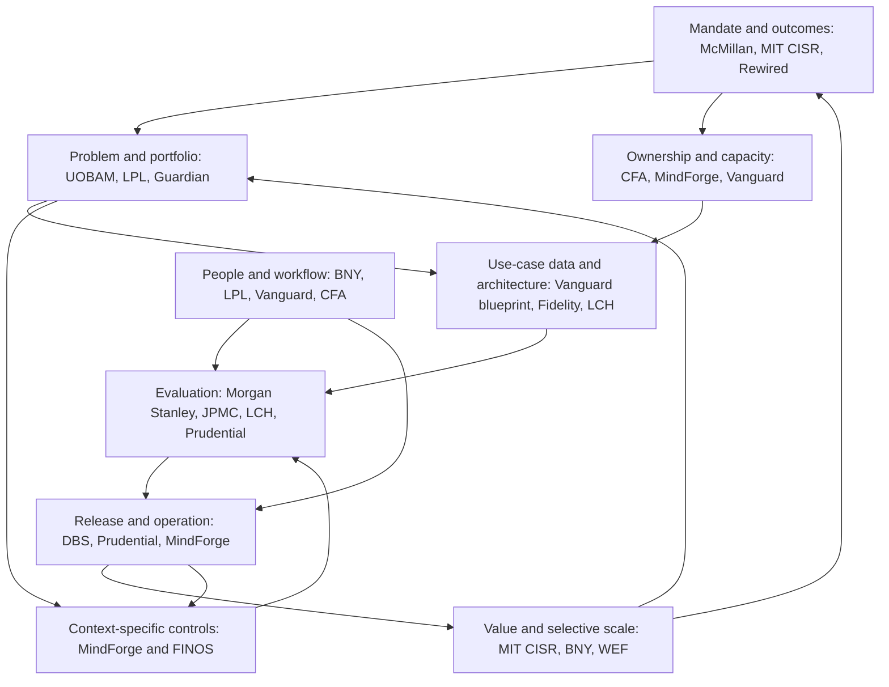

# Appendix B — Evidence map and cross-case pattern matrix

**Working synthesis completed before handbook drafting; review snapshot: 8 November 2026.** Source IDs resolve to exact filenames in Appendix A. Locators below use physical PDF pages or saved-file line numbers. This appendix distinguishes independent organizations from repeated accounts of one initiative.

## B.1 How the collection contributes

| Evidence family | Principal sources | Contribution | Limit on use |
|---|---|---|---|
| Enterprise direction and capability assessment | D19 McMillan; D22 MIT CISR + A02; D21/D32/D33 McKinsey; D35 BCG + A06–A10; D37 WEF | Maturity, business domains, operating-model choices, interdependent capabilities | Practitioner models, surveys and consultancy recommendations have different evidential bases; none supplies a universal maturity certification or return target |
| Delivery inside named organizations | D10 Fidelity; D14 Vanguard + A01; D24/D25 JPMC; D26 LCH + A03; D27 LPL; D34 UOBAM/Man Group | Reuse, data ownership, testing, workflow integration and delivery sequencing | Different technologies and stages; statements by insiders and vendors are attributed, not independently verified |
| Practitioner experience and adoption | D03–D08 Morgan Stanley; D12 BNY; D18 LSEG; D27 LPL; D36 Vanguard | Evaluation setbacks, education, sequencing, trade-offs and implementation friction | Auto-transcripts lack timestamps and may mis-transcribe names/numbers; D06 is market commentary; D09 is an educator discussion, not a firsthand account |
| Governance through the lifecycle | D28–D30 MindForge; FINOS risk/control/use-case files and diagrams; D16 BlackRock | Responsibility, inventories, proportionate review, third parties, controls, monitoring, change and retirement | Guidance and community specifications are not laws or proof that every control has been implemented |
| Regulatory observations and local responses | D01/D13 FINRA; D16 BlackRock; D29 cases; D30 illustrations; D37 DANA account | How legal context affects scope, data, review, release and expansion | Original jurisdictions remain explicit; current applicability and any required approval must be verified locally |
| Opportunity and economic framing | D02 wealth report; D23 asset-management report; D38 product decision framework | Candidate workflows, comparison with simpler methods, fully loaded costs, investment choices | Forecasts and illustrative values are not realized results or recommended targets |

## B.2 Relationship map

The arrows are **handbook synthesis of dependencies**, not a model claimed by any one source. Governance and adoption continue through the whole lifecycle. A shared platform supplies capabilities; it does not replace use-case-specific approval and evaluation.

### B.2.1 What the images add

All standalone images were opened. These observations record their visible contribution rather than treating them as illustrations to ignore. Appendix A identifies every filename and parent, including branding assets.

| Image | Visible labels, relationships and decisions | Interpretation and limit |
|---|---|---|
| A01 Vanguard blueprint | User question → identity/API → backend → model → SQL/data products → result. Metadata/catalogue, semantic layer and ground-truth examples provide context; governance/security and evaluation/observability surround delivery. Data products include ETL and quality/observability. RAG and knowledge graph also appear | Read with D14 lines 91–92 and 288–295: illustrative architecture and future exploration are distinct from established implementation. Adapt ownership, semantic context, access, quality and feedback relationships; do not copy every service box |
| A02 MIT maturity figure | Four columns: Experiment and prepare; Build pilots and capabilities; Develop AI ways of working; Become AI future ready. Activities progress from education/exploration through business cases/pilots, platforms/work change, to innovation/new revenue. Footnotes define Total AI Effectiveness and performance comparisons | Preserves original stage names and measurement. Shows associations and two survey distributions; no conversion into McMillan’s capability levels or causal return promise |
| A03 LCH architecture | User interface → API Gateway → ChatSync function → Q Business → indexed S3/web content; identity authorization uses a separate function and corporate identity. Responses in DynamoDB feed a validator comparing golden answers through a model and returning scores for admin review | Supports separating identity, retrieval, interaction storage and evaluation. D26 explains PoC origins, phased rollout and future integration; the picture alone cannot establish production scale or ROI |
| A04 Schwab slide 13 | “Spotlight on AI,” AI as an accelerant to strategy and a client-focused approach | Corporate strategic positioning, without a measured result or detailed delivery method |
| A05 Schwab slide 14 | Explicit categories include in use today, in development and initial launch 2026. Knowledge/research/service assistance and coding tools appear in the existing/enhancing group; portfolio insights and investor/advisor assistance appear among launch plans | Roadmap status matters. Filename gives slide/deck-date context, but the full parent deck is absent; later completion cannot be inferred |
| A06 BCG exhibit 1 | CIO agenda surrounded by changing customer/business expectations, technology/talent evolution and geopolitical/market/regulatory fragmentation | Source’s proposed integrated agenda; not evidence that an organization has implemented it |
| A07 BCG exhibit 2 | Example AI platform: core models/gateway, developer tools/orchestration, safety controls and registries, MLOps/LLMOps/FM operations, infrastructure/memory | Capability layers and controls inform architecture questions. An example platform is not a mandatory stack or proof of deployment |
| A08 BCG exhibit 3 | Work allocation across rules automation, generative interpretation/creation, agentic multi-step systems and augmented humans handling ambiguity/risk/accountability | Work-design proposal; not a required linear progression toward replacing human decisions |
| A09 BCG exhibit 4 | Work/tasks connect to worker skills and a blended human/agent workforce | Conceptual workforce lens; requires actual task and capacity discovery, not an assumed staffing forecast |
| A10 BCG exhibit 5 | Proposed roles include AI leadership, ethics/compliance, AI/ML governance, LLMOps and prompt engineering; changes are shown across product, IT, sales, operations and central functions | Role/capability prompts. Does not require a separate hire for every title or establish headcount reductions |
| F13/F14 plain RAG; F15/F16 risk-annotated RAG | Preparation: private raw data → filtering → refined source → embedding loader/vector store. Inference: user query → query processing → embedding/model endpoints → answer; tests connect to user-query flow. Annotated version maps risk identifiers to components and boundaries | Same conceptual architecture in alternate representations, not independent cases. Identifies data/processing boundaries and risk location; does not prescribe external model processing |
| F11/F12 agentic skill system | User/IDE interface, agent orchestrator, permissions/approval, persistent state, local shell/project files, local/remote MCP servers, vendor model endpoint and skill/plugin loader/content/code. Diagram explicitly describes full local privileges and no skill sandboxing; prompt and code layers form a dual attack surface | Illustrative threat configuration, not an endorsement. Labels refer to RI-11/31/32 whose risk files are absent in this snapshot; interpret from visible descriptions and available specifications, not invented missing entries |
| F18, F19, F20, F106 and F109 | AI Governance Framework horizontal/icon/stacked logos, AI Readiness FINOS logo and favicon | Branding only; no substantive maturity, architecture or outcome evidence. F109 was converted from ICO to PNG for inspection |

BCG exhibits are paired with D35, `The New Role of the Bank CIO in the AI Era _ BCG.md`; FINOS diagrams are paired with their identically named PlantUML files and risk/control catalogue. The diagram labels were read together with these textual materials. Embedded PDF figure labels were considered where extracted; the review does not claim exhaustive visual rendering of every embedded figure.

## B.3 Case accounting and status

| Organization / initiative | Source family and locator | What the reviewed evidence supports |
|---|---|---|
| Morgan Stanley knowledge assistant, Debrief, broader AI platform | D03 lines 120–270; D04 lines 367–463, 710–789; D05 lines 43–85; D07 lines 360–440; D08 lines 969–1020 | Practitioner-described deployment and evaluation experience. Autonomous agent evaluation remains an open problem in the accounts. NBA adoption discussed in D09/D31 is related, but is not the same application as the GenAI assistant. Multiple accounts remain one organizational case family |
| Fidelity modular services | D10 PDF pp. 1–4, 11–12 | Author-described deployed recommendation, embedding and explainability components; eight deployment recommendations. Library downloads are not enterprise financial value |
| Vanguard Virtual Analyst | D14 lines 55–92, 132–258, 262–295; A01 | Implemented data/semantic/evaluation practices and reported days-to-minutes insight improvement; reuse described. Knowledge graphs and RAG are future exploration in the text despite their appearance in the illustrative blueprint |
| Vanguard technology/skills transformation | D36 lines 118–151, 285–303 | Firsthand hiring, partner capacity and role-based reskilling; reported 10–15% SDLC productivity and 27% coding-time improvement have different denominators. Related organization, separate program |
| JPMC LLM Suite and Coach | D24 PDF pp. 3–5; D25 PDF pp. 6–8, 12–13 | Broad access, pattern-based platform, decentralized domain expertise, piloting and evaluation; Coach launch to 3,000 advisors reported. 50% client-roster growth was an aspiration; agent-builder and some productivity projections were future work |
| Schwab Knowledge Assistant and roadmap | D11 lines 44–79, 109–137; A04/A05 | Knowledge Assistant launch and conditional complex-call time-saving claim; slide 14 explicitly separates in-use, development and initial-launch-2026 items. Parent slide deck absent; later launch completion unverified |
| LCH within LSEG | D26 lines 82–128, 153–246; A03 | PoC selection, enterprise identity, reference-question evaluation and phased rollout described. Broad email/CRM expansion is planned; seconds-to-answer does not establish end-to-end productivity or resolution |
| LPL advisor tools | D27 lines 254–321, 345–374 | Advisor council, vendor governance and existing tools described; workflow integration being redesigned. Anecdotal time savings for externally chosen tools have weaker measurement than internal instrumentation |
| DBS | D15 PDF pp. 2–3; D29 PDF pp. 6–9; D30 PDF p. 113 | Platform, data chapter, repository, CodeBuddy rollout, training, monitoring and change practices. Deployment-time claims differ between accounts; do not combine or extrapolate them |
| Julius Baer | D29 PDF pp. 11–12; D30 PDF p. 78 | On-premises open-weight general chatbot without RAG/fine-tuning; trained rollout; model preapproval plus independent use-case validation; initial regulatory screen. Interaction by most employees is adoption evidence, not verified ROI |
| Prudential PRUShield | D29 PDF pp. 14–19 | Product-document RAG assistant, approximately four months of UAT, phased release, ongoing content maintenance. Reported 41%→99% test pass refers to its evolving, defined test criteria; automated evaluation integration remains future work |
| Unnamed investment firm | D29 PDF pp. 21–23 | Policy-search use case and reviews described; cross-jurisdiction complexity and observability failures reported. Institution and detailed outcomes unavailable |
| Guardian / Italgas | D22 lines 119–170 / 195–253; A02 | Guardian RFP pilot and proposed 2026 scaling; modernized architecture separately described as scaled. Italgas deployed initiatives and commercial outcomes reported in interview-based vignettes; no controlled attribution |
| UOBAM / Man Group | D34 PDF pp. 21–23 / 35–36 | UOBAM lifecycle and portfolio model revised for impractical turnover before production; Man AHL research/technology/data integration. They are separate firms and cases within one report |
| BNY Eliza | D12 PDF pp. 2–4 | Platform plus broad training, community, role-based engagement and builder activity reported; access/training figures do not establish realized financial benefits |
| EBRD LessonsBot / DANA | D37 PDF p. 31 / p. 22 | EBRD phased knowledge-access expansion reported; DANA national-roadmap engagement and estimated benefits reported. WEF compilation, not direct independent evaluation of either result |
| MindForge Compliance Co-Pilot | D17 PDF pp. 34–36; D20 PDF p. 10 | Consortium experimental PoC and SME testing; summary and full report are one initiative. Does not establish production approval or operational effectiveness |

## B.4 Pattern matrix

All proposed handbook uses in the final column are **synthesis**, conditional on local validation.

| Pattern / decision | Independent supporting cases; precise source | Status and reported result | Prerequisite / trade-off / failure mode | Handbook use and local validation |
|---|---|---|---|---|
| 1. Assign an outcome owner before delivery | Vanguard D14 lines 136–155; DBS D29 p. 8; UOBAM D34 pp. 21–22 | Implemented ownership arrangements; no isolated causal estimate | An owner needs capacity and authority; a named sponsor alone is insufficient | Chapters 1/3: validate who controls workflow, budget and acceptance; do not assume a technology reporting line |
| 2. Select problems and domains, then bounded releases | UOBAM D34 p. 21; Guardian D22 lines 119–128; LPL D27 lines 311–321 | Intake and prioritization practices; Guardian RFP is a pilot at source date | A domain may be strategically coherent while the first deliverable stays narrow; risk of fragmented demos or overlarge transformation | Chapters 1/2/10: validate problem magnitude, domain owner, baseline and delivery capacity |
| 3. Combine shared capabilities with domain expertise | Fidelity D10 pp. 11–12; JPMC D25 pp. 6–8, 13; DBS D29 pp. 7–9 | Modular tools and platforms implemented; differing deployment-time reports | Reuse needs compatible interfaces, semantics, permissions and operating ownership; shared faults increase concentration risk | Chapters 3/5/9: determine what genuinely repeats and what remains use-case-specific |
| 4. Make data ownership, semantics and permissions explicit | Vanguard D14 lines 132–198; LSEG D18 pp. 10–13; JPMC D25 pp. 7–8 | Implemented practices and corporate accounts of data preparation | Availability alone is not readiness; broad consolidation can expand access risk | Chapter 5: test intended questions against authorized, current, reconciled data |
| 5. Curate evaluation examples with domain experts | Morgan Stanley D04 lines 385–463; JPMC D25 pp. 12–13; LCH D26 lines 216–246; Prudential D29 pp. 16–17 | Regression suite, SME review and golden answers used; Prudential reports defined-test improvement | Reused development examples can overstate generalization; expert time is a real dependency; numeric results are not comparable across rubrics | Chapter 6: define local rubric, held-out evidence and critical-error rules; sample sizes are contextual |
| 6. Correct retrieval/content, then retest the system | Morgan Stanley D04 lines 409–450; JPMC D25 p. 13; Prudential D29 pp. 18–19 | Search problems, expired documents, incomplete knowledge and recurring maintenance documented | Better model capability cannot establish missing business facts; fixes can regress other cases | Chapters 5–7: classify failures and assign source/prompt/retrieval/model/workflow owners |
| 7. Review in proportion to use and impact | DBS D29 pp. 7–8; Julius Baer D29 pp. 11–12; Prudential D29 pp. 16–18 | Risk tiers, use-case review and recertification implemented | Early information is incomplete; duplicate forums cause delay; model approval does not approve all uses | Chapter 4: preliminary screening then evidence-based residual review; validate local duties and review independence |
| 8. Constrain consequential use and make oversight executable | DBS CodeBuddy D29 p. 8; Prudential D29 pp. 16–17; JPMC D25 p. 13 | User code review, bounded public-product answers, editable meeting records | A disclaimer or a human label alone cannot prove effective review; capacity and authority matter | Chapters 4/6/7: specify exact review action, information, escalation and fallback |
| 9. Use phased exposure with monitoring and a fallback | DBS D29 p. 8; Julius Baer D29 p. 12; Prudential D29 p. 17; LCH D26 lines 124–128 | Controlled cohorts/phased rollouts described | “Pilot” with real users/data can still cause harm; rollout scope must be approved | Chapters 6/7: validate exposure limits, abort triggers, support staffing and tested rollback |
| 10. Preserve source traceability | JPMC D25 p. 13; LCH D26 lines 95–100; Schwab D11 lines 44–63; EBRD D37 p. 31 | Cited-answer interfaces deployed/described | A cited document may be stale or fail to support the answer; users may lack access | Chapters 5/6: test citation correctness, content currency and permission enforcement, separately from answer fluency |
| 11. Build adoption around the actual job | BNY D12 pp. 3–4; Vanguard D36 lines 118–151; LPL D27 lines 254–293 | Role-based learning and integration work; some integration still planned | Generic training and separate tools may add work; learning needs protected time | Chapter 8: validate competence, task completion and changed process, rather than attendance alone |
| 12. Keep skilled business participants in the team | UOBAM D34 pp. 21–23; Vanguard D14 lines 59–79; JPMC D25 pp. 12–13 | Cross-functional interpretation, testing and business-constraint correction | A model can meet a technical score and produce unusable portfolios; domain staff have competing responsibilities | Chapters 3/6: assess actual available people and released capacity, not job-title counts |
| 13. Maintain quality after release | DBS D29 p. 8; Prudential D29 pp. 17–19; UOBAM D34 p. 22 | Monitoring, version-change tests, recertification and retirement/refinement processes | Source changes and evolving use can invalidate an earlier test | Chapters 7/9: set operating thresholds, review dates, incident owners and change triggers |
| 14. Separate broad-access utility from targeted transformation | JPMC D24 p. 4; BNY D12 pp. 2–4; McMillan D19 pp. 5–6 | Broad access exists; precise per-task ROI not always quantified; maturity critique emphasizes realized value | An impossible measurement burden can stall low-stakes exploration; unmeasured strategic spending can conceal failure | Chapters 2/9: bounded enablement budget and telemetry; stronger attributable business cases for major domain investments |
| 15. Compare simpler approaches before adding complexity | Fidelity D10 p. 11; BlackRock D16 p. 9; D38 lines 18–46, 95–100 | Fidelity uses interpretable baseline comparison; BlackRock recommends simpler task models; D38 proposes a decision funnel | Distinguish deployed practice from recommendations. Simplicity can reduce burden but still needs testing | Chapters 2/5: evaluate current workflow, rules/search, conventional ML and GenAI where plausible |
| 16. Keep architecture conditional on controls and capacity | Julius Baer D29 p. 12; Vanguard D14 lines 96–119; LCH D26 lines 90–107 | On-premises open-weight and managed-cloud approaches both used; Julius Baer general chatbot has neither RAG nor tuning | Ownership, permitted data flows, language performance, reliability and support differ | Chapter 5: make an architecture decision record; no universal requirement for cloud, self-hosting, RAG or fine-tuning |
| 17. Expand only after rechecking context | EBRD D37 p. 31; JPMC D25 pp. 6–8; MindForge D30 pp. 63–64, 112–113 | Expansion reported; guidance requires reassessment on material change | Same component can support a new audience or action with different risk; reuse is not inherited approval | Chapters 7/9/10: validate new users, jurisdictions, entitlements, workload and economics |
| 18. Govern agent actions and supply chains explicitly | Morgan Stanley D07 lines 360–440; FINOS F11/F12, F60–F68; D01 p. 28 | Practitioner acknowledges unresolved evaluation; FINOS proposes controls; no universal production-proven design established | Tool privileges, memory, credentials, plugins and compound failure expand scope beyond text QA | Chapters 4–7: choose bounded actions; test end-to-end trajectories, authorization and recovery locally |

## B.5 Differences and unresolved issues that affect the design

1. **Maturity models measure different things.** D19 p. 2 supplies six dimensions with Ad Hoc, Emerging, Managed and Scaled levels. D22/A02 groups firms using Total AI Effectiveness. The handbook uses the first to organize a capability evidence profile and the second to describe organizational transition; it does not convert one score into the other. D22 lines 276–284 and 309 give different interview counts; that discrepancy is retained.
2. **Piloting versus urgency.** D02 p. 23 advocates immediate scaling and says the time for piloting is over. D10 pp. 11–12 recommends starting small; D25 p. 6 documents incremental piloting; D29 pp. 16–17 records lengthy testing. The synthesis is to avoid aimless pilots while requiring proportionate evidence before exposure. None establishes a universal pilot duration.
3. **Centralization versus federation.** D33 pp. 3–6 associates central coordination with early production progress in 16 large institutions, while JPMC D25 p. 13 embeds specialists in domain teams and Italgas D22 lines 210–219 embeds business translators. These approaches can coexist at different decision layers. A reporting-chart choice cannot be inferred from either observation alone.
4. **Measurement intensity differs.** JPMC D24 p. 4 does not precisely quantify hours saved for broad personal productivity, while D19 p. 6 and D38 emphasize baselines and realized value. The handbook distinguishes exploratory enablement from material investment decisions and labels benefits according to evidence quality.
5. **Different outcomes and denominators.** Schwab’s “up to” complex-call savings, Vanguard coding versus SDLC improvement, Prudential test-pass rates, and MIT financial associations cannot be merged into a standard business case. DBS deployment-time figures in D15 versus D29 also have unclear comparability.
6. **Governance source limits.** FINOS contains Approved-Specification and Draft files, missing referenced risk IDs in diagrams, legacy links such as CT-15, and regulation indexes rather than full authoritative legal texts. Draft wealth-management legal classifications and generic statements about public data are unverified. These support questions to investigate, not assertions of legal status.

## B.6 Material gaps and external-research decision

| Question / gap | Decision affected | Why the collection does not settle it | Treatment in this edition |
|---|---|---|---|
| Which current laws, guidance, judicial interpretations and regulator approvals apply to an adopting organization? | Chapters 1/4/7/10 | Organization, locations, customers, activity and release date are unspecified; source indexes and historical accounts are insufficient | Local legal/regulatory worksheet and an explicit unresolved-decision gate. No claim of current-law completeness; generic external research would not settle company applicability |
| What thresholds, test volumes, infrastructure capacity, delivery budget and team size should an organization use? | Chapters 2/3/5/6/9 | Cases differ in task, exposure, maturity and measurement | Version 2.0 adds labeled **starting defaults** (handbook Appendix D.1): test-set sizes derived from the rule of three [E07], Wilson intervals [E08], canary principles [E12], and explicitly judgment-based timeboxes and cadences. None is presented as an industry benchmark; organizations replace them with local evidence |
| What is a universally reliable agent-evaluation method? | Chapters 6/7 | Practitioners explicitly report unresolved questions; catalogue controls are recommendations | Require bounded action scope, task/trajectory tests, independent challenge and operational containment; retain residual uncertainty. Do not promise a proven universal agent method |
| Do reported gains persist or causally follow from AI? | Chapters 1/9 | Most cases are self-reports, observational surveys or modelled potential | Use as case evidence; require local comparison and sustained measurement before benefit claims |

**Research decision, updated in version 2.0.** Version 1.0 used no external research. Version 2.0 added twelve targeted external sources (E01–E12, registered in handbook Appendix D.2) for gaps the collection could not fill: control catalogues, management-system standards, shadow-AI prevalence, statistical sample sizing, token and pricing mechanics, staged rollout and AI-literacy law. Questions of local legal applicability and causal benefit remain for the adopting organization; general citations cannot settle them.
