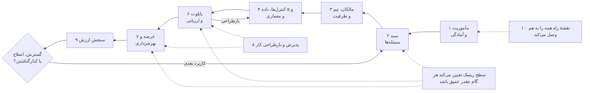
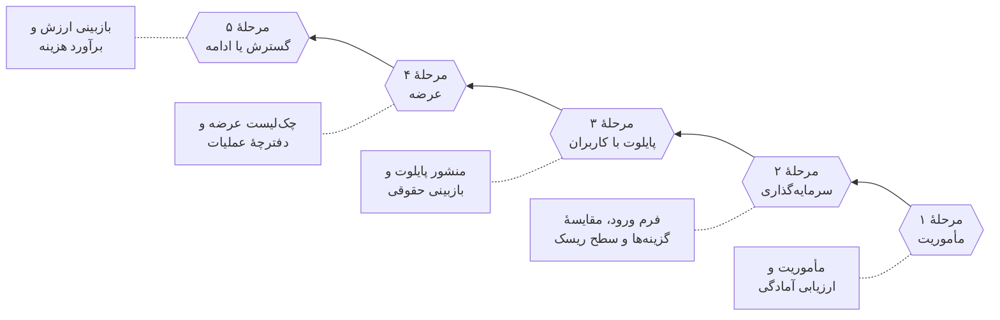
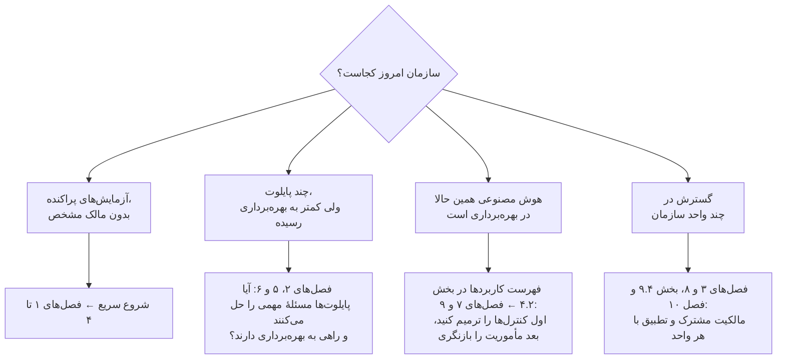
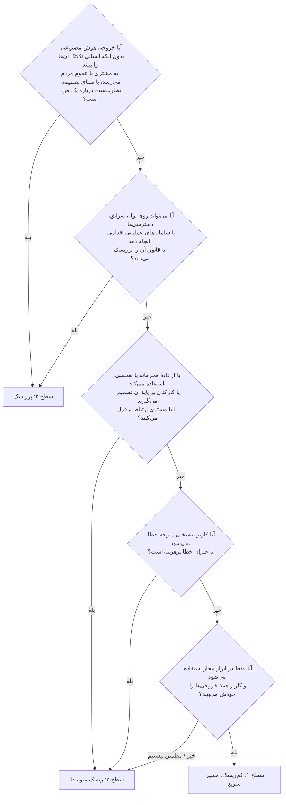
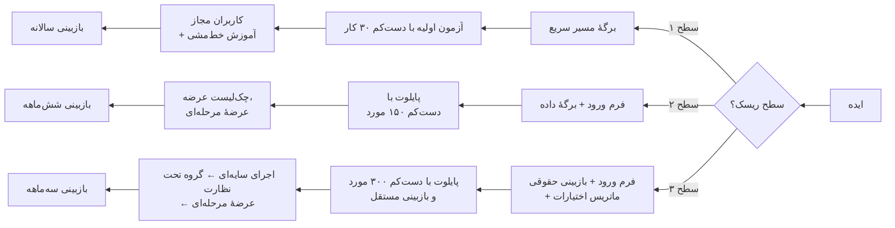
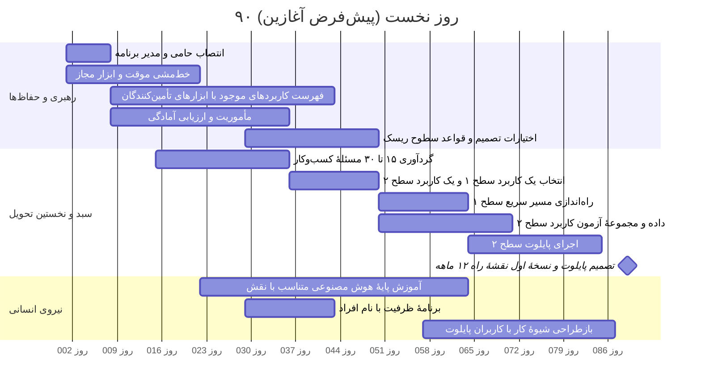

# راهنمای راهبرد و پیاده‌سازی هوش مصنوعی در سازمان

## از هدف کسب‌وکار تا بهره‌برداری پایدار

**این راهنما برای چه کسانی است؟** هیئت‌مدیره و نهادهای راهبری، حامیان اجرایی، مدیران کسب‌وکار، تیم‌های محصول و تحویل، تیم‌های داده و فناوری، منابع انسانی، واحدهای حقوقی و انطباق، متخصصان ریسک و امنیت اطلاعات و مالکان عملیات. برای هر نقش، در بخش [شیوهٔ استفاده از این راهنما](#how-to-use) مسیر مطالعهٔ جداگانه‌ای پیشنهاد شده است.

این راهنما روشی عملی است تا سازمان بتواند قابلیت‌های هوش مصنوعی را انتخاب کند، بسازد، به کار بگیرد و به‌مرور بهتر کند. هدف این است که یک مسئلهٔ واقعی کسب‌وکار به تغییری مشخص در شیوهٔ کار تبدیل شود؛ تغییری که مالک دارد و نتیجه‌اش را می‌توان سنجید. دامنهٔ راهنما هم یادگیری ماشین متعارف را در بر می‌گیرد، هم هوش مصنوعی مولد و هم سامانه‌هایی که خودشان اقدامی را انتخاب و اجرا می‌کنند (موسوم به «عامل‌ها»). بیشتر مثال‌ها از صنعت کارگزاری آمده‌اند، اما فقط برای روشن‌شدن روش‌اند و دامنهٔ کاربرد آن را محدود نمی‌کنند.

پیام اصلی راهنما ساده است: راهبرد هوش مصنوعی وقتی به کار می‌آید که سه چیز را به هم وصل کند: یک چالش مهم کسب‌وکار، رویکردی که با توان و محدودیت‌های واقعی سازمان جور باشد، و مجموعه‌ای منسجم از اقدام‌ها که بودجه و مالک پاسخ‌گو دارند. خرید ابزار، ساختن نمونه‌های نمایشی و انتشار بیانیهٔ اصول ممکن است کمک کند، اما هیچ‌کدام به‌تنهایی نشان نمی‌دهد که سازمان واقعاً توان اجرای کار را به دست آورده است. مک‌میلان صریحاً بر همین تفاوت تأکید می‌کند، و تجربهٔ فیدلیتی، ونگارد و نمونه‌های اجرایی MindForge نشان می‌دهد که هر سازمان این توانمندی‌های پایه را به روش خودش ساخته است. [D19 pp. 2–6; D10 pp. 11–12; D14 ll. 55–82; D29 pp. 6–19.]

### فهرست مطالب

- [خلاصهٔ مدیریتی](#exec-summary)
- [شیوهٔ استفاده از این راهنما](#how-to-use)
- [فرایند را متناسب با ریسک تنظیم کنید: سطوح ریسک و مسیر سریع](#tiers)
- [شروع سریع: ۹۰ روز نخست](#quick-start)
- [۱. تعیین مأموریت و سنجش آمادگی](#ch1)
- [۲. ساختن و اولویت‌بندی سبد کاربردها](#ch2)
- [۳. طراحی مدل عملیاتی و برنامهٔ نیروی انسانی](#ch3)
- [۴. گنجاندن حاکمیت در فرایند تحویل](#ch4)
- [۵. آماده‌سازی داده و فناوری](#ch5)
- [۶. طراحی و ارزیابی پایلوت](#ch6)
- [۷. از پایلوت تا بهره‌برداری](#ch7)
- [۸. پشتیبانی از پذیرش و تغییر شیوهٔ کار](#ch8)
- [۹. سنجش نتایج و گسترش سنجیده](#ch9)
- [۱۰. تبدیل چارچوب به نقشهٔ راه سازمان](#ch10)
- [پیوست الف — کلید منابع](#appendix-a)
- [پیوست ب — یک مثال کامل: از ایده تا تصمیم گسترش](#appendix-b)
- [پیوست ج — ابزارهای آمادهٔ تکمیل](#appendix-c)
- [پیوست د — پیش‌فرض‌ها، منابع بیرونی و محدودیت‌ها](#appendix-d)

فهرست کامل ۱۹۷ پروندهٔ منبع، نقشهٔ شواهد و سوابق راستی‌آزمایی در فایل همراه انگلیسی، [handbook-evidence-companion.md](../handbook-evidence-companion.md)، آمده است. ارجاع‌های داخل متن به همان شکل لاتینِ نسخهٔ اصلی نوشته شده‌اند، مثلاً `[D14 ll. 132–198]` یا `[FINOS mi-16]`، تا بتوان آن‌ها را مستقیماً با فهرست منابع تطبیق داد. معنای هر شناسه در [پیوست الف](#appendix-a) آمده است.

## خلاصهٔ مدیریتی

**این راهنما چه کاری می‌کند؟** کمک می‌کند سازمان از آزمایش‌های پراکنده با هوش مصنوعی به مجموعه‌ای از فرایندهای کاری برسد که مالک دارند، نتیجه‌شان سنجیده می‌شود و می‌توان به آن‌ها اتکا کرد. برای مدیران ارشد پنج تصمیم کلیدی را روشن می‌کند، به تیم‌ها روشی گام‌به‌گام می‌دهد و برای همه ابزارهای آمادهٔ تکمیل فراهم می‌کند. معیار آن شواهد است، نه هیجان بازار: هر سرمایه‌گذاری، پایلوت و عرضه باید به یک نتیجهٔ کسب‌وکاری، یک مالک مشخص و آزمونی وصل باشد که بتواند جواب «نه» بدهد.

**تصویر کلی.**

**ده قاعده‌ای که بیشترین اثر را دارند.**

۱. از یک نتیجهٔ کسب‌وکاری شروع کنید که مالک مشخص دارد، نه از ابزار. این امکان را هم باز بگذارید که بهترین راه‌حل اصلاً هوش مصنوعی نباشد. [D10 p. 11; D16 p. 9]  
۲. سخت‌گیری فرایند را با ریسک تنظیم کنید. دستیاری که فقط متن پیش‌نویس می‌کند نباید از همان مراحلی بگذرد که عاملی که پول جابه‌جا می‌کند. سه سطح ریسک این راهنما برای همین است. [D29 p. 14; D30 pp. 53–55]  
۳. پیش از آنکه ابزارها را ممنوع کنید یا نادیده بگیرید، حفاظ‌های اولیه را برقرار کنید: یک ابزار مجاز، یک خط‌مشی کوتاه برای استفاده و راهی برای ثبت استفاده‌هایی که همین حالا وجود دارد. [D30 p. 30; D08 ll. 519–530; E06]  
۴. برای گام‌های کوچک و مشخص در یک حوزهٔ کسب‌وکار بودجه بدهید و تعداد کارهای هم‌زمان را با تعداد متخصصانی که واقعاً دارید متناسب نگه دارید. [D21 pp. 3–4; D10 pp. 11–12]  
۵. معیار قبولی و ردّ را پیش از دیدن نتایج بنویسید و تعداد نمونه‌های آزمون را از نرخ خطایی که می‌خواهید کنار بگذارید محاسبه کنید. مثلاً برای اینکه بتوان گفت نرخ خطای جدی حداکثر ۱٪ است، حدود ۳۰۰ مورد بدون خطا لازم است. [D04 ll. 367–463; E07]  
۶. مجوزها و کارهایی را که سامانه اجازه دارد انجام دهد در خود نرم‌افزار و بیرون از مدل اعمال کنید. دستوری که در متن به مدل داده می‌شود، جای کنترل دسترسی را نمی‌گیرد. [FINOS mi-16; FINOS mi-18]  
۷. مرحله‌به‌مرحله عرضه کنید؛ کلید توقفی داشته باشید که آزموده شده و راهی برای انجام دستی کار در صورت نیاز. [D29 p. 8; D30 pp. 99–103; E12]  
۸. خودِ شیوهٔ کار را از نو طراحی کنید، نه فقط صفحهٔ نرم‌افزار را؛ و زمانی را که صرف بررسی و اصلاح خروجی می‌شود هم حساب کنید. [D12 pp. 2–4; D27 ll. 254–293]  
۹. هزینه را «به ازای هر نتیجهٔ موفق» بسنجید. زمانی که آزاد می‌شود فقط «ظرفیت» است، تا وقتی که مدیریت آن را به سود واقعی تبدیل کند. [D38 ll. 381–429]  
۱۰. دربارهٔ گسترش، اصلاح یا کنارگذاشتن، بر پایهٔ شواهدی تصمیم بگیرید که در طول زمان پایدار مانده‌اند، و پیش از هر گسترش شرایط تازه را دوباره بسنجید. [D30 pp. 63–64, 112–113]

**پنج تصمیمی که با مدیران ارشد است.** برای هر تصمیم، یک تصمیم‌گیرندهٔ پاسخ‌گو، حداقلی از شواهد و یک نتیجهٔ ثبت‌شده لازم است.

| مرحلهٔ تصمیم | تصمیم‌گیرندهٔ پاسخ‌گو (سازمان تعیین می‌کند) | حداقل شواهد | تصمیم‌های ممکن |
|---|---|---|---|
| مأموریت | حامی اجرایی / نهاد راهبری | نتایج کسب‌وکاری مورد انتظار، مرزها، ظرفیت و برآورد اولیهٔ آمادگی | اجازهٔ بررسی؛ بازنگری دامنه؛ تعویق |
| سرمایه‌گذاری در یک کاربرد | مرجع تصمیم‌گیری سبد، همراه با مالک کسب‌وکار | شواهد وجود مسئله، راه‌حل‌های جایگزین، سطح ریسک اولیه، امکان‌پذیری از نظر داده و هزینه | بودجه برای یک گام محدود؛ ابتدا فراهم‌کردن پیش‌نیازها؛ انتخاب راه ساده‌تر؛ توقف |
| آزمایش پایلوت با کاربران واقعی | مالک کسب‌وکار، با تأیید فنی و کنترلی لازم | منشور پایلوت، دادهٔ مجاز، محدودیت‌هایی که آزموده شده‌اند، برنامهٔ ارزیابی | اجرا در محدودهٔ تعیین‌شده؛ بازطراحی؛ رد |
| عرضه در محیط عملیاتی | مرجع مشخص تأیید عرضه | کیفیتی که پذیرفته شده، شواهد کنترل‌ها، آمادگی پشتیبانی و تصمیم دربارهٔ ریسکی که باقی می‌ماند | عرضه در دامنهٔ تعیین‌شده؛ عرضهٔ محدودتر؛ بازطراحی؛ توقف |
| گسترش یا ادامه | مالک کسب‌وکار و مرجع تصمیم‌گیری سبد | نتایج پایدار، هزینهٔ کامل، ریسک، ظرفیت و بررسی شرایط تازه | گسترش؛ ادامه؛ اصلاح؛ تعلیق؛ کنارگذاشتن |

این پنج مرحله به پنج کمیتهٔ تازه نیاز ندارد. همان مراجعی که امروز در سازمان تصمیم می‌گیرند می‌توانند این تصمیم‌ها را هم بگیرند، به شرط آنکه حدود اختیارشان، شواهدی که دیده‌اند و تصمیمی که گرفته‌اند ثبت شود. هر تأیید حقوقی یا نظارتی که لازم باشد، موضوعی جداگانه است و باید با قوانین محل فعالیت سازمان سنجیده شود.

همهٔ این ابزارها در پیوست ج آمده‌اند.

**آنچه مدیران باید در همین سه‌ماهه تصمیم بگیرند.**

- حامی اجرایی کیست و چه کسی مدیر برنامهٔ هوش مصنوعی است، با اختیاراتی که مکتوب شده باشد؟ (بخش ۳.۲)
- کدام دو یا سه نتیجهٔ کسب‌وکاری ارزش سرمایه‌گذاری دارد و مالک هر کدام کیست؟ (بخش ۱.۲)
- کارکنان همین حالا از کدام ابزار هوش مصنوعی و با چه قواعدی می‌توانند استفاده کنند؟ (بخش ۴.۲؛ نمونهٔ خط‌مشی در پیوست ج)
- کدام کاربردهای فعلی هوش مصنوعی، از جمله قابلیت‌هایی که در نرم‌افزار تأمین‌کنندگان گنجانده شده، باید تا چه تاریخی ثبت و سطح‌بندی شوند؟ (بخش ۴.۲)
- چه ظرفیتی، یعنی چه افرادی و چه بودجه‌ای، برای ۹۰ روز نخست کنار گذاشته می‌شود؟ (بخش شروع سریع)

## شیوهٔ استفاده از این راهنما

### مسیر مطالعه برای هر نقش

| نقش | ابتدا بخوانید | سپس از این ابزارها (پیوست ج) استفاده کنید | زمان لازم |
|---|---|---|---|
| هیئت‌مدیره / نهاد راهبری | خلاصهٔ مدیریتی؛ سطوح ریسک؛ بخش‌های ۴.۱ و ۴.۲؛ بخش ۹.۳ | ماتریس اختیارات تصمیم؛ بازبینی ارزش | ۳۰ دقیقه |
| حامی اجرایی | خلاصهٔ مدیریتی؛ شروع سریع؛ فصل ۱؛ بخش‌های ۲.۴ و ۳.۲؛ فصل ۱۰ | ارزیابی آمادگی؛ خلاصهٔ فرم ورود؛ قالب نقشهٔ راه | ۱ تا ۲ ساعت |
| مدیر برنامهٔ هوش مصنوعی | کل راهنما، با شروع از مثال پیوست ب | همهٔ ابزارها، به‌ویژه جدول ردیابی | ۱ روز |
| مالک کسب‌وکار / مالک کاربرد | سطوح ریسک؛ فصل ۲؛ بخش ۶.۲؛ فصل‌های ۸ و ۹ | برگهٔ مسیر سریع یا فرم ورود؛ منشور پایلوت؛ بازبینی ارزش؛ برنامهٔ نیروی انسانی | ۲ تا ۳ ساعت |
| محصول، داده و مهندسی | فصل‌های ۵، ۶ و ۷؛ کنترل‌های بخش ۴.۴ | منشور پایلوت؛ چک‌لیست عرضه؛ برگهٔ داده و معماری؛ دفترچهٔ عملیات؛ برآوردگر هزینه | نیم روز |
| حقوقی، انطباق و ریسک | سطوح ریسک؛ فصل ۴؛ بخش‌های ۶.۴ و ۷.۲ | نسخهٔ کنترلی ماتریس اختیارات؛ کاربرگ بازبینی حقوقی؛ چک‌لیست عرضه | ۲ تا ۳ ساعت |
| امنیت اطلاعات | بخش‌های ۴.۲، ۴.۴، ۵.۳ تا ۵.۵، ۷.۵ و ۷.۶ | چک‌لیست عرضه؛ برگهٔ داده و معماری؛ دفترچهٔ عملیات؛ خط‌مشی استفادهٔ مجاز | ۲ ساعت |
| منابع انسانی و مدیران مستقیم | بخش ۳.۵؛ فصل ۸ | برنامهٔ نیروی انسانی؛ خط‌مشی استفادهٔ مجاز | ۱ ساعت |
| مالی / تدارکات | بخش‌های ۲.۴، ۵.۵ و ۵.۶؛ فصل ۹ | بخش اقتصادی فرم ورود؛ بازبینی ارزش؛ برآوردگر هزینه | ۱ ساعت |

### از کجا شروع کنید؟

این نقطه‌های شروع فقط مسیر مطالعه را تعیین می‌کنند و شما را از شواهدی که مراحل قبلی لازم دارند معاف نمی‌کنند. اگر برای سامانه‌ای که همین حالا کار می‌کند مالک، حق استفاده از داده یا حفاظ‌های عملیاتی روشن نیست، ممکن است لازم شود آن سامانه پس از استقرار ارزیابی، محدود یا حتی متوقف شود. اینکه این ترمیم چقدر عمیق باشد و از کجا شروع شود، به سطح ریسک بستگی دارد. [جمع‌بندی راهنما بر پایهٔ D19 pp. 2–6; D30 pp. 63–64, 67–74, 112–113.]

### برچسب‌ها و شواهد را چطور بخوانید

در سراسر راهنما از شش برچسب استفاده شده است که هر کدام معنای متفاوتی دارد:

| برچسب | یعنی | با آن چه کنید |
|---|---|---|
| **رویهٔ مستند** | منبعی شرح داده که سازمانی کاری را انجام داده است | پیش از الگوبرداری، شرایط آن سازمان را با شرایط خودتان مقایسه کنید؛ مستند بودن یعنی گزارش شده، نه اینکه به‌طور مستقل تأیید شده باشد |
| **نتیجهٔ گزارش‌شده** | منبعی نتیجه‌ای را گزارش کرده است | معیار، مبنای محاسبه، دوره و میزان عدم‌قطعیت را همراه عدد نگه دارید؛ از آن رابطهٔ علت و معلولی نتیجه نگیرید و آن را هدفی تضمین‌شده ندانید |
| **توصیهٔ منبع** | نویسنده‌ای رویکردی را پیشنهاد کرده است | استدلال، دامنه و انگیزهٔ نویسنده را بسنجید و آن را با کاری که واقعاً اجرا شده یکی ندانید |
| **جمع‌بندی راهنما** | توصیه، ابزار یا ترتیبی که از مقایسهٔ منابع به دست آمده است | با احتیاط به کار ببرید، دلیل انتخابتان را ثبت کنید و اگر شواهد تغییر کرد، آن را هم تغییر دهید |
| **پیش‌فرض آغازین** | عدد، مدت یا تواتری مشخص که راهنما پیشنهاد می‌کند تا تیم‌ها بدون بحث طولانی شروع کنند | تا وقتی شواهد خودتان عدد دیگری را توجیه نکرده، همین را به کار ببرید؛ مبنای هر پیش‌فرض (آمار، استاندارد، نمونه‌ای از منابع یا داوری ویراستار) در [پیوست د](#appendix-d) آمده است |
| **پرسش باز** | شواهد موجود پاسخ روشنی نمی‌دهد | مشخص کنید چه کسی آن را بررسی می‌کند، چه شواهدی لازم است و تا چه تاریخی باید تصمیم گرفت؛ آن را بی‌سروصدا به یک فرض تبدیل نکنید |

دستورالعمل‌ها و ابزارها، اگر خلاف آن گفته نشده باشد، از نوع **جمع‌بندی راهنما** هستند. میزان الزام هر رویه در کارت هر فصل و در جدول سطوح ریسک مشخص شده است:

- **الزامی**: بدون آن، روش در آن سطح ریسک دیگر پاسخ‌گو و آزمون‌پذیر نیست.
- **مشروط**: فقط وقتی لازم است که شرط گفته‌شده برقرار باشد (مثلاً استفاده از دادهٔ شخصی، ارتباط مستقیم با مشتری یا اقدام‌هایی که عامل انجام می‌دهد).
- **اختیاری**: مفید است، اما پیش‌نیاز نیست.

**ارجاع‌ها.** `[D14 ll. 132–198]` یعنی سطرهای ۱۳۲ تا ۱۹۸ از منبع D14؛ `[D30 pp. 99–103]` یعنی صفحه‌های ۹۹ تا ۱۰۳ فایل PDF، با احتساب جلد؛ `[FINOS mi-16]` به یکی از پرونده‌های «کاهش ریسک» در چارچوب حاکمیت هوش مصنوعی FINOS اشاره دارد؛ و `[E07]` منبعی بیرونی است که در پیوست د معرفی شده است. هر فصل با یک **کارت فصل** شروع می‌شود که در یک نگاه نشان می‌دهد مالک کار کیست، چه زمانی شروع می‌شود، معمولاً چقدر طول می‌کشد، چه خروجی‌هایی دارد، از کدام ابزارها استفاده می‌کند و در هر سطح ریسک حداقل چه کارهایی لازم است.

## فرایند را متناسب با ریسک تنظیم کنید: سطوح ریسک و مسیر سریع

تناسب با ریسک، فرق روشی است که کار را پیش می‌برد با روشی که آن را زمین‌گیر می‌کند. پرودنشال برای سامانه‌های کم‌ریسک حاکمیتی سبک و برای سامانه‌های پرریسک‌تر الزامات کامل اعمال می‌کند. MindForge هم توصیه می‌کند که عمق بازبینی، اطلاعاتی که از تأمین‌کنندگان خواسته می‌شود و تواتر بازبینی پس از استقرار، همه به اهمیت ریسک بستگی داشته باشد. [D29 p. 14; D30 pp. 43, 53–55, 108.] این راهنما همین اصل را به سه سطح ریسک تبدیل کرده که برای هر کدام حداقل الزامات مشخصی تعریف شده است. این سطح‌بندی **جمع‌بندی راهنما** است: معیارها را با طبقه‌بندی ریسک سازمان خودتان و قوانین محلی تطبیق دهید، اما این قاعده را نگه دارید که هر جا پاسخی نامعلوم است، کاربرد یک سطح بالاتر قرار می‌گیرد تا وقتی که پاسخ روشن شود.

### تعیین سطح ریسک با پنج پرسش

| سطح | نمونه‌های رایج | ویژگی‌های تعیین‌کننده |
|---|---|---|
| **سطح ۱: کم‌ریسک** | نوشتن و خلاصه‌کردن متن‌های داخلی یا عمومی با دستیار مجاز؛ دستیار برنامه‌نویسی، با همان بازبینی معمول کد؛ یادداشت جلسه که خود شرکت‌کننده ویرایش می‌کند | فقط کاربران داخلی؛ کاربر همهٔ خروجی‌ها را پیش از استفاده می‌بیند؛ فقط انواع داده‌ای که برای ابزار مجاز تعریف شده؛ هیچ اقدام خودکاری جز پیش‌نویس برای خود کاربر؛ خطاها به‌آسانی دیده و جبران می‌شوند |
| **سطح ۲: ریسک متوسط** | دستیار دانشی کارکنان روی اسناد خط‌مشی و محصول؛ آماده‌سازی پژوهش برای تحلیل‌گران؛ استخراج اطلاعات از اسناد با یک مرحلهٔ کنترل انسانی | از دادهٔ محرمانه یا شخصی استفاده می‌کند، یا کارکنان بر پایهٔ آن تصمیم می‌گیرند یا با مشتری ارتباط برقرار می‌کنند؛ تصمیم نهایی با انسان است؛ آسیب قابل تشخیص است اما جبرانش پرهزینه است |
| **سطح ۳: پرریسک** | پاسخ‌هایی که مستقیم به مشتری داده می‌شود؛ توصیه‌های شخصی‌سازی‌شده؛ پشتیبانی از تصمیم‌های مربوط به تناسب محصول، اعتبار یا صلاحیت افراد؛ عامل‌هایی که سفارش ثبت می‌کنند، پول جابه‌جا می‌کنند یا سوابق را تغییر می‌دهند | خروجی بدون بازبینی موردی به مشتری می‌رسد یا دربارهٔ افراد تصمیم می‌گیرد؛ اقدام‌هایی که پیامد واقعی دارند؛ قانون آن را پرریسک می‌داند یا تأیید نهاد ناظر لازم است؛ خطاهایی که به‌سختی دیده می‌شوند |

هر کاربرد در **بالاترین** سطحی قرار می‌گیرد که یکی از این ویژگی‌ها ایجاب کند. هر بار که چیز مهمی تغییر می‌کند، مثلاً مخاطب، نوع داده، اقدام‌های سامانه، حوزهٔ قضایی یا تأمین‌کننده، سطح ریسک را دوباره تعیین کنید.

### هر سطح چه الزاماتی دارد

| رویه | سطح ۱: مسیر سریع | سطح ۲ | سطح ۳ |
|---|---|---|---|
| ورود و ثبت | **الزامی:** برگهٔ یک‌صفحه‌ای مسیر سریع و ثبت در فهرست کاربردها | **الزامی:** فرم کامل ورود؛ ثبت در فهرست کاربردها | **الزامی:** فرم کامل ورود؛ ثبت در فهرست کاربردها؛ مقایسهٔ گزینه‌ها |
| اجازهٔ شروع | **الزامی:** مالک کسب‌وکار و مدیر مستقیم؛ امنیت اطلاعات تأیید می‌کند که ابزار مجاز است | **الزامی:** مرجع تصمیم‌گیری سبد؛ بازبینی امنیت و حریم خصوصی | **الزامی:** مرجع تصمیم‌گیری سبد؛ پذیرش ریسک در سطح مدیریت ارشد؛ روشن‌شدن وضعیت حقوقی و نظارتی (کاربرگ بازبینی حقوقی) |
| اختیارات تصمیم | **اختیاری:** ماتریس اختیارات تصمیم | **الزامی:** نسخهٔ کنترلی ماتریس اختیارات | **الزامی:** ماتریس کامل اختیارات و بازبینی مستقل |
| توافق‌نامهٔ داده | **مشروط:** فقط اگر دادهٔ تازه‌ای وصل شود | **الزامی:** برگهٔ داده و معماری برای هر منبع حیاتی | **الزامی:** برگهٔ داده و معماری، به‌علاوهٔ آزمودن حذف داده و تغییر مجوزها |
| ارزیابی (پیش‌فرض آغازین) | **الزامی:** دست‌کم ۳۰ کار نمونه از کار واقعی، بدون هیچ خطای جدی (با اطمینان ۹۵٪ یعنی نرخ خطای جدی حداکثر ۱۰٪) | **الزامی:** دست‌کم ۱۵۰ مورد که می‌تواند به خطای جدی منجر شود، بدون هیچ خطای جدی (حداکثر ۲٪)، به‌علاوهٔ یک مجموعهٔ آزمون کنارگذاشته و بررسی جداگانهٔ زیرگروه‌ها | **الزامی:** دست‌کم ۳۰۰ مورد بدون خطای جدی (حداکثر ۱٪)، یا بیشتر اگر پیامدها ایجاب کند؛ ارزیابی مستقل؛ برای عامل‌ها، آزمودن مسیر اقدام |
| شیوهٔ عرضه | **الزامی:** عرضهٔ مستقیم به کاربران مجاز، پس از آموزش خط‌مشی استفاده | **الزامی:** عرضه به گروه‌ها در چند مرحله؛ کلید توقفی که آزموده شده | **الزامی:** اجرای سایه‌ای یا موازی، سپس یک گروه تحت نظارت با معیارهای مشخص برای توقف |
| پایش | **الزامی:** راهی برای بازخورد؛ آمار استفاده | **الزامی:** نمونه‌گیری ماهانه از کیفیت؛ هشدار برای دسترسی‌ها و هزینه | **الزامی:** بازبینی هفتگی کیفیت در نخستین دورهٔ کاری؛ هشدار فوری برای کنترل‌های حیاتی |
| بازبینی دوره‌ای | **الزامی:** سالانه یا هر بار که چیزی تغییر کند | **الزامی:** هر ۶ ماه یا هر بار که چیزی تغییر کند | **الزامی:** هر سه ماه یا هر بار که چیزی تغییر کند |
| ابزارها (پیوست ج) | برگهٔ مسیر سریع؛ خط‌مشی استفادهٔ مجاز | فرم ورود؛ نسخهٔ کنترلی ماتریس اختیارات؛ منشور پایلوت؛ چک‌لیست عرضه؛ برگهٔ داده و معماری؛ دفترچهٔ عملیات؛ برآوردگر هزینه | همهٔ ابزارها |
| زمان تا نخستین تصمیم | ۲ تا ۴ هفته | ۸ تا ۱۲ هفته | ۳ تا ۶ ماه یا بیشتر |

اعداد ارزیابی از «قاعدهٔ سه» در آمار آمده‌اند: اگر در *n* مورد مستقل و نمونه‌نما هیچ خطایی دیده نشود، با اطمینان ۹۵٪ می‌توان گفت نرخ خطا حداکثر حدود ۳ تقسیم بر *n* است. [E07] بازه‌های زمانی و تواتر بازبینی‌ها **پیش‌فرض آغازین** هستند و بر داوری ویراستار و نمونه‌هایی از منابع تکیه دارند؛ مثلاً آزمون پذیرش کاربر در پرودنشال حدود چهار ماه طول کشید و پایلوت اولیهٔ مورگان استنلی، برای دستیاری که تقریباً در سطح ۳ قرار می‌گیرد، نُه ماه. [D29 pp. 16–19; D04 ll. 367–463; D30 p. 108.] مبنای هر پیش‌فرض در پیوست د آمده است.

## شروع سریع: ۹۰ روز نخست

این برنامه یک **پیش‌فرض آغازین** است برای سازمانی که هنوز در مرحلهٔ «آزمایش‌های پراکنده» یا «چند پایلوت» است. سه رشته کار هم‌زمان پیش می‌رود: رهبری و حفاظ‌ها؛ سبد کاربردها و نخستین تحویل؛ و نیروی انسانی. بسته به ظرفیت سازمان می‌توانید آن را فشرده‌تر یا طولانی‌تر کنید. تاریخ‌های واقعی را با برآوردهایی تنظیم کنید که خود مالکان کارها پذیرفته‌اند (از قالب نقشهٔ راه در پیوست ج و توضیح فصل ۱۰ کمک بگیرید). این ترتیب، **جمع‌بندی راهنما** و خلاصهٔ اجرایی فصل‌های ۱ تا ۶ است. [D19 pp. 2–6; D30 pp. 30, 67–74; D24 p. 4; D12 pp. 2–4.]

| بازهٔ زمانی | اقدام | مسئول | نشانهٔ انجام کار |
|---|---|---|---|
| روزهای ۱ تا ۷ | انتصاب حامی اجرایی و مدیر برنامهٔ هوش مصنوعی، با اختیارات، بودجه و مسیر ارجاع مکتوب | حامی اجرایی | شرح وظایف امضاشده (بخش ۳.۲) |
| روزهای ۱ تا ۲۱ | ابلاغ یک خط‌مشی موقت برای استفاده از هوش مصنوعی؛ تأیید یک ابزار عمومی و انواع داده‌ای که در آن مجاز است | مدیر برنامه، امنیت اطلاعات، واحد حقوقی | خط‌مشی ابلاغ‌شده (نمونه در پیوست ج)؛ اطلاعیهٔ ابزار مجاز |
| روزهای ۷ تا ۴۲ | تهیهٔ فهرست همهٔ کاربردهای فعلی هوش مصنوعی، از جمله ابزارهایی که خود کارکنان ساخته‌اند و قابلیت‌هایی که در نرم‌افزار تأمین‌کنندگان گنجانده شده؛ تعیین سطح ریسک هر کدام | مدیر برنامه، همراه با مالکان سامانه‌ها و واحد تدارکات | فهرستی که برای هر مورد مالک و سطح ریسک دارد (بخش ۴.۲) |
| روزهای ۷ تا ۳۵ | پیش‌نویس مأموریت؛ ارزیابی آمادگی بر پایهٔ شواهد | حامی، مدیران کسب‌وکار، مدیر برنامه | مأموریت و ارزیابی آمادگی، همراه با کمبودهایی که مانع کارند (فصل ۱) |
| روزهای ۱۴ تا ۳۵ | گردآوری ۱۵ تا ۳۰ مسئله از واحدهای کسب‌وکار؛ مشاهدهٔ کار واقعی در محل | مالکان کسب‌وکار، مدیر محصول | فهرست مسئله‌ها همراه با شواهد وضع موجود |
| روزهای ۲۸ تا ۴۹ | توافق بر اختیارات تصمیم و قواعد سطوح ریسک | حامی، ریسک، حقوقی، امنیت | ماتریس اختیارات تصمیم، تصویب‌شده |
| روزهای ۳۵ تا ۴۹ | انتخاب یک کاربرد سطح ۱ که سریع نتیجه بدهد و یک کاربرد سطح ۲ که ارزش واقعی کسب‌وکاری دارد | مرجع تصمیم‌گیری سبد | سوابق تصمیم در فرم ورود (فصل ۲) |
| روزهای ۴۹ تا ۶۳ | راه‌اندازی مسیر سریع برای کاربرد سطح ۱ | مالک کسب‌وکار | برگهٔ مسیر سریع؛ آزمون اولیه؛ آموزش کاربران |
| روزهای ۴۹ تا ۸۴ | آماده‌کردن داده و مجموعهٔ آزمون کاربرد سطح ۲؛ اجرای پایلوت | مالک کسب‌وکار، مسئول ارزیابی، مالک داده | برگهٔ داده و منشور پایلوت، همراه با نتایج (فصل‌های ۵ و ۶) |
| روزهای ۲۱ تا ۶۳ | آموزش پایهٔ هوش مصنوعی متناسب با نقش برای همهٔ کارکنان؛ آموزش عمیق‌تر برای کاربران پایلوت | مسئول آموزش، مدیران مستقیم | شواهد گذراندن دوره و کسب مهارت (بخش ۸.۳) |
| حدود روز ۸۸ | جلسهٔ تصمیم مدیریت: نتیجهٔ پایلوت، وضعیت فهرست کاربردها و نقشهٔ راه ۱۲ ماهه | حامی، مرجع تصمیم‌گیری سبد | تصمیم‌های امضاشده؛ نسخهٔ اول نقشهٔ راه (فصل ۱۰) |

**نشانه‌های اینکه در روز ۹۰ کار خوب پیش نرفته است:** مدیر برنامه اختیار روشنی ندارد؛ در فهرست کاربردها مواردی بدون مالک مانده است؛ پایلوت بدون معیار قبولیِ از پیش تعیین‌شده اجرا شده است؛ کارکنان هنوز از ابزارهای غیرمجاز استفاده می‌کنند، چون گزینهٔ مجازی در دسترس ندارند.
