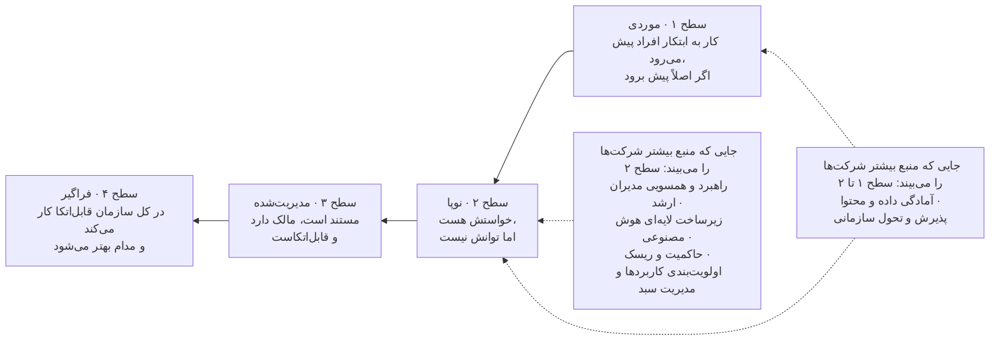
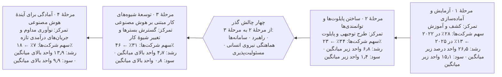
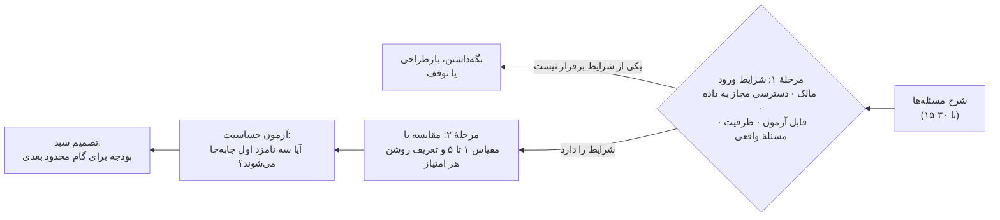
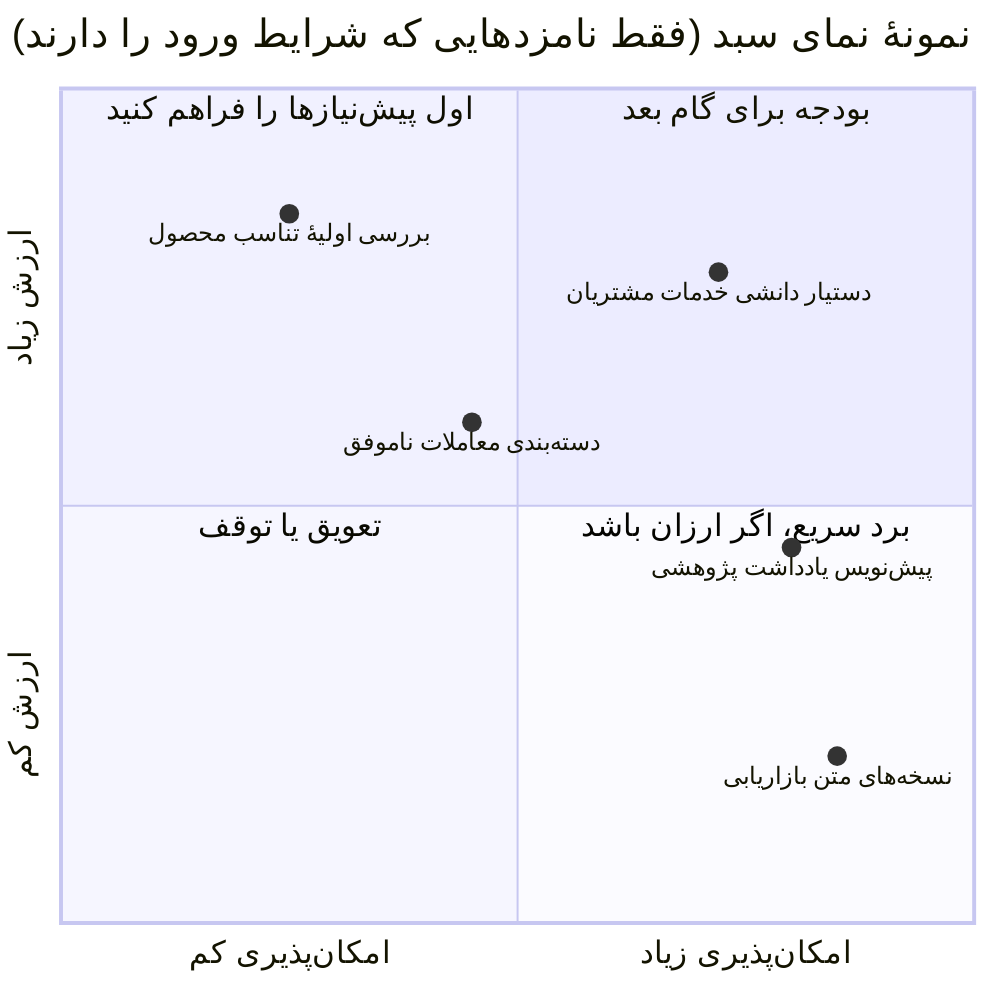
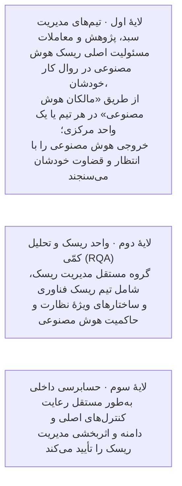
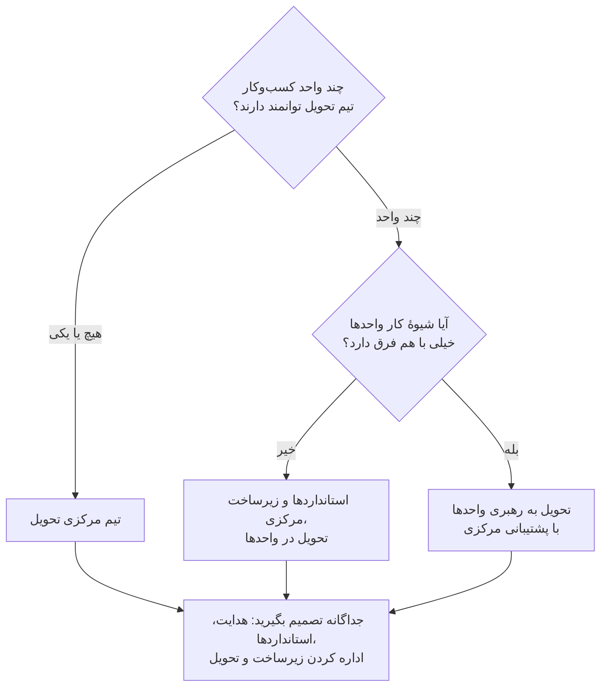

## ۱. تعیین مأموریت و سنجش آمادگی

| کارت فصل | |
|---|---|
| **مالک** | حامی اجرایی؛ مدیر برنامهٔ هوش مصنوعی شواهد را آماده می‌کند |
| **چه زمانی شروع کنیم** | پیش از آنکه برای کاری فراتر از ابزارهای سطح ۱ بودجه گذاشته شود، یا وقتی کارهای فعلی هوش مصنوعی هدف روشنی ندارند |
| **مدت معمول (پیش‌فرض آغازین)** | ۳ تا ۵ هفته برای مأموریت و ارزیابی آمادگی |
| **خروجی‌ها** | مأموریت دوصفحه‌ای؛ ارزیابی آمادگی؛ نخستین بررسی که بودجه گرفته است |
| **ابزارها (پیوست ج)** | ارزیابی آمادگی؛ جدول ردیابی |
| **میزان الزام** | برای هر سازمانی الزامی است؛ عمق کار به اندازهٔ سبد کاربردهای مورد نظر بستگی دارد، نه به سطح ریسک یک کاربرد |

### ۱.۱ هدف و نقطهٔ شروع

روشن کنید سازمان چرا در هوش مصنوعی سرمایه‌گذاری می‌کند، چه چیزی را می‌تواند مسئولانه تحویل دهد و چه کسانی می‌توانند تصمیم‌های لازم را بگیرند. کار را با حامی‌ای شروع کنید که حاضر باشد میان خواسته‌های متعارض داوری کند و افرادی را در دسترس بگذارد که کسب‌وکار، عملیات، داده، فناوری و الزامات کنترلی را می‌شناسند. اگر هنوز روشن نیست مسئلهٔ اصلی چیست، یک دورهٔ بررسی با خروجی مشخص و تاریخ بازبینی معین تعریف کنید. وقتی تشخیص مسئله قطعی نیست، باید اول بررسی کرد و بعد راه‌حل را انتخاب کرد.

**رویهٔ مستند:** گاردین کارهای هوش مصنوعی خود را حول سه محور سامان داد: تجربهٔ مشتری، کارایی عملیاتی و بهره‌وری کارکنان؛ و برای هر محور یک فرضیه، توجیه اقتصادی و برنامهٔ گسترش داشت. ایتال‌گاز هوش مصنوعی را به عملیات و نوسازی زیرساخت گره زد و حامیان اجرایی را مستقیماً در اجرا درگیر کرد. این دو نمونه نشان می‌دهند مأموریت هر سازمان از کسب‌وکار خودش می‌آید و می‌تواند کاملاً متفاوت باشد. [D22 ll. 104–128, 195–219.]

### ۱.۲ مأموریت را طوری بنویسید که بشود بر پایه‌اش تصمیم گرفت

حامی و مدیران کسب‌وکار باید مأموریت کوتاهی بنویسند که این موارد را روشن کند:

۱. چالش کسب‌وکار و شواهد آن: تقاضا، ضعف در خدمت، هزینه، کیفیت، ریسک، فرصت درآمدی یا کمبود ظرفیت. بنویسید این چالش ثابت شده است یا هنوز یک فرضیه است.  
۲. نتیجه‌ای که باید بهتر شود و کسی که پاسخ‌گوی آن است. شیوهٔ فعلی کار و افرادی را که تحت تأثیر قرار می‌گیرند شرح دهید.  
۳. مرزهای اولیه: کدام بخش‌های کسب‌وکار، کاربران، مکان‌ها، انواع داده و اقدام‌ها در دامنه‌اند، کدام بیرون از دامنه‌اند و دربارهٔ کدام هنوز تصمیمی گرفته نشده است.  
۴. سقف بودجه برای بررسی و آزمایش، کسی که تعهدات بعدی را تأیید می‌کند و شرایطی که در آن کار متوقف می‌شود.  
۵. محدودیت‌هایی که باید بررسی شوند: تعهدات قانونی، امنیت اطلاعات، دسترسی به داده، زیرساخت، وابستگی به تأمین‌کننده، اتصال شبکه، تداوم کسب‌وکار، ظرفیت نیروی انسانی و کارهایی که سازمان پیش‌تر به آن‌ها متعهد شده است.

**پیش‌فرض آغازین:** مأموریت را در دو صفحه نگه دارید و برای دوازده ماه نخست بیش از سه نتیجهٔ کسب‌وکاری هدف نگیرید. هدف‌های بیشتر معمولاً یعنی همان چند متخصص کمیاب میان تیم‌های زیادی پخش می‌شوند. نمونهٔ یک مأموریت تکمیل‌شده در پیوست ب.۱ آمده است.

مأموریت باید این امکان را باز بگذارد که راه‌حل اصلاً هوش مصنوعی نباشد. گاهی سازمان پیش از آنکه هوش مصنوعی از نظر اقتصادی یا عملیاتی معنا پیدا کند، به رویه‌های روشن‌تر، جست‌وجوی بهتر، خودکارسازی ساده یا دادهٔ بهتر نیاز دارد. فیدلیتی در سرویس توضیح‌پذیری خود یک مدل ساده‌تر را مبنای مقایسه گذاشت تا ببیند پیچیدگی بیشتر واقعاً ارزشی اضافه می‌کند یا نه. بلک‌راک هم توصیه می‌کند هر جا مدل‌های ساده‌تر و مخصوص همان کار کافی‌اند، از همان‌ها استفاده شود. [D10 p. 11; D16 p. 9.]

### ۱.۳ توانمندی‌ها را جدا جدا بسنجید، نه با یک میانگین گمراه‌کننده

شش بُعدی را که مک‌میلان پیشنهاد کرده، چارچوب گردآوری شواهد قرار دهید:

| بُعد | شواهدی که باید گردآوری شود | پرسشی که گام بعد را روشن می‌کند |
|---|---|---|
| راهبرد و همسویی مدیران ارشد | مأموریت، تصمیم‌های سرمایه‌گذاری، فعالیت حامی، مالکیت نتایج | آیا مدیران می‌توانند میان خواسته‌های رقیب داوری کنند و نیرو و بودجه اختصاص دهند؟ |
| زیرساخت هوش مصنوعی | دسترسی مجاز به مدل‌ها، یکپارچه‌سازی، بازیابی اطلاعات، هماهنگ‌سازی (در صورت نیاز)، ارزیابی و پایش | اگر این زیرساخت نباشد، هر تیم کدام قابلیت را از نو خواهد ساخت؟ |
| آمادگی داده و محتوا | مالکان مشخص، کیفیت منبع، تعریف روشن داده‌ها، مجوزها، به‌روز بودن، سابقهٔ مشکلات | آیا کاری که پیشنهاد شده می‌تواند از اطلاعات قابل‌اعتماد و مجاز استفاده کند؟ |
| حاکمیت و ریسک | فهرست کاربردها، بازبینی‌ها، آزمون کنترل‌ها، سوابق رخدادها و تغییرات | آیا کنترل‌ها در عمل روی شیوهٔ تحویل و بهره‌برداری اثر می‌گذارند؟ |
| پذیرش و تحول سازمانی | مهارت متناسب با نقش، تغییر در شیوهٔ کار، میزان استفادهٔ واقعی و بازخورد کاربران | آیا کار به شکلی مفید و قابل پشتیبانی تغییر می‌کند؟ |
| اولویت‌بندی کاربردها و مدیریت سبد | فرایند ورود، تصمیم‌های مقایسه‌ای، وضع موجود، ارزشی که واقعاً به دست آمده، تصمیم‌های کنارگذاشتن | آیا سازمان می‌تواند سرمایه‌گذاری‌های ضعیف را متوقف کند و موفق‌ها را گسترش دهد؟ |

این منبع چهار سطح تعریف می‌کند: **موردی** (کار به ابتکار افراد)، **نوپا** (خواست بیش از توان)، **مدیریت‌شده** (مستند، دارای مالک و قابل‌اتکا) و **فراگیر** (قابل‌اتکا در کل سازمان و رو به بهبود). این ارزیابی بر گفت‌وگو با مدیران و تجربهٔ مشاوره تکیه دارد؛ نه پیمایشی است که نمایندهٔ همهٔ سازمان‌ها باشد و نه ابزار امتیازدهی‌ای که به‌طور مستقل اعتبارسنجی شده باشد. این محدودیت را همیشه در نظر داشته باشید. [D19 pp. 2–6.]

*چارچوب بلوغ سازمانی McMillanAI، بازترسیم‌شده از گزارش «Everyone Is Behind» (ویراست اول، اوت ۲۰۲۶): تعریف سطح‌ها از صفحهٔ ۲ و جایگاه معمول شرکت‌ها در هر بُعد از صفحه‌های ۳ تا ۶. این جایگاه‌ها الگوهایی است که نویسنده می‌گوید دیده، نه امتیاز یک نمونهٔ مشخص از شرکت‌ها. [D19 pp. 2–6.]*

برای هر بُعد با کارکنان مسئول گفت‌وگو کنید، دست‌کم یک سند یا خروجی واقعی را بررسی کنید و یک بار اجرای واقعی کار را ببینید. سطحی را که دیدید، میزان اطمینانتان، کمبود شواهد و توانمندی مشخصی را که سبد پیشنهادی لازم دارد ثبت کنید. هر توانمندی که آزموده نشده را **نامعلوم** بنویسید. امتیاز بالای فناوری را با کنترلی که وجود ندارد میانگین نگیرید تا به این نتیجه برسید که سازمان آماده است. فرم قابل‌ویرایش ارزیابی آمادگی و راهنمای تفسیر آن در پیوست ج آمده است.

### ۱.۴ مراحل MIT CISR را برای منظور دیگری به کار ببرید

MIT CISR چهار مرحله را از هم جدا می‌کند: **آزمایش و آماده‌سازی**، **ساختن پایلوت‌ها و توانمندی‌ها**، **توسعهٔ شیوه‌های کار مبتنی بر هوش مصنوعی** و **آمادگی برای آیندهٔ هوش مصنوعی**. نمودار این منبع، پاسخ‌دهندگان را بر اساس معیاری از اثربخشی هوش مصنوعی در سه حوزهٔ عملیات، تجربهٔ مشتری و زیست‌بوم‌ها (با وزن برابر) گروه‌بندی می‌کند. تفاوت‌هایی که در رشد و سود گزارش شده، فقط همبستگی با عملکرد مالی نسبت به میانگین صنعت است؛ یعنی نشان نمی‌دهد که رسیدن به یک مرحله خودبه‌خود سود مالی مشخصی می‌آورد. نمونه‌های پیمایش ۲۰۲۲ و ۲۰۲۵ هم با هم فرق دارند. [D22 ll. 59–83, 276–309; A02، نمودار و پانوشت روش‌شناسی.]

*بازترسیم‌شده از نمودار MIT CISR با عنوان «Four Stages of Enterprise AI Maturity, 2022–2025»، همراه با چهار چالش گسترش که در متن همان گزارش آمده (Strategy، Systems، Synchronization، Stewardship). مرزهای مراحل بر اساس «اثربخشی کل هوش مصنوعی» است (مرحلهٔ ۱: ۰ تا ۴۹٪؛ مرحلهٔ ۲: ۵۰ تا ۷۴٪؛ مرحلهٔ ۳: ۷۵ تا ۹۹٪؛ مرحلهٔ ۴: ۱۰۰٪). رشد و سود به واحد درصد بالاتر یا پایین‌تر از میانگین صنعت و برای سال ۲۰۲۴ است؛ این‌ها همبستگی‌اند، نه اثر رسیدن به یک مرحله. حجم نمونه: پیمایش ۲۰۲۲، ۷۲۱ شرکت؛ پیمایش ۲۰۲۵، ۱۵۲ شرکت. [D22 ll. 59–83; A02.]*

این مراحل را برای گفت‌وگو دربارهٔ مسیر کلی سازمان به کار ببرید: از یادگیری، به اثبات کاربردها، به تغییر کار در مقیاس بزرگ، و سپس به نوآوری پایدار. ابعاد مک‌میلان را برای پیدا کردن نقاط ضعف توانمندی‌ها به کار ببرید. **نام مراحل را عوض نکنید، مقیاس‌های این دو منبع را به هم تبدیل نکنید و ارزیابی این راهنما را «امتیاز MIT» ننامید.** ممکن است همهٔ کارکنان یک سازمان به ابزاری دسترسی داشته باشند، اما سازمان هنوز ارزیابی منظم یا مالک مشخص برای داده‌هایش نداشته باشد.

### ۱.۵ ارزیابی را با یک تصمیم عملی تمام کنید

| اقدام | مسئول | خروجی | شواهد لازم برای ادامه |
|---|---|---|---|
| تأیید چالش کسب‌وکار و دامنهٔ کار | حامی و مدیران کسب‌وکار | مأموریت و فرضیه‌های نتیجه | مسئله‌ای که بر سرش توافق هست، شیوهٔ کاری که تغییر می‌کند، مالک پاسخ‌گو |
| بررسی توانمندی‌های فعلی | مدیر برنامه، با کارکنان کسب‌وکار، کنترل و فناوری | ارزیابی آمادگی و یادداشت میزان اطمینان | اسناد و نمونه‌های واقعی کار، نه فقط ادعاهایی که در مصاحبه مطرح شده |
| سنجش ظرفیت نیروی انسانی و تحویل | مدیر برنامه، مدیران واحدها، مسئول منابع انسانی | فهرست ظرفیت با نام افراد و کمبود مهارت‌ها | ظرفیتی که واقعاً در دسترس است، پس از کسر تعهدات فعلی |
| تصمیم دربارهٔ نخستین بررسی با بودجهٔ مشخص | حامی / مرجع تصمیم‌گیری سبد | اجازهٔ بررسی یا اجرا | مرزها، بودجه، مالک، وابستگی‌های حل‌نشده و تاریخ تصمیم بعدی |

**نشانه‌های شکست:** مأموریتی که فقط می‌گوید «باید هوش‌مصنوعی‌محور شویم»، امتیاز بلوغی که شاهدی پشتش نیست، و حامی‌ای که نمی‌تواند کارکنان را برای این کار آزاد کند؛ همهٔ این‌ها یعنی ارزیابی به تعهدی که بشود اجرایش کرد نرسیده است. پیش از گسترش سبد، مأموریت یا تخصیص ظرفیت را اصلاح کنید. بررسی مسئله‌ها، فهرست‌برداری از کاربردها و ارزیابی اولیهٔ مهارت‌ها می‌توانند هم‌زمان انجام شوند، ولی انتخاب راه‌حل باید منتظر یافته‌های آن‌ها بماند. هر وقت راهبرد، محدودیت‌ها یا شواهد به‌طور جدی تغییر کرد، مأموریت را بازنگری کنید.

## ۲. ساختن و اولویت‌بندی سبد کاربردها

| کارت فصل | |
|---|---|
| **مالک** | مرجع تصمیم‌گیری سبد تصمیم می‌گیرد؛ مالکان کسب‌وکار پیشنهاد می‌دهند؛ مدیر برنامه مقایسه را انجام می‌دهد |
| **چه زمانی شروع کنیم** | مأموریت نوشته شده و به کاربران و مالک نتیجه دسترسی هست |
| **مدت معمول (پیش‌فرض آغازین)** | ۲ تا ۴ هفته برای نخستین دور؛ بازنگری هر سه ماه و پس از هر تصمیم پایلوت |
| **خروجی‌ها** | فرم‌های ورود، مقایسهٔ گزینه‌ها، فهرست اولویت‌بندی‌شده، سابقهٔ تصمیم |
| **ابزارها (پیوست ج)** | برگهٔ مسیر سریع (سطح ۱)؛ فرم ورود و اولویت‌بندی (سطح‌های ۲ و ۳)؛ جدول ردیابی |
| **میزان الزام** | سطح ۱: فقط برگهٔ مسیر سریع. سطح ۲: بخش‌های اصلی فرم ورود. سطح ۳: فرم کامل، همراه با مقایسهٔ گزینه‌ها و آزمون حساسیت |

### ۲.۱ هدف و پیش‌نیازها

چالش‌های کسب‌وکار را به چند انتخاب سرمایه‌گذاری تبدیل کنید که بشود مدیریتشان کرد. پیش‌نیازها: مأموریت، دسترسی به کسانی که کار را انجام می‌دهند، مالک نتیجه و مرجعی برای تصمیم‌گیری دربارهٔ سبد که بتواند منابع محدود را تخصیص دهد. خروجی این مرحله ترتیبی از تصمیم‌ها و وابستگی‌هاست، نه فهرستی بلند از ایده‌های هوش مصنوعی.

**رویهٔ مستند:** UOBAM از واحدهای کسب‌وکار خواست مسئله‌هایشان را شرح دهند، اثر کسب‌وکاری و امکان‌پذیری هر مسئله را سنجید، مسئله‌های مشابه را ادغام کرد و سپس راه‌حل‌ها را ساخت و آزمود. LPL از شورای مشاورهٔ هوش مصنوعی مشاورانش، همایش‌ها و پژوهش‌های صنعت کمک گرفت تا کارهایی را پیدا کند که بیشترین وقت را می‌گیرند. این تجربه‌ها نشان می‌دهند بهتر است پیش از هر انتخاب فنی، مسئله را همراه با کاربران و متخصصان آن حوزه بررسی کرد. [D34 p. 21; D27 ll. 297–321.]

### ۲.۲ کاری را پیدا کنید که ارزش تغییر دارد

مالک کسب‌وکار و مسئول محصول باید کار را از نزدیک ببینند، چند نمونهٔ واقعی از کار انجام‌شده را بررسی کنند و با گروه‌های مختلف کاربران حرف بزنند: کاربران باتجربه، تازه‌کارها، کسانی که از ابزارهای فعلی دوری می‌کنند و کسانی که در مراحل بعدی با خطاها سروکار دارند. نقشهٔ کار را بکشید: چه چیزی کار را شروع می‌کند، چه ورودی‌هایی دارد، کجا قضاوت لازم است، کار کجا از یک نفر یا یک سامانه به دیگری می‌رسد، خروجی چیست و موارد استثنا چطور رسیدگی می‌شوند. کار فعلی را اندازه بگیرید، از جمله زمان انتظار، بررسی و دوباره‌کاری.

فرصت را این‌طور بنویسید: **«برای [کاربر]، [این مرحله از کار] را تغییر دهید تا [نتیجه‌ای قابل‌اندازه‌گیری] بهتر شود، بی‌آنکه [کیفیت، حقوق افراد، ایمنی و سطح خدمت] آسیب ببیند.»** نتیجه را با خروجی اشتباه نگیرید. پاسخی که سامانه تولید می‌کند خروجی است؛ پرسشی که درست حل شده، نتیجه است. تماس کوتاه‌تر، ارجاع کمتر یا گفت‌وگویی که بسته شده، ممکن است نشانهٔ کارایی باشد یا نشانهٔ اینکه کاربر کار را رها کرده یا شکست خورده است. فقط با پیگیری و شواهد کیفیت می‌توان این دو را از هم تشخیص داد. این شیوهٔ سنجش، **جمع‌بندی راهنما** است و از تأکید منابع بر نتایج واقعی کار و هزینهٔ کامل هر نتیجهٔ موفق گرفته شده است. [D38 ll. 53–100, 381–429; D14 ll. 248–258.]

### ۲.۳ گزینه‌های واقعی را تعریف و مقایسه کنید

برای هر فرصت این گزینه‌ها را در نظر بگیرید: ادامهٔ روش فعلی، بهتر کردن رویه‌ها یا کیفیت اطلاعات، قواعد ساده، جست‌وجو یا خودکارسازی فرایند، مدل‌های پیش‌بینی متعارف، دستیار مولد و، اگر مرتبط است، خودکارسازی‌ای که خودش اقدام می‌کند. فقط گزینه‌های معقول را مقایسه کنید و همه را با یک تعریف کار و یک مجموعه شواهد ارزیابی بسنجید. یک بررسی فنی کوتاه می‌تواند امکان‌پذیری را نشان دهد، بی‌آنکه سازمان را به استقرار متعهد کند.

مسئول فنی باید توضیح دهد هوش مصنوعی دقیقاً چه چیزی اضافه می‌کند: پیش‌بینی، استخراج اطلاعات، فهم زبان طبیعی، ترکیب و جمع‌بندی، پیشنهاد یا انتخاب اقدام. مالک کسب‌وکار باید توضیح دهد این چیز اضافه چرا کار را بهتر می‌کند. اینکه روی چیزی برچسب «هوش مصنوعی» خورده باشد کافی نیست. در فرم ورود (پیوست ج) گزینه‌ها و دلیل کنار گذاشتن هر کدام ثبت می‌شود.

### ۲.۴ اول شرایط ورود، بعد مقایسه

در دو مرحله کار کنید. در مرحلهٔ اول، شرایط حتمی ورود را بسنجید: مسئله‌ای که اهمیت دارد، مالکی که پاسخ‌گوست، راهی قانونی و مجاز برای استفاده از داده‌ها و انجام اقدام‌های لازم، روشی عملی برای ارزیابی و راهی معتبر برای تأمین ظرفیت. اگر یکی از این شرایط برقرار نباشد، نامزد **تا رسیدن شواهد نگه داشته می‌شود** یا بازطراحی می‌شود؛ امتیاز تجاری بالا نمی‌تواند این کمبود را جبران کند.

در مرحلهٔ دوم، نامزدهایی را که شرایط را دارند از این جنبه‌ها مقایسه کنید: اهمیت برای کسب‌وکار، میزان بهبود مورد انتظار، اطمینان به شواهد، امکان‌پذیری فنی و داده‌ای، احتمال پذیرش در کار روزمره، هزینهٔ کامل، زمان لازم تا رسیدن به شواهد، وابستگی‌ها و ریسکی که باقی می‌ماند. اگر کمک می‌کند، شرح کوتاهی از شواهد را کنار یک مقیاس ساده بگذارید. مقیاس‌ها و وزن‌ها را پیش از رتبه‌بندی توافق کنید و نشان دهید اگر اولویت‌های مدیران فرق کند، رتبه‌ها چقدر جابه‌جا می‌شوند. چیزی را که نمی‌دانید «نامعلوم» بنویسید و بی‌سروصدا امتیاز متوسط به آن ندهید. برآوردهای نامطمئن را در هم ضرب نکنید تا به بازده سرمایه‌ای برسید که دقیق به نظر می‌رسد ولی نیست.

| وضعیت نامزد | سرمایه‌گذاری مناسب بعدی | شواهد لازم برای تصمیم |
|---|---|---|
| مسئلهٔ مهم، اما شواهد کمی دربارهٔ خود مسئله | بررسی بیشتر مسئله | نمونه‌های واقعی کار و اندازه‌گیری وضع موجود |
| مسئلهٔ تأییدشده، اما داده یا دسترسی ضعیف | کار محدود روی داده و آماده‌سازی | اصلاح مشخص منبع داده و دسترسی مجاز |
| کار ارزشمند، اما رویکرد فنی نامطمئن | آزمایش مقایسه‌ای | یک تعریف کار و یک آزمون مشترک برای همهٔ گزینه‌ها |
| فایدهٔ کار ثابت شده، اما یکپارچه‌سازی یا عملیات ضعیف | مهندسی برای بهره‌برداری | آمادگی برای عرضه و پشتیبانی |
| سامانهٔ مستقری که مفید است | ادامه، اصلاح یا گسترش | ارزش، هزینه و عملکرد پایدار کنترل‌ها |
| ارزش کم، ریسک غیرقابل‌قبول یا نبود مالک واقعی | توقف یا انتخاب رویکرد دیگر | دلیل ثبت‌شده و تعیین تکلیف داده‌ها و خروجی‌های کار |

**معنای هر امتیاز (پیش‌فرض آغازین).** از این تعریف‌ها استفاده کنید تا امتیاز «۴» در همهٔ واحدها یک معنا داشته باشد. همهٔ ابعاد را هم‌وزن بگیرید، مگر اینکه مرجع تصمیم‌گیری سبد *پیش از* امتیازدهی روی وزن‌های دیگری توافق کند. بعد رتبه‌بندی را دوباره انجام دهید و هر بار وزن اولویت اصلی یکی از مدیران را دو برابر کنید. اگر سه نامزد اول جابه‌جا شدند، به‌جای میانگین گرفتن، این بده‌بستان را آشکارا به بحث بگذارید. این تعریف‌ها **جمع‌بندی راهنما** هستند.

| بُعد | ۱ | ۳ | ۵ |
|---|---|---|---|
| اهمیت برای کسب‌وکار | دردسری محلی | مهم برای اهداف یک واحد | مهم برای راهبرد سازمان یا یک تعهد قطعی |
| اطمینان به شواهد | حرف و حکایت | اندازه‌گیری وضع موجود روی نمونه‌ای از کار واقعی | اندازه‌گیری وضع موجود در یک دورهٔ کامل کسب‌وکار |
| امکان‌پذیری داده و فنی | داده در دسترس یا مجاز نیست | پس از یک اصلاح مشخص در دسترس می‌شود | در دسترس، دارای مالک، مجاز و آزموده |
| امکان پذیرش در کار روزمره | با کاربران مشورت نشده؛ ابزاری جدا از روال کار | کاربران درگیرند؛ یکپارچه‌سازی ناقص است | کاربران در طراحی شریک‌اند؛ در سامانه‌ای که همین حالا با آن کار می‌کنند جا می‌افتد |
| زمان تا رسیدن به شواهد مفید | بیش از ۶ ماه | ۲ تا ۳ ماه | کمتر از ۴ هفته |
| هزینهٔ کامل و اقتصاد طرح | هزینه نامعلوم است یا احتمالاً از فایده بیشتر است | با فرض‌های صریح برآورد شده | با برآوردگر هزینه (پیوست ج) محاسبه و از سوی واحد مالی تأیید شده |
| ریسک باقیمانده و بار کنترلی | سطح ۳ با الزامات حتمی که هنوز حل نشده‌اند | سطح ۲ با کنترل‌های شناخته‌شده | سطح ۱ |

نامزدهایی را که شرایط ورود را دارند روی دو محور ارزش و امکان‌پذیری نشان دهید تا بده‌بستان‌ها دیده شوند. نامزدهای زیر فقط برای نمونه‌اند.

**پیش‌فرض آغازین برای کارهای هم‌زمان:** تعداد پایلوت‌هایی که هم‌زمان اجرا می‌شوند نباید از تعداد متخصصانی بیشتر باشد که با نام مشخص و با وقت آزاد برای برچسب‌زدن نمونه‌های آزمون و بازبینی نتایج در اختیار دارید. برای بیشتر سازمان‌ها در سال اول، این یعنی یک تا سه پایلوت.

### ۲.۵ میان تمرکز بر یک حوزه و گام‌های کوچک تعادل برقرار کنید

«حوزه» یک فعالیت یا زنجیرهٔ به‌هم‌پیوسته از کسب‌وکار است، مثل پشتیبانی مشتری یا فرایند پژوهش سرمایه‌گذاری. «کاربرد» یک استفادهٔ مشخص در دل آن حوزه است. حوزه‌ها را طوری انتخاب کنید که به ابزارهای پراکنده و جدا از هم نرسید، و در هر حوزه گام‌های کوچک بردارید تا یادگیری، هزینه و ریسک قابل مدیریت بماند. اجزای مشترک باید از نیازهایی ساخته شوند که بارها تکرار شده و ثابت شده‌اند.

**اختلاف نظر منابع:** مک‌کینزی از تحول کل یک حوزه دفاع می‌کند، در حالی که فیدلیتی توصیه می‌کند با یک کاربرد مشخص شروع کنید و پس از اثبات فایده گسترش دهید. JPMC هم تحول از بالا به پایین در سطح حوزه را شرح می‌دهد و هم دسترسی گستردهٔ کارکنان از پایین به بالا را. جمع‌بندی ما این است: برنامه‌ریزی را در سطح حوزه انجام دهید، برای گام‌های مشخص بودجه بگذارید، و برای آزمایش و یادگیری آزادانهٔ کارکنان بودجه‌ای جداگانه و مصوب در نظر بگیرید. [D21 pp. 3–4; D10 pp. 11–12; D24 p. 4.]

### ۲.۶ تصمیم بگیرید، ثبت کنید و دوباره بسنجید

مدیر برنامه مقایسه را آماده می‌کند؛ واحد مالی هزینه‌ها و شیوهٔ محاسبهٔ فایده‌ها را به چالش می‌کشد؛ مالکان فنی و داده امکان‌پذیری را می‌سنجند؛ بازبینان کنترلی محدودیت‌ها را مشخص می‌کنند؛ و مرجع تصمیم‌گیری سبد دربارهٔ سرمایه‌گذاری تصمیم می‌گیرد. مالک کسب‌وکار تعریف نتیجه را می‌پذیرد و کاربران و متخصصان را در اختیار تیم می‌گذارد.

**خروجی‌ها:** فرم ورود، اندازه‌گیری وضع موجود، مقایسهٔ گزینه‌ها، سابقهٔ اولیهٔ بررسی ریسک و حقوقی، نقشهٔ وابستگی‌ها، برآورد ظرفیت، فهرست اولویت‌بندی‌شده و سابقهٔ تصمیم. وقتی دامنهٔ محدودی بودجه گرفته، معیارهای قبولی روشن است، مالک مشخص است و برنامه‌ای برای وابستگی‌ها وجود دارد، **کار را ادامه دهید**. **نشانه‌های شکست:** چند ایدهٔ تأییدشده که همه به همان چند متخصصِ همیشه‌گرفتار وابسته‌اند، چند سامانهٔ جست‌وجوی تکراری، و پروژه‌هایی که فقط با درآمدهای خیالی رتبه گرفته‌اند. کارهای هم‌زمان را در حد ظرفیت تحویل و بازبینی نگه دارید. پس از نتایج هر پایلوت، رخدادهای مهم یا تغییر جهت کسب‌وکار، اولویت‌ها را به‌روز کنید؛ از پروژه‌ای فقط به این دلیل که ساختش شروع شده دفاع نکنید.

## ۳. طراحی مدل عملیاتی و برنامهٔ نیروی انسانی

| کارت فصل | |
|---|---|
| **مالک** | حامی اجرایی همراه با مدیر برنامهٔ هوش مصنوعی؛ مدیران واحدها ظرفیت را تأیید می‌کنند |
| **چه زمانی شروع کنیم** | وقتی فهرست نامزدها شکل گرفته است؛ هم‌زمان با فصل ۲ |
| **مدت معمول (پیش‌فرض آغازین)** | ۲ تا ۳ هفته برای شرح نقش‌ها و ماتریس اختیارات تصمیم |
| **خروجی‌ها** | شرح وظایف مدیر برنامه، ماتریس اختیارات تصمیم، برنامهٔ تیم و ظرفیت با نام افراد |
| **ابزارها (پیوست ج)** | ماتریس اختیارات تصمیم؛ برنامهٔ نیروی انسانی |
| **میزان الزام** | در همهٔ سطوح الزامی است که مالک نتیجه و مرجع تأیید عرضه مشخص باشد؛ اندازهٔ تیم به سطح ریسک بستگی دارد (بخش ۳.۳) |

### ۳.۱ هدف و پیش‌نیازها

روشن کنید چه کسی مالک نتایج است، چه کسی سامانه را می‌سازد و اداره می‌کند، چه کسی آن را به چالش می‌کشد و چه کسی می‌تواند کار را تأیید یا متوقف کند. از فهرست نامزدها و نقشه‌ای از واحدهای فعلی و اختیاراتی که به آن‌ها تفویض شده شروع کنید. پیش از اینکه دربارهٔ واحد یا عنوان شغلی تازه تصمیم بگیرید، مسئولیت‌ها را تقسیم کنید.

**رویهٔ مستند:** ونگارد مهندسان داده، تحلیل‌گران کسب‌وکار، واحدهای انطباق و امنیت و کاربران کسب‌وکار را کنار هم نشاند. فیدلیتی همکاری میان تیم‌های هوش مصنوعی، مهندسی، طراحی تجربهٔ کاربر، کسب‌وکار و انطباق را توصیف می‌کند. مؤسسهٔ CFA واحد نوآوری‌ای را شرح می‌دهد که سرمایه‌گذاری و فناوری را به هم وصل می‌کند و نقشش از «مترجم» میان این دو فراتر رفته و حالا جهت و اولویت‌ها را هم تعیین می‌کند. [D14 ll. 55–79; D10 p. 12; D34 pp. 9–11.]

### ۳.۲ مدیر برنامهٔ هوش مصنوعی را با اختیار واقعی منصوب کنید

**مدیر برنامهٔ هوش مصنوعی** نقش هماهنگ‌کننده‌ای است که این راهنما پیشنهاد می‌کند. این فرد سبد کاربردها را نگه‌داری می‌کند، همکاری میان واحدها را سازمان می‌دهد، وابستگی‌ها را آشکار می‌کند، شواهد لازم برای سرمایه‌گذاری و عرضه را آماده می‌کند، ارزش به‌دست‌آمده را پیگیری می‌کند و مطمئن می‌شود تصمیم‌ها اجرا می‌شوند. بسته به اختیار و ظرفیت سازمان، این نقش می‌تواند زیر نظر کسب‌وکار، تحول، عملیات، داده یا فناوری باشد. آنچه مهم است دسترسی مستقیم به حامی و سازوکاری برای حل اختلاف میان واحدهاست.

مدیر برنامه خودبه‌خود مالک همهٔ نتایج، همهٔ داده‌ها یا همهٔ ریسک‌های باقیمانده نمی‌شود. مدیر هر فرایند کسب‌وکار همچنان پاسخ‌گوی نتایج آن فرایند است. مرجع تأیید عرضه، امنیت اطلاعات، بازبینان حقوقی و انطباق و مالک عملیات، هر کدام تصمیم‌های حوزهٔ خود را نگه می‌دارند. حدود اختیار مدیر برنامه برای هزینه‌کرد، توانایی‌اش برای درخواست یا آزادکردن نیرو، مسیر ارجاع و تعهداتش را مکتوب کنید.

### ۳.۳ اختیارات تصمیم را میان واحدها تقسیم کنید

| نقش / توانمندی | مسئولیت | نشانهٔ صلاحیت |
|---|---|---|
| حامی اجرایی / نهاد راهبری | مأموریت، بودجه، بده‌بستان‌های راهبردی، میزان ریسک‌پذیری در چارچوب الزامات حاکم | می‌تواند منابع تخصیص دهد و مسائل میان واحدها را حل کند |
| مالک کسب‌وکار / مالک کاربرد | نتیجه، دامنهٔ کار، پذیرش کسب‌وکار، پذیرش کاربران و تحقق فایده‌ها | کار را می‌شناسد و تغییر در عملیات را در اختیار دارد |
| مدیر برنامه | سبد، هماهنگی تحویل، شواهد و پیگیری اجرای تصمیم‌ها | می‌تواند کسب‌وکار و کار فنی را به هم وصل کند، فرض‌ها را به چالش بکشد و تصمیم‌ها را روشن بنویسد |
| مسئول محصول | شواهد کاربران، طراحی شیوهٔ کار، نیازمندی‌ها و بازخورد | در همین حوزه، توان پژوهش و قضاوت محصولی خود را نشان داده است |
| متخصص حوزه / مالک محتوا | معنای کسب‌وکاری، محتوای معتبر، برچسب‌گذاری نمونه‌های آزمون، موارد استثنا | می‌تواند درستی، کاستی‌ها و پیامدهای عملی را داوری کند |
| مالک داده و متولی مهندسی داده | استفادهٔ مجاز، تعریف‌ها، کیفیت، به‌روز بودن، منشأ داده و اصلاح آن | می‌تواند منابع را توضیح دهد، دسترسی را مجاز کند و از استفاده‌های بعدی پشتیبانی کند |
| مسئول فنی / معماری | طراحی راه‌حل، تأمین، یکپارچه‌سازی، مهندسی و محدودیت‌های فنی | تجربهٔ تحویل با همین نوع رویکرد را دارد |
| متخصص ارزیابی و اطمینان | طراحی آزمون، کیفیت شواهد، بازبینی مستقل متناسب با اثر | می‌تواند کیفیت کار، امتیاز مدل و نتیجهٔ کسب‌وکاری را از هم تشخیص دهد |
| امنیت اطلاعات | ارزیابی تهدیدها، کنترل دسترسی و خروج داده، آزمون امنیتی و هماهنگی در رخدادها | استقرار واقعی و راه‌های حمله به آن را می‌شناسد |
| بازبینان حقوقی، انطباق، حریم خصوصی و ریسک | قوانین قابل اعمال در محل، استفادهٔ مجاز، کنترل‌های لازم و شواهد تأیید | اختیار تفسیر الزامات را دارد یا می‌تواند از مشاور صلاحیت‌دار کمک بگیرد |
| مالک عملیات / تیم خدمت | دسترس‌پذیری، پشتیبانی، پایش، پاسخ به رخداد، تغییر و کنارگذاشتن سامانه | دفترچهٔ عملیات، نیرو، دسترسی‌ها و بودجهٔ عملیاتی را می‌پذیرد |
| منابع انسانی / آموزش و مدیران مستقیم | ظرفیت، تغییر نقش‌ها، مهارت، پشتیبانی و پیامدها برای نیروی کار | می‌تواند وقت افراد را آزاد کند، مهارت‌ها را بسنجد و تغییرات کار را مدیریت کند |
| مالی / تدارکات | مقایسهٔ سرمایه‌گذاری‌ها، شیوهٔ محاسبهٔ هزینه، قراردادها، تعهدات تأمین‌کنندگان | می‌تواند هزینهٔ کامل و فرض‌های تجاری را راستی‌آزمایی کند |

در سازمان کوچک ممکن است یک نفر چند نقش داشته باشد؛ در این صورت بار کاری و هر تعارض منافع را ثبت کنید. باید کسی باشد که بتواند تصمیم‌های تیم سازنده را به‌طور جدی به چالش بکشد. اگر درون سازمان چنین کسی نیست، از بازبین مستقل داخلی یا بیرونی کمک بگیرید. حسابرسی داخلی را خودبه‌خود تأییدکنندهٔ عرضه قرار ندهید؛ نقش اطمینان‌بخشی آن را همان‌طور که در سازمان تعریف شده نگه دارید. بلک‌راک مالکیت عملیاتی، بازبینی ریسک و حسابرسی داخلی را سه لایهٔ جدا توصیف می‌کند. [D16 pp. 6–7; D30 pp. 60–63.]

*سه لایهٔ دفاعی بلک‌راک برای هوش مصنوعی، بازترسیم‌شده از پاسخ این شرکت به نظرخواهی کمیسیون اروپا (اکتبر ۲۰۲۴). این شرح خود شرکت از چارچوبش است، نه یک الزام قانونی. [D16 pp. 6–7.]*

**حداقل تیم برای هر سطح ریسک (پیش‌فرض آغازین).** در سازمان کوچک ممکن است یک نفر چند نقش داشته باشد؛ بار کاری و هر تعارض منافع را ثبت کنید.

| سطح | نقش‌هایی که پیش از شروع کار باید با نام مشخص شوند |
|---|---|
| سطح ۱ | مالک کسب‌وکار؛ مدیر مستقیم؛ مسئول ابزار مجاز؛ تأیید امنیت اطلاعات دربارهٔ مجاز بودن ابزار و انواع داده |
| سطح ۲ | مالک کسب‌وکار؛ مسئول محصول یا تحویل؛ یک یا چند متخصص حوزه با وقت آزاد؛ مالک و متولی داده؛ یک یا چند مهندس؛ مسئول ارزیابی (می‌تواند همان مسئول محصول باشد)؛ بازبینان امنیت و حریم خصوصی؛ مالک عملیات |
| سطح ۳ | همهٔ نقش‌های سطح ۲، به‌علاوهٔ بازبین مستقل ارزیابی، بازبین حقوقی یا انطباق که در آن حوزهٔ قضایی صلاحیت دارد، مرجعی مشخص برای پذیرش ریسک و تیم پشتیبانی عملیاتی که نیرویش تأمین شده |

**چه کسی در هر یک از پنج مرحلهٔ تصمیم چه می‌کند.** R = آماده‌سازی و اجرا؛ A = تصمیم‌گیرندهٔ پاسخ‌گو؛ C = باید با او مشورت شود یا تأیید کند؛ I = در جریان قرار می‌گیرد.

| مرحلهٔ تصمیم | حامی | مرجع سبد | مالک کسب‌وکار | مدیر برنامه | مسئول فنی | بازبینان کنترلی | مالک عملیات | مالی |
|---|---|---|---|---|---|---|---|---|
| ۱ مأموریت | A | C | C | R | C | C | I | C |
| ۲ سرمایه‌گذاری | I | A | R | R | C | C | I | C |
| ۳ پایلوت با کاربران | I | I | A | R | R | C | C | I |
| ۴ عرضه | I | I | C | R | R | C | C | I |
| ۵ گسترش / ادامه | I | A | R | R | C | C | C | C |

تصمیم مرحلهٔ ۴ را مرجعی می‌گیرد که مشخصاً برای تأیید عرضه تعیین شده است؛ بسته به تفویض اختیار در سازمان، این مرجع می‌تواند مالک کسب‌وکار، مرجع تغییرات فناوری یا یک کمیته باشد. بازبینان کنترلی (امنیت، حقوقی و انطباق، ریسک) هر جا در حیطهٔ اختیارشان باشد، حق تأیید یا وتو دارند.

### ۳.۴ تصمیم بگیرید چه چیزی متمرکز باشد

| گزینه | چه زمانی مناسب است | بده‌بستانی که باید مدیریت شود |
|---|---|---|
| تیم مرکزی تحویل | متخصصان کمیاب‌اند، توان واحدها هنوز شکل نگرفته و نیازهای مشترک زیاد تکرار می‌شوند | فاصله از کاربران؛ صف مشترک کارها به گلوگاه تبدیل می‌شود |
| استانداردها و زیرساخت مرکزی، تحویل در واحدها | چند تیم توانمند در کسب‌وکار و کنترل‌ها و زیرساختی که می‌شود بارها از آن استفاده کرد | مالکیت نقاط اتصال، تأمین بودجه و یکسان بودن شواهد |
| تحویل به رهبری واحدها با پشتیبانی مرکزی | تخصص و ظرفیت قوی در واحدها؛ شیوه‌های کار بسیار متفاوت | هزینه‌های تکراری، کنترل‌های ناهمسان، استفادهٔ کم از کار دیگران |

برای هدایت راهبردی، استانداردها، اداره کردن زیرساخت و تحویل، جداگانه تصمیم بگیرید. یک شرکت می‌تواند امنیت، دسترسی به مدل و ابزارهای ارزیابی را متمرکز کند و در همان حال متخصصان حوزه و تیم‌های محصول را در واحدهای کسب‌وکار نگه دارد. پژوهش مک‌کینزی روی ۱۶ مؤسسه نشان می‌دهد هماهنگی مرکزی با رسیدن سریع‌تر به بهره‌برداری همراه است، اما ثابت نمی‌کند که یک ساختار سازمانی برای همه مناسب است. نمونهٔ JPMC متخصصانی را شرح می‌دهد که در واحدهای مختلف کار می‌کنند و از الگوهای مشترک بهره می‌برند. [D33 pp. 3–6; D25 pp. 6–8, 13.]

### ۳.۵ پیش از تعهد، ظرفیت واقعی را بسنجید

برای هر توانمندی لازم، این‌ها را فهرست کنید: افراد واقعی، نمونه‌هایی از کارهای مشابهی که تحویل داده‌اند، تعهدات فعلی‌شان، وقتی که واقعاً دارند، اختیار تصمیمشان و جانشینشان. از مدیرانشان بخواهید آزاد شدن این وقت را تأیید کنند. علاوه بر کار ساخت، حجم کار برچسب‌گذاری تخصصی، اصلاح محتوا، بازبینی امنیتی، عملیات و پذیرش را هم برآورد کنید. شمار کارکنان به‌تنهایی نشان نمی‌دهد سازمان واقعاً چقدر می‌تواند تحویل دهد.

برای هر کمبود، یکی از این راه‌ها را انتخاب کنید: جابه‌جایی نیرو در داخل، آموزش مهارت تازه، استخدام یا کمک بیرونی. هر جا دانش سازمانی، تصمیم‌های کسب‌وکاری یا پاسخ‌گویی دائمی در قبال خدمت اهمیت دارد، مالکیت را داخل سازمان نگه دارید. متخصصان بیرونی می‌توانند تخصص یا ظرفیت بیاورند، اما قرارداد با آن‌ها باید انتقال دانش، تحویل خروجی‌های قابل استفاده، مرزهای پشتیبانی و شرایط پایان همکاری را روشن کند. ونگارد استخدام افراد باتجربه، همکاری با شرکا و آموزش گستردهٔ کارکنان متناسب با نقششان را با هم به کار گرفت، اما نسبت ثابتی از این‌ها را برای دیگران تجویز نمی‌کند. [D36 ll. 118–151.]

**خروجی‌ها:** شرح نقش‌ها، ماتریس اختیارات تصمیم، برنامهٔ تیم و ظرفیت با نام افراد، تصمیم دربارهٔ هر کمبود مهارت و شیوهٔ تأمین آن، و توافق بر مدل عملیاتی. وقتی افراد مشخصی با وقت آزاد، مسئولیت نتیجه، تحویل، کنترل و عملیات را پذیرفته‌اند، **کار را ادامه دهید**. **نشانه‌های شکست:** مدیر برنامه‌ای که اختیاری ندارد، یک متخصص که به همهٔ پروژه‌ها گمارده شده، بازبینانی که فقط درست پیش از استقرار وارد کار می‌شوند، یا تأمین‌کننده‌ای بیرونی که همهٔ دانش اصلی را در دست دارد. بازنگری اولویت‌ها، استخدام و آموزش می‌توانند هم‌زمان پیش بروند، اما هیچ عرضه‌ای نباید به نقش عملیاتی‌ای تکیه کند که هنوز کسی برایش گمارده نشده است. با بزرگ‌تر شدن سبد و خدمات مشترک، این مدل را بازنگری کنید.
