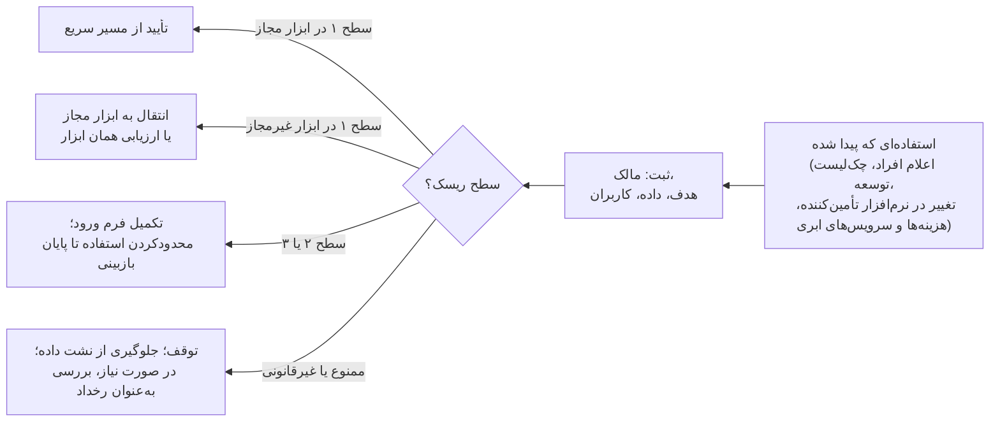
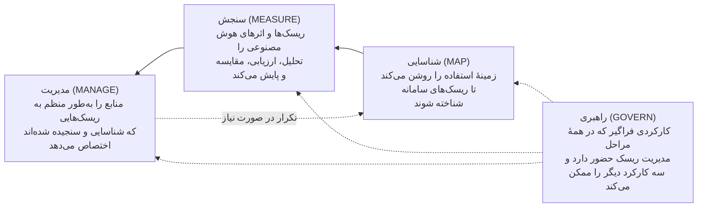
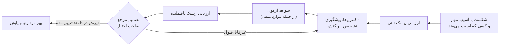
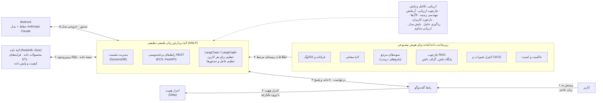
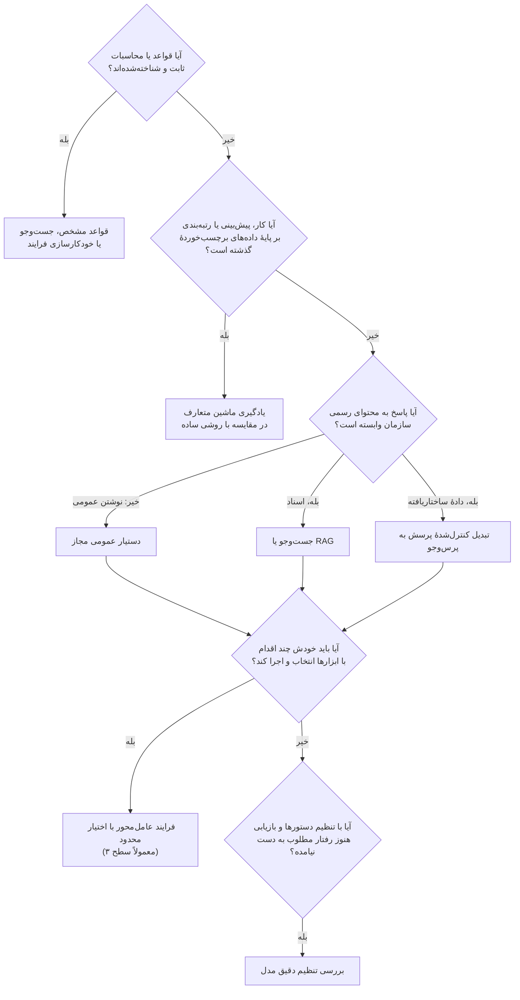
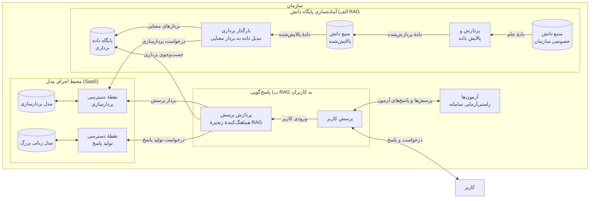

## ۴. گنجاندن حاکمیت در فرایند تحویل

| کارت فصل | |
|---|---|
| **مالک** | مالک کسب‌وکار اطلاعات زمینه‌ای را آماده می‌کند؛ متخصصان ارزیابی می‌کنند؛ مراجع صاحب اختیار تصمیم می‌گیرند؛ مدیر برنامه همهٔ شواهد را در یک بستهٔ واحد گرد می‌آورد |
| **چه زمانی شروع کنیم** | حفاظ‌های اولیه از همان روز اول (بخش ۴.۲)؛ برای هر کاربرد، از همان لحظه‌ای که ثبت می‌شود (بخش ۴.۳) |
| **مدت معمول (پیش‌فرض آغازین)** | خط‌مشی موقت استفاده ظرف ۳ هفته؛ فهرست کاربردها ظرف ۶ هفته؛ برای هر کاربرد، حاکمیت در دل همان زمان‌بندی تحویلِ سطح ریسکش انجام می‌شود |
| **خروجی‌ها** | خط‌مشی استفادهٔ مجاز، فهرست کاربردهای هوش مصنوعی، سابقهٔ سطح ریسک و کنترل‌ها، کاربرگ بازبینی حقوقی، دفتر ثبت تصمیم‌ها |
| **ابزارها (پیوست ج)** | برگهٔ مسیر سریع؛ ماتریس اختیارات تصمیم؛ کاربرگ بازبینی حقوقی؛ خط‌مشی استفادهٔ مجاز |
| **میزان الزام** | در همهٔ سطوح الزامی: ثبت در فهرست، تعیین سطح ریسک و مالک. سطح‌های ۲ و ۳: سابقهٔ کنترل‌ها. سطح ۳: روشن‌شدن وضعیت حقوقی با کاربرگ بازبینی حقوقی و بازبینی مستقل |

### ۴.۱ هدف و پیش‌نیازها

اصول کلی را به تصمیم‌هایی تبدیل کنید که واقعاً روی طراحی، آزمون، میزان دسترسی کاربران و بهره‌برداری اثر بگذارند. نقطهٔ شروع: اختیارات تصمیم روشن، یک مالک برای هر کاربرد و دسترسی به افرادی که مسئول موضوعات حقوقی، نظارتی، امنیتی و ریسک‌اند. هر جا فرایندهای حاکمیتی فعلی سازمان خوب کار می‌کنند، از همان‌ها استفاده کنید و فقط جایی کنترل ویژهٔ هوش مصنوعی اضافه کنید که سامانهٔ انتخاب‌شده ریسک تازه‌ای می‌آورد یا ریسک موجود را بزرگ‌تر می‌کند.

MindForge حاکمیت را متناسب با زمینهٔ کاربرد و اهمیت ریسک می‌داند و ریسک خود مدل را از ریسکی جدا می‌کند که وقتی یک مدل همه‌منظوره در یک کار مشخص به کار می‌رود پدید می‌آید. FINOS فهرستی از ریسک‌ها و راه‌های کاهش آن‌ها، یک ارزیابی تجربی و نمودارهای معماری فراهم می‌کند. این دو مکمل هم‌اند: اولی راهنمای چرخهٔ عمر و پاسخ‌گویی است و دومی منبعی برای انتخاب کنترل‌ها. هیچ‌کدام به‌تنهایی انطباق با قوانین را تضمین نمی‌کند. [D30 pp. 52–64؛ ارزیابی تجربی FINOS، بخش‌های A تا H؛ mi-5، راهنمای اجرا.]

### ۴.۲ حفاظ‌های روز اول: ابزار مجاز، قواعد استفاده و «هوش مصنوعی سایه»

کارکنان همین حالا از هوش مصنوعی استفاده می‌کنند، چه سازمان اجازه داده باشد چه نه. در پیمایش ۲۰۲۴ مایکروسافت و لینکدین، ۷۵٪ کارکنان دانشی گفتند در کارشان از هوش مصنوعی استفاده می‌کنند و ۷۸٪ از این گروه ابزارهای خودشان را به محیط کار آورده بودند؛ فقط ۳۹٪ از سوی شرکتشان آموزش دیده بودند. [E06] MindForge به هوش مصنوعی‌ای که سازمان هرگز شناسایی‌اش نکرده و در نتیجه ریسک‌هایش مدیریت نمی‌شود، «هوش مصنوعی سایه» می‌گوید. این منبع یادآوری می‌کند که رایج‌ترین راه شناسایی، اعلام خود مالکان سامانه‌هاست و اینکه تأمین‌کنندگان ممکن است به نرم‌افزارهایی که سازمان از قبل استفاده می‌کند، بی‌سروصدا قابلیت هوش مصنوعی اضافه کنند. [D30 pp. 30, 48.] مک‌میلان در پاسخ به پرسشی دربارهٔ هوش مصنوعی سایه می‌گوید خط‌مشی‌ها باید کاملاً روشن باشند و کارکنان آموزش ببینند؛ او راه‌حل‌هایی را که خود کارکنان می‌سازند، وقتی ابزار مناسب در دست متخصصان باشد، منبع ارزش می‌داند. [D08 ll. 519–530, 676–682.] JPMC و BNY هر دو به‌جای ممنوع‌کردن صرف، دسترسی گسترده اما کنترل‌شده به یک بستر داخلی را انتخاب کردند. [D24 p. 4; D12 pp. 2–4.]

**اقدام‌ها (برای هر سازمانی الزامی):**

۱. **یک گزینهٔ مجاز فراهم کنید.** دست‌کم یک ابزار همه‌منظورهٔ هوش مصنوعی را مجاز کنید و مشخص کنید چه نوع داده‌ای را می‌توان در آن وارد کرد و چه کسانی می‌توانند از آن استفاده کنند. ممنوعیت بدون جایگزین معمولاً فقط استفاده را پنهان می‌کند.  
۲. **یک خط‌مشی کوتاه برای استفاده منتشر کنید** (نمونه در پیوست ج). این خط‌مشی باید روشن کند کدام ابزارها مجازند، چه داده‌ای در کدام ابزار مجاز است، چه کاربردهایی ممنوع است، کاربر چه وظیفه‌ای در بررسی خروجی دارد، چه زمانی باید استفاده از هوش مصنوعی را اعلام کرد، ابزار یا کاربرد تازه را چطور می‌شود درخواست کرد، رخداد را چطور باید گزارش داد و تخلف چه پیامدی دارد.  
۳. **استفاده‌های فعلی را پیدا کنید.** چند روش را با هم به کار ببرید: اعلام خود مالکان سامانه‌ها و سازندگان؛ چک‌لیست حاکمیتی در هر مرحلهٔ توسعهٔ نرم‌افزار؛ پایش خریدها و شرایط قرارداد تأمین‌کنندگان برای یافتن قابلیت‌های تازهٔ هوش مصنوعی؛ و هر جا قانونی و متناسب است، بررسی هزینه‌ها، فهرست نرم‌افزارها و شناسایی سرویس‌های ابری و ترافیک شبکه. [D30 pp. 30, 48؛ سه روش آخر جمع‌بندی راهنماست.]  
۴. **یک دورهٔ ثبت بدون جریمه اعلام کنید.** برای مدتی مشخص، از همه بخواهید استفاده‌های فعلی‌شان را بدون ترس از جریمه ثبت کنند تا سطح ریسک هر کدام تعیین شود و بعد یا تأیید شود، یا به ابزار مجاز منتقل شود، یا متوقف شود.  
۵. **هر موردی را که پیدا شد** با پرسش‌های تعیین سطح ریسک **دسته‌بندی کنید** و همراه با نام مالکش در فهرست کاربردها ثبت کنید (بخش ۴.۳).  
۶. **سواد پایهٔ هوش مصنوعی را بالا ببرید.** در برخی کشورها این کار اکنون الزام قانونی است. مادهٔ ۴ قانون هوش مصنوعی اتحادیهٔ اروپا، از ۲ فوریهٔ ۲۰۲۵، ارائه‌دهندگان و استفاده‌کنندگان را ملزم کرده برای سواد هوش مصنوعی کارکنانشان اقدام کنند؛ این ماده بعدها با مقررات (EU) 2026/1744 اصلاح شد. متن فعلی و شمول آن بر سازمان خودتان را با مشاور حقوقی بررسی کنید. [E09]

**نشانه‌های شکست:** ممنوعیت بدون ابزار مجاز؛ خط‌مشی‌ای که کسی نخوانده؛ فهرستی که فقط سامانه‌های ساخت واحد مرکزی را در بر دارد؛ و نبودن راهی برای اینکه کارکنان بهبودهایی را که خودشان ساخته‌اند پیشنهاد کنند.

### ۴.۳ هر کاربرد را ثبت کنید و اثرش را زود بسنجید

برای هر کاربرد یک سابقهٔ معتبر نگه دارید، یا چند سابقهٔ به‌هم‌پیوسته که روی هم همین کار را بکنند. در آن ثبت کنید: هدف، کاربران، مکان‌ها، مالک، نوع هوش مصنوعی، مدل‌ها و ارائه‌دهندگان، داده‌ها، اقدام‌هایی که سامانه انجام می‌دهد، وابستگی‌ها، مرحلهٔ چرخهٔ عمر، ریسک‌ها، مالک هر کنترل، تأییدها، محدودیت‌ها و تاریخ‌های بازبینی. اسناد تفصیلی را پیوند بدهید، نه اینکه در هر گزارش کمیته از نو کپی کنید. هوش مصنوعی‌ای که در نرم‌افزار شرکت‌های دیگر گنجانده شده، ابزارهایی که خود کارکنان ساخته‌اند و سامانه‌هایی که کنار گذاشته شده‌اند هم باید در این فهرست باشند. [توصیهٔ منبع: D30 pp. 67–74.]

مالک کسب‌وکار و بازبینان ریسک، **ریسک ذاتی** را پیش از کنترل‌ها و **ریسک باقیمانده** را پس از آزمودن کنترل‌های پیشنهادی ارزیابی می‌کنند. این موارد را در نظر بگیرید: اثر بر افراد، مشتریان، عملیات و بازار؛ حساسیت داده؛ پیامدهای مالی؛ اینکه سامانه چقدر مستقل عمل می‌کند؛ مقیاس؛ پیچیدگی؛ وابستگی‌ها؛ اینکه آسیب را چقدر می‌توان تشخیص داد و جبران کرد؛ و تعهدات قانونی محلی. وقتی همهٔ جزئیات هنوز روشن نیست، با یک طبقه‌بندی اولیه شروع کنید و هر چه در طراحی و آزمون تصویر روشن‌تر شد، آن را به‌روز کنید. اینکه یک مدل برای یک کار تأیید شده، به این معنا نیست که برای هر کاری تأیید شده است.

سطح‌هایی تعریف کنید که برای همه در سازمان قابل فهم باشد. برای پیش‌نویس‌های داخلی کم‌اثر که به‌خوبی بازبینی می‌شوند، فرایند سبک‌تری موجه است تا برای توصیهٔ شخصی به مشتری یا اقدامی که روی پول یا دسترسی به خدمات اثر می‌گذارد. «داخلی بودن» یا «عمومی بودن داده» به زمینه بستگی دارد و خودبه‌خود به معنای کم‌ریسک بودن نیست. سطح ریسک یک تصمیم مدیریتی درون سازمان است؛ اگر کاربردی در یکی از دسته‌های تعریف‌شده در قانون قرار می‌گیرد، آن موضوع باید جداگانه از سوی بازبین صاحب صلاحیت بررسی شود. [D30 pp. 53–55, 60–63; D29 pp. 16–18.]

### ۴.۴ ریسک‌ها را به کنترل‌هایی تبدیل کنید که بشود آزمود

برای هر شکست مهم، این‌ها را مشخص کنید: کنترلی که جلوی آن را می‌گیرد، کنترلی که آن را تشخیص می‌دهد، واکنش در صورت وقوع، مالک، شواهد آزمون، محدودیتی که باقی می‌ماند و کسی که تصمیم می‌گیرد. از فهرست FINOS به‌صورت گزینشی استفاده کنید:

| ریسک | کنترل‌هایی که ارزش بررسی دارند | شواهدی که باید خواست |
|---|---|---|
| دادهٔ حساس در دستورها، نتایج بازیابی، لاگ‌ها، حافظه‌های موقت یا بردارهای معنایی | طبقه‌بندی داده، طراحی مسیر مجاز داده، پالایش، رمزنگاری و رعایت مجوزهای منبع | آزمون مسیر داده، آزمون دسترسی (از جمله اینکه کسی که نباید، نتواند دسترسی پیدا کند)، شواهد نگه‌داری و حذف |
| پاسخ نادرست، ناقص یا بی‌پشتوانه | منابع گزینش‌شده، نشان‌دادن منبع پاسخ، ارزیابی کار، امتناع بجا و بازبینی انسانی | نتایجی که متخصصان برچسب زده‌اند، موارد کاستی، بررسی اینکه منبع واقعاً پاسخ را پشتیبانی می‌کند، فرایند اصلاح |
| تغییر در مدل یا محتوا | ثبت نسخه‌ها، به‌روزرسانی کنترل‌شده، آزمون مجدد و راه جایگزین | ردیابی نسخه تا عرضه، مقایسهٔ نتایج آزمون، امکان بازگشت که آزموده شده |
| قطع خدمت یا هزینهٔ بی‌حساب | سهمیه، سقف بودجه، هشدار، ظرفیت و برنامهٔ اضطراری | سناریوهای بار و هزینه، مسیر رسیدن هشدار و تمرین شرایط خرابی |
| اقدام‌های عامل و ابزارهای متصل به آن | کمترین دسترسی لازم، اعتبارسنجی پارامترها و ترتیب اقدام‌ها، اختیار محدود، تأیید انسانی برای اقدام‌های پیامددار | تلاش برای فراتر رفتن از اختیار، آزمون تکرار و اجرای دوبارهٔ اقدام، سوابق اقدام و تأیید |
| حافظهٔ عامل، اعتبارنامه‌ها و افزونه‌ها | جداسازی وضعیت، حفاظت از اعتبارنامه‌ها، منابع مطمئن برای ابزارها و مهارت‌ها، به‌روزرسانی کنترل‌شده | آزمون جداسازی، آزمون دسترسی به اطلاعات محرمانه، نسخه‌های تأییدشده، منشأ وابستگی‌ها |

[توصیه‌های منبع: FINOS mi-1، راهنمای اجرا؛ mi-4، راهنمای اجرا؛ mi-9، راهنمای اجرا؛ mi-10، راهنمای اجرا؛ mi-13، بخش‌های ۱ تا ۴؛ mi-16، بخش‌های ۱ تا ۴؛ mi-18، راهنمای اجرا؛ mi-19، راهنمای اجرا؛ mi-23، راهنمای اجرا؛ mi-24، بخش‌های ۱ تا ۷، **پیش‌نویس**؛ mi-25، رویکرد اجرای سطح‌بندی‌شده، **پیش‌نویس**.]

**فهرست‌های کنترلی دیگر.** دو فهرست OWASP، یعنی «ده ریسک اصلی کاربردهای مدل‌های زبانی بزرگ (۲۰۲۵)» و «ده ریسک اصلی کاربردهای عامل‌محور (۲۰۲۶)»، چک‌لیست‌های پرکاربردی برای شناسایی تهدیدها و آزمون امنیتی‌اند. این فهرست‌ها ریسک‌هایی مثل تزریق دستور، اختیار بیش از حد، افشای دستورهای پنهان سامانه، ضعف در بردارهای معنایی، مصرف بی‌حدوحصر منابع، سوءاستفاده از ابزارها و سوءاستفاده از هویت و دسترسی را پوشش می‌دهند. سند NIST AI 600-1 ریسک‌های هوش مصنوعی مولد را به بیش از ۲۰۰ اقدام پیشنهادی در چارچوب NIST AI RMF وصل می‌کند. سازمان‌هایی که سامانهٔ مدیریتی قابل گواهی می‌خواهند، می‌توانند از استاندارد ISO/IEC 42001:2023 استفاده کنند؛ این استاندارد خود سامانهٔ مدیریت را ممیزی می‌کند، نه یک مدل خاص را. از این فهرست‌ها برای اطمینان از کامل بودن پوشش استفاده کنید، نه به‌جای آزمودن سامانهٔ خودتان. [E01; E02; E03; E04; E05]

*کارکردهای اصلی چارچوب NIST AI RMF 1.0، بازترسیم‌شده از شکل ۵ و بخش ۵ این چارچوب. پس از آنکه سازوکارهای راهبری برقرار شد، بیشتر سازمان‌ها با «شناسایی» شروع می‌کنند و به «سنجش» یا «مدیریت» می‌رسند و در صورت نیاز میان کارکردها رفت‌وبرگشت دارند. [E01]*

این‌ها را گزینه‌هایی برای یک طراحی مهندسی‌شده بدانید، نه راه‌حل آماده. فرض نکنید یک دیوارهٔ آتش جلوی تزریق دستور را کاملاً می‌گیرد، یا اینکه آوردن منبع ثابت می‌کند پاسخ درست است، یا اینکه رمزنگاری جای کنترل دسترسی را می‌گیرد. اینکه در دستور از مدل بخواهید مجوزها را رعایت کند، سازوکار مجوزدهی نیست. FINOS در راهکار حفظ مجوزهای منبع صریحاً هشدار می‌دهد که کنترل دسترسی نباید فقط به دستورهای متنی تکیه کند. [FINOS mi-16، «پرهیز از میان‌برهای ناامن»؛ mi-17، «چالش‌ها و ملاحظات».]

### ۴.۵ یک چرخهٔ عمر واحد، با بازبینی‌های متناسب

| مرحله | کار حاکمیتی لازم | تصمیم / شواهد |
|---|---|---|
| ورود | مالک، هدف، بررسی اولیهٔ آسیب‌ها و موضوعات حقوقی، و ثبت | اجازهٔ بررسی و محدودیت‌ها |
| طراحی | مسیرهای داده، شیوهٔ تأمین، نقش انسان، راه‌های شکست و انتخاب کنترل‌ها | دامنهٔ تأییدشده و مالکان مشخص کنترل‌ها |
| پایلوت | ارزیابی کار و کنترل‌ها در محدوده‌ای که صریحاً تعیین شده | ادامه، بازطراحی یا توقف، بر اساس معیارهای توافق‌شده |
| عرضه | بازبینی مستقل در حد لازم، پذیرش کسب‌وکار، بازبینی‌های امنیتی و حقوقی، آمادگی عملیات | اجازهٔ بهره‌برداری در دامنه‌ای مشخص و تصمیم دربارهٔ ریسک باقیمانده |
| بهره‌برداری | پایش، بازخورد، رخدادها، دامنهٔ استفاده و بازبینی دوره‌ای | ادامه، محدودکردن، تغییر یا تعلیق |
| گسترش / تغییر مهم | ارزیابی دوبارهٔ مخاطب، مکان، داده، مدل، اختیارات و وابستگی‌هایی که تغییر کرده‌اند | اجازه برای دامنهٔ تازه؛ تأیید قبلی کافی فرض نمی‌شود |
| کنارگذاشتن | قطع دسترسی‌ها و اقدام‌ها، تعیین تکلیف داده‌ها و خروجی‌ها، اطلاع به مالکان سامانه‌های وابسته و به‌روزکردن سوابق | شواهد بستن کار و تعهداتی که باقی مانده |

جدول سطوح ریسک (در ابتدای راهنما) تعیین می‌کند هر مرحله دست‌کم چقدر عمیق باشد. پذیرش ریسک نمی‌تواند کاری را مجاز کند که بازبین حقوقی آن را غیرمجاز دانسته است. هر استثنا از خط‌مشی‌های داخلی باید این‌ها را روشن کند: مرجعی که اجازه داده، دلیل، کنترل‌های جایگزین، تاریخ انقضا، شیوهٔ پایش و شرط بستن. اگر اختلاف نظر پیش آمد، دیدگاه‌های متفاوت را ثبت کنید و به مرجعی که اختیارش را دارد ارجاع دهید؛ موضوع را بی‌سروصدا کنار نگذارید.

### ۴.۶ از تجربهٔ نظارتی دیگران بیاموزید، اما قواعد یک کشور را به کشور دیگر تعمیم ندهید

| نمونه | زمینه و اعتبار منبع | آنچه انجام شد / دشواری‌ها | درسی که قابل انتقال است | آنچه باید در محل خودتان بررسی شود |
|---|---|---|---|---|
| جولیوس بِر | D29 بازبینی این شرکت را در برابر قواعد حاکم، از جمله **قانون هوش مصنوعی اتحادیهٔ اروپا**، شرح می‌دهد؛ این روایت خود شرکت است، نه تفسیر حقوقی برای هر استقرار | بررسی اولیه کاربردهای ممنوع را کنار می‌گذارد و بعد هر کاربرد جداگانه اعتبارسنجی می‌شود؛ چت‌بات عمومی روی سرورهای خود شرکت اجرا می‌شود؛ آموزش و هشدار به کاربران. تأیید پیشاپیش مدل، به‌روزرسانی‌ها را آسان‌تر می‌کند، اما هر کاربرد همچنان جداگانه بررسی می‌شود | پیش از سرمایه‌گذاری بزرگ در ساخت، مجاز بودن کار را بررسی کنید؛ تأیید مدل را، که می‌شود دوباره از آن استفاده کرد، از تأیید هر کاربرد جدا کنید | نهادهای مرتبط، دامنهٔ جغرافیایی قانون، تعریف قانونی سامانه، الزاماتی که لازم‌الاجرا شده‌اند و فعالیت واقعی سازمان |
| پرودنشال PRUShield | خط‌مشی‌های گروه و خط‌مشی‌های محلی در چند کشور، از جمله سنگاپور؛ کمیته‌های طراحی و عرضه، **سازوکار داخلی شرکت**‌اند | یک بستر پیام‌رسانی غیرمعمول، بازبینی معماری در سطح گروه را لازم کرد؛ پاسخ‌ها به محتوای عمومی و تأییدشدهٔ محصول محدود شد؛ هیچ پاسخی دربارهٔ حساب شخصی یا توصیهٔ شخصی داده نمی‌شود؛ تفاوت در تفسیرها و پرسش‌های تکراری، بازبینی‌ها را کند کرد | دامنه را محدود کنید، وابستگی‌های غیرمعمول را زود مطرح کنید، شواهد را یکجا آماده کنید و برای بازبینی تخصصی زمان بگذارید | قواعد محلی دربارهٔ اطلاعات محصول و توصیه، کانال‌های ارتباطی، حریم خصوصی، نگه‌داری سوابق و تأییدهای لازم |
| UOBAM | سنگاپور؛ گزارش، بررسی در برابر **اصول FEAT بانک مرکزی سنگاپور (MAS)** و اعتبارسنجی مستقل داخلی را شرح می‌دهد | پیش از آنکه کمیتهٔ فناوری (به ریاست مدیریت) اجازهٔ بهره‌برداری بدهد، یک تیم مستقل کار را بررسی کرد؛ جابه‌جایی زیاد در سبد سرمایه‌گذاری، بازطراحی را لازم کرد | بازبینی مستقل و محدودیت‌های کسب‌وکار را پیش از استقرار در کار بگنجانید | تکالیف قانونی حاکم بر سرمایه‌گذاری، انتظارات اعتبارسنجی، محدودیت‌های معاملاتی و مرجع تأیید؛ بدون این فرض که در کشور دیگری هم همان کمیته لازم است |
| مشاهدات FINRA | شرکت‌های عضو FINRA در آمریکا؛ گزارش ۲۰۲۶ تعهدات موجود و رویه‌هایی را که دیده شده شرح می‌دهد و صریحاً **هیچ الزام تازه‌ای** ایجاد نمی‌کند | گزارش به نظارت، آزمون، پایش، مستندسازی و کنترل دامنه و اختیار عامل‌ها اشاره می‌کند | بررسی کنید تکالیف فعلی شما چطور در همهٔ مراحل تحویل بر فناوری تازه اعمال می‌شود | قواعد محلی و تفسیر حقوقی آن‌ها؛ رویه‌هایی که دیده شده خودبه‌خود الزامی نیستند |
| بلک‌راک | پاسخ شرکت به **نظرخواهی عمومی اتحادیهٔ اروپا**، اکتبر ۲۰۲۴؛ این‌ها مواضع شرکت است، نه جمع‌بندی کمیسیون | چارچوب فعلی ریسک و کنترل، مالکیت کسب‌وکار، بازبینی ریسک، حسابرسی و پذیرش میان‌رشته‌ای را شرح می‌دهد | کنترل‌هایی را که خوب کار می‌کنند گسترش دهید و سه نقش جدای مالکیت، بازبینی و اطمینان‌بخشی را حفظ کنید | تکالیف خاص مؤسسه و فعالیت واقعی آن، میزان کافی توضیح‌پذیری و استفادهٔ مجاز از داده |
| یک شرکت سرمایه‌گذاری بی‌نام | روایت شرکت از **تنوع مقررات در کشورهای مختلف**، از جمله تفاوت‌های اروپا و آمریکا | بازبینی‌های متعدد حقوقی، امنیتی و مهندسی؛ تعریف‌ها و استانداردهای ناهمسان اجرا را پیچیده‌تر می‌کند | کنترل‌های داخلی مشترک، به‌علاوهٔ الزامات محلی که بررسی شده‌اند، و ثبت تعارض‌ها | برای هر نهاد، کشور، گروه مشتریان، ارائه‌دهنده و مسیر داده؛ تعارض الزامات را پیش از عرضه به کاربران حل کنید |

[D29 pp. 11–12, 14–19, 21–23; D34 pp. 22–23; D01 pp. 5, 25–28; D16 pp. 6–9.]

این منابع یک مسیر تأیید نظارتی واحد که برای همهٔ سازمان‌ها صادق باشد معرفی نمی‌کنند و ثابت هم نمی‌کنند که همهٔ این کنترل‌ها را نهادی بیرونی الزامی کرده است. فرق میان تعهد قانونی، راهنمای نهاد ناظر، خط‌مشی شرکت و تفسیری که هنوز قطعی نشده را حفظ کنید. کاربرگ بازبینی حقوقی (پیوست ج) برای ثبت همین موارد است: حوزهٔ قضایی، فعالیت، مرجع دقیق، وضعیت، بازبین، شواهد و کنترلی که تحت تأثیر قرار می‌گیرد. اگر در چند کشور فعالیت می‌کنید، برای هر سامانه یک سابقهٔ مشترک نگه دارید و تصمیم دربارهٔ شمول قوانین هر کشور را جداگانه ثبت کنید؛ اگر الزامات کشورها با هم قابل جمع نیست، دامنه‌ها یا استقرارهای جداگانه را در نظر بگیرید.

### ۴.۷ پایان کار و نشانه‌های شکست

**خروجی‌ها:** سابقهٔ به‌روز در فهرست کاربردها، ماتریس ریسک و کنترل، کاربرگ بازبینی حقوقی، دفتر ثبت تصمیم‌ها، برنامهٔ بازبینی و سوابق استثناها. **مسئولان:** مالک کسب‌وکار اطلاعات زمینه‌ای را آماده می‌کند؛ هر متخصص حوزهٔ خودش را ارزیابی می‌کند؛ مدیر برنامه همهٔ شواهد را در یک بسته گرد می‌آورد؛ هر مرجع صاحب اختیار تصمیم‌های حوزهٔ خودش را می‌گیرد. وقتی کنترل‌های لازم آزموده شده‌اند و پرسش‌های مهمی که برای این میزان دسترسی کاربران باز مانده بود پاسخ گرفته‌اند، **کار را ادامه دهید**. **نشانه‌های شکست:** تأییدی که هیچ سندی پشتش نیست؛ پرسش‌های تکراری بازبینی که کسی مسئول پاسخ‌دادن به آن‌ها نیست؛ سطح ریسکی که فقط بر اساس نام تجاری مدل تعیین شده؛ یا پایلوتی که برای دور زدن مسئولیت‌های عادی به کار رفته است. بازبینی‌های اولیه می‌توانند هم‌زمان پیش بروند، اما عرضه باید منتظر تصمیم‌های لازم بماند. پس از هر تغییر مهم، رخداد، سوءاستفاده یا تغییر در قوانین محلی، ارزیابی را تکرار کنید.

## ۵. آماده‌سازی داده و فناوری

| کارت فصل | |
|---|---|
| **مالک** | مسئول فنی کار را یکپارچه می‌کند؛ مالک دادهٔ کسب‌وکار و متولی مهندسی داده معنا و حق استفاده از داده را تأیید می‌کنند؛ امنیت اطلاعات و عملیات بخش‌های مربوط به خودشان را می‌پذیرند |
| **چه زمانی شروع کنیم** | کاربرد انتخاب شده و نمونه‌های واقعی از پرسش‌ها یا کارها در دست است |
| **مدت معمول (پیش‌فرض آغازین)** | سطح ۲: ۳ تا ۶ هفته برای توافق‌نامهٔ داده و سابقهٔ معماری، هم‌زمان با ساختن مجموعهٔ آزمون |
| **خروجی‌ها** | توافق‌نامهٔ داده، نمودار مسیر داده، تصمیم دربارهٔ فناوری و شیوهٔ تأمین، ارزیابی تأمین‌کننده، برآورد هزینهٔ اجرا |
| **ابزارها (پیوست ج)** | برگهٔ داده و معماری؛ برآوردگر هزینه و ارزش |
| **میزان الزام** | سطح ۱: مشروط (فقط اگر دادهٔ تازه‌ای وصل شود). سطح‌های ۲ و ۳: برای هر منبع حیاتی الزامی؛ در سطح ۳ آزمودن حذف داده و تغییر مجوزها هم اضافه می‌شود |

### ۵.۱ هدف و پیش‌نیازها

اطلاعات و فناوری را برای یک کار مشخص آماده کنید و در همان حال قابلیت‌هایی را که ارزش دارد میان چند کاربرد مشترک باشد شناسایی کنید. نقطهٔ شروع: کاربردی که تعریف شده، نمونه‌های واقعی از پرسش‌ها یا کارها، مالکان داده، محدودیت‌های اولیه و یک مسئول فنی. کار روی داده‌های سازمان می‌تواند گام‌به‌گام پیش برود؛ پیش از آنکه نتیجه بگیرید کل داده‌های سازمان باید از نو ساخته شود، نشان دهید داده برای همین کاربرد آماده است.

**رویهٔ مستند:** «تحلیل‌گر مجازی» ونگارد به پرسش‌های مالی پیچیده پاسخ می‌داد و برای این کار مالکیت کسب‌وکاری و فنی، فراداده، تعریف روشن مفاهیم، نمونه‌ها، کنترل کیفیت، مجوزها و ارزیابی مداوم را با هم ترکیب کرد. طرح معماری آن نشان می‌دهد این عناصر چطور با رابط کاربری، مدل و بستر داده در ارتباط‌اند. متن همراه آن، معماری را «نمونه‌وار» می‌نامد و گراف دانش و RAG را موضوع بررسی‌های آینده می‌داند. اگر از این طرح الگو می‌گیرید، این تفاوت‌ها را در نظر داشته باشید. [D14 ll. 55–119, 132–258, 288–295; A01، «طرح دادهٔ آماده برای هوش مصنوعی».]

*بازترسیم‌شده از نمودار ونگارد با عنوان «AI-Ready Data Blueprint: Virtual Analyst Architecture»؛ شماره‌ها همان ترتیب جریان کار در نمودار اصلی است. نام محصولات انتخاب ونگارد است، نه توصیهٔ این راهنما. [A01]*

### ۵.۲ برای هر کاربرد، توافق‌نامهٔ داده بنویسید

مالک دادهٔ کسب‌وکار و متولی مهندسی داده، برای هر منبع حیاتی، این موارد را با هم مستند می‌کنند:

۱. **هدف و معنا:** منبع چه چیزی را نشان می‌دهد، چه جمعیتی را در بر می‌گیرد، تعریف‌های رسمی، واحدها، مبنای زمانی، قواعد محاسبه و ابهام‌هایی که از آن‌ها خبر داریم.  
۲. **مالکیت و حق استفاده:** مالک کسب‌وکاری پاسخ‌گو، متولی فنی، اهدافی که استفاده برایشان مجاز است، محدودیت‌های مجوز یا قرارداد و کاربران و سرویس‌هایی که اجازهٔ دسترسی دارند.  
۳. **کیفیت و پوشش:** کامل بودن، درستی، به‌روز بودن، نمایندگی از کل، سازگاری با منابع دیگر، منشأ داده و کمبودهای شناخته‌شده؛ همه در نسبت با کار واقعی.  
۴. **دسترسی و پردازش:** داده کجا نگه‌داری می‌شود، به کجا مجاز است برود، چه تبدیل‌هایی روی آن انجام می‌شود، چه نسخه‌های فرعی از آن ساخته می‌شود، لاگ‌ها، حافظه‌های موقت، پشتیبان‌ها، دسترسی ارائه‌دهنده و الزامات حذف و نگه‌داری.  
۵. **توافق عملیاتی:** هر چند وقت یک بار به‌روز می‌شود، حد قابل قبول کیفیت، مسیر گزارش مشکلات، پشتیبانی، تغییر در منبع و اطلاع‌رسانی به سامانه‌هایی که از آن استفاده می‌کنند.

اگر تعریف‌های کسب‌وکاری با هم تعارض دارند، متخصصان آن حوزه باید تکلیفشان را روشن کنند. اتصال جدول‌ها، تطبیق رکوردهای مربوط به یک موجودیت و تفسیر زمان را روی نمونه‌هایی که جوابشان را می‌دانید بیازمایید. هر جا ابهام در معنای داده روی درستی پاسخ اثر دارد، آن را مانعی جدی ثبت کنید. ونگارد فرادادهٔ فنی را از زمینهٔ کسب‌وکاری جدا نگه می‌دارد و با یک لایهٔ معنایی، تعریف‌های توافق‌شده را به منطق قابل اجرا تبدیل می‌کند. درسی که از این تجربه گرفته می‌شود یکسان بودن معناست، نه لزوم خرید یک نرم‌افزار کاتالوگ یا انبار دادهٔ خاص. [D14 ll. 132–198, 217–245.]

### ۵.۳ فناوری را بر اساس نوع کار انتخاب کنید

| نوع کار / شرایط | رویکردی که باید سنجید | آنچه باید نشان داده شود |
|---|---|---|
| قواعد ثابت، محاسبات دقیق یا روال کاری شناخته‌شده | برنامه‌نویسی معمولی، جست‌وجو یا خودکارسازی فرایند با قواعد مشخص | قواعد درست، منابعی که نگه‌داری می‌شوند، یکپارچگی قابل استفاده |
| پیش‌بینی یا رتبه‌بندی بر پایهٔ داده‌های گذشته یا داده‌های برچسب‌خورده | مدل‌های متعارف یادگیری ماشین یا آماری، در مقایسه با روش‌های ساده‌تر | رفتار درست روی داده‌هایی که مدل ندیده، سلامت داده، محدودیت‌های عملی و پایش |
| نوشتن یا ایده‌پردازی عمومی که پاسخ رسمی سازمانی ندارد | دستیار عمومی مجاز | دادهٔ مجاز، توانایی کاربر در بازبینی، دامنهٔ استفاده و امنیت |
| پاسخ‌هایی که به اسناد در حال تغییر تکیه دارند | جست‌وجو یا «تولید همراه با بازیابی» (RAG) | پوشش منابع، کیفیت بازیابی، مجوزها، به‌روز بودن و درستی پاسخ و منبع آن |
| پرسیدن از دادهٔ ساختاریافته به زبان عادی | تبدیل کنترل‌شدهٔ پرسش متنی به پرس‌وجوی پایگاه داده | تعریف روشن مفاهیم کسب‌وکار، مجوزدهی، محدودیت پرس‌وجو و نتایج درست روی نمونه‌های واقعی |
| رفتار یا سبکی پایدار که با تنظیمات ساده‌تر به دست نمی‌آید | تنظیم دقیق مدل (Fine-tuning)، اگر موجه باشد | کیفیت بهتر، حق استفاده از داده، ارزیابی روی داده‌ای که در آموزش نبوده و امکان نگه‌داری |
| کار چندمرحله‌ای و متغیر که باید ابزار مناسب را انتخاب کند | فرایند عامل‌محور با اختیارات محدود، اگر موجه باشد | عملکرد کار و درستی مسیر اقدام‌ها، مجوز ابزارها، سالم ماندن وضعیت، مهار و بازیابی |

RAG محتوای مرتبط را از منابع پیدا می‌کند و در اختیار مدل می‌گذارد. تنظیم دقیق، خود مدل را با نمونه‌های آموزشی تغییر می‌دهد. این دو مسائل متفاوتی را حل می‌کنند و می‌توان آن‌ها را با هم به کار برد، اما هیچ‌کدام برای همهٔ کاربردها لازم نیست. چت‌بات عمومی جولیوس بِر از یک مدل متن‌باز استفاده می‌کند که روی سرورهای خود شرکت اجرا می‌شود و از هیچ‌یک از این دو روش بهره نمی‌برد. LCH پس از سنجیدن زحمت سفارشی‌سازی و نشان‌دادن منبع پاسخ‌ها، یک محصول آمادهٔ بازیابی را انتخاب کرد. راهبرد فیدلیتی هم چند قابلیت را در بر می‌گیرد که اصلاً بر مدل‌های زبانی بزرگ تکیه ندارند. [D29 p. 12; D26 ll. 90–107; D10 pp. 1–4.]

در سامانه‌های بازیابی، شناسهٔ منبع، نسخه، تاریخ اعتبار و مجوزها را در همان سطحی نگه دارید که طراحی لازم دارد، یعنی برای هر سند یا هر بخش از آن. حذف یک سند و تغییر مجوزها را تا آخر مسیر، یعنی در نمایه‌ها و حافظه‌های موقت هم، بیازمایید. پیش از آنکه محتوای محدود به مدل برسد، آن را بر اساس مجوز واقعی کاربر پالایش کنید. در پرس‌وجو از دادهٔ ساختاریافته، از هویت‌های کنترل‌شده استفاده کنید، داده‌ها و اقدام‌های مجاز را در خود نرم‌افزار اعمال کنید، پرس‌وجوهایی را که مدل ساخته پیش از اجرا بررسی کنید و برای مصرف منابع سقف بگذارید. در فرایندهای عامل‌محور، اقدام‌های مجاز و محدودیت پارامترها را بیرون از مدل اعمال کنید، هر جا ممکن است اطلاعات محرمانه (مثل رمزها و کلیدها) را از دید مدل دور نگه دارید و خروجی ابزارها و دستورهایی را که از منابع بازیابی شده‌اند ورودی غیرقابل‌اعتماد بدانید. [جمع‌بندی راهنما بر پایهٔ D14 ll. 149–155, 201–245; FINOS mi-16، راهنمای اجرا؛ mi-18، بخش‌های ۳ تا ۷؛ mi-19، بخش‌های ۱ تا ۳؛ mi-23، بخش‌های ۱ تا ۳.]

### ۵.۴ تصمیم بگیرید پردازش کجا انجام شود و کنترلش با چه کسی باشد

گزینه‌ها را با الزامات واقعی بسنجید: سرویس‌های ابری آماده، محیط‌های اختصاصی که ارائه‌دهنده اداره می‌کند، مدل‌های متن‌بازی که خود سازمان اجرا می‌کند و ترکیبی از این‌ها. برای هر گزینه روشن کنید چه داده‌ای فرستاده یا دیده می‌شود، چه کسی به آن دسترسی دارد، پردازش و لاگ‌ها و پشتیبان‌ها کجا نگه‌داری می‌شوند، کدام تغییرات در اختیار ارائه‌دهنده است و اگر خدمت قطع شد یا خواستید ارائه‌دهنده را عوض کنید چه می‌شود.

اینکه دادهٔ حساس در پایگاه دادهٔ سازمان می‌ماند، به‌تنهایی ثابت نمی‌کند که سرویس هوش مصنوعی آن را نمی‌بیند. دستورها، بخش‌های بازیابی‌شده، پاسخ‌های تولیدشده، بردارهای معنایی، داده‌های پایش و دسترسی تیم پشتیبانی ارائه‌دهنده، همه باید در بررسی مسیر داده دیده شوند. از آن طرف، پردازش در محیط کنترل‌شدهٔ سازمان لزوماً به این معنا نیست که مدل باید درون خود پایگاه داده اجرا شود. مرز مجاز را تعریف کنید و کل مسیر را بیازمایید. این جمع‌بندی از نمودارهای RAG در FINOS گرفته شده که مراحل آماده‌سازی، اجرا و نقاط دسترسی به مدل را از هم جدا می‌کنند، و نیز از شرح ریسک نشت داده و کنترل‌های آن. [FINOS F13 و F15، مرز آماده‌سازی و اجرا؛ کدهای PlantUML آن‌ها؛ ri-2، خلاصه / شرح تهدید؛ mi-1، راهنمای اجرا.]

*بازترسیم‌شده از نمودار «RAG System Architecture» در چارچوب حاکمیت هوش مصنوعی FINOS (نسخهٔ v0، بدون نمایش ریسک‌ها). این نمودار سه محیط را از هم جدا می‌کند: آماده‌سازی پایگاه دانش (محیط پردازش داده) و پاسخ‌گویی به کاربران (محیط اجرا و پایش)، که هر دو روی سرورهای خود سازمان یا ابر سازمان قرار دارند، و محیط SaaS که مدل‌های بردارسازی و زبانی را میزبانی می‌کند. [FINOS F13]*

اگر پردازش بیرون از سازمان ممنوع است، هر مسیری را که از این مرز می‌گذرد کنار بگذارید، از جمله سرویس‌های ارزیابی و پایش. گزینهٔ میزبانی داخلی هم ظرفیت، مجوز استفاده، امنیت، به‌روزرسانی، ارزیابی و نیروی عملیاتی کافی لازم دارد. اگر اتصال اینترنت یا در دسترس بودن ارائه‌دهنده قطعی نیست، برنامهٔ اضطراری مشخصی داشته باشید و آن را بیازمایید: انجام دستی کار، صف کارها، کم‌کردن تدریجی قابلیت‌ها یا یک جایگزین تأییدشده. مدل جایگزین هم باید جداگانه نشان دهد که سازگار است و کیفیت کافی دارد؛ صرف تعویض ارائه‌دهنده یک مسیر جایگزین امن نیست.

### ۵.۵ تأمین‌کنندگان و اجزای مشترک را ارزیابی کنید

از تأمین‌کنندگان یک «کارت هوش مصنوعی» برای همین کاربرد بخواهید که این موارد را روشن کند: کاربرد مورد نظر و محدودیت‌ها، اجزا، مسیر داده‌ها، روش ارزیابی، ریسک‌های شناخته‌شده، کنترل‌های امنیتی، شرایط پردازش، نگه‌داری داده و استفاده از آن برای آموزش مدل، تغییر نسخه‌ها، پشتیبانی، اطلاع‌رسانی رخدادها، ظرفیت، و امکان گرفتن خروجی از داده‌ها، حذف آن‌ها و پایان همکاری. هر جا ممکن است، ادعاها را از نظر فنی و قراردادی راستی‌آزمایی کنید. هر چیزی که تأمین‌کننده اعلام نکرده، شکافی در شواهد است؛ تصمیم بگیرید آزمون‌ها و محدودیت‌های جبرانی کافی است یا باید این گزینه را کنار گذاشت. قالب کارت هوش مصنوعی MindForge نقطهٔ شروع خوبی است؛ این قالب چارچوبی برای اطلاع‌رسانی است، نه گواهی تأیید. [D30 pp. 152–153; FINOS mi-7، راهنمای اجرا.]

قابلیت‌هایی را که قرار است چند کاربرد از آن‌ها استفاده کنند، با این مشخصات طراحی کنید: مالک خدمت، نقطهٔ اتصال، نسخه‌های پشتیبانی‌شده، مجوزها، تعهد کیفیت، تقسیم هزینه و قواعد تغییر. دسترسی به مدل، مدیریت هویت، ورود اسناد، بسترهای ارزیابی و پایش از نامزدهای خوب برای اشتراک‌اند. فقط چیزی را بسازید که سبد کاربردها واقعاً توجیهش می‌کند. ساختار ماژولار فیدلیتی اجازه می‌دهد هر بخش مستقل از بقیه تکامل یابد و الگوهای مشترک JPMC پراکندگی را کم کرد. اما خدمات مشترک هم وابستگی می‌آورند و کنترل‌های عملیاتی خودشان را لازم دارند. [D10 pp. 11–12; D25 pp. 6–8.]

### ۵.۶ پیش از تعهد، هزینهٔ اجرا را برآورد کنید

هزینهٔ مدل معمولاً فقط بخشی از هزینهٔ هر نتیجهٔ موفق است. پس پیش از بودجه دادن به پایلوت همهٔ اجزای هزینه را برآورد کنید، و پیش از عرضه، با اعدادی که در پایلوت اندازه گرفته شده، برآورد را تکرار کنید (برآوردگر هزینه و ارزش در پیوست ج). ساختار زیر **جمع‌بندی راهنما** است و از تأکید منابع بر هزینهٔ کامل هر نتیجهٔ موفق گرفته شده است. [D38 ll. 381–429; D10 pp. 11–12.]

**هزینهٔ ماهانهٔ استفاده از مدل:**

> تعداد درخواست‌ها × [(توکن‌های ورودی × قیمت ورودی) + (توکن‌های خروجی × قیمت خروجی)] ÷ ۱٬۰۰۰٬۰۰۰ × (۱ + نرخ تکرار و سرباری که اندازه گرفته‌اید)

- سرویس‌های ابری مدل معمولاً برای توکن‌های ورودی و خروجی، به ازای هر یک میلیون توکن، قیمت جداگانه دارند و ممکن است برای پردازش دسته‌ای یا بخش‌های تکراری دستور که در حافظهٔ موقت نگه داشته می‌شود تخفیف بدهند. از نرخ‌های قرارداد خودتان استفاده کنید، نه از قیمت‌هایی که از جایی به خاطر دارید. [E11]
- در متن انگلیسی هر توکن تقریباً چهار حرف یا حدود سه‌چهارم یک واژه است. زبان‌های دیگر، از جمله فارسی، ممکن است برای همان متن توکن‌های خیلی بیشتری لازم داشته باشند؛ پس تعداد توکن‌ها را با ابزار شمارش ارائه‌دهنده و روی متن‌های خودتان اندازه بگیرید. [E10]
- در سامانه‌های RAG معمولاً بیشتر توکن‌های ورودی از متن‌های بازیابی‌شده است، و عامل‌ها برای هر کار چندین بار مدل را فراخوانی می‌کنند. تعداد توکن هر درخواست را در پایلوت اندازه بگیرید، نه در نمایش آزمایشی.

**باقی اجزای هزینه:** ساختن بردارهای معنایی و نمایه‌ها؛ هزینهٔ میزبانی یا بستر؛ اجرای ارزیابی‌ها (تعداد نمونه‌های آزمون × تعداد تکرار × هزینهٔ هر فراخوانی، به‌علاوهٔ ساعت‌هایی که متخصصان برای بازبینی می‌گذارند)؛ نمونه‌گیری کیفیت در دورهٔ بهره‌برداری؛ وقتی که کارکنان برای بازبینی خروجی‌ها در روال کارشان صرف می‌کنند؛ پشتیبانی و عملیات؛ کار امنیتی و حاکمیتی؛ آموزش و مدیریت تغییر؛ مدیریت تأمین‌کننده؛ و هزینهٔ کنارگذاشتن سامانه.

**یک محاسبهٔ نمونه (قیمت‌ها و حجم‌ها فرضی‌اند، نه معیار).** فرض کنید ماهی ۲۰٬۰۰۰ درخواست داریم، هر درخواست ۶٬۰۰۰ توکن ورودی با قیمت فرضی ۳ دلار برای هر میلیون توکن، و ۵۰۰ توکن خروجی با قیمت فرضی ۱۵ دلار برای هر میلیون. ورودی می‌شود ۱۲۰ میلیون توکن یعنی ۳۶۰ دلار؛ خروجی ۱۰ میلیون توکن یعنی ۱۵۰ دلار؛ پس هزینهٔ مدل پیش از سربار حدود ۵۱۰ دلار در ماه است. حالا اگر کارکنان برای بررسی هر پاسخ ۳۰ ثانیه وقت بگذارند و هزینهٔ کامل هر ساعت کارشان ۶۰ دلار باشد، بررسی پاسخ‌ها ماهانه ۱۰٬۰۰۰ دلار خرج دارد؛ یعنی حدود بیست برابر هزینهٔ مدل. در این مثال، آنچه هزینه را تعیین می‌کند کیفیت پاسخ و زحمت بررسی آن است، نه قیمت توکن. محاسبهٔ کامل یک نمونه در پیوست ب.۸ آمده است.

برآورد را برای سه حالت حجم کم، حجم مورد انتظار و حجم زیاد انجام دهید و همهٔ فرض‌ها را صریح بنویسید. وقتی پایلوت میزان استفادهٔ واقعی را نشان داد، هزینهٔ هر نتیجهٔ موفق را (بخش ۹.۲) دوباره حساب کنید.

### ۵.۷ پایان کار و نشانه‌های شکست

**خروجی‌ها:** توافق‌نامهٔ داده و سابقهٔ آمادگی، نمودارهای معماری و مسیر داده، مقایسهٔ گزینه‌های تأمین، ارزیابی تأمین‌کننده، طراحی کنترل‌ها، توافق‌نامه‌های خدمات مشترک و سابقهٔ تصمیم‌های معماری. **مسئولان:** مسئول فنی طراحی را یکپارچه می‌کند؛ مالکان کسب‌وکار و داده معنا و حق استفاده را تأیید می‌کنند؛ امنیت اطلاعات و بازبینان حقوقی حوزهٔ خود را ارزیابی می‌کنند؛ عملیات بار پشتیبانی را می‌پذیرد. وقتی داده‌ای که نمایندهٔ کار واقعی است مناسب و مجاز است، کنترل‌های اصلی قابل نمایش‌اند و معماری با رعایت محدودیت‌ها قابل بهره‌برداری است، **کار را ادامه دهید**. **نشانه‌های شکست:** پیشنهاد تنظیم دقیق مدل برای جبران اطلاعاتی که اصلاً در منابع نیست؛ کنترل مجوزها فقط از طریق دستور به مدل؛ اینکه داشتن انبار داده دلیل آمادگی داده فرض شود؛ یا بستری که هیچ کاربردِ بودجه‌داری از آن استفاده نمی‌کند. اصلاح داده، تأمین و طراحی رابط کاربری می‌توانند هم‌زمان پیش بروند، اما دسترسی به دادهٔ حساس و آغاز پایلوت با کاربران باید منتظر تأییدهای لازم بماند.
