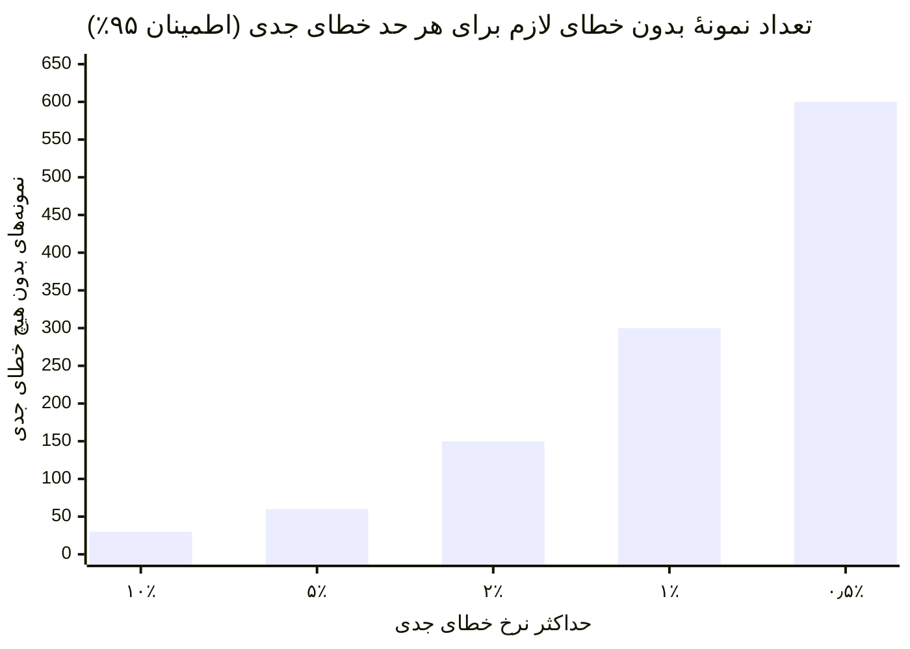
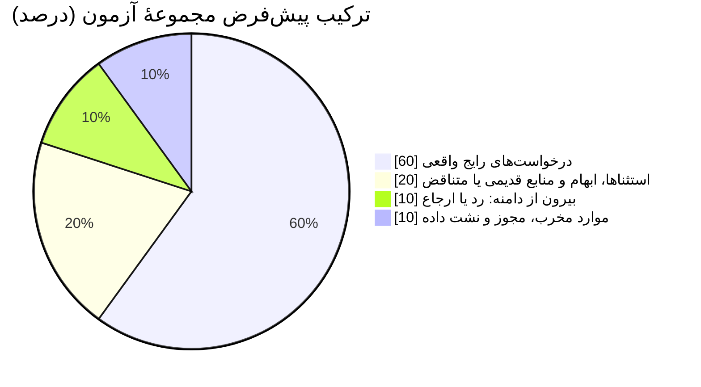
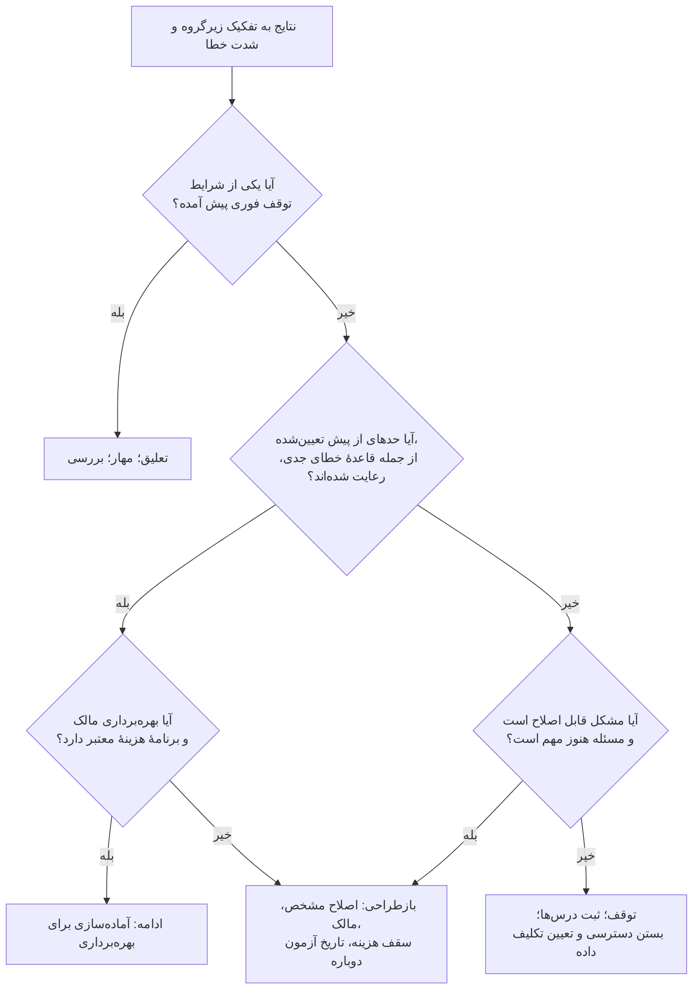
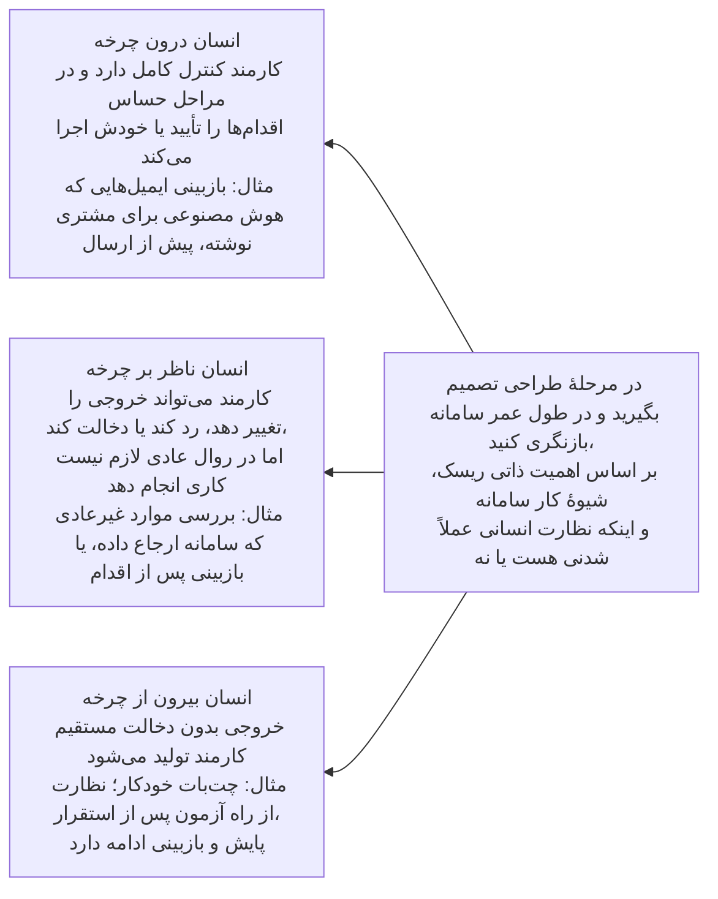
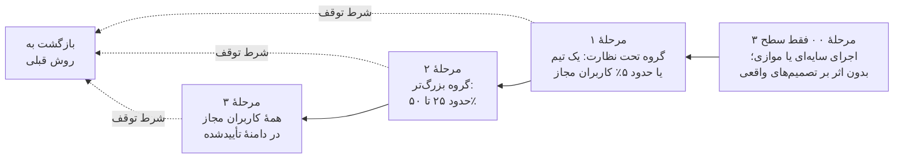
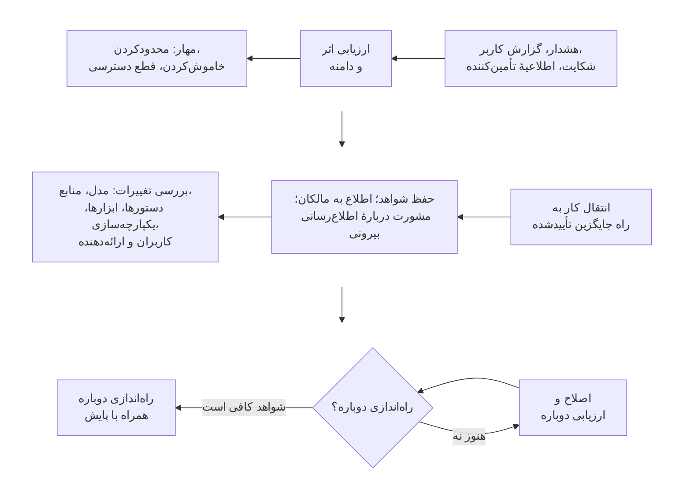

## ۶. طراحی و ارزیابی پایلوت

| کارت فصل | |
|---|---|
| **مالک** | مالک کسب‌وکار همراه با مسئول ارزیابی؛ بازبینان کنترلی و عملیات، میزان دسترسی کاربران به سامانه را می‌پذیرند |
| **چه زمانی شروع کنیم** | وضع موجود اندازه‌گیری شده، دادهٔ مجاز آماده است، کاربران و دامنه مشخص‌اند و راه مهار مشکلات طراحی شده |
| **مدت معمول (پیش‌فرض آغازین)** | سطح ۱: ۲ تا ۴ هفته · سطح ۲: ۸ تا ۱۲ هفته · سطح ۳: ۳ تا ۶ ماه یا بیشتر، بسته به شواهدی که لازم است |
| **خروجی‌ها** | منشور امضاشده، مجموعهٔ آزمون و معیار داوری با شمارهٔ نسخه، نتایج به تفکیک زیرگروه و شدت خطا، فهرست شکست‌ها، تصمیم |
| **ابزارها (پیوست ج)** | برگهٔ مسیر سریع (آزمون اولیهٔ سطح ۱)؛ منشور پایلوت و برنامهٔ ارزیابی؛ برآوردگر هزینه و ارزش |
| **میزان الزام** | در سطح‌های ۲ و ۳ الزامی: تعیین حد قبولی پیش از دیدن نتایج؛ مجموعهٔ آزمون کنارگذاشته؛ قاعدهٔ خطای جدی. سطح ۱: آزمون اولیه بدون هیچ خطای جدی |

### ۶.۱ هدف و پیش‌نیازها

پایلوت برای این است که ابهامی را برطرف کند که روی تصمیم سرمایه‌گذاری یا عرضه اثر دارد. باید از پیش روشن باشد چه چیزی آزموده می‌شود، چه نتیجه‌ای تصمیم را عوض می‌کند و بعد از پایلوت چه اتفاقی می‌افتد. نقطهٔ شروع: اندازه‌گیری وضع موجود، کاربران و دامنهٔ کار مشخص، دادهٔ مجاز، یک مالک و طراحی‌ای که راه مهار مشکلات را هم در بر دارد. پایلوتی که با کاربران واقعی، دادهٔ واقعی یا اقدام‌های واقعی سروکار دارد، همچنان به مجوزی متناسب با همین میزان دسترسی نیاز دارد.

**رویهٔ مستند:** یکی از دست‌اندرکاران مورگان استنلی از پایلوت نُه‌ماههٔ اولیه می‌گوید، از اینکه ارزیابی مبتنی بر شباهت متنی (cosine similarity) جواب نداد، از یک مجموعهٔ ۵۰۰ پرسشی برای آزمون مجدد پس از هر تغییر، و از یک طبقه‌بندی مشترک برای آزمون‌ها. JPMC از متخصصان موضوعی خواست درستی و کامل بودن پاسخ‌ها را بازبینی کنند و کاستی‌هایی پیدا کرد که ریشه‌شان در اسناد قدیمی بود. این نمونه‌ها نشان می‌دهند ارزیابی باید مخصوص همان کار باشد و پس از هر تغییر تکرار شود؛ نه اینکه پایلوت طول یا تعداد پرسش ثابتی داشته باشد. [D04 ll. 367–463; D25 pp. 12–13.]

### ۶.۲ پیش از آنکه کاربران بیشتری درگیر شوند، منشور پایلوت را بنویسید

مالک کسب‌وکار و مسئول ارزیابی بر سر این موارد توافق می‌کنند:

- فرضیه‌ای که پایلوت باید دربارهٔ آن تصمیم بگیرد، شیوهٔ فعلی کار و گزینه‌هایی که مقایسه می‌شوند.
- کاربران، انواع کار، زبان‌ها، حجم کار، دادهٔ مجاز و مرز اقدام‌هایی که سامانه اجازه دارد انجام دهد.
- نتیجهٔ اصلی، الزامات کیفیت و ایمنی، معیارهای عملیاتی و همهٔ هزینه‌هایی که باید ثبت شوند.
- روش ارزیابی، شیوهٔ ساختن مجموعهٔ آزمون، معیار داوری، بازبینی مستقل و مدتی که برای رسیدن به شواهد کافی لازم است.
- معیارهای ادامه، بازطراحی و توقف، از جمله شرایطی که باید فوراً کار را متوقف کرد.
- افراد مسئول، وقتی که برایشان آزاد شده، مسیر بازخورد و گزارش رخداد، راه جایگزین، و تاریخ و مرجع تصمیم.

حد قبولی را پیش از دیدن نتایج اعلام کنید و هر تغییری را که بعداً در آن می‌دهید با دلیلش ثبت کنید. **مدت‌های پیش‌فرض** در کارت فصل آمده است. برای مقایسه: آزمون پذیرش کاربر در پرودنشال حدود چهار ماه طول کشید و پایلوت اولیهٔ مورگان استنلی نُه ماه. پایلوت با یک تصمیم تمام می‌شود، نه با تمدید خودکار. [D29 pp. 16–19; D04 ll. 367–463.] حد قبولی را از نیاز کسب‌وکار، پیامد شکست، عملکرد وضع موجود و کنترل‌های عملی به دست آورید؛ درصدی که در نمونهٔ یک شرکت دیگر آمده، حد پیش‌فرض شما نیست. قالب منشور پایلوت و برنامهٔ ارزیابی در پیوست ج آمده است.

### ۶.۳ مجموعهٔ آزمونی بسازید که شبیه کار واقعی باشد

هر جا اجازه دارید، از نمونه‌های واقعی استفاده کنید که کار واقعی را نمایندگی می‌کنند: کارهای رایج، استثناهای پرهزینه، موارد مبهم، داده‌های ناقص، منابع قدیمی یا متناقض، کاربرانی با مجوزهای متفاوت، درخواست‌هایی که بیرون از دامنه‌اند و، اگر مرتبط است، ورودی‌های آسیب‌زا یا مخرب. برای پر کردن جاهای خالی می‌توانید نمونه‌های ساختگی بسازید، اما روی آن‌ها برچسب بزنید و بررسی کنید که واقع‌نما باشند. فرض نکنید نمونه‌های ساختگی تمام تنوع کار واقعی را بازسازی می‌کنند.

نمونه‌هایی را که برای نوشتن دستورها، تنظیم رفتار سامانه یا رفع اشکال به کار می‌برید، از نمونه‌هایی که برای ارزیابی نهایی کنار گذاشته‌اید جدا نگه دارید. دو مجموعه داشته باشید: یکی برای آزمون مجدد خطاهای شناخته‌شده پس از هر تغییر، و یکی که کنار گذاشته شده تا بسنجد سامانه روی موارد تازه هم درست کار می‌کند یا نه. هر نمونه را بر اساس نوع کار، پیامد، گروه کاربران و وضعیت منبع و مجوز برچسب بزنید تا عملکرد خوب در کل نتواند شکستی جدی در یک زیرگروه را پنهان کند. متخصصان حوزه باید تعریف کنند چه پاسخ یا اقدامی قابل قبول است، چه اطلاعاتی حتماً باید در پاسخ باشد و چه کاستی‌ای باعث رد پاسخ می‌شود. اختلاف نظرها را ثبت کنید و بر اساس معیار داوری حل کنید.

**چند نمونهٔ آزمون لازم است؟ تعداد را از ادعایی که باید ثابت کنید به دست آورید.**

دو نکتهٔ آماری نقطهٔ شروعی قابل دفاع به دست می‌دهد:

- **برای رد کردن خطاهای جدی (قاعدهٔ سه).** اگر در *n* نمونهٔ مستقل و واقعی هیچ خطای جدی دیده نشود، با حدود ۹۵٪ اطمینان می‌توان گفت نرخ واقعی خطای جدی حداکثر ۳ تقسیم بر *n* است. [E07] پس برای اینکه بگویید نرخ خطای جدی ۱٪ یا کمتر است، حدود ۳۰۰ نمونهٔ بدون خطا لازم دارید؛ برای ۲٪ حدود ۱۵۰ و برای ۵٪ حدود ۶۰. اگر حتی یک خطای جدی دیده شود، برای همان ادعا یا نمونه‌های بیشتری لازم است یا بازطراحی.
- **برای برآورد نرخ قبولی.** به‌جای فرمول سادهٔ ±۱٫۹۶√(p(1−p)/n)، که در نمونه‌های کوچک و نرخ‌های خیلی بالا یا خیلی پایین خوب کار نمی‌کند، از فاصلهٔ اطمینان ویلسون استفاده کنید. [E08] مثلاً اگر ۹۰٪ نمونه‌ها قبول شوند، فاصلهٔ اطمینان ۹۵٪ با ۱۰۰ نمونه تقریباً ۸۲٫۶ تا ۹۴٫۵٪ است، با ۲۰۰ نمونه تقریباً ۸۵٫۱ تا ۹۳٫۴٪ و با ۴۰۰ نمونه تقریباً ۸۶٫۷ تا ۹۲٫۶٪.

| حداکثر نرخ خطای جدی که می‌خواهید ثابت کنید (اطمینان ۹۵٪) | تعداد نمونهٔ بدون خطای لازم (≈ ۳ ÷ نرخ) |
|---|---|
| ۱۰٪ | ۳۰ |
| ۵٪ | ۶۰ |
| ۲٪ | ۱۵۰ |
| ۱٪ | ۳۰۰ |
| ۰٫۵٪ | ۶۰۰ |

این اعداد فقط وقتی معتبرند که نمونه‌ها واقعی و مستقل از هم باشند؛ ۳۰۰ نمونهٔ تقریباً تکراری چیز زیادی را ثابت نمی‌کند. همچنین این حدها **برای هر زیرگروه مهم** جداگانه صدق می‌کند، مثلاً برای هر خط محصول، هر زبان یا هر گروه مجوز. اگر بیشتر پیامدهای جدی در یک زیرگروه متمرکز است، تعداد نمونه‌های همان زیرگروه را جداگانه تعیین کنید.

**ترکیب پیش‌فرض مجموعهٔ آزمون** (آن را با ترکیب واقعی کارها تطبیق دهید): حدود ۶۰٪ درخواست‌های رایج واقعی؛ ۲۰٪ استثناهای پرهزینه، موارد مبهم و منابع قدیمی یا متناقض؛ ۱۰٪ درخواست‌های بیرون از دامنه که سامانه باید رد یا ارجاع دهد؛ ۱۰٪ موارد مخرب، آزمون مرز مجوزها و نشت داده. دست‌کم یک‌سوم نمونه‌ها را برای ارزیابی نهایی کنار بگذارید و هرگز برای تنظیم دستورها، بازیابی یا مدل از آن‌ها استفاده نکنید. این ترکیب **جمع‌بندی راهنما** است.

ونگارد از نمونه‌های «پرسش و کد SQL متناظر» هم برای راهنمایی مدل در دستور، هم برای ارزیابی و هم برای آزمون مجدد پس از تغییرات استفاده کرد؛ LCH حدود ۱۰۰ جفت پرسش و پاسخ مرجع از کارشناسان خدمات گردآوری کرد. این‌ها کارهایی است که واقعاً انجام شده. این راهنما یک نکته به آن اضافه می‌کند: جدا نگه‌داشتن نمونه‌های توسعه از نمونه‌های ارزیابی نهایی، تا اصلاح‌های پشت‌سرهم به اشتباه نشانهٔ قابل‌اتکا بودن در شرایط واقعی تلقی نشود. [D14 ll. 201–214; D26 ll. 216–246؛ **جداسازی نمونه‌ها: جمع‌بندی راهنما**.]

### ۶.۴ سامانه را در چند لایه ارزیابی کنید

| لایه | چه چیزی را بیازمایید | چرا روی تصمیم اثر دارد |
|---|---|---|
| داده و بازیابی | پوشش، به‌روز بودن، پیدا کردن منبع درست، مجوزها و حذف | پاسخی که روان و قانع‌کننده است می‌تواند خطای منبع یا دسترسی را پنهان کند |
| پاسخ و مدل | درستی، کامل بودن، تکیه بر منبع، اینکه منبع واقعاً پاسخ را پشتیبانی کند، امتناع بجا، ثبات | میانگین خوب، اطلاعات نادرست جدی یا کاستی‌ها را توجیه نمی‌کند |
| کار و فرایند | انجام کامل کار، زحمت بررسی و اصلاح، تحویل کار میان افراد، توان کاربر | خروجی‌ای که از نظر فنی درست است ممکن است بیش از آنچه کار را کم می‌کند، کار اضافه کند |
| کنترل‌ها | دسترسی غیرمجاز، نشت داده، اقدام‌های ممنوع، ارجاع و راه جایگزین | نشان می‌دهد سامانه در شرایط خرابی و سوءاستفاده چه می‌کند، نه فقط با درخواست‌های عادی |
| خدمت و اقتصاد | سرعت پاسخ در بار واقعی، در دسترس بودن، هزینهٔ بازبینی، هزینهٔ کامل هر نتیجهٔ موفق | نشان می‌دهد کار در عمل قابل انجام و پایدار است یا نه |
| گروه‌های تحت تأثیر | تفاوت‌های معنادار در دسترسی، کیفیت، خطا یا اثر | ضعف‌هایی را که در میانگین پنهان می‌ماند آشکار می‌کند؛ گردآوری داده دربارهٔ گروه‌ها و شیوهٔ گروه‌بندی باید از نظر حقوقی بررسی شود |

برای مدل‌های پیش‌بینی متعارف، ارزیابی را روی داده‌هایی انجام دهید که مدل ندیده است و نشت اطلاعات از آینده، اثرهای زمانی، محدودیت‌های عملی و رفتار در زیرگروه‌های مهم را بیازمایید. در کاربردهای سرمایه‌گذاری باید خود تصمیم و محدودیت‌های عملیاتی سنجیده شود، از جمله در صورت لزوم اثر هزینه‌های معاملاتی؛ اینکه مدل روی داده‌ها خوب جواب بدهد کافی نیست. پایلوت UOBAM به جابه‌جایی‌های زیادی در سبد سرمایه‌گذاری منجر شد که در عمل شدنی نبود، و پیش از بهره‌برداری بازنگری‌ای به رهبری کسب‌وکار لازم شد. [D34 pp. 22–23.]

در سامانه‌های مولد، آزمون‌ها را چند بار تکرار کنید تا ببینید پاسخ‌ها چقدر تغییر می‌کنند، کاستی‌ها را بسنجید و بررسی کنید که منابعی که سامانه نشان می‌دهد واقعاً پاسخ را تأیید می‌کنند. امتناعِ درست را از ناتوانی بی‌دلیل در پاسخ به پرسشی که باید پاسخ داده می‌شد جدا کنید. در سامانه‌هایی که اقدام انجام می‌دهند، کل مسیر را ارزیابی کنید: انتخاب ابزار، درستی پارامترها، مجوزها، داده‌ها و وضعیت در مراحل میانی، نتیجهٔ نهایی، رفتار در تکرار و اجرای دوباره، و امکان دخالت انسان و بازیابی. پاسخ نهایی خوب، اقدام‌های ناامن در میانهٔ راه را توجیه نمی‌کند. نمودار عامل در FINOS نشان می‌دهد که دسترسی‌های زمان اجرا، ابزارها، وضعیت، فراخوانی‌های مدل و بسته‌های مهارت چطور راه‌های حملهٔ به‌هم‌پیوسته‌ای می‌سازند؛ این نمودار نمونه‌ای برای شناخت ریسک است، نه طرحی برای کپی در محیط واقعی. [FINOS ri-6، چالش‌های آزمون و ارزیابی؛ F11 و کد PlantUML آن؛ mi-19، بخش‌های ۱ تا ۳؛ mi-24، بخش‌های ۱ تا ۷، پیش‌نویس.]

### ۶.۵ داوری متخصصان و ارزیابی خودکار را درست ترکیب کنید

ارزیابی خودکار می‌تواند نمونه‌های بیشتری را پوشش دهد و افت کیفیت پس از تغییرات را تشخیص دهد. اگر از یک مدل زبانی برای داوری خروجی‌ها استفاده می‌کنید، اول داوری آن را روی نمونه‌های واقعی با داوری متخصصان مقایسه کنید؛ اختلاف‌ها، سوگیری‌ها و انواع خطاهایش را بررسی کنید؛ و موارد پرپیامد یا نامطمئن را همچنان به انسان بسپارید. مدل داور، دستور آن و معیار داوری را با شمارهٔ نسخه نگه دارید و عملکرد و هزینهٔ خود داور را هم پایش کنید. **پیش‌فرض آغازین:** داور را دست‌کم روی ۱۰۰ نمونه که متخصصان برچسب زده‌اند و همهٔ انواع کار و همهٔ الگوهای شناخته‌شدهٔ خطای جدی را در بر می‌گیرند، تنظیم و سنجش کنید. در هر دسته‌ای که داور خطاهای جدی را که متخصصان دیده‌اند تشخیص نمی‌دهد، به آن تکیه نکنید و آن دسته را به انسان بسپارید. LCH امتیازدهی با مدل همراه با بازبینی مدیر را شرح می‌دهد. FINOS هم صریحاً «مدل زبانی در نقش داور» را مکمل نظارت انسانی می‌داند، نه جایگزین آن، و سنجش آن در برابر داوری متخصصان را لازم می‌داند. [D26 ll. 210–246; FINOS mi-15، بخش‌های ۴ تا ۶ و «چالش‌ها و ملاحظات».]

تعداد نمونه‌های آزمون را به این دلیل که شرکت دیگری ۱۰۰، ۵۰۰ یا چند هزار پرسش به کار برده انتخاب نکنید. آن را از تنوع کار، شدت پیامد خطا، میزان تغییر پاسخ‌ها، اطمینانی که لازم دارید و ظرفیت بازبینان به دست آورید. تعداد نمونه‌ها، شیوهٔ نمونه‌گیری، نمونه‌هایی که کنار گذاشته شدند، خطاها و میزان عدم‌قطعیت را گزارش کنید. یک نمونهٔ کوچک که فقط از سر دسترسی جمع شده، نتیجه‌گیری محدودتری را پشتیبانی می‌کند تا ارزیابی‌ای که نمایندهٔ کار واقعی است و به‌طور مستقل بازبینی شده.

### ۶.۶ علت شکست‌ها را پیدا کنید و تصمیم بگیرید

هر شکست مهم را در یکی از این دسته‌ها قرار دهید: تعریف مسئله، کیفیت منبع، محتوای ناموجود، بازیابی، معنای داده، دستور یا تنظیمات، رفتار مدل، مجوزها یا کنترل‌ها، یکپارچه‌سازی، بازبینی انسانی یا طراحی شیوهٔ کار. اصلاح را به مالک همان بخش بسپارید و آزمون‌هایی را که تحت تأثیر قرار می‌گیرند، همراه با آزمون مجدد خطاهای قبلی، دوباره اجرا کنید. تغییر مدل فقط یکی از چند راه‌حل است.

پرودنشال گزارش می‌کند که نرخ قبولی در آزمون‌ها ابتدا ۴۱٪ بود و پس از چند دور کار روی محتوا و ارزیابی، روی بیش از ۵۰۰ پرسش و با معیارهایی که خود شرکت تعریف کرده بود، به ۹۹٪ رسید. آزمون پذیرش کاربر حدود چهار ماه طول کشید و نگه‌داری مداوم محتوا همچنان لازم بود. این‌ها **نتایج گزارش‌شدهٔ آزمون** است؛ نه ثابت می‌کند سامانه در همه‌جا دقیق است، نه معیاری است که بشود به جای دیگر برد، و نه اثر واقعی آن بر کسب‌وکار را نشان می‌دهد. [D29 pp. 16–19.]

وقتی فایدهٔ کار و کنترل‌های لازم با شواهد نشان داده شده، محدودیت‌های باقیمانده با دامنهٔ تأییدشده جور است و بهره‌برداری مالک و برنامهٔ هزینهٔ معتبر دارد، **ادامه دهید**. وقتی مسئله هنوز مهم است اما داده، شیوهٔ کار، کیفیت یا اقتصاد طرح به دلیلی قابل اصلاح شکست خورده، **بازطراحی کنید** و آزمایش بعدی و سقف بودجه‌اش را مشخص کنید. وقتی ارزشی دیده نمی‌شود، محدودیت‌ها رعایت‌شدنی نیستند، آسیب قابل مهار نیست یا هزینهٔ فرصت قابل قبول نیست، **متوقف کنید**. شرایط توقف فوری همیشه بر میانگین خوب مقدم است.

**خروجی‌ها:** منشور تکمیل‌شده، مجموعهٔ ارزیابی و معیار داوری با شمارهٔ نسخه، نتایج به تفکیک کار و شدت خطا، فهرست شکست‌ها، شواهد کنترل‌ها، یافته‌های کاربران، سابقهٔ هزینه و تصمیم امضاشده. **نشانه‌های شکست:** نمایشی پرزرق‌وبرق بدون اندازه‌گیری وضع موجود؛ تغییر معیار قبولی پس از دیدن نتایج؛ گزارش‌کردن فقط نمونه‌های خوب؛ یا پایلوتی که بدون هیچ تصمیمی ادامه پیدا می‌کند. ساخت، ارزیابی و گرفتن بازخورد از کاربران چند بار پشت سر هم تکرار می‌شوند، اما درگیر کردن کاربران بیشتر باید منتظر شواهد و تصمیمی بماند که از پیش توافق شده است.

## ۷. از پایلوت تا بهره‌برداری

| کارت فصل | |
|---|---|
| **مالک** | مسئول فنی و مالک عملیات آماده می‌کنند؛ مالک کسب‌وکار کفایت سامانه را می‌پذیرد؛ مرجع تأیید عرضه تصمیم می‌گیرد |
| **چه زمانی شروع کنیم** | تصمیم پایلوت «ادامه» بوده و دامنه، مالک و بودجهٔ بهره‌برداری تأمین شده است |
| **مدت معمول (پیش‌فرض آغازین)** | سطح ۲: ۴ تا ۸ هفته تا نخستین گروه کاربران؛ سطح ۳: بسته به طول اجرای سایه‌ای و مراحل عرضه |
| **خروجی‌ها** | بستهٔ شواهد عرضه، چک‌لیست امضاشده، دفترچهٔ عملیات، برنامهٔ پایش، کلید توقف و راه جایگزینی که آزموده شده |
| **ابزارها (پیوست ج)** | چک‌لیست آمادگی عرضه؛ دفترچهٔ عملیات، رخداد و تغییر |
| **میزان الزام** | در سطح‌های ۲ و ۳ الزامی: امکان خاموش‌کردن که آزموده شده، مسئولان مشخص برای واکنش، سابقهٔ عرضه با شمارهٔ نسخه. سطح ۱: تنظیم ابزار مجاز و راهی برای بازخورد |

### ۷.۱ هدف و پیش‌نیازها

هدف این است که قابلیت در دل یک خدمت واقعی و با همهٔ مسئولیت‌هایش قابل‌اتکا شود. پایلوت موفق شواهدی برای تصمیم عرضه فراهم می‌کند، اما ثابت نمی‌کند که یکپارچه‌سازی، امنیت، پشتیبانی و تداوم خدمت آماده‌اند. پیش‌نیازها: شواهد پایلوت که پذیرفته شده، دامنهٔ مشخص برای بهره‌برداری، مالک عملیاتی که بودجه دارد و بازبینی‌هایی که برای این میزان دسترسی کاربران تمام شده‌اند.

MindForge توصیه می‌کند این‌ها را داشته باشید: برنامهٔ پایش، مسئولان مشخص برای واکنش، اقدام‌های اضطراری، عرضه‌ای متناسب با ریسک، آموزش هدفمند کاربران و بررسی‌های مستند پیش از عرضه. نمونهٔ CodeBuddy در بانک DBS بازبینی کد توسط کاربر، مدل‌های تأییدشده، آزمون عملکرد، امکان خاموش‌کردن، عرضهٔ مرحله‌ای، آموزش و آزمودن تغییرات را شرح می‌دهد. [D30 pp. 99–103; D29 p. 8.]

### ۷.۲ بستهٔ شواهد عرضه را آماده کنید

مسئول فنی و مالک عملیات بسته‌ای آماده می‌کنند که این موارد را یکجا داشته باشد:

۱. دامنهٔ تأییدشدهٔ کاربرد، مالک، کاربران، مکان‌ها، داده‌ها و اقدام‌ها، همراه با محدودیت‌هایی که صریح نوشته شده‌اند.  
۲. معماری و مسیر داده‌ها، و نسخهٔ دقیق مدل‌ها، دستورها، تنظیمات بازیابی، منابع و نمایه‌ها، ابزارها و کدهای مرتبط.  
۳. آزمون‌های کار، کنترل‌ها و امنیت؛ نقص‌هایی که هنوز حل نشده؛ تصمیم‌های حقوقی و انطباق؛ بازبینی مستقل و پذیرش کسب‌وکار.  
۴. شواهد مربوط به هویت کاربران، مجوزها، مدیریت رمزها و کلیدها، نگه‌داری و حذف داده و دسترسی تیم پشتیبانی.  
۵. شواهد بار، سرعت پاسخ، در دسترس بودن و هزینه برای تعداد کاربرانی که برنامه‌ریزی شده؛ وابستگی به شرکت‌های دیگر و خدمات مشترک.  
۶. پایش، هشدارها، مسیر ارجاع، کشیک و پشتیبانی، به‌روزرسانی محتوا، رویه‌های تغییر و تاریخ‌های بازبینی.  
۷. امکان خاموش‌کردن و بازگشت به نسخهٔ قبل (یا هر روش امن دیگر) که آزموده شده، و روال ادامهٔ کار به‌صورت دستی.  
۸. آموزش کاربران، ظرفیت نظارت، اطلاع‌رسانی و هر اعلام یا تأییدی که قوانین محلی لازم می‌داند.

به همهٔ بازبینان همان شواهد پایه را بدهید، همراه با خلاصه‌ای روشن از تغییراتی که از آخرین بازبینی‌شان پیش آمده. پرودنشال شرح می‌دهد که پیش از تأیید نهایی، نتایج آزمون، اثر حفاظ‌ها و اسناد معماری را بایگانی کرد، و همچنین از تأخیرهایی می‌گوید که بازبینی‌های هم‌پوشان ایجاد کردند. درسی که می‌شود گرفت، یکجا کردن شواهد و روشن بودن شرایط است، نه کپی کردن نام کمیته‌های آن‌ها. [D29 pp. 17–18.]

### ۷.۳ سامانه را در روال کار و نقش انسان جا بیندازید

مشخص کنید کاربر کجا با قابلیت روبه‌رو می‌شود، چه اطلاعاتی می‌بیند، چطور خروجی را بررسی، قبول، رد یا ویرایش می‌کند، چه چیزی در سوابق یا سامانه‌های دیگر ثبت می‌شود و وقتی سامانه نمی‌تواند کمک کند چه اتفاقی می‌افتد. هر جا سامانه‌های فعلی کار را پشتیبانی می‌کنند از همان‌ها استفاده کنید؛ کاربران را مجبور نکنید اطلاعات زمینه‌ای را در چند ابزار جدا از نو وارد کنند. مدیر اجرایی LPL می‌گوید بینش‌ها باید درون ClientWorks (سامانهٔ کاری مشاوران) نمایش داده شوند و بخشی از این یکپارچه‌سازی هنوز در حال ساخت بود. JPMC در دستیار Coach چند پنجرهٔ گفت‌وگوی موضوعی را که مشاوران را سردرگم کرده بود، در یک پنجره یکی کرد. [D27 ll. 254–293; D25 p. 13.]

نظارت انسانی را یک کار عملیاتی مشخص تعریف کنید: چه کسی، در کدام مرحله، با دیدن کدام منابع، با چه حجم کاری و با چه اختیاری برای رد یا ارجاع، بازبینی می‌کند. بسته به ریسک و امکان عملی، یکی از این‌ها را انتخاب کنید: تأیید پیش از هر اقدام، رسیدگی فقط به موارد استثنا، یا نظارت پس از اقدام (نمونه‌ای یا پیوسته). هر جا انسان نمی‌تواند خطای جدی را به‌طور قابل‌اتکا تشخیص دهد، اختیار سامانه را کم کنید یا کنترل را از نو طراحی کنید؛ فرض نکنید یک دکمهٔ «بازبینی» مشکل را حل می‌کند. MindForge سه حالت را از هم جدا می‌کند: انسان درون چرخهٔ تصمیم، انسان ناظر بر چرخه، و انسان بیرون از چرخه؛ و بر مهارت و اختیار واقعی فرد ناظر تأکید می‌کند. [D30 pp. 77–78, 109–110.]

*شکل‌های نظارت انسانی، بازترسیم‌شده از MindForge که این دسته‌بندی را از چارچوب الگوی حاکمیت هوش مصنوعی IMDA/PDPC سنگاپور گرفته است. [D30 pp. 77–78]*

### ۷.۴ با دامنهٔ مشخص و مرحله‌به‌مرحله عرضه کنید

بسته به کار، یکی از این شیوه‌ها را انتخاب کنید: اجرای سایه‌ای یا موازی، یک گروه تحت نظارت، دامنهٔ محدود در محیط واقعی یا عرضهٔ مرحله‌ای. اجرای سایه‌ای نباید روی تصمیم‌های واقعی اثر بگذارد، مگر اینکه اجازه‌اش داده شده باشد. گروه کاربران، اقدام‌های مجاز، مدت، شدت پایش و معیارهای گسترش یا عقب‌نشینی را تعریف کنید. حتی در عرضهٔ محدود، مطمئن شوید که استفاده از دادهٔ واقعی و کاربران واقعی مجوزهای لازم را دارد.

مرجع تأیید عرضه، با تکیه بر تصمیم‌های کسب‌وکار، فنی، عملیاتی و کنترلی، دامنهٔ مجاز، شرایط و تاریخ انقضا یا بازبینی را تعیین می‌کند. عرضهٔ مشروط باید اقدام‌ها و محدودیت‌هایی را که باقی مانده نام ببرد و نمی‌تواند الزامات حتمی حل‌نشده را پنهان کند. امکان بازگشت به روش قبلی کار را حفظ کنید.

**شیوهٔ پیش‌فرض عرضه.** راهنمای مهندسی پایداری سایت (SRE) گوگل «قناری» را استقراری جزئی و موقت تعریف می‌کند که با یک گروه کنترل مقایسه می‌شود. این راهنما توصیه می‌کند تعداد کاربران و مدت آن آن‌قدر باشد که نمایندهٔ کل باشد، از جمله ساعت‌های اوج بار را پوشش دهد، و در هر زمان فقط یک قناری اجرا شود. مثال خود این راهنما ۵٪ ترافیک است. [E12] کاربرد این روش در هوش مصنوعی:

هر مرحله را دست‌کم به اندازهٔ یک دورهٔ کامل کسب‌وکار ادامه دهید، طوری که اوج کار یا کارهای پایان دوره را هم شامل شود. فقط وقتی معیارهای هر مرحله برآورده شد، دامنه را گسترش دهید. در هر زمان فقط یک چیز را تغییر دهید تا اگر مشکلی پیش آمد، بتوان علتش را پیدا کرد. این درصدها **پیش‌فرض آغازین** هستند، نه قاعدهٔ قطعی.

### ۷.۵ بهره‌برداری با پایشی که به اقدام منجر می‌شود

| آنچه پایش می‌شود | مسئول | شرط و واکنشی که سازمان باید تعریف کند |
|---|---|---|
| کیفیت کار و خطاهای جدی | مالک کسب‌وکار / مسئول ارزیابی | بررسی، محدودکردن پاسخ‌ها یا اقدام‌ها، اصلاح داده یا تعلیق |
| به‌روز بودن منابع، ورود و بازیابی داده و تغییر معنای داده‌ها | مالک محتوا / داده | به‌روزرسانی، کنار گذاشتن موقت منابع آسیب‌دیده، آزمون دوباره و اطلاع به استفاده‌کنندگان |
| مجوزها، نشت داده و سوءاستفاده از ابزار یا اعتبارنامه | امنیت اطلاعات همراه با تیم خدمت | مهار، قطع دسترسی، حفظ شواهد و اجرای رویه‌های رخداد |
| در دسترس بودن، سرعت پاسخ، خطاها و وابستگی‌ها | مالک عملیات | ارجاع به پشتیبانی، کاستن امن از قابلیت‌ها یا اجرای برنامهٔ تداوم |
| میزان استفاده، نادیده‌گرفتن خروجی، کارهای نیمه‌کاره و شکایت‌ها | مالک کسب‌وکار / محصول | بررسی اینکه مشکل از شیوهٔ کار است، سوءاستفاده است یا نیاز به آموزش |
| هزینه و مصرف منابع | مالک خدمت و واحد مالی | هشدار، محدودکردن مصرف بر اساس اولویت‌های تأییدشده، بررسی و پیش‌بینی دوباره |

برای هر معیار این‌ها لازم است: تعریف، منبع داده، حد هشدار، تواتر بازبینی، مسئول مشخص برای واکنش، اختیار واکنش و شواهد بسته شدن موضوع.

**تواتر پیش‌فرض.** سطح ۱: بازبینی ماهانهٔ میزان استفاده و بازخوردها. سطح ۲: هر ماه دست‌کم ۵۰ مورد از کار واقعی را انسان بازبینی کند، به‌علاوهٔ هشدار فوری برای دسترسی، نشت داده و هزینه. سطح ۳: در نخستین دورهٔ کسب‌وکار هر هفته دست‌کم ۵۰ مورد، سپس بر اساس ریسک؛ هشدار فوری برای همهٔ کنترل‌های حیاتی. نمونهٔ ۵۰تایی بدون خطا فقط نشان می‌دهد نرخ خطای جدی بالاتر از حدود ۶٪ نیست؛ پس نمونه‌گیری را با گزارش‌های کاربران، پیگیری مواردی که کاربران خروجی را نادیده گرفته‌اند و بررسی هدفمند موارد پرپیامد تکمیل کنید. [E07; D30 p. 108]

آن‌قدر لاگ ثبت کنید که بشود هر رویداد مهم را بررسی کرد، و در همان حال قواعد سازمان دربارهٔ حداقل‌سازی داده، دسترسی و مدت نگه‌داری را رعایت کنید. هر جا لازم است، نسخهٔ مدل، تنظیمات، منابع و اقدام‌ها را ردیابی کنید؛ نگه‌داشتن همهٔ دستورهای خام برای همیشه الزامی همگانی نیست. [FINOS mi-4، بخش‌های ۱ تا ۶؛ mi-9، رویه‌های هشدار و واکنش؛ D30 pp. 100, 109–113.]

### ۷.۶ به رخدادها واکنش نشان دهید و تغییرات را کنترل کنید

وقتی یکی از شرایط هشدار فعال می‌شود، مسئول رخداد باید اثر را ارزیابی کند، قابلیت یا دسترسی آسیب‌دیده را مهار کند، کار را به راه جایگزین تأییدشده منتقل کند، شواهد را حفظ کند، به مالکان مرتبط در سازمان اطلاع دهد و دربارهٔ هر تعهدی برای اطلاع‌رسانی بیرونی یا جبران خسارت، مشورت حقوقی بگیرد. تغییرات اخیر در مدل، منابع، دستورها، ابزارها، یکپارچه‌سازی، کاربران و ارائه‌دهنده را بررسی کنید. اقدام‌های اصلاحی را ثبت کنید و پیش از راه‌اندازی دوبارهٔ خدمت، ارزیابی متناسبی انجام دهید.

تغییرات را بر اساس اثرشان طبقه‌بندی کنید، نه بر اساس اینکه چند خط کد عوض شده. مخاطب تازه، منبع تازه، ارائه‌دهندهٔ تازه، مجوز تازه برای اقدام یا خط‌مشی تازه برای اسناد می‌تواند ریسک را به‌شدت تغییر دهد. تغییر را ثبت کنید، آزمون‌های مجدد و آزمون‌های کنترلی مرتبط را اجرا کنید، تأیید لازم را بگیرید و فهرست کاربردها را به‌روز کنید. به‌روزرسانی‌هایی که تأمین‌کننده خودش اعمال می‌کند، اگر نشود پیشاپیش آزمودشان، ممکن است پایش یا محدودیت بیشتری لازم داشته باشند. ثابت نگه‌داشتن نسخهٔ مدل، اگر ارائه‌دهنده اجازه بدهد، به کنترل تغییرات کمک می‌کند؛ اما تغییر تدریجی داده‌ها را از بین نمی‌برد و دلیلی نیست که یک نسخهٔ بدون پشتیبانی را برای همیشه نگه دارید. [D30 pp. 112–113; FINOS mi-10، راهنمای اجرا.]

**خروجی‌ها:** چک‌لیست آمادگی امضاشده، سابقهٔ عرضه با شمارهٔ نسخه، دفترچهٔ عملیات، برنامهٔ پشتیبانی و پایش، شواهد آموزش، برنامهٔ اضطراری آزموده و سوابق تغییرات و رخدادها. وقتی تیم عملیاتیِ پاسخ‌گو می‌تواند قابلیت را اجرا کند، آن را زیر نظر داشته باشد و متوقفش کند، و دامنهٔ بهره‌برداری تأییدهای لازم را گرفته، **کار را ادامه دهید**. **نشانه‌های شکست:** هشدارها به دست هیچ‌کس نمی‌رسد؛ محتوا کسی را ندارد که به‌روزش کند؛ نمی‌شود قابلیت هوش مصنوعی را خاموش کرد بی‌آنکه فرایند اصلی از کار بیفتد؛ یا تغییرات تأمین‌کننده بدون آزمون وارد سامانه می‌شود. یکپارچه‌سازی و نوشتن دفترچهٔ عملیات می‌تواند هم‌زمان با آخرین ارزیابی‌های پایلوت پیش برود، اما دسترسی کاربران واقعی باید منتظر تکمیل شرایط عرضه بماند.
