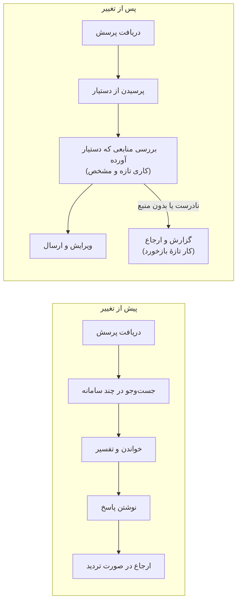
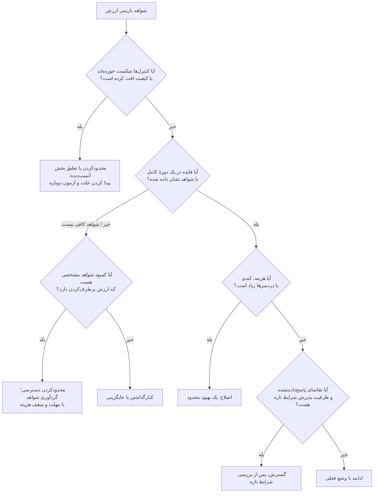
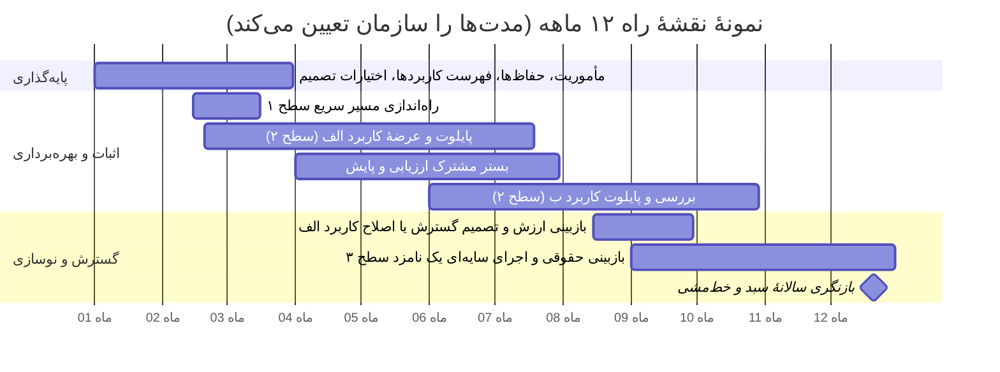

## ۸. پشتیبانی از پذیرش و تغییر شیوهٔ کار

| کارت فصل | |
|---|---|
| **مالک** | مالک کسب‌وکار مسئول تغییر و فایدهٔ آن است؛ مدیران مستقیم وقت کارکنان را آزاد می‌کنند؛ منابع انسانی و آموزش پشتیبانی می‌کنند |
| **چه زمانی شروع کنیم** | از همان مرحلهٔ بررسی مسئله، و بعد به‌طور مداوم در طول بهره‌برداری |
| **مدت معمول (پیش‌فرض آغازین)** | آموزش متناسب با نقش پیش از هر مرحلهٔ عرضه تمام شود؛ بازبینی پذیرش در روزهای ۳۰، ۶۰ و ۹۰ پس از عرضه |
| **خروجی‌ها** | شرح شیوهٔ کار جدید، تغییرات نقش‌ها، شواهد مهارت، فهرست بازخوردها، بازبینی پذیرش |
| **ابزارها (پیوست ج)** | برنامهٔ نیروی انسانی، ظرفیت و پذیرش؛ خط‌مشی استفادهٔ مجاز |
| **میزان الزام** | در همهٔ سطوح الزامی: آموزش خط‌مشی استفاده و راهی برای بازخورد. سطح‌های ۲ و ۳: سنجش مهارت متناسب با نقش روی کارهای واقعی |

### ۸.۱ هدف و پیش‌نیازها

شیوهٔ کار جدید را برای کسانی که انجامش می‌دهند مفید، قابل فهم و پایدار کنید. از همان مرحلهٔ بررسی مسئله شروع کنید: کاربران را مشارکت دهید، مدیران مستقیم را درگیر کنید و برای یادگیری وقت بگذارید. بعد از عرضه هم ادامه دهید، چون استفادهٔ واقعی موارد استثنا و نیازهای پشتیبانی تازه‌ای را آشکار می‌کند.

BNY مسیری را شرح می‌دهد که با دسترسی و آشنایی شروع می‌شود و به مهارت‌های متناسب با نقش، ساختن عملی و پشتیبانی از سوی جامعهٔ کاربران می‌رسد. ونگارد استخدام افراد باتجربه، کمک شرکا، آموزش متناسب با نقش و رویدادهای یادگیری مکرر را شرح می‌دهد. این‌ها رویکردهایی است که سازمان‌ها واقعاً اجرا کرده‌اند، نه شاهدی بر اینکه یک شیوهٔ آموزشی خاص به‌تنهایی پذیرش یا ارزش ایجاد می‌کند. کمبود آموزش رایج است: در پیمایش ۲۰۲۴ مایکروسافت و لینکدین، فقط ۳۹٪ کسانی که در کارشان از هوش مصنوعی استفاده می‌کردند از شرکتشان آموزش دیده بودند. [E06] [D12 pp. 2–4; D36 ll. 118–151.]

### ۸.۲ کار را حول نتیجهٔ مطلوب از نو طراحی کنید

برای هر نقشی که تحت تأثیر قرار می‌گیرد، مالک کسب‌وکار و مدیر مستقیم شرح می‌دهند که کار پیش و پس از استقرار چه شکلی دارد: چه چیزی حذف می‌شود، چه چیزی می‌ماند، چه چیزی اضافه می‌شود و چه چیزی ارجاع داده می‌شود؛ هوش مصنوعی چه چیزی تولید می‌کند؛ فرد چه چیزی را باید بررسی کند؛ و موارد استثنا چطور به دست کسی می‌رسد که صلاحیت رسیدگی دارد. وقت بررسی، اصلاح، مستندسازی و نظارت را هم در شیوهٔ کار جدید حساب کنید. با کارکنانی که این کارها را انجام خواهند داد و تیم‌هایی که خروجی کارشان را می‌گیرند مشورت کنید.

این نمودار نشان می‌دهد چرا بازطراحی مهم است: بررسی منابع و گزارش‌دادن خطا کارهای تازه‌ای هستند که باید آموزش داده شوند، زمانشان سنجیده شود و در محاسبه‌ها بیایند.

تصمیم بگیرید سازمان با وقتی که آزاد می‌شود چه می‌خواهد بکند: خدمت بهتر، پاسخ به تقاضای بیشتر، کم‌کردن کارهای عقب‌افتاده، تغییر ترکیب نقش‌ها یا صرفه‌جویی مالی. کاری را که مدیریت باید انجام دهد تا این فایده واقعاً به دست آید ثبت کنید. صرفه‌جویی چند دقیقه‌ای خودبه‌خود درآمد نمی‌آورد یا هزینه را کم نمی‌کند. پیامدهای این تغییر برای کارکنان را صادقانه بگویید؛ دربارهٔ امنیت شغلی یا تعدیل نیرویی که مدیران هنوز دربارهٔ آن تصمیم نگرفته‌اند وعده ندهید.

### ۸.۳ مهارت متناسب با هر نقش بسازید

| مخاطب | آنچه باید عملاً بتواند انجام دهد | نشانهٔ مهارت |
|---|---|---|
| مدیران ارشد و میانی | انتخاب مسئله، تفسیر شواهد، تخصیص ظرفیت و تصمیم‌گیری دربارهٔ ریسک و ارزش | بازبینی یک پیشنهاد واقعی و توضیح تصمیم و محدودیت‌هایش |
| کاربران کسب‌وکار | استفاده از ابزار در دامنهٔ مجاز، بررسی خروجی و رسیدگی به استثناها | انجام چند کار واقعی، از جمله کاری که خروجی آن نادرست یا بیرون از دامنه است |
| متخصصان حوزه و محتوا | نگه‌داری منابع، برچسب‌گذاری نمونه‌ها و شناسایی کاستی‌های پرپیامد | به‌کارگیری یکسان معیار داوری و رفع کمبودهای محتوا |
| سازندگان سامانه | اجرای روش‌های تأییدشده برای داده، کنترل، ارزیابی و تغییر | نشان‌دادن آزمون‌ها و شیوهٔ رسیدگی به خطا در معماری انتخاب‌شده |
| بازبینان و تیم عملیات | به چالش کشیدن شواهد، پایش، بررسی، و توقف و بازیابی امن | انجام یک بازبینی یا تمرین رخداد و بازگشت به نسخهٔ قبل |

آموزش عمومی زبان مشترک می‌سازد، اما آمادگی برای استفاده از یک سامانهٔ مشخص فقط با تمرین روی همان کار به دست می‌آید. عمق آموزش را متناسب با نقش و میزان سروکار فرد با سامانه تعیین کنید. هر جا قانون وظیفه‌ای برای سواد هوش مصنوعی تعیین کرده، شواهد اقدام‌هایتان را نگه دارید (بخش ۴.۲، [E09]). جولیوس بِر آموزش الکترونیکی عمومی و اجباری، نمایش آشکار محدودیت‌های سامانه به کاربران و یک گروه اولیهٔ آموزش‌دیده را شرح می‌دهد. این تجربه نشان می‌دهد ترکیب آموزش و دسترسی کنترل‌شده مفید است، اما ثابت نمی‌کند که آموزش به‌تنهایی برای تصمیم‌های خودکار پرپیامد کافی باشد. [D29 p. 12; D30 pp. 102, 104.]

### ۸.۴ بازخوردی راه بیندازید که واقعاً محصول را تغییر دهد

راهی ساده فراهم کنید تا کاربران رفتار نادرست، ناقص، ناامن یا غیرقابل استفادهٔ سامانه را گزارش کنند و در صورت لزوم با یک انسان حرف بزنند. آن‌قدر از جزئیات را ثبت کنید که بشود مشکل را بازسازی و بررسی کرد، بی‌آنکه اطلاعات حساس بی‌جهت در دسترس قرار گیرد. برای هر گزارش اولویت، شدت، مالک و وضعیت بسته شدن تعیین کنید. هر جا ممکن است، به کاربران بگویید چه چیزی تغییر کرد. بازخورد مستقیم را کنار داده‌های دیگر بگذارید: میزان انجام کامل کار، دوباره‌کاری، مواردی که خروجی نادیده گرفته شده و گزارش‌های پشتیبانی. تعریف و تمجیدهای پرشور و تعداد ورود به سامانه کافی نیست.

جامعه‌های کاربری، کاربران پیشرو، ساعت‌های مشاوره، جلسه‌های نمایش و کتابخانه‌های دستور می‌توانند روش‌های خوب را میان کارکنان پخش کنند. این‌ها را ابزارهای کمکی و اختیاری بدانید که روش‌ها و محتوای مشترکشان زیر نظر است. یک روال کاری که کارکنان ساخته‌اند و دیگران هم از آن استفاده می‌کنند، وقتی با اجزای دیگر ترکیب شود، ممکن است مسیرهای دادهٔ تازه یا اقدام‌های تازه‌ای ایجاد کند؛ تأیید هر جزء به‌تنهایی، نیاز به ارزیابی ترکیب آن‌ها را از بین نمی‌برد.

روایت‌های مورگان استنلی بر مشارکت کاربران و نقش روشن انسان تأکید دارند، و BNY از جامعه‌های کاربری و آموزش متناسب با نقش بهره می‌گیرد. توجه کنید که D09 تفسیر یک مدرس دانشگاه از تجربهٔ مورگان استنلی است، در حالی که D05 و D08 روایت کسانی است که خودشان در کار بوده‌اند. هنگام استفاده از درس‌های این منابع، این تفاوت را در نظر داشته باشید. [D09 ll. 69–164; D05 ll. 43–85; D12 pp. 3–4; FINOS mi-11، بخش‌های ۱ تا ۳ و ۶.]

### ۸.۵ پذیرش را با تغییر در شیوهٔ کار بسنجید

این‌ها را پیگیری کنید: تعداد کاربران مجاز، استفادهٔ مکرر برای کارهای مورد نظر، انجام کامل و کیفیت کار، زحمت اصلاح، الگوی نادیده‌گرفتن خروجی و ارجاع، و بار کاری کاربران. نتایج را به تفکیک نقش و شرایط مهم ببینید. پذیرش کم ممکن است نشانهٔ کم‌فایده بودن سامانه، یکپارچگی ضعیف با روال کار، بی‌اعتمادی، مهارت ناکافی، زیرساخت نامناسب یا مسئله‌ای باشد که از اول درست انتخاب نشده. پیش از اینکه آموزش بیشتر تجویز کنید یا استفاده را اجباری کنید، علت را پیدا کنید.

**خروجی‌ها:** شرح شیوهٔ کار جدید، تغییرات نقش‌ها و ظرفیت، برنامهٔ آموزش و شواهد مهارت، اطلاع‌رسانی، فهرست بازخوردها و بازبینی پذیرش. **مسئولان:** مالک کسب‌وکار مسئول تغییر و فایدهٔ آن است؛ مدیران مستقیم وقت کارکنان را آزاد می‌کنند؛ منابع انسانی، آموزش و تیم محصول پشتیبانی می‌کنند؛ متخصصان حفاظ‌ها را نگه می‌دارند. وقتی کاربران می‌توانند کار را با مهارت انجام دهند، پشتیبانی در دسترس است و شواهد نشان می‌دهد شیوهٔ جدید مفید است، **سراغ پذیرش گسترده‌تر بروید**. **نشانه‌های شکست:** شرکت در کلاس به‌جای توانایی واقعی شمرده شود؛ تشویق‌هایی برای استفادهٔ بیشتر که باعث شود خروجی‌ها بدون بررسی پذیرفته شوند؛ یا ادعاهای افزایش بهره‌وری که هزینهٔ بررسی را حساب نکرده‌اند. کار روی نیروی انسانی هم‌زمان با طراحی و ساخت پیش می‌رود و در دورهٔ بهره‌برداری و گسترش هم ادامه دارد.

## ۹. سنجش نتایج و گسترش سنجیده

| کارت فصل | |
|---|---|
| **مالک** | مالک کسب‌وکار و واحد مالی فایده‌ها و هزینه‌ها را تأیید می‌کنند؛ مالکان عملیات و کنترل تأیید می‌کنند که ادامهٔ کار مناسب است؛ مرجع تصمیم‌گیری سبد برای گسترش بودجه می‌گذارد |
| **چه زمانی شروع کنیم** | پیش از عرضه (برای اندازه‌گیری وضع موجود) و سپس در هر بازبینی |
| **مدت معمول (پیش‌فرض آغازین)** | نخستین بازبینی ارزش ۹۰ روز پس از عرضهٔ کامل؛ سپس بسته به سطح ریسک: سطح ۱ سالانه، سطح ۲ هر ۶ ماه، سطح ۳ هر سه ماه، و پس از هر تغییر مهم |
| **خروجی‌ها** | دفتر نتایج و هزینه‌ها، ارزیابی کیفیت شواهد، تصمیم گسترش، اصلاح، ادامه یا کنارگذاشتن |
| **ابزارها (پیوست ج)** | بازبینی ارزش و راهنمای تصمیم؛ برآوردگر هزینه و ارزش |
| **میزان الزام** | در سطح‌های ۲ و ۳ الزامی؛ در سطح ۱ میزان استفاده و ارزشی که خود کاربران گزارش می‌کنند پیگیری می‌شود |

### ۹.۱ هدف و پیش‌نیازها

روشن کنید که آیا سامانه، با هزینه و اثری قابل قبول، آن‌قدر ارزش ایجاد می‌کند که ادامه یا گسترشش موجه باشد. نقطهٔ شروع: اندازه‌گیری توافق‌شدهٔ وضع موجود، داده‌های عملیاتی، شواهد کیفیت، هزینه‌ها و مالک کسب‌وکاری که بتواند شیوهٔ کار یا سرمایه‌گذاری را تغییر دهد.

منابع نتایج متفاوتی گزارش می‌کنند: شوآب می‌گوید دستیارش ممکن است در تماس‌های پیچیده تا دو دقیقه وقت صرفه‌جویی کند؛ ونگارد برای زمان کدنویسی و بهره‌وری کل فرایند توسعهٔ نرم‌افزار اعداد متفاوتی گزارش می‌کند؛ و LPL فایده‌هایی را که از ابزارهای بیرونی نقل شده از معیارهای دقیق‌تر ابزارهای داخلی جدا می‌کند. این نمونه‌ها خوب نشان می‌دهند چرا باید تعریف هر معیار و کیفیت شواهد آن را همیشه صریح نوشت. [D11 ll. 109–113; D36 ll. 285–293; D27 ll. 345–374.]

### ۹.۲ دفتر نتایج و هزینه‌ها را نگه دارید

| لایهٔ سنجش | پرسش نمونه | نکتهٔ تفسیر |
|---|---|---|
| نتیجهٔ کسب‌وکار | آیا پرسش‌ها درست حل می‌شوند، پرونده‌ها کامل می‌شوند، صف‌ها کوتاه‌تر می‌شوند یا خدمت بهتر می‌شود؟ | کار مشابه را با کار مشابه مقایسه کنید و تغییرات دیگری را که ممکن است نتایج را توضیح دهند ثبت کنید |
| کیفیت و اثر | چه خطاها، کاستی‌ها، اثرهای ناخواسته یا شکایت‌هایی پیش می‌آید؟ | خطاهای جدی و گروه‌های مهم را جداگانه نشان دهید، نه فقط میانگین‌ها را |
| شیوهٔ کار و ظرفیت | کل زحمت لازم، با احتساب بررسی و دوباره‌کاری، چقدر است؟ | وقتی که آزاد شده فقط ظرفیت است، تا وقتی مدیریت آن را به فایدهٔ دیگری تبدیل کند |
| مالی | چه درآمد اضافه یا تغییر واقعی در هزینه را می‌توان با شواهد نشان داد؟ | درآمد با سود یکی نیست؛ کاری که دیگر لازم نیست انجام شود خودبه‌خود صرفه‌جویی نقدی نیست |
| پذیرش | آیا کاربران مجاز کارهای مورد نظر را بارها و به‌طور کامل انجام می‌دهند؟ | دسترسی، آموزش و ورود به سامانه فایده را ثابت نمی‌کند |
| هزینهٔ عملیاتی | هر نتیجهٔ موفق و کامل چقدر خرج دارد؟ | تلاش‌های ناموفق، بازبینی، پشتیبانی و هزینه‌های مشترک را بدون دوبار شمردن حساب کنید |

یک روش مقایسهٔ معتبر انتخاب کنید: تقسیم کنترل‌شده (هر جا مناسب و مجاز است)؛ گروه‌های مشابه که در مراحل مختلف وارد می‌شوند؛ اجرای موازی یا سایه‌ای؛ یا مقایسهٔ پیش و پس که تغییر در ترکیب کارها، فصل، نیروی انسانی و فرایند را هم ثبت کند. محدودیت‌های روش را گزارش کنید و بیش از آنچه طراحی اجازه می‌دهد از رابطهٔ علت و معلول حرف نزنید. مالک کسب‌وکار مفید بودن را تأیید می‌کند؛ واحد مالی شیوهٔ محاسبهٔ پول و ظرفیت را تأیید می‌کند؛ مسئول ارزیابی مقایسه را به چالش می‌کشد. MindForge توصیه می‌کند تواتر بازبینی پس از استقرار به اهمیت ریسک بستگی داشته باشد و رویدادهایی مثل تغییرات بزرگ، عبور از حد شاخص‌های کلیدی یا بازخورد ذی‌نفعان هم بازبینی را به جریان بیندازد؛ تواترهایی که در کارت فصل آمده بر همین اصل است. [D30 p. 108]

هزینهٔ کامل را برای یک دورهٔ مشخص حساب کنید: ساخت و یکپارچه‌سازی، کار روی داده و محتوا، مدل و زیرساخت یا مجوزها، ارزیابی و بازبینی انسانی، پشتیبانی عملیاتی، کار امنیتی و حاکمیتی، آموزش و مدیریت تغییر، مدیریت تأمین‌کننده و هزینه‌های جابه‌جایی و کنارگذاشتن. توضیح دهید هزینه‌های مشترک چطور تقسیم شده و مراقب باشید هیچ هزینه‌ای دوبار شمرده نشود.

**فرمول‌ها (جمع‌بندی راهنما):**

- هزینهٔ هر نتیجهٔ موفق = کل هزینه‌ای که در یک دوره به این کاربرد مربوط است ÷ تعداد نتایجی که در همان دوره کامل شده و به استاندارد کیفیت توافق‌شده رسیده‌اند.
- فایدهٔ عملیاتی خالص = فایدهٔ اقتصادی اضافه‌ای که با شواهد نشان داده شده − هزینهٔ عملیاتی اضافه، بر اساس قواعد مالی سازمان.
- طرح توجیهی سرمایه‌گذاری = همان نمای عملیاتی بالا، به‌علاوهٔ هزینه‌های یک‌باره، زمان‌بندی، عدم‌قطعیت، گزینه‌های جایگزین و معیارهای سازمان برای تخصیص سرمایه.

اگر هیچ نتیجهٔ موفقی وجود ندارد (یعنی مخرج کسر صفر است)، همین را گزارش کنید و عددی به‌عنوان هزینهٔ واحد ارائه ندهید. سناریوهای کم، مورد انتظار و زیاد برای تقاضا و هزینه را با فرض‌های صریح نشان دهید. D38 الهام‌بخش این چارچوب هزینهٔ کامل و نتیجه است، اما سندی توصیه‌ای و بی‌نام است، نه معیاری که راستی‌آزمایی شده باشد. [D38 ll. 1–49, 381–429, 550–577; D10 pp. 11–12.]

### ۹.۳ گام بعدی را بر پایهٔ شواهد پایدار انتخاب کنید

| شواهد | تصمیم | کار بعدی |
|---|---|---|
| فایده و کنترل‌ها با شواهد نشان داده شده؛ عملیات پایدار است؛ تقاضای پاسخ‌داده‌نشده وجود دارد | بررسی گسترش | ارزیابی دوبارهٔ شرایط تازه، ظرفیت و اقتصاد طرح |
| کار مفید است، اما هزینه یا کندی زیاد است یا دردسرهای قابل‌اجتنابی دارد | اصلاح | بودجه برای یک بهبود محدود با هدف و تاریخ بازبینی مشخص |
| کیفیت یا میزان استفاده پس از یک تغییر یا دادهٔ تازه افت کرده | محدودکردن یا تعلیق بخش آسیب‌دیده | پیدا کردن علت، بازگرداندن کنترل‌ها و آزمون دوباره پیش از راه‌اندازی |
| ارزش کافی نیست یا گزینهٔ بهتری هست | کنارگذاشتن یا جایگزینی | مدیریت تداوم کار، داده‌ها، دسترسی‌ها، وابستگی‌ها و سوابق |
| شواهد هنوز کافی نیست | محدودکردن دسترسی و گردآوری شواهد مشخص، یا توقف | روشن کردن پرسشی که بی‌پاسخ مانده، مالک، سقف هزینه و مهلت |

فقط به این دلیل که پایلوتی موفق بوده یا شرکت دیگری از موفقیت خبر داده، گسترش ندهید. گسترش یعنی تغییر در ترکیب کارها، مخاطبان، زبان‌ها، مجوزهای منابع، حجم کار، کشورها، یکپارچه‌سازی‌ها یا اختیار اقدام. هر چیزی را که تغییر کرده و وابستگی‌هایش را دوباره ارزیابی کنید. آزمون‌های قبلی یک جزء مشترک می‌تواند به استفادهٔ دوباره از آن کمک کند، اما خودبه‌خود مجوز استفاده در شرایط تازه نیست.

### ۹.۴ اجزای قابل استفادهٔ دوباره را با دقت گسترش دهید

این‌ها را در قالب یک بسته آماده کنید: نقطهٔ اتصال، توافق‌نامهٔ داده، تنظیمات کنترل‌ها، بستر ارزیابی، نمونه‌های آزمون، دفترچهٔ عملیات و توافق دربارهٔ مالکیت و پشتیبانی. مشخص کنید کدام بخش‌ها بدون تغییر منتقل می‌شوند و کدام‌ها باید با شرایط تازه تطبیق داده شوند. پیش از اضافه کردن استفاده‌کنندگان تازه، ظرفیت خدمت مشترک را بیازمایید و ببینید اگر از کار بیفتد چند کاربرد هم‌زمان آسیب می‌بینند. هزینه‌های راه‌اندازی و آموزش را بخشی از هزینهٔ گسترش بدانید.

فیدلیتی خدمات ماژولاری را شرح می‌دهد که از ابتدا برای استفادهٔ دوباره طراحی شده‌اند؛ JPMC از بیرون کشیدن الگوهای مشترک از دل آزمایش‌های پراکنده می‌گوید. نمونهٔ EBRD در گزارش مجمع جهانی اقتصاد، گسترش مرحله‌ای یک سامانهٔ مبتنی بر اسناد را به کاربران بیشتر و مؤسسه‌های همکار، همراه با افزایش بهره‌وری که گزارش شده، شرح می‌دهد. این تجربه‌ها بررسی قابلیت‌های قابل استفادهٔ دوباره را توجیه می‌کنند، اما ثابت نمی‌کنند که درصد ثابتی از کد یا کار عملیاتی در هر سازمانی قابل استفادهٔ دوباره است. [D10 pp. 11–12; D25 pp. 6–8; D37 p. 31.]

### ۹.۵ کنارگذاشتن را هم به همان دقت عرضه انجام دهید

مالک کسب‌وکار و مالک عملیات بر سر روش جایگزین یا دستی، اطلاع‌رسانی و تعهدات خدمت توافق می‌کنند. مسیر هوش مصنوعی و دسترسی‌های ابزارهایش را قطع کنید، اعتبارنامه‌ها و دسترسی تأمین‌کننده را باطل کنید، کارهای زمان‌بندی‌شده را متوقف کنید، تکلیف وابستگی‌های مشترک را روشن کنید و قواعد سازمان دربارهٔ نگه‌داری و حذف را برای منابع، نمایه‌ها، لاگ‌ها، حافظه‌های موقت، پشتیبان‌ها و دیگر خروجی‌ها اجرا کنید. فهرست کاربردها و سوابق مالی را به‌روز کنید و تصمیم و درس‌هایی را که برای بررسی‌های آینده لازم است نگه دارید. مطمئن شوید کار واقعاً تمام شده؛ فرض نکنید پنهان کردن رابط کاربری یعنی سامانه از کار افتاده است. چرخهٔ عمری که UOBAM تعریف کرده، صریحاً اجازه می‌دهد راه‌حل‌هایی که دیگر نیاز کسب‌وکار را برآورده نمی‌کنند بهبود یابند یا کنار گذاشته شوند. [D34 p. 22; D30 pp. 53, 63–64, 68.]

**خروجی‌ها:** دفتر ارزش و هزینه، ارزیابی کیفیت شواهد، بازبینی عملیات و ریسک، تصمیم گسترش یا کنارگذاشتن و، در صورت لزوم، بستهٔ خدمت قابل استفادهٔ دوباره. **مسئولان:** مالک کسب‌وکار و واحد مالی فایده‌ها و هزینه‌ها را تأیید می‌کنند؛ مالکان عملیات و کنترل تأیید می‌کنند که ادامهٔ کار مناسب است؛ مرجع تصمیم‌گیری سبد برای گسترش بودجه می‌گذارد. فقط وقتی **کار را گسترش دهید** که شواهد پایدار و متناسب با این میزان دسترسی وجود دارد و برای شرایط تازه برنامه‌ای بررسی‌شده در دست است. **نشانه‌های شکست:** ثبت صرفه‌جویی‌هایی که گزارش‌های صنعت پیش‌بینی کرده‌اند به‌جای فایدهٔ واقعی؛ دوبار شمردن ظرفیت؛ نسبت دادن رشد به هوش مصنوعی بدون مقایسه؛ یا بالا رفتن استفاده و هزینه در حالی که تعداد نتایج موفق ثابت مانده است. هر چه نتایج بیشتری جمع می‌شود، سبد را بازنگری کنید.

## ۱۰. تبدیل چارچوب به نقشهٔ راه سازمان

| کارت فصل | |
|---|---|
| **مالک** | مدیر برنامه نقشه را گرد می‌آورد؛ مالکان کسب‌وکار، فنی، کنترل، نیروی انسانی و مالی تعهدات خود را تأیید می‌کنند؛ مدیران صاحب اختیار تصویب می‌کنند |
| **چه زمانی شروع کنیم** | پس از نخستین دور انتخاب کاربردها؛ بازنگری در هر مرحلهٔ تصمیم و دست‌کم هر سه ماه |
| **مدت معمول (پیش‌فرض آغازین)** | نسخهٔ اول نقشهٔ راه تا روز ۹۰ (بخش شروع سریع)؛ افق ۱۲ ماهه با بازبرنامه‌ریزی هر سه ماه |
| **خروجی‌ها** | فهرست دانسته‌ها و نادانسته‌ها، نقشهٔ راه مبتنی بر وابستگی‌ها، طرح‌های توجیهی، بستهٔ تصمیم مدیریت |
| **ابزارها (پیوست ج)** | قالب نقشهٔ راه مبتنی بر وابستگی‌ها؛ جدول ردیابی پرسش تا تصمیم |
| **میزان الزام** | برای هر سبدی که بیش از یک کاربرد سطح ۱ دارد الزامی است |

### ۱۰.۱ هدف و پیش‌نیازها

این راهنما را به برنامه‌ای از تعهدات خود سازمانتان تبدیل کنید. اینجا جایی است که بررسی‌های داخلی، انتخاب‌های مدیران و شواهد به راهبرد شرکت تبدیل می‌شوند. این راهنما اولویت‌ها، ساختار گزارش‌دهی، تاریخ‌های تحویل، نیرو یا بودجهٔ هیچ شرکتی را از پیش تعیین نمی‌کند. نقطهٔ شروع: مأموریت و ارزیابی آمادگی، شواهد سبد کاربردها، محدودیت‌های شناخته‌شده و ظرفیت واقعی تحویل و بازبینی.

### ۱۰.۲ کار را با یک فرایند منظم پیش ببرید

مدیر برنامه باید چند جلسهٔ کاری متمرکز برگزار کند و در فاصلهٔ آن‌ها شواهد گردآوری کند:

۱. **تشخیص و نتایج:** مدیران و مالکان فرایندهای کاری چالش اصلی، افرادی که تحت تأثیر قرار می‌گیرند، اهمیت راهبردی و وضع موجود را تأیید می‌کنند. آنچه ثابت شده، آنچه فرضیه است و آنچه نمی‌دانیم را از هم جدا کنید.  
۲. **توانمندی‌ها و محدودیت‌ها:** متخصصان کسب‌وکار، داده، فناوری، عملیات، نیروی انسانی و کنترل، آمادگی سازمان را برای هر کاربرد نامزد می‌سنجند. شمول قوانین و مقررات محلی و راه‌های مجاز استفاده از داده را بررسی کنید.  
۳. **انتخاب‌های سرمایه‌گذاری:** گزینه‌های واقعی را مقایسه کنید، نخستین سبد را انتخاب کنید و پیش‌نیازهای مشترک را مشخص کنید. گزینه‌هایی را که رد یا به تعویق افتاده‌اند و شواهدی را که می‌تواند این انتخاب را عوض کند ثبت کنید.  
۴. **تعهدات تحویل:** بر دامنه، مالکان مشخص، وقتی که برای کار آزاد می‌شود، شیوهٔ تأمین، هزینه‌ها، نقاط تصمیم و شواهد لازم برای پایلوت و عرضه توافق کنید.  
۵. **تصمیم مدیریت:** پیشنهادی منسجم ارائه دهید که چالش، رویکرد انتخاب‌شده، اقدام‌ها، اقتصاد طرح، ریسک‌ها، گزینه‌ها و تصمیم‌های باقیمانده را نشان دهد، و از مرجع صاحب اختیار سازمان تصویب بگیرید.

این‌ها هدف جلسه‌هاست، نه تعداد اجباری جلسه یا برنامهٔ زمانی ثابت. در هر جلسه چند پرسش مشخص مطرح کنید و از پاسخ‌ها و شواهد برای تعیین بررسی بعدی استفاده کنید. ارتباط میان هر پرسش مهم و پاسخ‌ها، شواهد، فرض‌ها، تصمیم‌ها، گزینه‌ها و شرایط بازبینی را قابل ردیابی نگه دارید. وقتی مدیران با هم اختلاف نظر دارند، گزینه‌ها را کنار هم نگه دارید و توافقی ساختگی نسازید.

### ۱۰.۳ نقشهٔ راه را با میزان بلوغ و ظرفیت تحویل تطبیق دهید

| وضعیت فعلی | تمرکز مناسب نقشهٔ راه | شواهد لازم پیش از تعهد بعدی |
|---|---|---|
| آزمایش‌های فردی، مالکیت کم | فهرست کاربردها، ابزار مجاز، بررسی مسئله‌های کسب‌وکار، تعیین نقش‌ها و ارزیابی پایه | مالک مشخص، یک کاربرد محدود، اندازه‌گیری وضع موجود و کنترل‌هایی که کار می‌کنند |
| پایلوت‌های زیاد، خدمات قابل‌اتکای کم | تمرکز سبد، اصلاح داده، مهندسی برای بهره‌برداری و مالکیت عملیاتی | فایدهٔ کار، به‌علاوهٔ شواهد آمادگی عرضه و اجرا |
| چند سامانه در حال بهره‌برداری، با کنترل و پذیرش ناهمسان | استانداردهای مشترک، نظم در مدیریت رخداد و تغییر، مهارت‌ها و یکپارچگی با روال کار | نتیجهٔ پایدار، قابلیت ردیابی و شواهد پشتیبانی |
| کاربردهای قابل‌اتکا در چند واحد | خدمات مشترک، تطبیق با هر واحد، بررسی شرایط تازه و نوآوری گزینشی | اقتصاد طرح، ظرفیت، ریسک وابستگی همه به یک جزء و شمول قوانین محلی برای گسترش |

در سازمان‌های کوچک‌تر، توانمندی‌ها را در یک تیم کوچک جمع کنید و اگر ابزارهای فعلی برای فهرست‌برداری، پیگیری مسائل و حاکمیت کافی‌اند، از همان‌ها استفاده کنید. در سازمان‌های بزرگ‌تر، مالکیت حوزه‌ها و تحویل را میان واحدها پخش کنید و در همان حال استانداردهای مشترک، توافق‌نامه‌های خدمات مشترک و دید کلی بر سبد را حفظ کنید. مراحل بلوغی که در منابع آمده به گفت‌وگو کمک می‌کند، اما جای این تشخیص شواهدمحور را نمی‌گیرد. [D19 pp. 2–6; D22 ll. 59–83, 119–170, 210–247; D30 pp. 67–74.]

### ۱۰.۴ نقشهٔ راهی بسازید که وابستگی‌ها را نشان دهد

هر ردیف نقشهٔ راه باید این‌ها را به هم وصل کند: یک نتیجه، مالک پاسخ‌گو، پیش‌نیازها، نیرو و هزینه، خروجی، نقطهٔ تصمیم و معیار سنجش. وابستگی به داده، امنیت، بازبینی حقوقی، یکپارچه‌سازی، انتخاب تأمین‌کننده، ارزیابی و پشتیبانی عملیاتی را نشان دهید. تاریخ‌ها را از برآورد کار و ظرفیت موجود به دست آورید و هر چه در بررسی‌ها ابهام کمتر شد، به‌روزشان کنید.

سه افق برنامه‌ریزی به کار ببرید که طول هر کدام را خود سازمان تعیین می‌کند:

- **پایه‌گذاری:** روشن کردن مأموریت، مالکیت، بررسی مسئله‌ها، مجوزها و حداقل توانمندی‌های لازم برای جمع‌آوری شواهد.
- **اثبات و بهره‌برداری:** آزمودن کاربردهای اولویت‌دار، آماده‌سازی داده، جا انداختن سامانه در روال کار و عرضهٔ کاربردهایی که معیارها را برآورده می‌کنند.
- **گسترش و نوسازی:** سنجش ارزش پایدار، بسته‌بندی خدمات قابل استفادهٔ دوباره، تطبیق با شرایط تازه و کنار گذاشتن کاربردهای ضعیف.

این‌ها افق‌های برنامه‌ریزی است که برای این راهنما تعریف شده، نه سطوح تازهٔ بلوغ.

هر جا وابستگی‌ها اجازه دهند، کارها می‌توانند هم‌زمان پیش بروند. مثلاً آموزش متناسب با نقش و بررسی کاربرد دوم می‌تواند هم‌زمان با یک پایلوت انجام شود، در حالی که عرضه‌ای که از دادهٔ حساس استفاده می‌کند باید منتظر شواهد لازم دربارهٔ دسترسی و کنترل‌ها بماند. یک بستر فناوری که برای آیندهٔ نامعلوم طراحی شده نباید جلوی بهبودی مفید و مستقل را بگیرد، مگر اینکه واقعاً به آن وابسته باشد.

### ۱۰.۵ کاربرد در کارگزاری: نمونه، نه توصیه برای شرکتی خاص

سازمانی که به سرمایه‌گذاران خدمت می‌دهد ممکن است این کاربردها را بررسی کند: دستیار دانشی برای کارکنان، آماده‌سازی پژوهش برای تحلیل‌گران، پشتیبانی از روال کار مشتریان، یا کاربردی که روی تصمیم‌های سرمایه‌گذاری اثر می‌گذارد. شواهدی که هر کدام لازم دارد متفاوت است. نمونه‌های زیر **کاربردهای فرضی** هستند؛ نه ادعا می‌کنند که کارگزاری خاصی واقعاً به آن‌ها نیاز دارد و نه اینکه از نظر قانونی مجازند. پیوست ب نخستین نامزد را از ایده تا تصمیم گسترش، با همهٔ ابزارهای تکمیل‌شده، دنبال می‌کند.

| نامزد | پرسشی که باید بررسی شود | وضع موجود / گزینه‌های ممکن | تصمیم‌های کلیدی که هر سازمان خودش باید بگیرد |
|---|---|---|---|
| دسترسی به دانش پشتیبانی | کدام پرسش‌ها زحمت زیادی دارند یا بی‌پاسخ می‌مانند و چرا؟ | جست‌وجوی فعلی، رویه‌های بهتر، دستیار کارکنان | مالکیت محتوا، معیار حل‌شدن مسئله، دادهٔ شخصی، ارجاع و پاسخ‌گویی در قبال خدمت |
| آماده‌سازی اخبار و پژوهش برای تحلیل‌گران | کدام مراحل گردآوری و خلاصه‌سازی، وقت تحلیل را می‌گیرد؟ | خوراک‌های خبری، جست‌وجو و قالب‌ها، کمک به بازیابی و نوشتن | مجوز داده‌ها، به‌روز بودن، منشأ منبع، بازبینی متخصص و فایدهٔ واقعی برای تحلیل |
| غربالگری، هشدار و روال کار سرمایه‌گذاران | گروه‌های مختلف کاربران در انجام چه کاری مشکل دارند؟ | نمودارها، قواعد و هشدارهای فعلی، بهبود کاربری، کمک هوش مصنوعی که ارزیابی شده | شواهد کاربران، حق استفاده از دادهٔ بازار، مرز میان اطلاع‌رسانی و توصیه، کانال ارائه و کیفیت نتیجه |
| توصیه یا اجرای شخصی‌سازی‌شده | کدام تصمیم یا اقدام مجاز تغییر می‌کند و اگر اشتباه شود چه کسی آسیب می‌بیند؟ | فرایند انسانی یا قاعده‌محور، و کمک محدود هوش مصنوعی | تکالیف قانونی محلی، سنجش تناسب محصول با مشتری (در صورت شمول)، مجوزها، کنترل‌های مالی، اختیار انسان و ارزیابی مستقل |

منابع دربارهٔ دسترسی به دانش، پشتیبانی از مشاوران، داده و پرس‌وجو و ابزارهای داخلی کنترل‌شده جزئیات اجرایی بیشتری دارند تا دربارهٔ اجرای خودکار معاملات در کارگزاری که به‌طور مستقل تأیید شده باشد. کاربرد «مدیریت ثروت خودکار» در FINOS یک **طرح پیش‌نویس** است، نه نمونه‌ای که در یک کارگزاری مستقر شده باشد، و طبقه‌بندی‌های حقوقی آن هم باید بررسی شود. آن را دلیلی بر اثربخشی اثبات‌شده یا مجوزی برای خودکارسازی ندانید. [D11 ll. 44–79; D14 ll. 132–258; D25 pp. 12–13; FINOS uc-2، مقدمه، شرح و ملاحظات نظارتی.]

### ۱۰.۶ یک پیشنهاد قابل اجرا برای شرکت آماده کنید

سند نهایی شرکت باید چالش اصلی، رویکرد انتخاب‌شده و اقدام‌های منسجم را به زبان ساده توضیح دهد. این سند باید تصمیم‌هایی که مدیران باید بگیرند، مالکان پاسخ‌گو، خروجی‌ها، ظرفیت، پیش‌نیازها، هزینه‌ها، نقاط عطف، معیارها، شرایط عرضه و گسترش و گزینه‌های جایگزین را در بر گیرد. پیوست‌های آن باید فرض‌ها و مسیر هر پرسش مهم تا تصمیم را نگه دارند تا وقتی شواهد تازه‌ای به دست مدیران رسید، بشود برنامه را تغییر داد بی‌آنکه دلیل تصمیم‌های قبلی گم شود.

**خروجی‌ها:** فهرست دانسته‌ها و نادانسته‌های شرکت، ابزارهای تکمیل‌شده، سبد انتخاب‌شده، برنامهٔ ظرفیت و تأمین، نقشهٔ راه همراه با وابستگی‌ها، طرح‌های توجیهی و بستهٔ تصمیم مدیریت. **مسئولان:** مدیر برنامه نقشه را گرد می‌آورد؛ مالکان کسب‌وکار، فنی، کنترل، نیروی انسانی و مالی تعهدات خود را تأیید می‌کنند؛ مدیران صاحب اختیار تصویب می‌کنند. **آماده برای اجرا** یعنی هر مدیر بتواند بگوید گام بعدی‌اش چیست، چه اختیاری دارد، به چه چیزی وابسته است، چه خروجی‌ای باید تحویل دهد و بر اساس چه شواهدی تصمیم می‌گیرد. **نشانه‌های شکست:** تاریخ‌هایی که ظرفیتی پشتشان نیست؛ اولویت‌هایی که از شرکت‌های دیگر کپی شده؛ فرض اینکه کار از نظر قانونی مجاز است بدون بررسی محلی؛ یا انتخاب‌هایی که مدیران هنوز درباره‌شان تصمیم نگرفته‌اند ولی حل‌شده نشان داده می‌شوند. نقشهٔ راه را در نقاط مهم تصمیم و پس از تغییرات جدی بازبینی کنید؛ وقتی شواهد پایه تغییر می‌کند، تعهدها را هم تغییر دهید.
