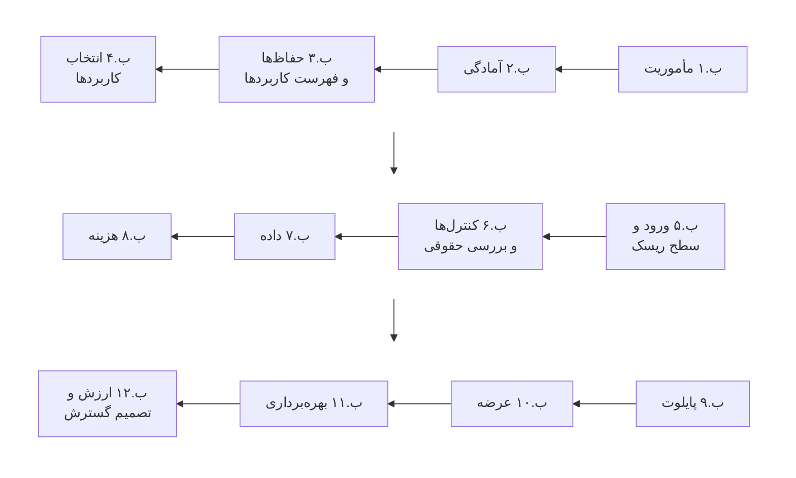
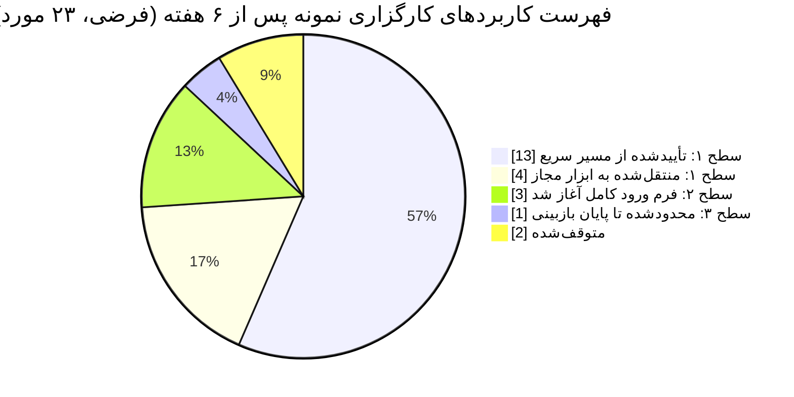
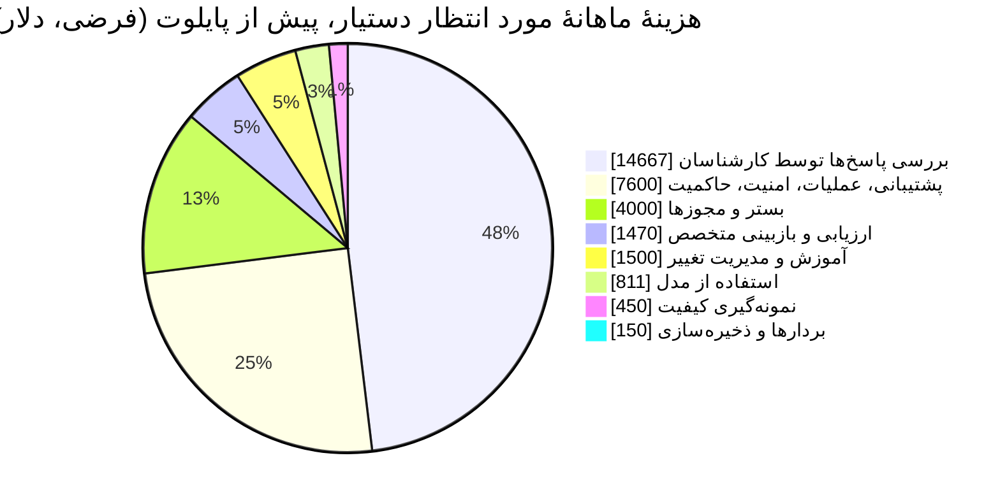
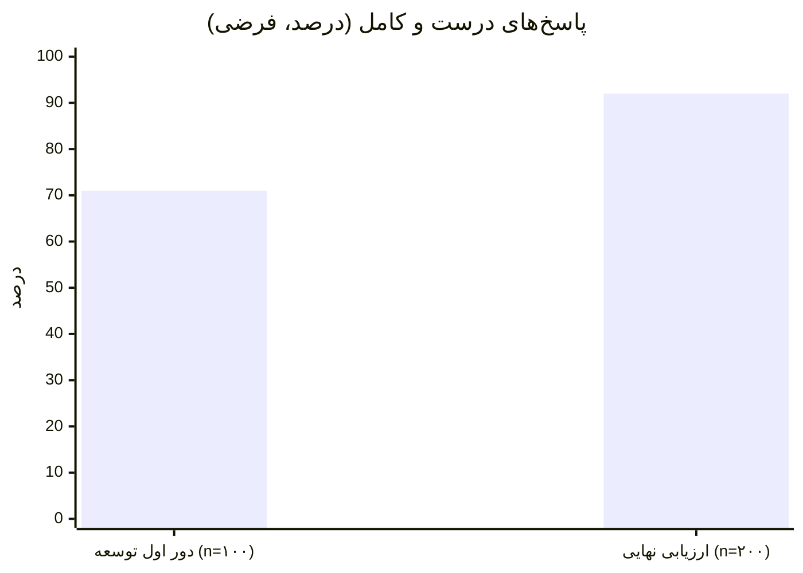
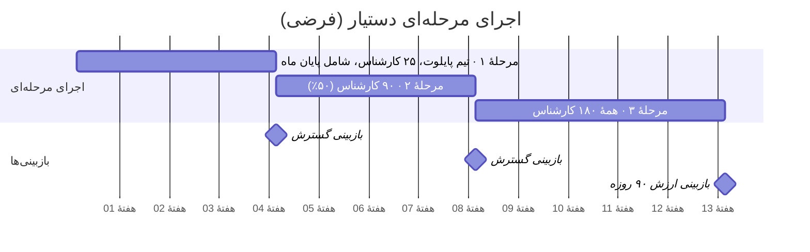

# پیوست ب — یک مثال کامل: از ایده تا تصمیم گسترش

**پیش از هر چیز.** «کارگزاری نمونه» یک کارگزاری خرد **فرضی** با اندازهٔ متوسط است. همهٔ نام‌ها، حجم‌ها، نرخ‌ها، قیمت‌ها و نتایج این پیوست ساختگی‌اند و فقط نشان می‌دهند روش و ابزارها در عمل چطور کنار هم قرار می‌گیرند و محاسبه‌ها چطور انجام می‌شود. هیچ‌کدام معیار، هدف یا ادعایی دربارهٔ یک شرکت واقعی نیست. بخش‌های حقوقی و نظارتی با جای خالی آمده‌اند، چون پاسخ آن‌ها به نهاد، کشور و فعالیت واقعی هر سازمان بستگی دارد (بخش ۴.۶ و کاربرگ بازبینی حقوقی در پیوست ج). الگوی این کاربرد، یعنی دستیار دانشی کارکنان که منبع پاسخ‌هایش را نشان می‌دهد، شبیه نمونه‌های مستند در منابع است (شوآب، LCH، پرودنشال، JPMC)، اما جزئیاتش از آن‌ها گرفته نشده است. [D11 ll. 44–79; D26 ll. 82–128; D29 pp. 14–19; D25 pp. 12–13.]

## ب.۱ مأموریت (بخش ۱.۲)

| بخش مأموریت | آنچه کارگزاری نمونه نوشت |
|---|---|
| چالش کسب‌وکار و شواهد آن | پاسخ به پرسش‌های پیچیدهٔ مشتریان (رویدادهای شرکتی، انتقال سهام، کارمزدها، قواعد محصولات) طول می‌کشد و اغلب به همکار دیگری ارجاع داده می‌شود. نمونه‌گیری دوهفته‌ای نشان داد میانگین زمان رسیدگی به پرسش‌های پیچیده ۹٫۵ دقیقه است، در برابر ۴٫۱ دقیقه برای پرسش‌های ساده؛ ۱۲٪ پرسش‌ها ارجاع داده می‌شوند و ۸٪ مشتریان ظرف ۷ روز دوباره تماس می‌گیرند. این مسئله با داده‌های مرکز تماس و سامانهٔ مدیریت ارتباط با مشتری (CRM) **تأیید شده** است. اینکه حجم پرسش‌ها رو به افزایش است فعلاً یک **فرضیه** است و منتظر آمار فصل بعد. |
| نتایج و مالکان | (۱) حل سریع‌تر و درست پرسش‌های پیچیدهٔ مشتریان؛ مالک: مدیر خدمات مشتریان. (۲) آزاد شدن وقت تحلیل‌گران از نوشتن گزارش‌های تکراری؛ مالک: مدیر پژوهش. (۳) استفادهٔ کنترل‌شدهٔ کارکنان از ابزارهای عمومی هوش مصنوعی؛ مالک: مدیر ارشد عملیات. |
| مرزها | در دامنه: ابزارهای داخلی کارکنان، واحدهای خدمات و پژوهش، کشور اصلی فعالیت. تا ۱۲ ماه بیرون از دامنه: محتوایی که مستقیم به مشتری داده می‌شود، توصیهٔ شخصی، اجرای سفارش. هنوز تصمیم‌گیری نشده: کانال ایمیل. |
| بودجه و اختیار | بودجهٔ بررسی و دو کاربرد برای ۶ ماه تأمین شده است؛ هر تعهد بیشتر در مرحلهٔ تصمیم ۲ به تأیید مرجع تصمیم‌گیری سبد نیاز دارد. اگر تا ماه ششم هیچ کاربردی به مرحلهٔ ۳ (پایلوت با کاربران) نرسد، کار متوقف می‌شود. |
| محدودیت‌هایی که باید بررسی شوند | پردازش دادهٔ مشتری نزد ارائه‌دهندگان بیرونی مدل؛ نگه‌داری سوابق مکاتباتی که با کمک هوش مصنوعی انجام می‌شود؛ وابستگی به یک تأمین‌کننده؛ ظرفیت تیم خدمات در اوج کار پایان ماه. |

## ب.۲ ارزیابی آمادگی (خلاصهٔ فرم پیوست ج)

| بُعد | آنچه دیده شد و نمونهٔ آن | سطح | اطمینان / کمبود | توانمندی لازم بعدی، مالک، موعد |
|---|---|---|---|---|
| راهبرد و همسویی مدیران ارشد | حامی (مدیر ارشد عملیات) دو سرپرست تیم خدمات را برای ۶ ماه با ۴۰٪ وقتشان آزاد کرد | نوپا | زیاد؛ هنوز فرایندی برای مدیریت سبد وجود ندارد | شرح وظایف مرجع تصمیم‌گیری سبد؛ مدیر ارشد عملیات؛ هفتهٔ ۶ |
| زیرساخت هوش مصنوعی | مجوز سازمانی برای یک دستیار ابری؛ هیچ ابزاری برای ارزیابی یا پایش وجود ندارد | موردی | متوسط | انتخاب بستر ارزیابی؛ مدیر ارشد فناوری؛ هفتهٔ ۸ |
| آمادگی داده و محتوا | اسناد محصولات و رویه‌ها در سه مخزن پراکنده‌اند؛ ۳۰٪ مالک ندارند؛ هیچ‌کدام تاریخ انقضا ندارند | موردی | زیاد (بررسی شده) | تعیین مالک و تاریخ انقضا برای محتوا؛ مدیر خدمات مشتریان؛ هفتهٔ ۱۰ |
| حاکمیت و ریسک | خط‌مشی ریسک مدل فقط مدل‌های اعتباری را پوشش می‌دهد؛ فهرستی از کاربردهای هوش مصنوعی وجود ندارد | موردی | زیاد | قواعد سطوح ریسک و فهرست کاربردها؛ مدیر ارشد ریسک همراه با مدیر برنامه؛ هفتهٔ ۶ |
| پذیرش و تحول | گزارش‌هایی از استفادهٔ غیررسمی از ابزارهای گفت‌وگوی عمومی در دو تیم | موردی | کم (فقط گفتهٔ خود افراد) | خط‌مشی استفادهٔ مجاز و ابزار مجاز؛ مدیر ارشد عملیات؛ هفتهٔ ۳ |
| اولویت‌بندی کاربردها و مدیریت سبد | وجود ندارد | نامعلوم | — | نخستین دور انتخاب کاربردها؛ مدیر برنامه؛ هفتهٔ ۷ |

**نتیجهٔ ارزیابی آمادگی:** سازمان برای بررسی مسئله‌ها و یک پایلوت محدود سطح ۲ آماده است، به شرط آنکه اول برای اسناد مورد استفاده در پایلوت مالک تعیین شود. **موانع:** نبود مالک برای اسناد پایلوت؛ نبود قواعد سطوح ریسک. همان‌طور که در بخش ۱.۳ گفته شد، از این سطح‌ها میانگین گرفته نمی‌شود.

## ب.۳ حفاظ‌های روز اول و فهرست کاربردها (بخش ۴.۲؛ خط‌مشی استفادهٔ مجاز در پیوست ج)

کارگزاری نمونه در هفتهٔ دوم یک خط‌مشی موقت برای استفاده از هوش مصنوعی ابلاغ کرد. دستیاری را که مجوز سازمانی داشت برای داده‌های عمومی و داخلی مجاز کرد، یک دورهٔ شش‌هفته‌ای برای ثبت بدون جریمهٔ استفاده‌های فعلی اعلام کرد و از واحد تدارکات خواست بررسی کند که پنج تأمین‌کنندهٔ اصلی اخیراً قابلیت هوش مصنوعی به نرم‌افزارهایشان اضافه کرده‌اند یا نه.

مورد سطح ۳، قابلیتی بود که یک تأمین‌کننده به سامانهٔ مدیریت ارتباط با مشتری اضافه کرده بود و تماس‌های مشتریان را خلاصه می‌کرد. این قابلیت تا بررسی شرایط داده خاموش شد. دو موردی که متوقف شدند، وارد کردن دادهٔ مشتری در یک ابزار عمومی بود و هر دو به‌عنوان رخداد بررسی شدند.

## ب.۴ انتخاب کاربردها (فصل ۲؛ بخش مقایسهٔ فرم ورود)

بیست‌ودو مسئله از واحدها گردآوری شد. پنج مورد شرایط ورود را داشتند و با مقیاس ۱ تا ۵ (با تعریف روشن هر امتیاز) و وزن‌های برابر امتیاز گرفتند.

| نامزد | اهمیت | شواهد | امکان‌پذیری | پذیرش | زمان تا شواهد | اقتصاد | ریسک | جمع (از ۳۵) | سطح |
|---|---|---|---|---|---|---|---|---|---|
| دستیار دانشی خدمات مشتریان | ۵ | ۴ | ۴ | ۴ | ۳ | ۳ | ۳ | ۲۶ | ۲ |
| پیش‌نویس یادداشت پژوهشی | ۳ | ۳ | ۵ | ۴ | ۵ | ۴ | ۵ | ۲۹ | ۱ |
| بررسی اولیهٔ تناسب محصول با مشتری | ۵ | ۳ | ۲ | ۲ | ۱ | ۲ | ۱ | ۱۶ | ۳ |
| دسته‌بندی معاملات ناموفق | ۴ | ۳ | ۳ | ۳ | ۳ | ۳ | ۳ | ۲۲ | ۲ |
| نسخه‌های متن تبلیغاتی | ۲ | ۲ | ۵ | ۳ | ۵ | ۳ | ۳ | ۲۳ | ۳ (محتوای عمومی) |

**آزمون حساسیت:** اگر وزن «اهمیت برای کسب‌وکار» (اولویت مدیر ارشد عملیات) دو برابر شود، دستیار دانشی خدمات به رتبهٔ اول و بررسی تناسب محصول به رتبهٔ سوم می‌رسد. اگر وزن «زمان تا شواهد» دو برابر شود، پیش‌نویس پژوهشی همچنان اول می‌ماند. **تصمیم:** پیش‌نویس پژوهشی از مسیر سریع سطح ۱ به‌عنوان یک برد سریع و کم‌ریسک بودجه بگیرد؛ دستیار دانشی خدمات سرمایه‌گذاری اصلی سطح ۲ باشد؛ پیش‌نیازهای داده‌ای دسته‌بندی معاملات ناموفق آماده شود؛ بررسی تناسب محصول به تعویق بیفتد (سطح ۳ است و هم بررسی حقوقی می‌خواهد و هم دادهٔ بهتر)؛ و نسخه‌های متن تبلیغاتی فعلاً کنار گذاشته شود (ارزش کم، و چون برای عموم منتشر می‌شود سطح ریسکش بالاست).

**خلاصهٔ برگهٔ مسیر سریع سطح ۱ برای پیش‌نویس پژوهشی:** پاسخ هر شش شرط سطح ۱ «بله» بود. ۳۶ کار نوشتاری واقعی آزموده شد و هیچ خطای جدی دیده نشد (یعنی با اطمینان ۹۵٪، نرخ خطای جدی حداکثر حدود ۸٪ است). مشکل رایج این بود که وقتی داده‌ای در دستور نبود، دستیار عدد از خودش می‌ساخت؛ راهنمایی که به کاربران داده شد: «جدول‌های منبع را در دستور بگذارید؛ هرگز عدد را از دستیار نخواهید». ۱۴ تحلیل‌گر آموزش دیدند و بازبینی سالانه تعیین شد. در هفتهٔ نهم تأیید شد.

## ب.۵ ورود و سطح ریسک دستیار دانشی خدمات (خلاصهٔ فرم ورود)

**شرح فرصت:** برای کارشناسان خدمات مشتریان، *پیدا کردن و تفسیر قواعد محصولات و رویه‌ها* را تغییر دهید تا *پرسش‌های پیچیده سریع‌تر و درست حل شوند*، بی‌آنکه *درستی پاسخ، محرمانگی دادهٔ مشتری و تعهدات نگه‌داری سوابق* آسیب ببیند.

| گزینه | نتیجه و دلیل |
|---|---|
| ادامهٔ روش فعلی | رد شد: مشکل وضع موجود تأیید شده است |
| بهبود رویه‌ها و جست‌وجوی سازمانی | **به‌عنوان بخشی از راه‌حل حفظ شد:** تعیین مالک و تاریخ انقضا برای محتوا در هر حال لازم است؛ جست‌وجو به‌تنهایی روی ۵۰ پرسش نمونه فقط در ۴۱٪ موارد نتیجهٔ اول را مرتبط نشان داد |
| درخت تصمیم مبتنی بر قواعد | برای بیشتر موضوع‌ها رد شد، چون قواعد مدام تغییر می‌کنند؛ برای محاسبهٔ کارمزد که قاعدهٔ ثابتی دارد حفظ شد |
| دستیار مبتنی بر منبع که منبع پاسخ را نشان می‌دهد (RAG) | **برای پایلوت انتخاب شد** |
| عاملی که خودش سوابق مشتری را به‌روز کند | بیرون از دامنه: سطح ۳ است و برای رسیدن به نتیجه لازم نیست |

**سطح ریسک:** سطح ۲. از محتوای محرمانهٔ رویه‌ها استفاده می‌کند، ممکن است جزئیاتی از مشتری را که کارشناس تایپ می‌کند دریافت کند و کارشناسان بر پایهٔ آن با مشتری حرف می‌زنند؛ اما مسئولیت هر پاسخ با خود کارشناس است و دستیار هیچ اقدامی انجام نمی‌دهد. **چه چیزی باعث تعیین دوبارهٔ سطح می‌شود:** هر نوع دسترسی مستقیم مشتری به دستیار یا اتصال آن به اطلاعات حساب مشتریان.

## ب.۶ کنترل‌ها و بررسی حقوقی (خلاصهٔ ماتریس اختیارات و کاربرگ بازبینی حقوقی)

| شکست / آسیب | کنترل و مرحلهٔ اجرای آن | مالک | شواهد آزمون | تصمیم دربارهٔ ریسک باقیمانده |
|---|---|---|---|---|
| ارائهٔ قاعدهٔ قدیمی یا نادرست به مشتری | تاریخ انقضا برای اسناد؛ مالک برای محتوا؛ پاسخ همراه با منبع؛ قاعدهٔ «منبع نداری، پاسخ نده» | مدیر خدمات مشتریان | نمونه‌های اسناد قدیمی در مجموعهٔ آزمون؛ بررسی اینکه منبع واقعاً پاسخ را تأیید می‌کند | مالک کسب‌وکار آن را در دامنهٔ پایلوت پذیرفت |
| ارسال دادهٔ مشتری به بیرون از مرز مجاز | قرارداد با ارائه‌دهنده که استفاده از داده برای آموزش مدل را ممنوع می‌کند و پردازش را در منطقهٔ مشخصی نگه می‌دارد؛ پالایش ورودی برای حذف شمارهٔ حساب | مدیر ارشد امنیت اطلاعات | آزمون مسیر داده؛ آزمون با شماره‌حساب‌های ساختگی برای اطمینان از اینکه رد می‌شوند | مدیر ارشد امنیت اطلاعات پذیرفت |
| دیدن محتوایی که کاربر اجازهٔ دیدنش را ندارد | پالایش نتایج بازیابی بر اساس مجوزهای فعلی کاربر روی اسناد، که در خود نرم‌افزار اعمال می‌شود [FINOS mi-16] | مدیر ارشد فناوری | آزمون تغییر مجوز و آزمون اینکه کاربر غیرمجاز دسترسی پیدا نکند | مدیر ارشد امنیت اطلاعات پذیرفت |
| هزینهٔ بی‌حساب | سهمیه برای هر کاربر؛ هشدار بودجه [FINOS mi-9] | مالک خدمت | آزمون هشدار | پذیرفته شد |

**خلاصهٔ کاربرگ بازبینی حقوقی (با جای خالی):** کشور [کشور اصلی فعالیت]؛ فعالیت [خدمات مشتریان برای کارگزاری تحت نظارت]. پرسش‌هایی که بررسی شد: نگه‌داری سوابق مکاتباتی که با کمک هوش مصنوعی انجام می‌شود [نتیجه: پاسخ‌هایی که به مشتری فرستاده می‌شود در همان سوابق فعلی CRM نگه‌داری می‌شود؛ واحد انطباق تأیید کرد]؛ الزامات برون‌سپاری یا اطلاع‌رسانی دربارهٔ استفاده از شرکت‌های دیگر [نتیجه از سوی واحد حقوقی: (مجاز / مشروط / نیاز به اطلاع‌رسانی)]؛ مبنای قانونی پردازش دادهٔ شخصی نزد ارائه‌دهنده [نتیجه از سوی واحد حریم خصوصی]. **جمع‌بندی:** مجاز، با شرایط؛ این شرایط پیش از عرضه باید برآورده شوند، اما مانع پایلوت نیستند.

## ب.۷ توافق‌نامهٔ داده (خلاصهٔ برگهٔ داده و معماری)

| منبع | معنا و محدودیت‌ها | مالکان | استفادهٔ مجاز | کیفیت و به‌روز بودن | مسیر داده و نگه‌داری |
|---|---|---|---|---|---|
| کتابخانهٔ قواعد محصولات (۱٬۲۴۰ سند) | مرجع رسمی شرایط محصولات است؛ محصولات قدیمی که پیش از [سال] بسته شده‌اند در آن نیست | مدیر محصولات / متولی محتوا | پاسخ‌های داخلی کارکنان | ۳۰٪ مالک نداشتند ← مالک تعیین شد؛ تاریخ انقضا اضافه شد؛ همگام‌سازی هفتگی | در پایگاه برداری مجاز نمایه می‌شود؛ اسناد حذف‌شده ظرف ۲۴ ساعت از نمایه پاک می‌شوند (آزموده شده) |
| رویه‌های خدمات (۴۱۰ سند) | مرجع رسمی مراحل کار است | مدیر خدمات مشتریان / متولی عملیات | داخلی | چرخهٔ بازبینی ماهانه برقرار شد | مانند ردیف بالا |
| لاگ گفت‌وگوها | دستورها، پاسخ‌ها و منابعی که نشان داده شده | مالک خدمت | بازبینی کیفیت، بررسی رخداد | — | مدت نگه‌داری [طبق خط‌مشی سوابق]؛ دسترسی فقط برای نقش‌های کیفیت و رخداد |

## ب.۸ برآورد هزینهٔ اجرا (برآوردگر هزینه، حالت مورد انتظار، پیش از پایلوت)

فرض‌ها (ساختگی): ماهانه ۲۴٬۰۰۰ پرسش پیچیده با کمک دستیار؛ برای هر پرسش به‌طور میانگین ۱٫۳ درخواست، یعنی ۳۱٬۲۰۰ درخواست؛ هر درخواست ۶٬۰۰۰ توکن ورودی (بیشترش متن‌های بازیابی‌شده) و ۴۵۰ توکن خروجی؛ نرخ قراردادی فرضی ۳ دلار برای هر میلیون توکن ورودی و ۱۵ دلار برای هر میلیون توکن خروجی؛ ۵٪ سربار تکرار؛ هزینهٔ کامل هر ساعت کار کارشناس ۵۵ دلار؛ و ۴۰ ثانیه وقت اضافه برای بررسی هر پاسخ (برآورد اولیه، پیش از اندازه‌گیری).

| ردیف | ماهانه، حالت مورد انتظار |
|---|---|
| استفاده از مدل: (۱۸۷٫۲ میلیون توکن ورودی × ۳ دلار + ۱۴٫۰ میلیون توکن خروجی × ۱۵ دلار) ÷ ۱ میلیون × ۱٫۰۵ | ۸۱۱ دلار |
| ساخت بردارها، نمایه و ذخیره‌سازی | ۱۵۰ دلار |
| میزبانی، بستر و مجوزها | ۴٬۰۰۰ دلار |
| اجرای ارزیابی و بازبینی متخصص (۱۶ ساعت × ۹۰ دلار) | ۱٬۴۷۰ دلار |
| نمونه‌گیری کیفیت در دورهٔ بهره‌برداری (۵۰ مورد × ۶ دقیقه × ساعتی ۹۰ دلار) | ۴۵۰ دلار |
| بررسی پاسخ‌ها توسط کارشناسان (۲۴٬۰۰۰ × ۴۰ ثانیه × ساعتی ۵۵ دلار) | ۱۴٬۶۶۷ دلار |
| پشتیبانی، عملیات، امنیت و حاکمیت (۸۰ ساعت × ۹۵ دلار) | ۷٬۶۰۰ دلار |
| آموزش، مدیریت تغییر و مدیریت تأمین‌کننده | ۱٬۵۰۰ دلار |
| **جمع** | **۳۰٬۶۴۸ دلار** |

در حالت حجم کم (۱۲٬۰۰۰ پرسش) و حجم زیاد (۳۶٬۰۰۰ پرسش)، هزینهٔ مدل به ترتیب حدود ۴۰۵ و ۱٬۲۱۶ دلار و هزینهٔ بررسی حدود ۷٬۳۳۳ و ۲۲٬۰۰۰ دلار می‌شود. **این برآورد چه می‌گوید:** هزینهٔ مدل کمتر از ۳٪ کل هزینه است. اینکه این کاربرد به‌صرفه هست یا نه، به این بستگی دارد که وقتی در هر پرسش صرفه‌جویی می‌شود از وقتی که برای بررسی اضافه می‌شود بیشتر باشد؛ و این را فقط پایلوت می‌تواند اندازه بگیرد.

## ب.۹ منشور پایلوت، ارزیابی و تصمیم (خلاصهٔ منشور پایلوت)

**پایلوت باید به چه تصمیمی کمک کند:** آیا برای بهره‌برداری در تیم خدمات بودجه گذاشته شود؟ **کاربران:** ۲۵ کارشناس در یک تیم. **مدت:** ۱۰ هفته (پیش‌فرض سطح ۲: ۸ تا ۱۲ هفته). **میزان دسترسی:** تحت نظارت؛ کارشناسان باید پیش از استفاده از هر پاسخ، منبعی را که دستیار نشان داده بررسی کنند.

**مجموعهٔ آزمون:** ۳۰۰ پرسش واقعی که جزئیات مشتری از آن‌ها حذف شده: ۱۰۰ مورد برای توسعه و آزمون مجدد، و **۲۰۰ مورد کنارگذاشته** برای ارزیابی نهایی که هرگز در تنظیم سامانه به کار نرفت. ترکیب نمونه‌ها همان ترکیب پیش‌فرض است: ۶۰٪ پرسش‌های رایج، ۲۰٪ استثناها و منابع قدیمی یا متناقض، ۱۰٪ پرسش‌های بیرون از دامنه، ۱۰٪ موارد مخرب و آزمون مجوز. پرسش‌های محاسبهٔ کارمزد یک زیرگروه جداگانهٔ ۴۰ موردی را تشکیل می‌دهند.

**حدهای قبولی که پیش از دیدن نتایج تعیین شد (امضاشده در هفتهٔ ۲):**

| معیار | حد قبولی و دلیل آن |
|---|---|
| خطای جدی (قاعدهٔ نادرستی که می‌تواند به مشتری زیان بزند) | صفر خطا در ۲۰۰ مورد کنارگذاشته ← با اطمینان ۹۵٪ یعنی نرخ خطای جدی حداکثر ۱٫۵٪ (قاعدهٔ سه) |
| پاسخ‌های درست و کامل | دست‌کم ۹۰٪، و حد پایین فاصلهٔ اطمینان ویلسون دست‌کم ۸۵٪ |
| منبعی که نشان داده شده واقعاً پاسخ را تأیید کند | دست‌کم ۹۵٪ |
| برخورد درست با پرسش‌های بیرون از دامنه (رد یا ارجاع) | دست‌کم ۹۵٪ همان زیرگروه |
| آزمون‌های مجوز و نشت داده | همه قبول |
| زمان رسیدگی به پرسش‌های پیچیده (گروه پایلوت در مقایسه با یک تیم مشابه) | دست‌کم ۱۰٪ کمتر، بدون افزایش تماس دوبارهٔ مشتریان |

**نتایج:**

- **دور اول توسعه:** ۷۱ پاسخ درست از ۱۰۰؛ ۳ خطای جدی که همه از اسناد کارمزد منسوخی بود که هنوز در نمایه مانده بودند. دستهٔ مشکل: *کیفیت منبع* (بخش ۶.۶). اصلاح: متولی محتوا ۸۶ سند منسوخ را کنار گذاشت و برای اسناد تاریخ انقضا و بررسی هنگام ورود اضافه کرد. همین موارد به مجموعهٔ آزمون مجدد اضافه شد.
- **ارزیابی نهایی روی مجموعهٔ کنارگذاشته:** ۱۸۴ پاسخ درست از ۲۰۰ (۹۲٪؛ فاصلهٔ اطمینان ۹۵٪ ویلسون: ۸۷٫۴ تا ۹۵٫۰٪)؛ **هیچ خطای جدی** (یعنی حداکثر ۱٫۵٪)؛ منبع در ۱۹۴ مورد از ۲۰۰ پاسخ را تأیید می‌کرد (۹۷٪)؛ ۱۹ از ۲۰ پرسش بیرون از دامنه درست رد یا ارجاع شد؛ همهٔ آزمون‌های مجوز و نشت داده قبول شد. در زیرگروه محاسبهٔ کارمزد، ۳۶ از ۴۰ درست بود و ۴ مورد خطای گرد کردن داشت ← پرسش‌های کارمزد از این پس به‌جای مدل به ماشین‌حساب قاعده‌محور موجود فرستاده می‌شود.
- **روال کار:** در تیم پایلوت، زمان رسیدگی به پرسش‌های پیچیده از ۹٫۵ به ۷٫۸ دقیقه رسید (۱۸٪ کاهش)، در حالی که تیم مقایسه در همان هفته‌ها ۹٫۴ دقیقه بود. تماس دوباره ۸٫۱٪ در برابر ۸٫۰٪ بود (تفاوت معناداری ندارد) و ارجاع‌ها از ۱۲٫۰٪ به ۱۰٫۵٪ رسید. زمان رسیدگی که اندازه گرفته شد **وقت بررسی منابع را هم در بر دارد**.

**تصمیم (هفتهٔ ۱۰):** *ادامه* و آماده‌سازی برای بهره‌برداری، به این شرط که مدل دیگر به پرسش‌های کارمزد پاسخ ندهد. مالک کسب‌وکار امضا کرد و تأیید مدیر ارشد امنیت اطلاعات و واحد انطباق ثبت شد.

## ب.۱۰ عرضه (خلاصهٔ چک‌لیست عرضه) و اجرای مرحله‌ای

مواردی که هنگام عرضه هنوز مشروط بودند: تنظیمات نگه‌داری سوابق در CRM اصلی بررسی و تأیید شد (پیش از مرحلهٔ ۱ بسته شد)؛ برای نخستین پایان ماه کشیک پشتیبانی تعیین شد (بسته شد). کلید توقف آزموده شد و کارشناسان را ظرف ۵ دقیقه به جست‌وجوی سازمانی قبلی برمی‌گرداند.

**شرایط توقف:** هر خطای جدی تأییدشده که به مشتری برسد؛ هر شکست در کنترل مجوزها؛ دقت کمتر از ۸۵٪ در نمونهٔ هفتگی؛ تماس دوبارهٔ مشتریان بیش از ۱ واحد درصد بالاتر از گروه مقایسه.

## ب.۱۱ بهره‌برداری و یک رخداد (خلاصهٔ دفترچهٔ عملیات)

**رخداد (هفتهٔ هفتم بهره‌برداری):** شرایط یکی از محصولات به‌روز شد، اما به‌روزرسانی به نمایهٔ دستیار نرسید و حدود ۳ ساعت دستیار به جدول کارمزد قدیمی استناد کرد. **تشخیص:** یکی از کارشناسان گزارش داد و بعد معلوم شد هشدار خطای همگام‌سازی صادر شده بود، اما به صندوق ایمیلی می‌رفت که کسی آن را نمی‌دید. **مهار:** بازیابی اسناد مربوط به کارمزد خاموش شد؛ ۱۱ گفت‌وگوی آسیب‌دیده از روی لاگ‌ها پیدا شد و سرپرستان تیم با مشتریان تماس گرفتند و پاسخ را اصلاح کردند. **اقدام‌های اصلاحی:** هشدار به کشیک وصل شد؛ همگام‌سازی طوری تنظیم شد که اگر خطا بدهد، اسناد قدیمی را کنار بگذارد نه اینکه همچنان نشانشان دهد؛ یک مورد تازه به مجموعهٔ آزمون مجدد اضافه شد. پس از قبولی آزمون‌های مجدد و آزمون مجوزها، خدمت دوباره راه‌اندازی شد.

## ب.۱۲ بازبینی ارزش و تصمیم گسترش در روز ۹۰ (بازبینی ارزش و برآوردگر هزینه)

**نتیجهٔ موفق** این‌طور تعریف شده است: پرسش پیچیده‌ای که با کمک دستیار حل شده، مشتری ظرف ۷ روز دوباره تماس نگرفته و در نمونه‌گیری کیفیت هم قبول شده است. تعداد مورد انتظار در ماه: ۲۴٬۰۰۰ × (۱ − ۰٫۰۸۱) × ۰٫۹۵ ≈ ۲۰٬۹۵۰.

**مراقب دوبار شمردن باشید:** برآورد پیش از پایلوت یک ردیف جداگانهٔ ۱۴٬۶۶۷ دلاری برای بررسی پاسخ‌ها داشت، چون آن موقع فایده به‌صورت وقت صرفه‌جویی‌شدهٔ ناخالص برآورد شده بود. اما کاهش زمان رسیدگی که در پایلوت اندازه گرفته شد **خالص** است، یعنی وقت بررسی از قبل در آن کسر شده؛ پس در بازبینی ارزش، ردیف جداگانهٔ بررسی حذف می‌شود.

| ردیف (فرضی، ماهانه) | مقدار | کیفیت شواهد |
|---|---|---|
| هزینهٔ عملیاتی، بدون هزینهٔ بررسی در روال کار | ۱۵٬۹۸۱ دلار | صورت‌حساب‌ها و برگه‌های ساعت کار واقعی |
| هزینهٔ هر نتیجهٔ موفق | ۱۵٬۹۸۱ ÷ ۲۰٬۹۵۰ ≈ **۰٫۷۶ دلار** | محاسبه‌شده؛ نمونهٔ کیفیت ماهانه ۲۰۰ مورد |
| ظرفیت آزادشده | ۲۴٬۰۰۰ × ۱٫۷ دقیقه ≈ ۶۸۰ ساعت (≈ ۳۷٬۴۰۰ دلار با هزینهٔ کامل) | مقایسه با تیم شاهد در یک دورهٔ کامل؛ پول نقد نیست |
| استفادهٔ مدیریت از این ظرفیت | پاسخ به ۹٪ رشد حجم پرسش‌ها بدون پر کردن ۳ جای خالی که قرار بود استخدام شود | تأییدشده از سوی واحد مالی |
| فایدهٔ نقدی که واحد مالی تأیید کرده | ۳ استخدام که لازم نشد × ۵٬۵۰۰ دلار هزینهٔ کامل = **۱۶٬۵۰۰ دلار** | تطبیق‌داده‌شده با برنامهٔ مصوب استخدام |
| فایدهٔ عملیاتی خالص (فقط نقدی) | ۱۶٬۵۰۰ − ۱۵٬۹۸۱ ≈ **۵۱۹+ دلار** | محافظه‌کارانه؛ ارزش بهتر شدن خدمت را حساب نمی‌کند |
| کیفیت خدمت | ارجاع‌ها ۱٫۵ واحد درصد کمتر؛ تماس دوباره بدون تغییر؛ یک رخداد (مهارشده) | داده‌های عملیاتی |
| هزینه‌های یک‌بارهٔ تا امروز | ۱۴۰٬۰۰۰ دلار (ساخت، یکپارچه‌سازی، اصلاح محتوا) | ارقام واقعی |

**تفسیر:** از نظر نقدی، این کاربرد هزینهٔ جاری‌اش را پوشش می‌دهد، اما هنوز هزینهٔ ساخت را برنگردانده است. ظرفیت آزادشده واقعی است، اما فقط به اندازه‌ای که مدیریت از آن استفاده کند فایده به حساب می‌آید. بیشتر هزینه‌های بستر و عملیات ثابت‌اند، پس اگر کاربران بیشتری از دستیار استفاده کنند، هزینهٔ هر نتیجه کمتر می‌شود.

**تصمیم مرجع تصمیم‌گیری سبد:** **اصلاح، و گسترش در همان شرایط.** (۱) گسترش به ۴۰ کارمند پشتیبانی که به همان پرسش‌های محصولات پاسخ می‌دهند. سطح ریسک و داده‌ها همان است، اما گروه کاربران تازه است؛ پس مجوزها و آموزش دوباره بررسی می‌شود (بخش ۹.۳). (۲) اصلاح: کم کردن حجم متن بازیابی‌شده در هر درخواست و مذاکرهٔ دوباره بر سر هزینهٔ مجوز بستر. (۳) **فعلاً** از دستیار برای پیش‌نویس ایمیل به مشتریان استفاده نشود: پیش‌نویسی که برای مشتری فرستاده می‌شود ریسک را بالا می‌برد، پس این تغییر هم تعیین دوبارهٔ سطح ریسک و هم بازبینی حقوقی تازه لازم دارد. (۴) بازبینی ارزش بعدی شش ماه دیگر، طبق تواتر سطح ۲.

**یک ردیف از جدول ردیابی (پیوست ج):** *پرسش:* «آیا وقتی که صرفه‌جویی می‌شود به فایدهٔ مالی تبدیل می‌شود؟» ← *پاسخ:* بله، از راه برنامهٔ استخدام (واحد مالی تأیید کرد) ← *تصمیم:* فقط استخدام‌هایی که لازم نشد فایدهٔ نقدی شمرده شود ← *اگر این شرایط تغییر کند* (مثلاً حجم پرسش‌ها کم شود): فایده فقط ظرفیت شمرده شود و اقتصاد گسترش دوباره ارزیابی شود ← *زمان بازبینی:* پیش‌بینی سه‌ماههٔ حجم پرسش‌ها.

**درس این مثال:** بیشتر کار صرف مالکیت محتوا، ارزیابی و سنجش روال کار شد، نه انتخاب مدل. اعدادی که تصمیم را تعیین کردند، یعنی زمان رسیدگی خالص پس از بررسی و استفادهٔ تأییدشده از ظرفیت آزادشده، از دل کسب‌وکار آمدند، نه از فناوری.
