# Enterprise AI Strategy and Implementation Handbook

## From business mandate to dependable operation

**Version 2.0 · 9 November 2026**  
**Audience:** governing bodies, executive sponsors, business leaders, product and delivery teams, data and technology teams, people leaders, legal and compliance reviewers, risk specialists, Information Security, and operational owners. Each role has its own reading path under [How to use the handbook](#how-to-use-the-handbook).

This handbook gives organizations a method they can act on for choosing, delivering, operating and improving AI capabilities. It shows how to turn a business problem into an owned, measurable change in how work gets done. It covers conventional machine learning, generative AI and systems that use AI to select and execute actions. Brokerage examples illustrate the method; they do not limit its scope.

The central proposition is that a useful AI strategy connects three things: a consequential business challenge, an approach that fits the organization’s actual capabilities and constraints, and a coherent set of funded actions with accountable owners. Buying tools, running demonstrations and publishing principles can support that work, but they do not show that the operating capability exists. McMillan makes this distinction explicitly; Fidelity, Vanguard and the MindForge implementation cases show different ways of building the capabilities underneath delivery. [D19 pp. 2–6; D10 pp. 11–12; D14 ll. 55–82; D29 pp. 6–19.]

### Contents

- [Executive summary](#executive-summary)
- [How to use the handbook](#how-to-use-the-handbook)
- [Size the process to the risk: tiers and the fast path](#size-the-process-to-the-risk-tiers-and-the-fast-path)
- [Quick start: the first 90 days](#quick-start-the-first-90-days)
- [1. Set the mandate and assess readiness](#1-set-the-mandate-and-assess-readiness)
- [2. Build and prioritize the use-case portfolio](#2-build-and-prioritize-the-use-case-portfolio)
- [3. Design the operating model and people strategy](#3-design-the-operating-model-and-people-strategy)
- [4. Build governance into delivery](#4-build-governance-into-delivery)
- [5. Prepare data and technology foundations](#5-prepare-data-and-technology-foundations)
- [6. Design and evaluate pilots](#6-design-and-evaluate-pilots)
- [7. Move from pilot to production](#7-move-from-pilot-to-production)
- [8. Support adoption and changes in work](#8-support-adoption-and-changes-in-work)
- [9. Measure results and scale selectively](#9-measure-results-and-scale-selectively)
- [10. Adapt the framework into an organizational roadmap](#10-adapt-the-framework-into-an-organizational-roadmap)
- [Appendix A — Source key](#appendix-a)
- [Appendix B — Worked example: one use case from idea to scale decision](#appendix-b)
- [Appendix C — Editable implementation tools](#appendix-c)
- [Appendix D — Starting defaults, external sources and limitations](#appendix-d)

The full 197-file source register, the cross-case evidence map and the verification record are in the companion file, [handbook-evidence-companion.md](handbook-evidence-companion.md). Citations in this handbook use short IDs such as `[D14 ll. 132–198]` or `[FINOS mi-16]`, which [Appendix A](#appendix-a) resolves.

## Executive summary

**What this handbook is for.** It helps an organization move from scattered AI activity to a portfolio of owned, measured and dependable AI-enabled workflows. It gives leaders five decisions to own, teams a step-by-step method, and everyone a set of fill-in tools. It favours evidence over enthusiasm: every investment, pilot and release is tied to a business outcome, a named owner and a test that could say "no".

**The big picture.**

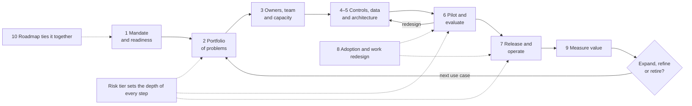

**Ten rules that carry most of the value.**

1. Start from a business outcome with a named owner, not from a tool. Leave room for a non-AI answer. [D10 p. 11; D16 p. 9]
2. Size the process to the risk. A drafting assistant should not face the same gates as an agent that moves money. Use the three tiers below. [D29 p. 14; D30 pp. 53–55]
3. Put day-one guardrails in place before banning or ignoring tools: an approved option, a short acceptable-use policy and a way to register existing use. [D30 p. 30; D08 ll. 519–530; E06]
4. Fund bounded increments inside a coherent business domain, and limit work in progress to the experts you actually have. [D21 pp. 3–4; D10 pp. 11–12]
5. Write pass/fail criteria before you see results, and size test sets from the error rate you need to rule out (for example, about 300 clean cases to support a claim of a critical-error rate at or below 1%). [D04 ll. 367–463; E07]
6. Enforce permissions and allowed actions in software, outside the model; a prompt is not an access control. [FINOS mi-16; FINOS mi-18]
7. Release in stages with a tested off-switch and a manual fallback. [D29 p. 8; D30 pp. 99–103; E12]
8. Redesign the job, not just the screen; count checking and correction time. [D12 pp. 2–4; D27 ll. 254–293]
9. Measure cost per successful outcome, and treat released time as capacity until management turns it into a benefit. [D38 ll. 381–429]
10. Expand, refine or retire on sustained evidence, and re-check context before every expansion. [D30 pp. 63–64, 112–113]

**Five decisions leaders own.** Each decision has a named accountable person, minimum evidence and a recorded disposition.

| Decision point | Accountable decision-maker to appoint locally | Minimum evidence | Possible disposition |
|---|---|---|---|
| Mandate | Executive sponsor / governing authority | Business outcomes, boundaries, capacity and initial readiness | Authorize discovery; revise scope; defer |
| Invest in a use case | Portfolio authority with business owner | Problem evidence, alternatives, preliminary risk tier, data and cost feasibility | Fund bounded delivery; prepare dependencies; choose a simpler approach; stop |
| Expose a pilot | Business owner with required technical/control concurrence | Pilot charter, permitted data, tested containment, evaluation plan | Run within limits; redesign; decline |
| Release to production | Named release authority | Accepted quality, control evidence, support readiness and residual-risk decision | Release defined scope; restrict; redesign; stop |
| Expand or retain | Business owner and portfolio authority | Sustained outcomes, full cost, risk, capacity and new-context review | Expand; maintain; refine; suspend; retire |

These five decision points do not require five committees. Existing authorities can make them, provided their remit, evidence and decisions are recorded. Any required legal or regulatory approval remains a separate, locally validated dependency.

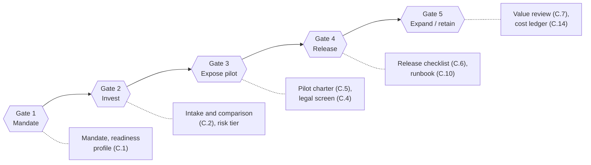

**What leaders should decide this quarter.**

- Who is the executive sponsor, and who is the AI Program Lead with written authority (Chapter 3.2)?
- Which two or three business outcomes justify investment, and who owns each (Chapter 1.2)?
- Which AI tool is approved for general staff use now, under what acceptable-use rules (Chapter 4.2, tool C.13)?
- Which existing AI uses, including AI embedded in vendor products, must be registered and tiered by a set date (Chapter 4.2)?
- How much capacity (named people and budget) is released for the first 90 days (Quick start)?

## How to use the handbook

### Reading paths by role

| Role | Read first | Then use these tools | Time to orient |
|---|---|---|---|
| Board / governing body | Executive summary; tiers; 4.1–4.2; 9.3 | C.3 decision rights; C.7 value review | 30 minutes |
| Executive sponsor | Executive summary; Quick start; Chapters 1, 2.4, 3.2, 10 | C.1, C.2 summary, C.8 roadmap | 1–2 hours |
| AI Program Lead | Everything; Appendix B worked example first | All tools; C.12 traceability | 1 day |
| Business / use-case owner | Tiers; Chapters 2, 6.2, 8, 9 | C.0 or C.2, C.5, C.7, C.11 | 2–3 hours |
| Product, data and engineering | Chapters 5, 6, 7; 4.4 controls | C.5, C.6, C.9, C.10, C.14 | Half a day |
| Legal, compliance, risk | Tiers; Chapter 4; 6.4; 7.2 | C.3 control record, C.4, C.6 | 2–3 hours |
| Information Security | 4.2, 4.4, 5.3–5.5, 7.5–7.6 | C.6, C.9, C.10, C.13 | 2 hours |
| People leaders and line managers | 3.5, Chapter 8 | C.11, C.13 | 1 hour |
| Finance / procurement | 2.4, 5.5–5.6, Chapter 9 | C.2 economics, C.7, C.14 | 1 hour |

### Choose an entry point

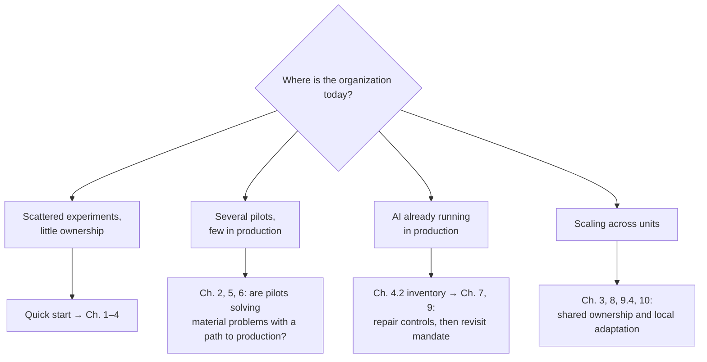

These are entry choices, not exemptions from earlier evidence. An existing deployment may need retrospective assessment, restriction or suspension if its owner, data rights or operational safeguards are unclear. The depth and sequence of remediation depend on the risk tier. [Synthesis informed by D19 pp. 2–6; D30 pp. 63–64, 67–74, 112–113.]

### Read the evidence and the labels correctly

Six labels carry different meanings throughout this document:

| Label | Meaning | How to use it |
|---|---|---|
| **Documented practice** | A source describes an organization doing something | Examine the circumstances before adapting it; documentation is not independent verification |
| **Reported outcome** | A source reports a result | Preserve the measure, denominator, period and uncertainty; do not infer causation or use it as a promised target |
| **Source recommendation** | An author proposes an approach | Assess the reasoning, scope and incentives; distinguish it from implemented practice |
| **Handbook synthesis** | A recommendation, tool or dependency created by comparing the sources | Apply conditionally, record the local rationale and change it when evidence changes |
| **Starting default** | A concrete initial value (a number, duration or cadence) the handbook proposes so teams can begin without debate | Use it until local evidence justifies a different value; its basis (statistics, standard, source reference point or editorial judgment) is listed in [Appendix D](#appendix-d) |
| **Open question** | Available evidence does not establish the answer | Assign a reviewer, required evidence and decision date; do not silently turn it into an assumption |

Action instructions and tools are **handbook synthesis unless described otherwise**. Requirement levels are marked in every chapter card and in the tier matrix:

- **Core** — required for this method to remain accountable and testable at that tier.
- **Conditional** — required when the stated condition applies (for example, personal data, customer exposure or agent actions).
- **Optional** — helpful but not a prerequisite.

**Citations.** `[D14 ll. 132–198]` means source D14, lines 132–198 of the saved file; `[D30 pp. 99–103]` means physical PDF pages, counting covers; `[FINOS mi-16]` is a FINOS AI Governance Framework mitigation file; `[E07]` is an external source registered in Appendix D. Every chapter starts with a **chapter card** that lists the owner, trigger, starting-default timebox, outputs, tools and tier minimums.

**Diagrams** are written in Mermaid. They render on GitHub, GitLab, in most documentation tools, and in VS Code with a Mermaid preview extension.

## Size the process to the risk: tiers and the fast path

Proportionality is the difference between a usable method and one that stalls. Prudential applies light-touch governance to low-risk AI systems and full requirements to higher-risk ones; MindForge recommends that review depth, disclosure requests and post-deployment review frequency follow risk materiality. [D29 p. 14; D30 pp. 43, 53–55, 108.] The handbook turns that principle into three tiers with defined minimums. The tier definitions are **handbook synthesis**; adapt the triggers to local risk taxonomy and law, but keep the rule that an unknown answer moves the use case up a tier until resolved.

### Assign a tier in five questions

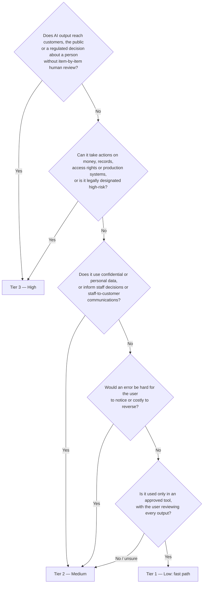

| Tier | Typical examples | Defining conditions |
|---|---|---|
| **Tier 1 — Low** | Drafting and summarizing internal or public material in an approved assistant; coding assistant inside the normal code-review process; meeting notes the attendee edits | Internal users only; the user reviews every output before use; only data classes the approved tool permits; no automated action beyond the user’s own drafts; errors easy to see and reverse |
| **Tier 2 — Medium** | Staff knowledge assistant over policy and product documents; analyst research preparation; document extraction with human checkpoint | Uses confidential or personal data, or informs staff decisions or staff-to-customer communication; a human remains the decision-maker; harm is detectable but costly |
| **Tier 3 — High** | Customer-facing generated answers; personalized recommendations; suitability, credit or eligibility support; agents that place orders, move money or change records | Output reaches customers or decides about individuals without item-level review; consequential actions; legal designation or regulator approval; errors hard to detect |

A use case takes the **highest** tier that any trigger produces. Re-tier on any material change: new audience, data class, action, jurisdiction or provider.

### What each tier requires

| Practice | Tier 1 — fast path | Tier 2 | Tier 3 |
|---|---|---|---|
| Intake and record | **Core:** one-page fast-path record (C.0) and inventory entry | **Core:** full intake (C.2); inventory entry | **Core:** full intake (C.2); inventory entry; alternatives comparison |
| Approval to start | **Core:** business owner and line manager; security confirms the tool is approved | **Core:** portfolio authority; security and privacy review | **Core:** portfolio authority; senior risk acceptance; legal/regulatory determination (C.4) |
| Decision rights | **Optional:** C.3 | **Core:** C.3 control record | **Core:** full C.3 and independent challenge |
| Data contract | **Conditional:** only if new data is connected | **Core:** C.9 for each critical source | **Core:** C.9, plus deletion and permission-change tests |
| Evaluation (starting default) | **Core:** ≥30 representative tasks, zero critical failures (supports a critical-error rate ≤10% at 95% confidence) | **Core:** ≥150 critical-relevant cases with zero critical failures (≤2%), plus held-out set and slices | **Core:** ≥300 cases with zero critical failures (≤1%) or more if consequences require; independent evaluation; trajectory tests for agents |
| Release mode | **Core:** direct to approved users after acceptable-use training | **Core:** phased cohort; tested off-switch | **Core:** shadow or parallel run, then supervised cohort with abort triggers |
| Monitoring | **Core:** feedback channel; usage telemetry | **Core:** monthly quality sample; alerts on access and cost | **Core:** weekly quality review in the first cycle; real-time alerts on critical controls |
| Periodic review | **Core:** annual, or on change | **Core:** every 6 months, or on change | **Core:** quarterly, or on change |
| Tools | C.0, C.13 | C.2, C.3 record, C.5, C.6, C.9, C.10, C.14 | All tools |
| Timebox to first decision | 2–4 weeks | 8–12 weeks | 3–6 months or more |

The evaluation figures come from the statistical "rule of three": if none of *n* independent, representative cases fails, the 95% upper bound on the failure rate is about 3/*n*. [E07] The timeboxes and cadences are **starting defaults** based on editorial judgment and on reference points in the collection, such as Prudential’s roughly four months of user-acceptance testing and Morgan Stanley’s nine-month initial pilot for a Tier-3-like assistant. [D29 pp. 16–19; D04 ll. 367–463; D30 p. 108.] Appendix D lists the basis for each default.

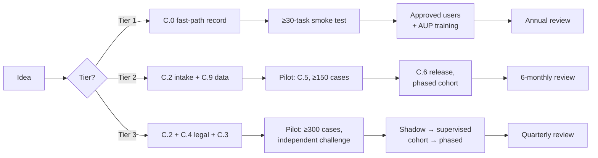

## Quick start: the first 90 days

This plan is a **starting default** for an organization at the "scattered experiments" or "several pilots" stage. It runs three workstreams in parallel: leadership and guardrails, portfolio and first delivery, and people. Compress or extend it to fit capacity. Dates should follow the owner-accepted estimates in tool C.8. The sequence is handbook synthesis that applies Chapters 1–6. [D19 pp. 2–6; D30 pp. 30, 67–74; D24 p. 4; D12 pp. 2–4.]

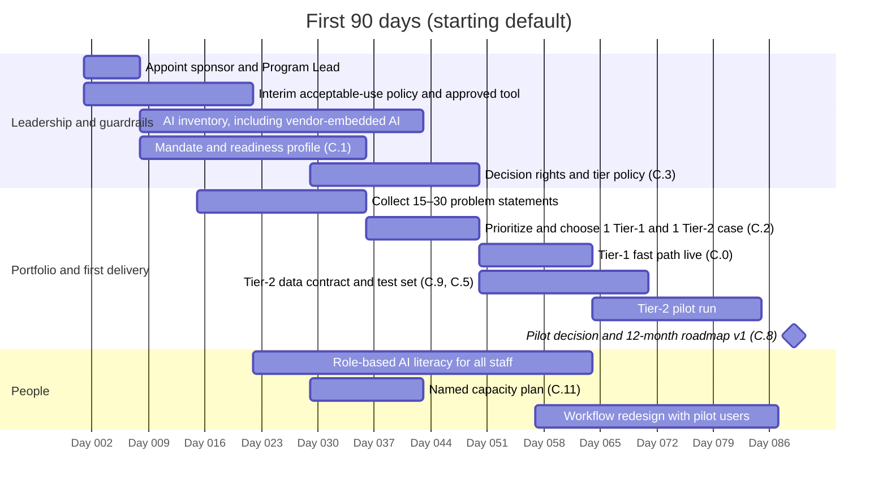

| Window | Action | Owner | Output that proves completion |
|---|---|---|---|
| Days 1–7 | Appoint the executive sponsor and the AI Program Lead with written authority, budget and escalation route | Sponsor | Signed role charter (3.2) |
| Days 1–21 | Publish an interim acceptable-use policy; confirm one approved general-purpose tool and its permitted data classes | Program Lead, Information Security, Legal | Policy issued (C.13); approved-tool notice |
| Days 7–42 | Inventory existing AI, including staff-built tools and AI embedded in vendor products; tier each item | Program Lead with application owners and procurement | Inventory with owner and tier for every item (4.2) |
| Days 7–35 | Draft the mandate; build the readiness evidence profile | Sponsor, business leaders, Program Lead | Mandate and C.1 profile with blocking gaps |
| Days 14–35 | Collect 15–30 problem statements from business units; observe the work | Business owners, product lead | Problem list with baseline evidence |
| Days 28–49 | Agree decision rights and the tier policy | Sponsor, risk, legal, security | C.3 matrix approved |
| Days 35–49 | Choose one Tier-1 quick win and one Tier-2 use case with real business value | Portfolio authority | C.2 decision records |
| Days 49–63 | Launch the Tier-1 fast path | Business owner | C.0 record; smoke test; users trained |
| Days 49–84 | Build the Tier-2 data contract and test set; run the pilot | Business owner, evaluation lead, data owner | C.9, C.5 with results |
| Days 21–63 | Role-based AI literacy for all staff; deeper training for pilot users | People/learning lead, line managers | Completion and competence evidence (8.3) |
| Day ~88 | Executive review: pilot decision, inventory status and 12-month roadmap | Sponsor, portfolio authority | Signed decisions; C.8 roadmap v1 |

**Failure signs at day 90:** no named Program Lead authority; an inventory with unowned items; a pilot without pre-set acceptance criteria; staff still using unapproved tools because no approved option exists.

## 1. Set the mandate and assess readiness

| Chapter card | |
|---|---|
| **Owner** | Executive sponsor; the AI Program Lead prepares the evidence |
| **Start when** | Before funding AI work beyond Tier-1 tools, or when existing AI activity has no mandate |
| **Timebox (starting default)** | 3–5 weeks for the mandate and readiness profile |
| **Outputs** | Two-page mandate; readiness profile (C.1); first funded investigation |
| **Tools** | C.1, C.12 |
| **Requirement level** | Core for every organization; depth scales with the intended portfolio, not with the tier of any single use case |

### 1.1 Purpose and starting conditions

Establish why the organization is investing, what it can responsibly deliver, and who can make the necessary decisions. Begin with a sponsor willing to resolve trade-offs and give access to the people who understand business performance, operations, data, technology and control requirements. When the core problem is uncertain, authorize discovery with an explicit output and review point; an uncertain diagnosis is a reason to investigate before selecting solutions.

**Documented practice:** Guardian organized AI around customer experience, operating efficiency and employee productivity, with hypotheses, business cases and scaling plans. Italgas tied AI to infrastructure operations and modernization and involved executive sponsors in delivery. These demonstrate different mandates grounded in different businesses. [D22 ll. 104–128, 195–219.]

### 1.2 Define the mandate in decision terms

The sponsor and business leaders should produce a short mandate containing:

1. The business challenge and the evidence supporting it: demand, service failure, cost, quality, risk, revenue opportunity or a constraint on capacity. State whether it is confirmed or a hypothesis.
2. The outcome to improve and the person accountable for that outcome. Describe the current workflow and affected people.
3. Initial boundaries: business domains, users, locations, data classes and actions that are included, excluded or undecided.
4. The permitted investment in discovery and experimentation, the authority for approving further commitments, and the conditions for stopping.
5. Constraints needing investigation: legal obligations, Information Security, data access, infrastructure, supplier dependence, connectivity, continuity, workforce capacity and existing commitments.

**Starting default:** keep the mandate to two pages and name no more than three business outcomes for the first twelve months. More outcomes usually means the same scarce experts are spread across too many teams. Appendix B.1 shows a completed mandate.

The mandate must leave room for a non-AI solution. A company may need clearer procedures, better search, conventional automation or improved data before an AI capability makes economic or operational sense. Fidelity’s explainability service used a simpler model as a baseline against which to assess additional complexity; BlackRock recommends simpler, task-specific models where they suffice. [D10 p. 11; D16 p. 9.]

### 1.3 Assess capabilities without creating a misleading average

Use McMillan’s six dimensions as the organizing structure for an evidence profile:

| Dimension | Evidence to collect | A useful next-step question |
|---|---|---|
| Strategy and executive alignment | Mandate, investment decisions, sponsor activity, outcome ownership | Can leaders resolve competing demands and allocate people and money? |
| Layered AI infrastructure | Approved access, integration, retrieval, orchestration where needed, evaluation and monitoring | Which capability will each team otherwise rebuild? |
| Data and content readiness | Named owners, source quality, semantics, permissions, freshness, issue records | Can the proposed task use trustworthy and authorized information? |
| Governance and risk | Inventory, reviews, control tests, incident and change records | Do controls change delivery and operation in practice? |
| Adoption and organizational transformation | Role-based competence, workflow changes, actual use and user feedback | Is the work changing in a useful, supportable way? |
| Use prioritization and portfolio management | Intake, comparative decisions, baselines, realized value, retirement decisions | Can the organization stop weak investments and expand strong ones? |

The source’s four levels are **Ad Hoc** (individual initiative), **Emerging** (intent exceeds capability), **Managed** (documented, owned and reliable) and **Scaled** (reliable across the firm and improving). The source is a practitioner assessment based on executive conversations and advisory experience, not a representative survey or an independently validated scoring instrument. Preserve that limitation. [D19 pp. 2–6.]

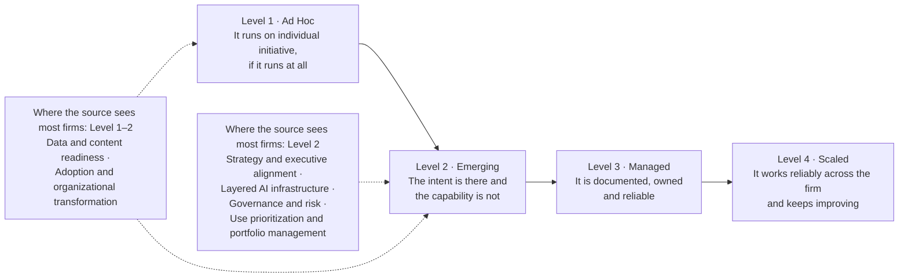

*McMillanAI Enterprise Maturity Framework, redrawn from* Everyone Is Behind *(first edition, August 2026): level definitions from p. 2; typical placement of firms on each dimension from pp. 3–6. The placements are patterns the author reports observing, not scores for a fixed sample. [D19 pp. 2–6.]*

For each dimension, interview responsible staff, inspect an artifact and examine an example of the process actually working. Record the observed level, confidence, evidence gaps and the specific capability required for the candidate portfolio. Mark an untested capability **unknown**. Do not average a strong technology rating with a missing control and conclude that the organization is ready. Appendix C.1 supplies the editable assessment and synthesis anchors.

### 1.4 Use the MIT CISR stages for a different purpose

MIT CISR distinguishes **Experiment and prepare**, **Build pilots and capabilities**, **Develop AI ways of working**, and **Become AI future ready**. Its companion figure groups respondents using an equally weighted measure of AI effectiveness in operations, customer experience and ecosystems. Its reported growth/profit differences are associations with financial performance relative to industry averages; they do not show that moving to a stage causes a specified financial gain. Different survey samples are reported for 2022 and 2025. [D22 ll. 59–83, 276–309; A02, figure and methodology footnote.]

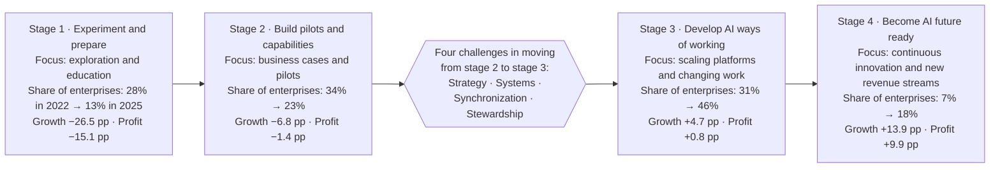

*Redrawn from MIT CISR,* Four Stages of Enterprise AI Maturity, 2022–2025*, with the four scaling challenges from the accompanying text. Stages are bands of Total AI Effectiveness (stage 1: 0–49%; stage 2: 50–74%; stage 3: 75–99%; stage 4: 100%). Growth and profit are percentage points above or below industry average, measured in 2024; they are associations, not effects of reaching a stage. Samples: 2022 survey N = 721; 2025 survey N = 152. [D22 ll. 59–83; A02.]*

Use these stages to discuss the organizational transition: from learning, to proving uses, to changing work at scale, to sustained innovation. Use McMillan’s dimensions to locate capability weaknesses. **Do not rename the source stages, convert their scales, or label the handbook’s assessment an MIT score.** An organization can have scaled access to a tool and still lack managed evaluation or data ownership.

### 1.5 Close the assessment with an actionable decision

| Action | Responsible role | Output | Evidence needed to move forward |
|---|---|---|---|
| Validate business challenge and scope | Sponsor and business leaders | Mandate and outcome hypotheses | Agreed problem, affected workflow, accountable owner |
| Inspect current capabilities | AI Program Lead with domain/control/technical staff | Readiness profile and confidence notes | Artifacts and operational examples, not interview assertions alone |
| Assess people and delivery capacity | Program Lead, functional managers, people leader | Named capacity and skill-gap record | Availability reconciled with existing commitments |
| Decide the first funded investigation | Sponsor / portfolio authority | Discovery or delivery authorization | Boundaries, budget, owner, unresolved dependencies and next decision date |

**Failure detection:** a mandate consisting only of “be AI-first,” a maturity score without evidence, and a sponsor who cannot release staff indicate that assessment has not produced an executable commitment. Repair the mandate or capacity allocation before expanding the portfolio. Discovery, inventory and initial skills assessment can run in parallel; solution selection depends on their findings. Revisit the mandate when strategy, constraints or evidence materially change.

## 2. Build and prioritize the use-case portfolio

| Chapter card | |
|---|---|
| **Owner** | Portfolio authority decides; business owners propose; the Program Lead runs the comparison |
| **Start when** | A mandate exists, and workflow users and an outcome owner are accessible |
| **Timebox (starting default)** | 2–4 weeks for the first portfolio round; refresh quarterly and after each pilot decision |
| **Outputs** | Intake records, alternatives comparison, ranked portfolio, decision record |
| **Tools** | C.0 (Tier 1), C.2 (Tier 2–3), C.12 |
| **Requirement level** | Tier 1: C.0 only. Tier 2: C.2 core fields. Tier 3: full C.2 with alternatives and sensitivity check |

### 2.1 Purpose and prerequisites

Turn business challenges into a manageable set of investment choices. Prerequisites are a mandate, access to workflow users, an outcome owner and a portfolio authority capable of allocating scarce resources. The output is a sequence of decisions and dependencies, rather than a long catalogue of AI ideas.

**Documented practice:** UOBAM collected problem statements from business units, assessed business impact and feasibility, consolidated overlapping problems and then developed and tested solutions. LPL combined an Advisor AI Council, conferences and industry research to identify time-consuming work. These accounts support discovery with users and domain specialists before technical selection. [D34 p. 21; D27 ll. 297–321.]

### 2.2 Discover work worth changing

The business owner and product/discovery lead should observe work, inspect representative completed cases and interview different user groups. Include experienced users, newer users, users who avoid existing tools and the people who handle failures downstream. Map the trigger, inputs, judgment, hand-offs, systems, output and exception path. Measure the current task, including waiting, checking and rework.

Write the opportunity as: **“For [user], change [workflow step] so that [measurable outcome] improves, while maintaining [quality, rights, safety and service constraints].”** Distinguish the outcome from the output. A generated answer is an output; a correctly resolved inquiry is an outcome. A shorter call, fewer escalations or a closed chat may represent efficiency, abandonment or failure. Use follow-up and quality evidence to tell them apart. This measurement design is synthesis informed by the sources’ emphasis on useful workflow outcomes and full cost per successful outcome. [D38 ll. 53–100, 381–429; D14 ll. 248–258.]

### 2.3 Define and compare credible alternatives

For each opportunity, consider keeping the current process, improving procedures or information quality, rules/search/workflow automation, conventional predictive models, a generative assistant, and action-taking automation where relevant. Compare only plausible alternatives using the same task definition and evaluation evidence. A short technical investigation can establish feasibility without committing to production.

The technical lead must explain what AI contributes: prediction, extraction, language access, synthesis, recommendations or action selection. The business owner must explain why that contribution improves the workflow. An AI label is insufficient. Appendix C.2 records the alternatives, including a reason for eliminating each option.

### 2.4 Prioritize with eligibility first, judgment second

Use two stages. First apply hard eligibility conditions: a meaningful problem, a responsible owner, a lawful/permitted path to required data and actions, a feasible evaluation method, and a credible capacity path. An unresolved mandatory requirement means **hold pending evidence** or redesign; a high commercial score cannot compensate for it.

Then compare eligible candidates across business importance, expected outcome improvement, evidence confidence, technical/data feasibility, workflow adoption, full cost, time to evidence, dependencies and residual risk. Use an evidence narrative and a simple scale if useful. Agree scales and weights before ranking and show sensitivity to different executive priorities. Treat unknown as unknown rather than silently assigning a middle score. Avoid multiplying uncertain estimates into a precise-looking investment return.

| Candidate situation | Appropriate next investment | Decision evidence |
|---|---|---|
| Important problem, weak problem evidence | Discovery | Representative workflows and a baseline |
| Confirmed problem, poor data or access | Bounded data/preparation work | Defined source remediation and permitted access |
| Valuable task, uncertain technical approach | Comparative experiment | Same task/test evidence across alternatives |
| Supported task benefit, weak integration or operations | Production engineering | Release and support readiness |
| Useful existing deployment | Retain, refine or expand | Sustained value, cost and control performance |
| Weak value, unacceptable exposure or no feasible owner | Stop or select another approach | Recorded rationale and disposition of artifacts/data |

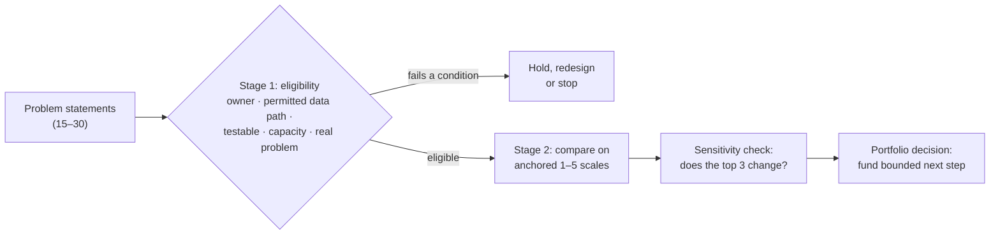

**Starting-default scoring anchors.** Use these anchors so that a "4" means the same thing in every business unit. Weight the dimensions equally unless the portfolio authority agrees different weights *before* scoring. Then re-run the ranking with each executive's top priority doubled; if the top three change, discuss the trade-off explicitly instead of averaging it away. The anchors are handbook synthesis.

| Dimension | 1 | 3 | 5 |
|---|---|---|---|
| Business importance | Local inconvenience | Material to one unit’s targets | Material to enterprise strategy or a committed obligation |
| Evidence confidence | Anecdote | Sampled baseline from real work | Measured baseline over a full business cycle |
| Data and technical feasibility | Data unavailable or not permitted | Available after defined remediation | Available, owned, permitted and tested |
| Workflow and adoption feasibility | Users not consulted; new tool outside workflow | Users engaged; partial integration | Users co-designing; fits the existing system of work |
| Time to useful evidence | More than 6 months | 2–3 months | Under 4 weeks |
| Full cost and economics | Cost unknown or plausibly above benefit | Estimated with stated assumptions | Estimated with C.14 and validated by finance |
| Residual risk and control burden | Tier 3 with unresolved mandatory items | Tier 2 with known controls | Tier 1 |

Plot eligible candidates on value against feasibility to make the trade-offs visible. The candidates below are illustrative.

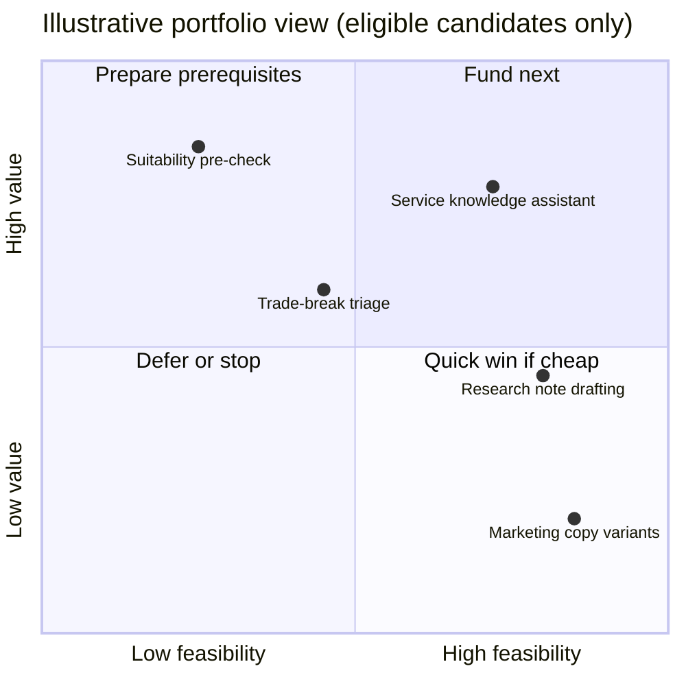

**Starting default for work in progress:** run no more concurrent pilots than you have named domain experts with released time to label test cases and review results. For most first-year programs that means one to three.

### 2.5 Balance a coherent domain with bounded delivery

A domain is a connected business activity or journey, such as customer support or an investment research process. A use case is a specific application within it. Select domains to avoid scattered, disconnected tools; deliver bounded increments so that learning, costs and exposure remain manageable. Shared components should emerge from validated recurring needs.

**Difference in the sources:** McKinsey advocates domain-wide transformation, while Fidelity recommends starting with a focused use case and expanding after validating benefits. JPMC describes both top-down domain transformation and bottom-up broad employee access. The synthesis is to plan at domain level, fund explicit increments and keep exploratory enablement within a separately approved budget. [D21 pp. 3–4; D10 pp. 11–12; D24 p. 4.]

### 2.6 Decide, record and revisit

The Program Lead prepares the comparison, finance challenges costs and benefit treatment, technical/data owners assess feasibility, control reviewers identify constraints, and the portfolio authority makes the investment decision. The business owner accepts the outcome definition and supplies users and specialists.

**Deliverables:** intake worksheet, current-workflow baseline, alternatives comparison, preliminary risk/legal record, dependency map, capacity estimate, ranked portfolio and a decision record. **Proceed** when a funded bounded scope, acceptance criteria, owner and dependency plan exist. **Failure detection:** many approved ideas sharing the same unavailable specialists, duplicate retrieval systems, and projects ranked entirely by speculative revenue. Keep work in progress within delivery and review capacity. Refresh priorities after pilot results, material incidents or changes in business direction; do not protect a project merely because development has begun.

## 3. Design the operating model and people strategy

| Chapter card | |
|---|---|
| **Owner** | Executive sponsor with the AI Program Lead; functional managers confirm capacity |
| **Start when** | A candidate portfolio exists; run it in parallel with Chapter 2 |
| **Timebox (starting default)** | 2–3 weeks for role charters and the decision-rights matrix |
| **Outputs** | Program Lead charter, decision-rights matrix, named team and capacity plan |
| **Tools** | C.3, C.11 |
| **Requirement level** | Core: named outcome owner and release authority at every tier; team size scales by tier (3.3) |

### 3.1 Purpose and prerequisites

Make it clear who owns outcomes, who builds and operates the system, who challenges it, and who may approve or stop activity. Begin with a candidate portfolio and a map of existing functions and delegated authority. Assign responsibilities before deciding whether to create new departments or job titles.

**Documented practice:** Vanguard brought together data engineers, business analysts, compliance, security and business users. Fidelity describes cross-functional collaboration across AI, engineering, experience design, business and compliance. CFA Institute describes an innovation function connecting investment and technology, with responsibilities extending beyond translation to setting direction and priorities. [D14 ll. 55–79; D10 p. 12; D34 pp. 9–11.]

### 3.2 Appoint an AI Program Lead with a real mandate

The **AI Program Lead** is the handbook’s proposed coordination role. The person maintains the portfolio, organizes cross-functional delivery, exposes dependencies, prepares investment/release evidence, tracks value and ensures decisions are acted upon. The role can report through business, transformation, operations, data or technology, depending on local authority and capacity. It needs access to the sponsor and a mechanism for resolving cross-unit conflicts.

The lead does not automatically become the owner of every service result, all data or all residual risk. The head of the business process remains accountable for its outcomes. The release authority, Information Security, legal/compliance reviewers and operational owner retain their respective decisions. Define the lead’s spending authority, ability to convene/release resources, escalation route and obligations in writing.

### 3.3 Allocate decision rights across functions

| Role / capability | Required responsibility | Evidence of suitability |
|---|---|---|
| Executive sponsor / governing authority | Mandate, funding, strategic trade-offs, risk appetite within applicable requirements | Can allocate resources and resolve cross-unit issues |
| Business / use-case owner | Outcome, workflow scope, business acceptance, adoption and benefit realization | Understands the work and controls operational change |
| Program Lead | Portfolio, delivery coordination, evidence and decision follow-through | Can connect business and technical work, challenge assumptions and write clear decisions |
| Product / discovery lead | User evidence, workflow design, requirements and feedback | Demonstrates research and product judgment in the domain |
| Domain specialist / content owner | Business meaning, authoritative content, test labels, exceptions | Can judge correctness, omissions and practical consequences |
| Data owner and engineering steward | Permitted use, definitions, quality, freshness, lineage and remediation | Can explain sources, authorize access and support downstream use |
| Technical / architecture lead | Solution design, sourcing, integration, engineering and technical limits | Has delivery experience relevant to the selected approach |
| Evaluation / assurance specialist | Test design, evidence quality, independent challenge proportionate to impact | Can distinguish task quality, model scores and business outcomes |
| Information Security | Threat assessment, access/egress controls, security testing and incident coordination | Competence in the actual deployment and its attack surfaces |
| Legal, compliance, privacy and relevant risk reviewers | Local applicability, permitted use, required controls and approval evidence | Authorized to interpret the relevant requirements or obtain qualified advice |
| Operational owner / service team | Availability, support, monitoring, incident response, change and retirement | Accepts the runbook, staffing, access and operating budget |
| People / learning lead and line managers | Capacity, role changes, competence, support and workforce implications | Can release time, assess skills and manage changes to work |
| Finance / procurement | Investment comparison, cost treatment, contracts, supplier commitments | Can validate full costs and commercial assumptions |

One person may cover several capabilities in a smaller organization, but record the workload and conflicts. Maintain proportionate review by someone able to challenge development decisions. When internal capacity cannot provide suitable challenge, use an appropriate independent internal or external reviewer. Do not automatically make internal audit an operational release approver; preserve the locally defined assurance role. BlackRock describes operational ownership, risk challenge and internal audit as distinct lines. [D16 pp. 6–7; D30 pp. 60–63.]

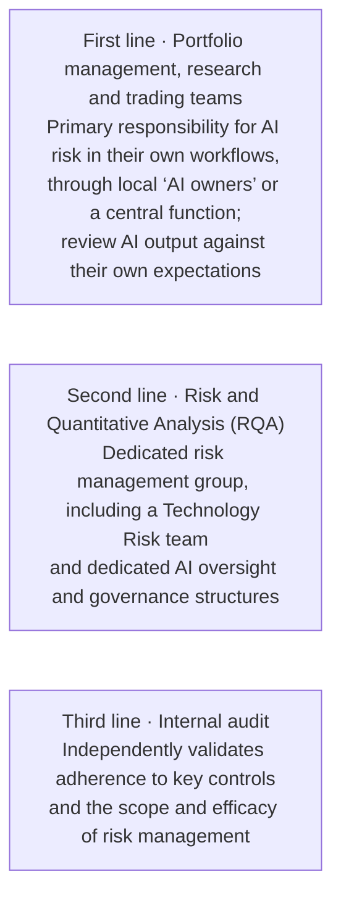

*BlackRock’s three lines of defense for AI, redrawn from the firm’s response to the European Commission consultation (October 2024). This is the firm’s description of its own framework, not a regulatory requirement. [D16 pp. 6–7.]*

**Minimum viable team by tier (starting default).** One person may hold several roles in a smaller organization; record the workload and any conflict of interest.

| Tier | Minimum roles that must be named before work starts |
|---|---|
| Tier 1 | Business owner; line manager; administrator of the approved tool; Information Security confirmation that the tool and data classes are approved |
| Tier 2 | Business owner; product/delivery lead; domain expert(s) with released time; data owner and steward; engineer(s); evaluation lead (may be the product lead); security and privacy reviewers; operational owner |
| Tier 3 | All Tier 2 roles, plus an independent evaluation/assurance reviewer, a legal/compliance reviewer with authority for the jurisdiction, a named risk-acceptance authority and staffed operational support |

**Who does what at the five gates.** R = prepares and executes; A = accountable decision; C = must be consulted or concur; I = informed.

| Gate | Sponsor | Portfolio authority | Business owner | Program Lead | Technical lead | Control reviewers | Operational owner | Finance |
|---|---|---|---|---|---|---|---|---|
| 1 Mandate | A | C | C | R | C | C | I | C |
| 2 Invest | I | A | R | R | C | C | I | C |
| 3 Expose pilot | I | I | A | R | R | C | C | I |
| 4 Release | I | I | C | R | R | C | C | I |
| 5 Expand / retain | I | A | R | R | C | C | C | C |

Gate 4 is decided by the named release authority, which may be the business owner, a technology change authority or a committee, depending on local delegation. Control reviewers (security, legal/compliance, risk) hold concurrence or veto rights where their remit requires it.

### 3.4 Choose what to centralize

| Choice | Conditions favoring it | Trade-off to manage |
|---|---|---|
| Central delivery team | Scarce specialists, immature local capabilities, recurring common needs | Distance from users; shared backlog bottleneck |
| Central standards/platforms, domain delivery | Several capable business teams and reusable controls/infrastructure | Interface ownership, funding and consistent evidence |
| Domain-led delivery with central support | Strong local expertise and capacity; differentiated workflows | Duplicate spend, inconsistent controls, weak cross-unit reuse |

Make separate decisions for strategic steering, standards, platform operation and delivery. A firm can centralize security, model access and common evaluation tooling while embedding domain experts and product teams in business units. McKinsey’s 16-institution study associates central coordination with earlier production progress but does not prove a universal organizational structure. JPMC’s case describes federated domain specialists using common patterns. [D33 pp. 3–6; D25 pp. 6–8, 13.]

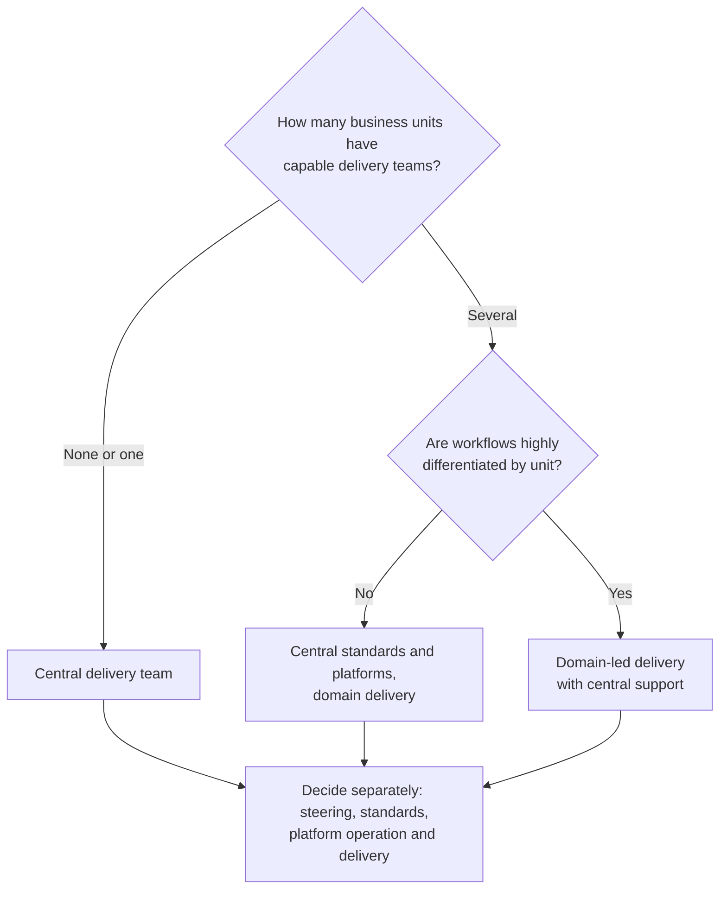

### 3.5 Assess people and delivery capacity before committing

For each necessary capability, list the actual people, relevant delivery examples, current obligations, available time, decision authority and backup. Ask their functional managers to confirm release of capacity. Estimate demand for expert labeling, content remediation, security review, operations and adoption alongside development. A headcount list alone cannot establish available delivery capacity.

Choose among internal assignment, reskilling, recruitment and external support for each gap. Use internal ownership where institutional knowledge, business decisions or ongoing service accountability are essential. External specialists can supply expertise or capacity, but contracts and working arrangements must include knowledge transfer, usable artifacts, support boundaries and exit arrangements. Vanguard’s account combines experienced hires, sourcing partners and extensive role-based retraining; it does not prescribe a staffing ratio for others. [D36 ll. 118–151.]

**Deliverables:** role charters, decision-rights matrix, named team/capacity plan, skill-gap and sourcing decisions, operating-model agreement. **Proceed** when outcome, delivery, control and operational ownership are accepted by named people with available capacity. **Failure detection:** a Program Lead without authority, one expert assigned to every project, reviewers involved only at staging, or an external supplier holding all essential knowledge. Portfolio reprioritization, hiring and learning can run together; a release cannot rely on an unstaffed operating role. Revisit the model as the portfolio and reusable services grow.

## 4. Build governance into delivery

| Chapter card | |
|---|---|
| **Owner** | Business owner prepares context; specialists assess; competent authorities decide; Program Lead coordinates one evidence pack |
| **Start when** | Day one for guardrails (4.2); at intake for each use case (4.3) |
| **Timebox (starting default)** | Interim acceptable-use policy within 3 weeks; inventory within 6 weeks; per use case, governance runs inside the delivery timebox of its tier |
| **Outputs** | Acceptable-use policy, AI inventory, tier and control record, local applicability worksheet, decision log |
| **Tools** | C.0, C.3, C.4, C.13 |
| **Requirement level** | Core at every tier: inventory entry, tier, owner. Tier 2–3: control record. Tier 3: C.4 legal determination and independent challenge |

### 4.1 Purpose and prerequisites

Translate principles into choices that affect design, testing, exposure and operation. Begin with known decision rights, a use-case owner and access to the people responsible for applicable legal, regulatory, security and risk matters. Use existing enterprise governance where it is effective; add AI-specific controls where the selected system introduces new or amplified risks.

MindForge treats governance as proportionate to use-case context and risk materiality and distinguishes model-level risk from risk arising when a general-purpose model is used in a particular workflow. FINOS supplies a risk and mitigation catalogue, a heuristic assessment and architecture diagrams. These are complementary: lifecycle/accountability guidance and a control-selection resource. They do not establish compliance by themselves. [D30 pp. 52–64; FINOS heuristic assessment, sections A–H; mi-5, Implementation Guidance.]

### 4.2 Put day-one guardrails in place: approved access, acceptable use and shadow AI

Staff are already using AI, whether or not it is approved. Microsoft and LinkedIn’s 2024 survey reported that 75% of knowledge workers used AI at work and that 78% of those users brought their own AI tools; only 39% of users had received AI training from their company. [E06] MindForge calls AI whose risks go unmanaged because it was never identified "shadow AI". It notes that the most common identification approach is self-declaration by application owners, and that vendors can add AI to products the organization already uses. [D30 pp. 30, 48.] McMillan’s answer, asked about shadow AI, is to be very clear on policy and to educate employees. He also describes staff-built solutions as a source of value once the right tools are in experts’ hands. [D08 ll. 519–530, 676–682.] JPMC and BNY both chose broad, governed access to an internal platform rather than prohibition alone. [D24 p. 4; D12 pp. 2–4.]

**Actions (Core for every organization):**

1. **Provide an approved option.** Name at least one approved general-purpose AI tool, the data classes it may receive and who may use it. Prohibition without an alternative tends to push use out of sight.
2. **Publish a short acceptable-use policy** (tool C.13). It should cover approved tools, a data-class matrix, prohibited uses, the user’s duty to verify outputs, disclosure rules, how to request a new tool or use case, how to report incidents, and consequences.
3. **Discover existing use.** Combine self-declaration by application owners and builders; governance checklists at each SDLC stage; procurement and vendor-terms monitoring for newly embedded AI; and, where lawful and proportionate, review of expense claims, software inventories and network or SaaS discovery. [D30 pp. 30, 48; the last three methods are handbook synthesis.]
4. **Offer a registration window.** For a defined period, register existing uses without penalty so they can be tiered and either approved, moved to an approved tool or stopped.
5. **Triage each discovery** using the tier questions. Register it in the inventory with an owner (4.3).
6. **Build baseline literacy.** Some jurisdictions now require it. Article 4 of the EU AI Act has required providers and deployers to take measures to support staff AI literacy since 2 February 2025, and it was amended by Regulation (EU) 2026/1744. Verify the current text and applicability locally. [E09]

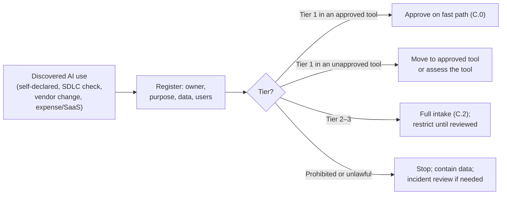

**Failure signs:** a ban with no approved tool; a policy nobody has read; an inventory that lists only centrally built systems; no route for staff to propose improvements they have built.

### 4.3 Register the use case and assess impact early

Maintain one authoritative use-case record, or linked records that collectively provide the same function. Record intended purpose, users, locations, owner, AI type, models/providers, data, actions, dependencies, lifecycle status, risks, control owners, approvals, limitations and review dates. Link detailed artifacts rather than copying them into every committee pack. Include third-party AI embedded in other products, citizen-built workflows and retired deployments. [Source recommendation: D30 pp. 67–74.]

The business owner and risk reviewers assess **inherent risk** before controls and **residual risk** after testing the proposed controls. Consider impact on individuals, customers, operations and markets; data sensitivity; financial consequences; autonomy; scale; complexity; dependency; ability to detect/correct harm; and local obligations. Use a preliminary classification when details are incomplete, then update it as design and testing clarify exposure. A model approved for one purpose does not approve every application.

Define locally understandable tiers. A low-impact internal draft with effective review may justify a lighter process than personalized customer advice or an action affecting money or access to services. “Internal” and “public data” are contextual facts, not automatic low-risk classifications. The organization's tier is an internal management decision; a legally defined category, if applicable, must be assessed separately by the authorized reviewer. [D30 pp. 53–55, 60–63; D29 pp. 16–18.]

### 4.4 Convert risks into testable controls

For each material failure, name the prevention, detection and response controls, the owner, test evidence, residual limitation and decision-maker. Use the FINOS catalogue selectively:

| Exposure | Control choices to evaluate | Evidence to request |
|---|---|---|
| Sensitive data in prompts, retrieval, logs, caches or embeddings | Data classification, permitted-flow design, filtering, encryption and source entitlements | Data-flow tests, access tests including negative cases, retention/deletion evidence |
| Inaccurate, incomplete or unsupported answers | Curated sources, source traceability, task evaluation, appropriate refusal and human review | Expert-labeled results, omission cases, citation-support checks, correction workflow |
| Model or content change | Version records, controlled updates, regression tests and fallback | Version-to-release trace, test comparison, tested rollback |
| Service interruption or uncontrolled spend | Quotas, budgets, alerts, capacity and contingency arrangements | Load/cost scenarios, alert routing and failure exercise |
| Agent actions and connected tools | Least privilege, parameter/sequence validation, bounded authority, approval at consequential actions | Attempts to exceed authority, replay/duplicate-action tests, action and approval records |
| Agent memory, credentials and extensions | State isolation, credential protection, trusted tool/skill sources and controlled updates | Isolation tests, secret-access tests, approved versions, dependency provenance |

[Source recommendations: FINOS mi-1, Implementation Guidance; mi-4, Implementation Guidance; mi-9, Implementation Guidance; mi-10, Implementation Guidance; mi-13, sections 1–4; mi-16, sections 1–4; mi-18, Implementation Guidance; mi-19, Implementation Guidance; mi-23, Implementation Guidance; mi-24, sections 1–7, **Draft**; mi-25, Tiered Implementation Approach, **Draft**.]

**Other control catalogues.** The OWASP Top 10 for LLM Applications (2025) and the OWASP Top 10 for Agentic Applications (2026) are widely used checklists for threat modelling and security testing, covering risks such as prompt injection, excessive agency, system-prompt leakage, vector and embedding weaknesses, unbounded consumption, tool misuse and identity and privilege abuse. NIST AI 600-1 maps generative-AI risks to more than 200 suggested actions under the NIST AI RMF functions. Organizations that want a certifiable management system can use ISO/IEC 42001:2023, which audits the management system rather than any single model. Use these to check coverage, not as substitutes for testing your own system. [E01; E02; E03; E04; E05]

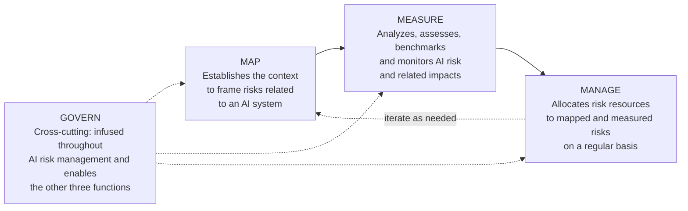

*NIST AI RMF 1.0 core functions, redrawn from Figure 5 and Section 5 of the framework. After governance outcomes are in place, most users start with MAP and continue to MEASURE or MANAGE, cross-referencing between functions as necessary. [E01]*

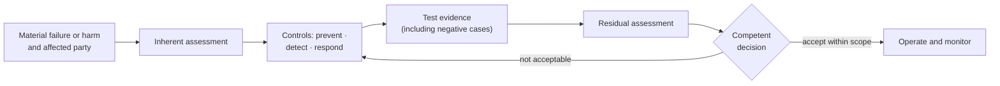

Apply these as candidates for an engineered design. Do not assume a firewall eliminates prompt injection, that citations establish correctness, or that encryption replaces access control. A prompt asking a model to respect permissions is not an authorization mechanism. The FINOS source-entitlement mitigation explicitly discourages prompt-only access control. [FINOS mi-16, “Avoiding Insecure Shortcuts”; mi-17, “Challenges and Considerations.”]

### 4.5 Use one lifecycle with proportionate reviews

| Stage | Required governance work | Decision / evidence |
|---|---|---|
| Intake | Owner, purpose, preliminary harm/legal screen and record | Permitted investigation and constraints |
| Design | Data flows, sourcing, human role, failure paths and control selection | Approved scope and named control owners |
| Pilot | Evaluate tasks and controls under explicit exposure limits | Continue, redesign or stop using agreed criteria |
| Release | Independent challenge as appropriate, business acceptance, security/local reviews and operating readiness | Defined production authorization and residual-risk decision |
| Operation | Monitoring, feedback, incidents, usage scope and periodic review | Retain, restrict, change or suspend |
| Expansion / material change | Reassess changed audience, location, data, model, authority and dependencies | New scope authorization; previous approval is not assumed sufficient |
| Retirement | Disable access/actions, handle data/artifacts, notify dependent owners and update records | Closure evidence and retained obligations |

The tier matrix sets the minimum depth of each stage. Risk acceptance cannot authorize conduct that the responsible legal reviewer determines is impermissible. An exception to an internal policy should identify the competent authority, rationale, compensating controls, expiration, monitoring and closure condition. Resolve disagreement by recording the competing assessments and escalating to the delegated authority; do not close it by silently removing the issue.

### 4.6 Learn from regulatory conditions without exporting local rules

| Case | Local context and source status | Documented response / friction | Transferable lesson | Required local validation |
|---|---|---|---|---|
| Julius Baer | D29 discusses its review against applicable rules including the **EU AI Act**; the case is a company account, not a legal interpretation for every deployment | Initial screen excludes prohibited uses; later use-case validation; general chatbot hosted on-premises; training and disclaimers. Model preapproval supports updates, but use cases still validated | Check permissibility before major build investment; separate reusable model approval from use-context approval | Relevant entities, territorial scope, legal system definitions, effective requirements and actual activity |
| Prudential PRUShield | Group and local policies across jurisdictions including Singapore; design/release forums are **company governance** | Non-standard messaging interface required group architecture review; answers restricted to approved public product content; no account-specific or personalized advice; interpretation differences and repeated questions delayed reviews | Bound scope, surface non-standard dependencies early, coordinate evidence and schedule expert review | Local rules for product information/advice, communication channels, privacy, records and required approvals |
| UOBAM | Singapore context; report describes checking against **MAS FEAT principles** and internal independent validation | Independent team check before a management-led technology committee approved operationalization; portfolio turnover required redesign | Include independent challenge and business constraints before deployment | Applicable investment duties, validation expectations, trading constraints and approval authority; no assumption that another jurisdiction requires the same committee |
| FINRA observations | US FINRA member-firm context; the 2026 report describes existing obligations and observed practices and explicitly creates **no new requirements** | Report points to supervision, testing, monitoring, documentation and controls for agent scope/authority | Review how existing sector duties apply to a new technology throughout delivery | Applicable local rules and legal interpretation; observed practices are not automatically mandatory |
| BlackRock | Company response to an **EU consultation**, October 2024; company positions are not the Commission’s conclusions | Existing risk/control framework, business ownership, risk challenge, audit and cross-disciplinary onboarding described | Extend effective controls and preserve distinct ownership/challenge/assurance roles | Duties for the actual institution and activity, adequate explainability and permitted data use |
| Unnamed investment firm | Company account describes **global regulatory variability**, including EU/US differences | Multiple legal, security and engineering reviews; inconsistent definitions and standards create implementation complexity | Use common internal controls plus locally validated requirements and document conflicts | Each entity, location, customer population and provider/data route; resolve conflicting requirements before exposure |

[D29 pp. 11–12, 14–19, 21–23; D34 pp. 22–23; D01 pp. 5, 25–28; D16 pp. 6–9.]

These sources do not document a single regulatory approval route applicable to all organizations. They also do not establish that all controls were externally required. Preserve the distinction between legal obligation, regulator guidance, company policy and an unresolved interpretation. Appendix C.4 captures the jurisdiction, activity, exact authority, status, reviewer, evidence and affected control. For multiple jurisdictions, maintain a common system record with separate applicability decisions; consider separate scopes or deployments if requirements cannot be reconciled.

### 4.7 Completion and failure detection

**Deliverables:** current inventory entry, risk/control matrix, local applicability worksheet, decision log, review schedule and exception records. **Responsible:** business owner prepares context; specialists assess their domains; the Program Lead coordinates one evidence pack; competent authorities make their respective decisions. **Proceed** when required controls are tested and material open questions are resolved for the proposed exposure. **Failure detection:** approval without artifacts, repeated review questions without owners, a risk tier based only on model brand, or a pilot used to bypass normal responsibilities. Preliminary reviews can run in parallel; release depends on completion of required decisions. Reassess after material change, incidents, misuse or changed local requirements.

## 5. Prepare data and technology foundations

| Chapter card | |
|---|---|
| **Owner** | Technical lead integrates; business data owner and engineering steward validate meaning and rights; Information Security and operations accept their parts |
| **Start when** | A use case is selected and representative questions or cases exist |
| **Timebox (starting default)** | Tier 2: 3–6 weeks for the data contract and architecture record, alongside test-set building |
| **Outputs** | Data contract, data-flow diagram, technique and sourcing decision, supplier assessment, run-cost estimate |
| **Tools** | C.9, C.14 |
| **Requirement level** | Tier 1: Conditional (only if new data is connected). Tier 2–3: Core for each critical source; Tier 3 adds deletion and permission-change tests |

### 5.1 Purpose and prerequisites

Make the information and technology fit for a specific task, while identifying capabilities worth sharing. Start with a defined use case, representative questions/cases, data owners, preliminary constraints and a technical lead. Enterprise data work can proceed incrementally; demonstrate readiness for the selected use before assuming the entire data estate must be rebuilt.

**Documented practice:** Vanguard’s Virtual Analyst addressed complex financial queries by combining business and technical ownership, metadata, semantics, examples, quality checks, permissions and continuous evaluation. Its blueprint shows how these elements relate to the interface, model and data platform. The accompanying text calls the architecture illustrative and describes knowledge graphs and RAG as future exploration. Preserve those status distinctions when adapting the design. [D14 ll. 55–119, 132–258, 288–295; A01, “AI-Ready Data Blueprint.”]

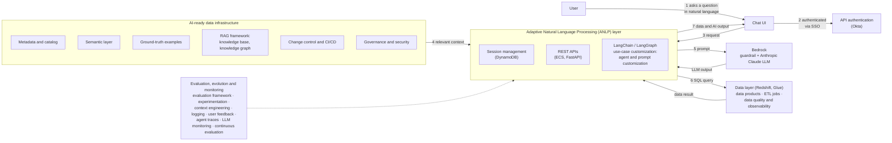

*Redrawn from Vanguard’s* AI-Ready Data Blueprint: Virtual Analyst Architecture*; the numbers follow the figure’s end-to-end flow. Product names are Vanguard’s choices, not recommendations. [A01]*

### 5.2 Produce a use-case data contract

The business data owner and engineering steward jointly document the following for each critical source:

1. **Purpose and meaning:** what the source represents, applicable population, authoritative definitions, units, time basis, calculation rules and known ambiguities.
2. **Ownership and rights:** accountable business owner, technical steward, permitted purposes, licensing/contract restrictions and approved user/service identities.
3. **Quality and coverage:** completeness, correctness, freshness, representativeness, reconciliation, lineage and known missing cases, assessed against the actual task.
4. **Access and processing:** data locations, allowed destinations, transformations, derived stores, logs, caches, backups, provider access and deletion/retention requirements.
5. **Operating agreement:** refresh process, quality thresholds, issue escalation, support, source changes and downstream notifications.

Have domain specialists resolve conflicting business definitions. Test joins, entity matching and time interpretation against known cases. Record unresolved semantics as blocking issues where they affect correctness. Vanguard distinguishes technical metadata from business context and uses a semantic layer to turn agreed definitions into executable logic; the transferable practice is consistent meaning, not a requirement to buy a particular catalogue or warehouse. [D14 ll. 132–198, 217–245.]

### 5.3 Choose the technique from the task

| Task / condition | Approach to evaluate | What must be demonstrated |
|---|---|---|
| Fixed rules, exact calculations or known workflow | Deterministic application/search/workflow | Correct rules, maintained sources, usable integration |
| Prediction/ranking from suitable labeled/historical data | Conventional ML/statistical models, with simpler baselines | Relevant out-of-sample behavior, data integrity, practical constraints and monitoring |
| General drafting/brainstorming without authoritative company answers | Approved general assistant | Permitted data, user review competence, scope and security |
| Answers grounded in changing documents | Search or retrieval-augmented generation (RAG) | Source coverage, retrieval quality, permissions, freshness and answer/citation correctness |
| Natural-language access to structured data | Governed query interface / text-to-query | Business semantics, authorization, query limits and correct results on representative cases |
| Persistent task behavior or style unmet by simpler configurations | Fine-tuning, if warranted | Quality advantage, suitable data rights, held-out evaluation and maintainability |
| Variable multi-step work requiring tool selection | Bounded agent workflow, if justified | Task and trajectory performance, tool authorization, state integrity, containment and recovery |

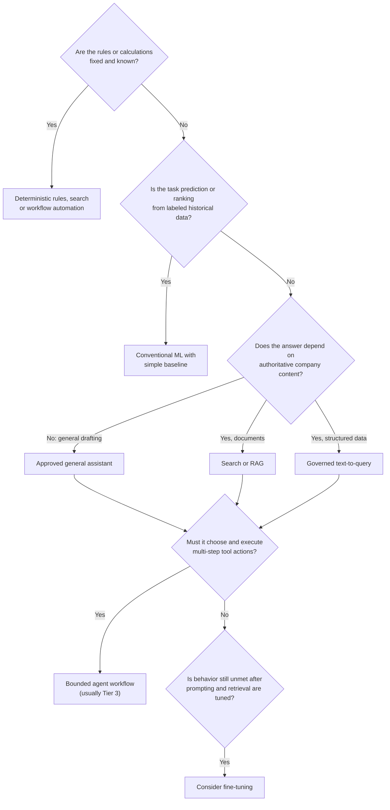

RAG retrieves relevant source content into the system’s working context. Fine-tuning changes model parameters using training examples. They solve different problems and can be combined, but neither is a universal prerequisite. Julius Baer’s general chatbot uses an on-premises open-weight model without either; LCH selected a managed retrieval product after considering customization effort and citations; Fidelity’s strategy includes several non-LLM capabilities. [D29 p. 12; D26 ll. 90–107; D10 pp. 1–4.]

For retrieval, retain source identity, version, validity dates and permissions at the document/chunk level needed by the design. Test deletion and permission changes through the derived index and caches. Filter by actual authorization before restricted material reaches the model. For structured querying, use controlled identities, enforce allowed data/actions in software, validate generated queries and set resource limits. For agent workflows, enforce allowed actions and parameter constraints outside the model, separate secrets from model-visible context where feasible, and treat tool outputs and retrieved instructions as untrusted inputs. [Synthesis informed by D14 ll. 149–155, 201–245; FINOS mi-16, Implementation Guidance; mi-18, sections 3–7; mi-19, sections 1–3; mi-23, sections 1–3.]

### 5.4 Decide where processing and control live

Compare hosted services, managed dedicated environments, internally operated open-weight models and hybrid arrangements against the actual requirements. Specify what each option would send or expose, who can access it, where processing/logging/backups occur, what changes the provider controls, and what happens during an outage or exit.

Sensitive data remaining in an organization’s database does not, by itself, establish that an AI service does not receive it. Prompts, retrieved passages, generated results, embeddings, telemetry and support access all belong in the data-flow assessment. Likewise, processing inside a controlled organizational environment need not mean running the model inside the database engine. Define the permitted boundary and test the complete flow. This is architectural synthesis from the FINOS RAG diagrams, which separate preparation, inference and model endpoints, and its leakage/control specifications. [FINOS F13 and F15, preparation/inference boundaries; their PlantUML sources; ri-2, Summary/Threat Description; mi-1, Implementation Guidance.]

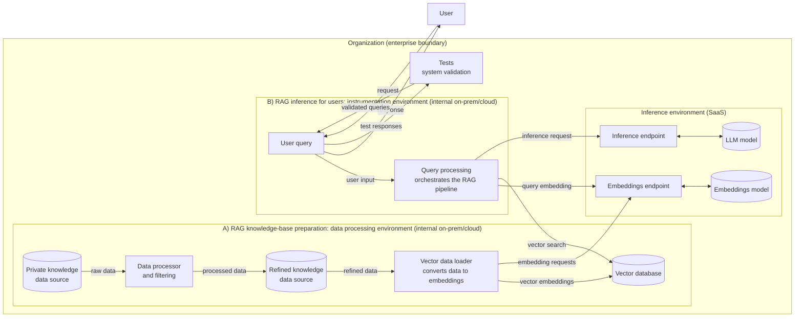

*Redrawn from the FINOS AI Governance Framework diagram* RAG System Architecture *(v0, without risks). It separates three environments: knowledge-base preparation, inference for users, and a SaaS inference environment that hosts the embedding and language models. [FINOS F13]*

If external processing is prohibited, exclude any route that violates that boundary, including evaluation and observability services. An internally hosted option still needs suitable capacity, licensing, security, updates, evaluation and operations. If connectivity or provider availability is uncertain, test the defined contingency: manual workflow, queued work, graceful feature restriction or an approved alternative. A replacement model needs its own compatibility and quality evidence; provider switching is not automatically a safe fallback.

### 5.5 Assess suppliers and shared components

Ask suppliers for the use-case-relevant AI card: intended use/limits, components, data flows, evaluation method, known risks, security controls, processing/retention/training terms, version changes, support, incident notification, capacity, export and deletion/exit options. Verify the commitments technically and contractually where feasible. A missing disclosure is an evidence gap; decide whether compensating tests and restrictions suffice or the option should be rejected. MindForge’s AI Card template provides a source basis; it is a disclosure structure, not an approval certificate. [D30 pp. 152–153; FINOS mi-7, Implementation Guidance.]

Design reusable capabilities with a defined service owner, interface, supported versions, permissions, quality contract, cost attribution and change policy. Candidate shared capabilities include model access, identity, document ingestion, evaluation harnesses and monitoring. Build only what the portfolio justifies. Fidelity’s modularity supports independent evolution; JPMC’s common patterns reduced fragmentation. Shared services also create dependencies and require their own operating controls. [D10 pp. 11–12; D25 pp. 6–8.]

### 5.6 Estimate run cost before you commit

Model fees are usually only one part of the cost of a successful outcome, so estimate all of the components before funding a pilot, and re-estimate with measured pilot data before release (tool C.14). The structure below is handbook synthesis informed by the collection’s emphasis on full cost per successful outcome. [D38 ll. 381–429; D10 pp. 11–12.]

**Model usage (per month):**

> requests × [(input tokens × input price) + (output tokens × output price)] ÷ 1,000,000 × (1 + measured retry/overhead rate)

- Hosted model APIs typically price input and output tokens separately per million tokens and may offer discounts for batch processing and for cached prompt content. Use your contracted rates, not list prices from memory. [E11]
- For English text a token is roughly four characters, or about three-quarters of a word. Other languages can need noticeably more tokens for the same text, so measure tokens on your own content with the provider’s tokenizer. [E10]
- Retrieved context usually dominates input tokens in RAG systems, and agents multiply calls per task. Measure tokens per request in the pilot, not from a demo.

**Everything else:** embedding and indexing; hosting or platform fees; evaluation runs (test cases × repetitions × cost per call, plus expert review hours); production quality sampling; human review time built into the workflow; support and operations; security and governance effort; training and change; supplier management; and decommissioning.

**Worked arithmetic (illustrative prices and volumes, not benchmarks).** 20,000 requests per month × 6,000 input tokens at an assumed $3 per million, plus 500 output tokens at an assumed $15 per million: input = 120 million tokens = $360; output = 10 million tokens = $150; model total ≈ $510 per month before overhead. If staff spend an extra 30 seconds checking each answer at a loaded cost of $60 per hour, checking costs $10,000 per month, about twenty times the model fees. In this illustration the cost lever is answer quality and checking effort, not the token price. Appendix B.8 carries the full calculation.

Show low, expected and high volumes. State every assumption. Recompute cost per successful outcome (9.2) once the pilot measures real usage.

### 5.7 Completion and failure detection

**Deliverables:** data contract/readiness record, architecture and data-flow diagrams, sourcing comparison, supplier assessment, control design, shared-service agreements and architecture decision record. **Responsible:** technical lead integrates the design; business/data owners validate meaning and rights; Information Security and local reviewers assess their domains; operations accepts support implications. **Proceed** when representative task data is fit and permitted, essential controls can be demonstrated and the architecture can be operated within constraints. **Failure detection:** fine-tuning proposed to fix missing source facts, permission checks embedded only in prompts, a warehouse treated as proof of readiness, or a platform without funded consumers. Data remediation, sourcing and interface design can run together; sensitive access and pilot exposure depend on the relevant approvals.

## 6. Design and evaluate pilots

| Chapter card | |
|---|---|
| **Owner** | Business owner, with an evaluation lead; control and operations reviewers accept exposure |
| **Start when** | Baseline, permitted data, scoped users and a containment design exist |
| **Timebox (starting default)** | Tier 1: 2–4 weeks · Tier 2: 8–12 weeks · Tier 3: 3–6 months or more, set from evidence needs |
| **Outputs** | Signed charter, versioned test set and rubric, results by slice and severity, failure log, decision |
| **Tools** | C.0 (Tier 1 smoke test), C.5, C.14 |
| **Requirement level** | Core at Tier 2–3: thresholds set before results; held-out set; critical-error rule. Tier 1: smoke test with zero critical failures |

### 6.1 Purpose and prerequisites

Resolve the uncertainty that matters to an investment or release decision. A pilot must identify what it is testing, what evidence would change the decision and what will happen afterwards. Begin with a business baseline, defined users/task scope, permitted data, an owner and a credible design with containment. A pilot involving real users, production data or actual actions still needs authorization appropriate to that exposure.

**Documented practice:** Morgan Stanley’s practitioner describes an initial nine-month pilot, unsuccessful reliance on cosine-similarity-style assessment, a 500-question regression suite and a shared testing taxonomy. JPMC used subject experts to review correctness and completeness and found omissions tied to outdated documents. These examples support task-specific evaluation and regression testing, not a prescribed pilot length or question count. [D04 ll. 367–463; D25 pp. 12–13.]

### 6.2 Write the charter before increasing exposure

The business owner and evaluation lead agree:

- The decision hypothesis, current process and alternatives being compared.
- Intended users, task types, languages, volumes, permitted data and action boundaries.
- Primary outcome, quality/safety requirements, operating measures and full costs to capture.
- Evaluation method, test-set construction, review rubric, independent challenge and duration determined by evidence needs.
- Continue, redesign and stop criteria, including immediate suspension triggers.
- Responsible people, released capacity, feedback/incident routes, fallback and the date/authority for the decision.

State acceptance thresholds before examining results, and record any later change with its rationale. **Starting-default timeboxes** are in the chapter card; reference points in the collection include Prudential’s roughly four months of UAT and Morgan Stanley’s nine-month initial pilot. A timebox ends in a decision, not an automatic extension. [D29 pp. 16–19; D04 ll. 367–463.] Targets come from business needs, failure consequences, baseline performance and feasible controls. No percentage in a reference case is a default threshold. Appendix C.5 provides the charter and evaluation plan.

### 6.3 Build a test set that represents the actual task

Use representative real-world cases where permitted, including common work, costly exceptions, ambiguity, missing data, stale/conflicting sources, different user permissions, out-of-scope requests and harmful or adversarial inputs where relevant. Use synthetic cases to fill known coverage gaps, labeling them and checking their realism. Do not assume synthetic cases reproduce the full production distribution.

Separate examples used to develop prompts, tune behavior or repair failures from evidence reserved for final evaluation. Maintain a regression set for known failures and a held-out set for generalization. Tag cases by task, consequence, user group and source/permission conditions so aggregate performance cannot hide a serious failure slice. Have domain experts define acceptable answers/actions, required facts and disqualifying omissions. Record disagreements and adjudicate them against the rubric.

**How many test cases? Size the set from the claim you need to make.**

Two statistical facts give a defensible starting point:

- **Ruling out critical errors (rule of three).** If none of *n* independent, representative cases produces a critical failure, you can be about 95% confident that the true critical-failure rate is at most 3/*n*. [E07] To claim a rate of 1% or less, you need about 300 clean cases; for 2%, about 150; for 5%, about 60. One observed critical failure means you need more cases, or a redesign, to support the same claim.
- **Estimating a pass rate.** Use a Wilson score interval rather than the simple ±1.96√(p(1−p)/n) formula, which behaves poorly at small samples and extreme rates. [E08] With an observed 90% pass rate, the 95% interval is roughly 82.6–94.5% at n = 100, 85.1–93.4% at n = 200 and 86.7–92.6% at n = 400.

| Critical-failure rate you need to rule out (95% confidence) | Clean cases needed (≈ 3 / rate) |
|---|---|
| 10% | 30 |
| 5% | 60 |
| 2% | 150 |
| 1% | 300 |
| 0.5% | 600 |

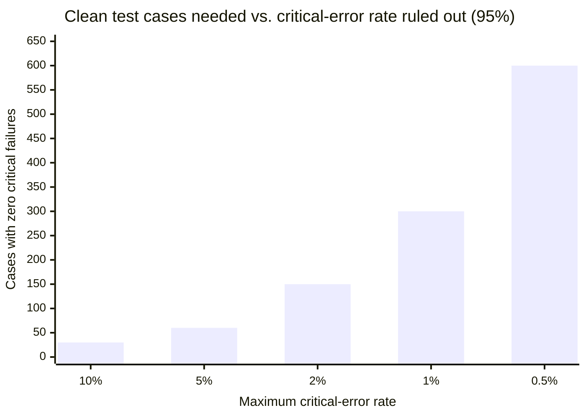

These bounds hold only if cases are representative and independent; 300 near-duplicates prove little. They apply **per slice** that matters, such as a product line, a language or a permission group. If one slice carries most of the consequence, size that slice on its own.

**Starting-default composition** (adjust to the observed task mix): about 60% common real requests; 20% costly exceptions, ambiguity, stale or conflicting sources; 10% out-of-scope requests that should be refused or escalated; 10% adversarial, permission-boundary and data-leakage cases. Hold out at least one third of cases as a final evaluation set that is never used to tune prompts, retrieval or models. The mix is handbook synthesis.

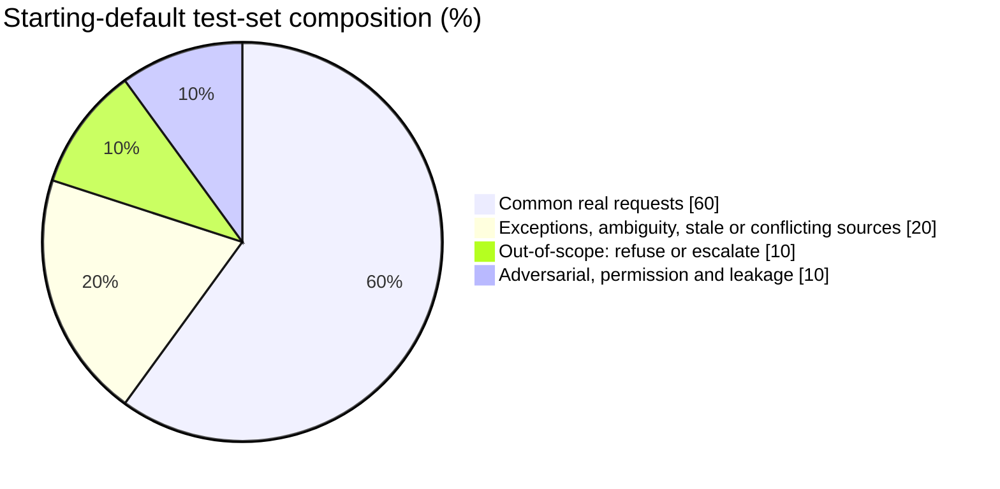

Vanguard’s question-to-SQL exemplars served in-context prompting, evaluation and regression purposes; LCH used approximately 100 golden question/answer pairs collected from service agents. These are documented implementations. The handbook adds separation of development and final evaluation evidence to reduce the risk that repeated repair is mistaken for broader reliability. [D14 ll. 201–214; D26 ll. 216–246; **additional design separation: handbook synthesis**.]

### 6.4 Evaluate the system at several levels

| Level | What to test | Why it affects the decision |
|---|---|---|
| Data/retrieval | Coverage, freshness, correct source retrieval, entitlements and deletion | A fluent answer can conceal a source or access failure |
| Answer/model | Correctness, completeness, groundedness, citation support, refusal behavior, consistency | Averages cannot excuse critical misinformation or omissions |
| Task/workflow | Successful completion, verification/correction effort, hand-offs, user competence | A technically correct output may add more work than it removes |
| Controls | Unauthorized access, leakage, prohibited actions, escalation and fallback | Demonstrates behavior under failure and misuse, not just normal prompts |
| Service/economics | Latency under relevant load, availability behavior, review cost, full cost per successful outcome | Establishes whether the workflow is usable and sustainable |
| Affected groups | Relevant differences in access, quality, error or impact | Detects performance gaps hidden by the aggregate; data collection and grouping require local review |

For conventional predictive models, use appropriate out-of-sample evaluation and test for leakage, time effects, practical constraints and relevant subgroup behavior. An investment application must assess the actual decision and operating constraints, including transaction effects where relevant; model fit alone is insufficient. UOBAM’s pilot generated impractical portfolio turnover and needed business-led revision before production. [D34 pp. 22–23.]

For generative systems, repeat relevant tests to examine variability, assess omissions and check whether citations support the answer. Distinguish a correct refusal from an unhelpful failure to answer an eligible question. For action-taking systems, evaluate full trajectories: tool choice, parameter validity, authorization, intermediate data/state, final outcome, duplicate/retry behavior and intervention/recovery. A good final answer does not validate unsafe intermediate actions. FINOS’s agent diagram shows how runtime privileges, tools, state, model calls and skill bundles create linked attack surfaces; it is an illustrative risk architecture, not a production design to copy. [FINOS ri-6, Testing and Evaluation Challenges; F11 and its PlantUML source; mi-19, sections 1–3; mi-24, sections 1–7, Draft.]

### 6.5 Combine experts and automated evaluation appropriately

Automation can extend coverage and detect regressions. If an LLM judges outputs, first compare its decisions with expert judgments on representative examples; examine disagreements, biases and failure categories; preserve human escalation for consequential or uncertain cases. Version the judge, prompt and rubric, and monitor its own performance and cost. **Starting default:** calibrate on at least 100 expert-labeled items stratified across task types, including every known critical-failure pattern. Do not rely on the judge for a category where it misses critical failures that experts caught; route those cases to people. LCH describes model-based scoring with admin review. FINOS explicitly treats LLM-as-a-Judge as a complement to human oversight and requires calibration against expert evaluations. [D26 ll. 210–246; FINOS mi-15, sections 4–6 and Challenges and Considerations.]

Do not choose a test volume because another firm used 100, 500 or thousands of questions. Set it from task diversity, failure severity, variability, required confidence and reviewer capacity. Report case counts, sampling, exclusions, failures and uncertainty. A small convenience sample supports a narrower conclusion than a representative, independently reviewed evaluation.

### 6.6 Diagnose failures and make a decision

Classify each important failure as problem definition, source quality, missing content, retrieval, semantics, prompt/configuration, model behavior, authorization/control, integration, human review or workflow design. Assign the corrective action to the relevant owner and rerun affected tests plus regression evidence. Changing the model is one option among several.

Prudential reports an initial 41% test pass followed by a 99% result after iterative content/evaluation work on more than 500 questions under its defined criteria. UAT lasted roughly four months; continuing content maintenance remained necessary. These are **reported test outcomes**, not proof of universal accuracy, a transferable benchmark or a causal estimate of business improvement. [D29 pp. 16–19.]

**Continue** when the defined task benefit and required controls are supported, remaining limitations fit the approved scope, and production work has a credible owner/cost plan. **Redesign** when the problem remains important but data, workflow, quality or economics fail a remediable condition; specify the next experiment and funding limit. **Stop** when value is unsupported, constraints cannot be met, harm cannot be controlled or the opportunity cost is unacceptable. Immediate suspension triggers override an otherwise favorable average.

```mermaid
flowchart TD
    R["Results by slice and severity"] --> C1{"Any immediate<br/>suspension trigger?"}
    C1 -- Yes --> SUS["Suspend; contain; investigate"]
    C1 -- No --> C2{"Pre-set thresholds met,<br/>including critical-error rule?"}
    C2 -- Yes --> C3{"Credible owner and cost<br/>plan for production?"}
    C3 -- Yes --> GO["Continue to production readiness"]
    C3 -- No --> RD
    C2 -- No --> C4{"Is the failure remediable<br/>and the problem still important?"}
    C4 -- Yes --> RD["Redesign: named fix, owner,<br/>cost limit, retest date"]
    C4 -- No --> ST["Stop; record learning;<br/>close data and access"]
```

**Deliverables:** completed charter, versioned evaluation set/rubric, results by task and severity, failure log, control evidence, user findings, cost record and signed decision. **Failure detection:** a polished demo with no baseline, changing acceptance rules after results, reporting only favorable examples, or a pilot kept running without a next decision. Development, evaluation and workflow feedback iterate together; increased exposure depends on evidence and the agreed decision.

## 7. Move from pilot to production

| Chapter card | |
|---|---|
| **Owner** | Technical lead and operational owner prepare; business owner accepts fitness; release authority decides |
| **Start when** | Pilot decision is "continue" and production scope, owner and budget are funded |
| **Timebox (starting default)** | Tier 2: 4–8 weeks to first production cohort; Tier 3: set by shadow and cohort durations |
| **Outputs** | Release evidence pack, signed checklist, runbook, monitoring plan, tested off-switch and fallback |
| **Tools** | C.6, C.10 |
| **Requirement level** | Core at Tier 2–3: tested disablement, named responders, versioned release record. Tier 1: approved tool configuration and feedback route |

### 7.1 Purpose and prerequisites

Make the capability dependable within a real service and its responsibilities. A successful pilot supplies evidence for a release decision; it does not establish that integration, security, support and continuity are ready. Prerequisites are accepted pilot evidence, a defined production scope, funded operating ownership and completed reviews for the intended exposure.

MindForge recommends a monitoring plan, accountable responders, contingency measures, proportionate rollout, targeted user training and documented release checks. DBS’s CodeBuddy case describes user review, approved models, performance testing, disablement, phased rollout, training and tested changes. [D30 pp. 99–103; D29 p. 8.]

### 7.2 Assemble the release evidence pack

The technical lead and operational owner prepare a pack linking:

1. Accepted use-case scope, owner, users, locations, data and actions, including explicit limitations.
2. Architecture/data flows and the exact versions of models, prompts, retrieval configuration, source/index, tools and relevant code.
3. Task/control/security tests, unresolved defects, local legal/compliance decisions, independent challenge and business acceptance.
4. Identity, permissions, secret handling, retention/deletion and support-access evidence.
5. Load, latency, availability and cost evidence for the planned exposure; dependence on third parties and other shared services.
6. Monitoring, alerts, escalation, on-call/support capacity, content refresh, change procedures and review dates.
7. Tested disablement/rollback or other safe recovery and the human/manual continuity workflow.
8. User training, supervision capacity, communications and any locally required notices or approvals.

Give reviewers the same underlying evidence with a clear summary of changes since their prior review. Prudential’s case describes archiving test results, guardrail outcomes and architecture documents before final change approval, alongside the delays caused by overlapping reviews. The transferable practice is coordinated evidence and explicit conditions, not copying its committee names. [D29 pp. 17–18.]

### 7.3 Integrate the workflow and human role

Specify where the user encounters the capability, what information they see, how they check/accept/reject/edit, what is committed to records or downstream systems, and what happens when the system cannot help. Use existing systems where they support the task; avoid requiring users to recreate context across disconnected tools. LPL’s executive describes the need to place insights inside ClientWorks and says that parts of that integration were still being developed. JPMC’s Coach consolidated multiple topic-specific chat windows after they confused advisors. [D27 ll. 254–293; D25 p. 13.]

Define human oversight as an operational action. Record who reviews, at which point, using what source evidence, within what workload, with authority to reject or escalate. Choose pre-action approval, exception handling, or sampled/continuous post-event oversight according to risk and feasibility. Where a human cannot reliably detect a critical failure, reduce the capability’s authority or redesign the control; do not assume a review button solves the problem. MindForge distinguishes human-in, over and out of the loop and emphasizes practical competence and authority. [D30 pp. 77–78, 109–110.]

```mermaid
flowchart LR
    R["Decide at design stage, and revisit through the lifecycle,<br/>based on inherent risk materiality, intended modality<br/>and feasibility of human oversight"]
    R --> H1["Human in the loop<br/>An employee retains full control and approves<br/>or executes actions at crucial points<br/>e.g. reviewing AI-drafted customer emails before sending"]
    R --> H2["Human over the loop<br/>An employee may modify, overrule or intervene,<br/>but need not act in normal operation<br/>e.g. reviewing escalated anomalies or outputs after the fact"]
    R --> H3["Human out of the loop<br/>Outputs without direct employee involvement<br/>e.g. an autonomous chatbot; oversight continues through<br/>post-deployment testing, monitoring and review"]
```

*Forms of human oversight, redrawn from MindForge, which adopts them from the IMDA/PDPC Model AI Governance Framework. [D30 pp. 77–78]*

### 7.4 Release within explicit exposure limits

Choose shadow/parallel operation, a supervised cohort, a restricted live scope or a phased rollout appropriate to the task. Shadow operation should not affect actual decisions unless authorized. Define the cohort, allowed actions, duration, monitoring intensity and criteria for widening or reversing exposure. Confirm that real data and real users are covered by the relevant permissions even during a limited release.

The release authority decides the authorized scope, conditions and expiration/review date, drawing on business, technical, operational and required control decisions. A conditional release must name remaining actions and limits; it cannot conceal unresolved mandatory requirements. Preserve the ability to return to the previous supported workflow.

**Starting-default rollout.** Google’s SRE guidance describes a canary as a partial, time-limited deployment compared against a control. It recommends a population and duration large enough to be representative, including heavy-load periods, and running one canary at a time. Its example uses 5% of traffic. [E12] Applied to AI workflows:

```mermaid
flowchart LR
    S0["Stage 0 · Tier 3 only<br/>Shadow or parallel run;<br/>no effect on real decisions"] --> S1["Stage 1<br/>Supervised cohort: one team<br/>or about 5% of eligible users"]
    S1 --> S2["Stage 2<br/>Expanded cohort:<br/>about 25–50%"]
    S2 --> S3["Stage 3<br/>All eligible users<br/>in approved scope"]
    S1 -. "abort trigger" .-> B["Roll back to the<br/>previous workflow"]
    S2 -. "abort trigger" .-> B
    S3 -. "abort trigger" .-> B
```

Keep each stage for at least one full business cycle that includes the peak or period-end work the system will face. Widen only when the stage’s criteria are met. Change one thing at a time, so that a problem can be attributed to its cause. The percentages are starting defaults, not rules.

### 7.5 Operate with actionable monitoring

| Monitor | Responsible owner | Trigger and response to define locally |
|---|---|---|
| Task quality and critical errors | Business/evaluation owner | Investigate, restrict answers/actions, correct data or suspend |
| Source freshness, ingestion/retrieval and semantic changes | Content/data owner | Refresh, quarantine affected sources, retest and notify consumers |
| Permissions, leakage and tool/credential misuse | Information Security with service team | Contain, revoke access, preserve appropriate evidence and follow incident procedures |
| Availability, latency, errors and dependencies | Operational owner | Route to support, degrade safely or activate continuity plan |
| Usage, overrides, abandoned work and complaints | Business/product owner | Investigate workflow failure, misuse or training needs |
| Cost and resource consumption | Service owner and finance | Alert, throttle within approved service priorities, investigate and reforecast |

Each metric needs a definition, data source, threshold, review cadence, named responder, response authority and evidence of closure.

**Starting-default cadence.** Tier 1: usage and feedback reviewed monthly. Tier 2: a monthly human-reviewed sample of at least 50 production interactions, with real-time alerts on access, leakage and cost. Tier 3: a weekly sample of at least 50 during the first business cycle, then risk-based; real-time alerts on every critical control. A clean sample of 50 only rules out a critical-error rate above about 6%, so pair sampling with user flags, override tracking and targeted checks of high-consequence cases. [E07; D30 p. 108] Log enough to investigate the relevant event, while respecting locally approved minimization, access and retention. Trace model/configuration/source versions and actions where needed; retaining every raw prompt indefinitely is not a universal requirement. [FINOS mi-4, sections 1–6; mi-9, Alerting and Response Procedures; D30 pp. 100, 109–113.]

### 7.6 Respond to incidents and control changes

When a trigger occurs, the designated incident lead should assess impact, contain the affected capability or access, move work to the approved fallback, preserve permitted evidence, notify the relevant internal owners and obtain local advice on any external notification or remediation obligation. Investigate model, source, prompt, tool, integration, user and provider changes. Record corrective actions and require proportionate re-evaluation before restoration.

```mermaid
flowchart LR
    T["Trigger: alert, user flag,<br/>complaint, vendor notice"] --> A["Assess impact<br/>and scope"]
    A --> C["Contain: restrict,<br/>disable, revoke access"]
    C --> F["Move work to<br/>approved fallback"]
    F --> N["Preserve evidence;<br/>notify owners; obtain advice<br/>on external notification"]
    N --> I["Investigate: model, source,<br/>prompt, tool, integration, user,<br/>provider changes"]
    I --> X["Corrective action and<br/>proportionate re-evaluation"]
    X --> RS{"Restore?"}
    RS -- "evidence sufficient" --> OK["Restore with<br/>monitoring"]
    RS -- "not yet" --> X
```

Classify changes by impact, not by the size of a code diff. A new audience, source, provider route, action permission or document policy can change risk substantially. Record the change, run relevant regression/control tests, obtain required approval and update the inventory. Supplier-enforced updates may require extra monitoring or restrictions if advance testing is unavailable. Version pinning can support controlled change where providers permit it; it does not remove data drift or justify retaining an unsupported version indefinitely. [D30 pp. 112–113; FINOS mi-10, Implementation Guidance.]

**Deliverables:** signed readiness checklist, versioned release record, runbook, support/monitoring plan, training evidence, tested contingency and change/incident records. **Proceed** when an accountable operational team can run, observe and stop the capability and the production scope has the necessary acceptance. **Failure detection:** no one receives alerts, content has no update owner, an AI feature cannot be disabled without breaking the core workflow, or vendor changes enter untested. Integration and runbook preparation run in parallel with late pilot evaluation; production exposure depends on completed release conditions.

## 8. Support adoption and changes in work

| Chapter card | |
|---|---|
| **Owner** | Business owner owns the change and benefit; line managers release capacity; the people/learning lead supports |
| **Start when** | During discovery, then continuously through operation |
| **Timebox (starting default)** | Role-based training completed before each rollout stage; adoption reviewed at 30, 60 and 90 days after release |
| **Outputs** | Future-workflow description, role changes, competence evidence, feedback backlog, adoption review |
| **Tools** | C.11, C.13 |
| **Requirement level** | Core at all tiers: acceptable-use training and a feedback route. Tier 2–3: role-based competence checks on representative tasks |

### 8.1 Purpose and prerequisites

Make the new workflow useful, understood and sustainable for the people carrying it out. Begin during discovery, with user participation, line-manager involvement and allocated learning time. Continue after release because real use reveals new exceptions and support needs.

BNY describes a sequence from access and awareness to role-based skills, hands-on building and community support. Vanguard describes experienced hires, partner capacity, role-based learning and repeated learning events. These are implemented organizational approaches, not evidence that a particular training format alone causes adoption or value. The training gap is common: in Microsoft and LinkedIn’s 2024 survey, only 39% of people using AI at work had received AI training from their company. [E06] [D12 pp. 2–4; D36 ll. 118–151.]

### 8.2 Redesign the job around the intended outcome

For each affected role, the business owner and line manager describe work before and after deployment: what is removed, retained, added or escalated; what the AI produces; what the person must verify; and how exceptions reach qualified support. Include checking, correcting, documenting and supervising time in the new process. Consult the employees who will perform these steps and the teams receiving their outputs.

Decide what the organization intends to do with released capacity: improve service, handle more demand, shorten backlogs, change role mix or realize a financial saving. Record the management action needed to achieve that benefit. Saving minutes does not automatically create revenue or reduce cost. Address workforce implications honestly; do not promise job security or headcount reductions that leaders have not decided.

```mermaid
flowchart LR
    subgraph Before
      B1["Receive inquiry"] --> B2["Search several systems"] --> B3["Read and interpret"] --> B4["Draft answer"] --> B5["Escalate if unsure"]
    end
    subgraph After
      A1["Receive inquiry"] --> A2["Ask assistant"] --> A3["Verify cited sources<br/>(new, explicit step)"] --> A4["Edit and send"]
      A3 -- "wrong or uncited" --> A5["Flag and escalate<br/>(new feedback step)"]
    end
```

The illustration shows why redesign matters: verification and flagging are new work that must be trained, timed and counted.

### 8.3 Build role-specific competence

| Audience | Practical learning objective | Evidence of competence |
|---|---|---|
| Leaders and managers | Choose problems, interpret evidence, allocate capacity and make risk/value decisions | Review an actual proposal and explain the decision/limits |
| Business users | Use the tool within scope, verify outputs and handle exceptions | Complete representative tasks, including an incorrect or out-of-scope output |
| Domain/content specialists | Maintain sources, create labels and identify consequential omissions | Apply the rubric consistently and resolve content defects |
| Builders | Implement approved data, controls, evaluation and change practices | Demonstrate tests and failure handling in the chosen architecture |
| Reviewers and operations | Challenge evidence, monitor, investigate and stop/recover safely | Conduct a review or incident/rollback exercise |

General literacy can establish common language; task-specific practice establishes readiness to use a system. Require the depth appropriate to the role and exposure. Where a jurisdiction imposes an AI literacy duty, keep evidence of the measures taken (4.2, [E09]). Julius Baer’s case describes mandatory general e-learning plus visible limitations and a trained initial cohort; this supports combining education and controlled access. It does not establish that training alone is adequate for consequential automated decisions. [D29 p. 12; D30 pp. 102, 104.]

### 8.4 Establish feedback that changes the product

Offer a low-friction way to flag incorrect, incomplete, unsafe or unusable behavior and to reach a human where appropriate. Capture enough context to reproduce/investigate without unnecessarily exposing sensitive information. Assign triage, severity, owner and closure. Tell users what changed where practical. Combine direct feedback with task completion, rework, overrides and support evidence; enthusiastic testimonials and login counts are incomplete.

Communities, champions, office hours, demonstrations and prompt libraries can help spread useful practices. Treat them as optional enabling mechanisms, with oversight for shared workflows and content. A reusable employee-built workflow can introduce new data flows or actions when combined; approved components do not remove the need to evaluate the combined use.

The Morgan Stanley accounts emphasize engagement and clear human roles, while BNY uses communities and role-based development. D09 is an educator interpretation of Morgan Stanley’s adoption, whereas D05/D08 are practitioner accounts. Preserve that distinction when using their lessons. [D09 ll. 69–164; D05 ll. 43–85; D12 pp. 3–4; FINOS mi-11, sections 1–3, 6.]

### 8.5 Measure adoption as a changed workflow

Track eligible users, repeat use for intended tasks, completion and quality, correction effort, override/escalation patterns and user burden. Disaggregate by role and relevant circumstances. Low adoption can indicate poor usefulness, weak integration, lack of trust, insufficient competence, inaccessible infrastructure or a badly chosen problem. Investigate before prescribing more training or mandatory use.

**Deliverables:** future-workflow description, role/capacity changes, learning plan and competence evidence, communications, feedback backlog and adoption review. **Responsible:** business owner owns the change and benefit; line managers release capacity; people/learning and product leads support; specialists maintain safeguards. **Proceed to wider adoption** when users can complete the task competently, support is available and evidence shows that the new workflow is useful. **Failure detection:** attendance counted as capability, usage incentives that encourage unsafe output acceptance, or checking costs omitted from productivity claims. People work runs alongside design and engineering and continues through operation and scale.

## 9. Measure results and scale selectively

| Chapter card | |
|---|---|
| **Owner** | Business owner and finance validate benefits and costs; operations and control owners validate fitness; portfolio authority allocates expansion funding |
| **Start when** | Before release (baseline), then at each review |
| **Timebox (starting default)** | First value review 90 days after full release; then at the tier’s review cadence: Tier 1 annual, Tier 2 every 6 months, Tier 3 quarterly, and after any material change |
| **Outputs** | Outcome and cost ledger, evidence-quality assessment, expand/refine/retain/retire decision |
| **Tools** | C.7, C.14 |
| **Requirement level** | Core at Tier 2–3; Tier 1 tracks adoption and user-reported value |

### 9.1 Purpose and prerequisites

Determine whether the deployment is creating enough value, at an acceptable cost and impact, to retain or expand. Start with an agreed baseline, operating telemetry, quality evidence, costs and a business owner who can change the workflow or investment.

The collection reports varied outcomes: Schwab says its assistant may save up to two minutes on complex calls; Vanguard reports different figures for coding time and overall software-development productivity; LPL distinguishes anecdotal external-tool benefits from better-instrumented internal-tool measures. These are useful examples of why measurement definitions and evidence quality must remain explicit. [D11 ll. 109–113; D36 ll. 285–293; D27 ll. 345–374.]

### 9.2 Maintain an outcome and cost ledger

| Measurement layer | Example question | Interpretation constraint |
|---|---|---|
| Business outcome | Are inquiries correctly resolved, cases completed, backlogs reduced or service improved? | Compare equivalent work and record other changes that may explain results |
| Quality and impact | What errors, omissions, adverse effects or complaints occur? | Show critical failures and relevant groups, not only averages |
| Workflow/capacity | How much total effort is required, including checking and rework? | Released time is capacity until management converts it into another benefit |
| Financial | What incremental contribution or actual cost change is supported? | Revenue is not profit; avoided effort is not automatically a cash saving |
| Adoption | Are eligible users repeatedly completing intended tasks? | Access, training and logins do not establish benefit |
| Operating cost | What does a successful completed outcome cost? | Include failed attempts, review, support and shared costs without double counting |

Choose a credible comparison: controlled allocation when appropriate and permissible; phased comparable cohorts; parallel/shadow work; or a before/after analysis that documents task mix, seasonality, staffing and process changes. Report limitations and avoid causal language beyond the design. The business owner validates usefulness; finance validates treatment of money and capacity; the evaluation lead challenges the comparison. MindForge describes post-deployment review frequency as following risk materiality and triggers such as major changes, KPI breaches and stakeholder feedback; the tier cadences in the chapter card apply that principle. [D30 p. 108]

Calculate fully loaded cost over a defined period, including development/integration, data/content work, model/infrastructure or licenses, human evaluation/review, operational support, security/governance effort, training/change, supplier management and applicable transition/retirement costs. Explain allocation of shared costs and avoid charging the same cost twice.

**Handbook synthesis formulas:**

- Cost per successful outcome = attributable full period cost ÷ completed outcomes meeting the agreed quality standard in that period.
- Net operating benefit = supported incremental economic benefit − incremental operating cost, using the organization’s finance rules.
- Investment case = the above operating view plus one-time costs, timing, uncertainty, alternatives and capital allocation criteria.

If the denominator is zero, report that no successful outcome was demonstrated; do not present a meaningful unit cost. Show low, expected and high demand/cost scenarios with explicit assumptions. D38 informs the full-cost/outcome framing but is an unattributed recommendation document, not a verified benchmark. [D38 ll. 1–49, 381–429, 550–577; D10 pp. 11–12.]

### 9.3 Choose the next action from sustained evidence

| Evidence | Decision | Required follow-through |
|---|---|---|
| Benefit and controls supported; stable operations; unmet demand | Consider expansion | Reassess the new context, capacity and economics |
| Useful task benefit; high cost/latency or avoidable friction | Refine | Fund a bounded improvement with an explicit target and review |
| Quality/use degrades after change or new data | Restrict or suspend affected scope | Diagnose, restore controls and retest before reinstatement |
| Insufficient value or a better alternative | Retire or replace | Manage continuity, data, access, dependencies and records |
| Evidence remains insufficient | Limit exposure and gather specific evidence, or stop | Set the unresolved question, owner, cost limit and deadline |

```mermaid
flowchart TD
    E["Value review evidence"] --> Q1{"Controls failing or<br/>quality degraded?"}
    Q1 -- Yes --> RS["Restrict or suspend affected scope;<br/>diagnose and retest"]
    Q1 -- No --> Q2{"Benefit supported over<br/>a full cycle?"}
    Q2 -- "No / insufficient evidence" --> Q3{"Specific evidence gap<br/>worth closing?"}
    Q3 -- Yes --> L["Limit exposure; gather evidence<br/>by a deadline and cost limit"]
    Q3 -- No --> RT["Retire or replace"]
    Q2 -- Yes --> Q4{"High cost, latency<br/>or friction?"}
    Q4 -- Yes --> RF["Refine: bounded improvement"]
    Q4 -- No --> Q5{"Unmet demand and capacity<br/>to absorb a new context?"}
    Q5 -- Yes --> EX["Expand after new-context review"]
    Q5 -- No --> MT["Maintain"]
```

Do not scale solely because a pilot passed or because another firm reported success. Expansion changes task mix, audience, languages, source permissions, volumes, jurisdictions, integrations or action authority. Re-evaluate the changed dimensions and their dependencies. A shared component’s prior tests can support reuse, but do not automatically authorize a new context.

### 9.4 Scale the reusable parts deliberately

Package the interface, data contract, control configuration, evaluation harness, test cases, runbook and owner/support agreement. State which parts transfer unchanged and which need local adaptation. Test the shared service’s capacity and failure concentration before adding dependents. Account for onboarding and training costs as part of expansion.

Fidelity describes modular services designed for reuse; JPMC describes deriving common patterns from decentralized experimentation. EBRD’s WEF case describes phased expansion of a document-grounded system to broader users and partner institutions, with reported productivity benefits. These support considering reusable capabilities; they do not establish a fixed percentage of code or operating effort that every organization can reuse. [D10 pp. 11–12; D25 pp. 6–8; D37 p. 31.]

### 9.5 Retire as deliberately as you release

The business owner and operational owner agree the replacement/manual workflow, communications and service commitments. Disable the AI route and its tool privileges, revoke credentials and supplier access, stop scheduled jobs, resolve shared dependencies, and apply locally approved retention/deletion requirements to sources, indexes, logs, caches, backups and artifacts. Update the inventory and finance record; retain the decision and lessons required for future assurance. Validate completion rather than assuming that hiding the interface decommissions the system. UOBAM’s lifecycle explicitly permits improvement or decommissioning when solutions no longer meet business needs. [D34 p. 22; D30 pp. 53, 63–64, 68.]

**Deliverables:** value/cost ledger, evidence-quality assessment, operating/risk review, expansion or retirement decision and reusable-service package where warranted. **Responsible:** business owner and finance validate benefits/costs; operations/control owners validate ongoing fitness; portfolio authority allocates expansion funding. **Proceed** only with sustained evidence appropriate to the exposure and a validated new-context plan. **Failure detection:** projected industry savings booked as realized benefits, double-counted capacity, growth attributed to AI without a comparison, or escalating usage/cost while successful outcomes stagnate. Revisit the portfolio as results accumulate.

## 10. Adapt the framework into an organizational roadmap

| Chapter card | |
|---|---|
| **Owner** | Program Lead assembles; business, technical, control, people and finance owners validate their commitments; competent leaders authorize |
| **Start when** | After the first portfolio round; refresh at each gate decision and at least quarterly |
| **Timebox (starting default)** | Roadmap v1 by day 90 (Quick start); a 12-month horizon with quarterly re-planning |
| **Outputs** | Fact and unknown log, dependency roadmap, business cases, executive decision package |
| **Tools** | C.8, C.12 |
| **Requirement level** | Core for any portfolio beyond a single Tier-1 use |

### 10.1 Purpose and prerequisites

Translate the handbook into an organization’s own sequence of commitments. This is the point at which local discovery, leadership choices and evidence become a company strategy. The handbook does not preselect a company’s priorities, reporting lines, delivery dates, staffing or budget. Begin with the mandate/readiness profile, portfolio evidence, known constraints and actual delivery/review capacity.

### 10.2 Conduct a structured application process

The Program Lead should run a series of focused working sessions, collecting evidence between them:

1. **Diagnosis and outcomes:** leaders and workflow owners confirm the core challenge, affected people, strategic importance and baseline. Separate established facts, hypotheses and unknowns.
2. **Capability and constraints:** business, data, technology, operations, people and control specialists test readiness against candidate uses. Verify local legal/regulatory applicability and permitted data routes.
3. **Investment choices:** compare credible alternatives, select the initial portfolio and identify shared prerequisites. Record rejected/deferred options and what evidence could change the choice.
4. **Delivery commitments:** agree scope, named owners, released capacity, sourcing, costs, decision milestones and pilot/release evidence.
5. **Executive decision:** present a coherent proposal showing the challenge, chosen approach, actions, economics, risks, alternatives and unresolved decisions. Obtain authorization from the organization’s competent authority.

These are session purposes, not a mandatory number of meetings or a fixed schedule. Ask a few focused questions at a time and use answers/evidence to determine the next investigation. Maintain traceability from consequential question and answer/evidence to assumption, decision, alternative and review trigger. Where leaders disagree, preserve the alternatives instead of manufacturing agreement.

### 10.3 Adapt by maturity and delivery capacity

| Observed condition | Appropriate roadmap emphasis | Evidence needed before the next commitment |
|---|---|---|
| Individual experiments, little ownership | Inventory, permitted access, business discovery, basic roles and evaluation | Named owner, bounded use, baseline and usable controls |
| Many pilots, few dependable services | Portfolio concentration, data remediation, production engineering and operational ownership | Task benefit plus release/run evidence |
| Several production systems, inconsistent control/adoption | Common standards, incident/change discipline, skills and workflow integration | Sustained outcome, traceability and support evidence |
| Reliable uses across units | Shared services, local adaptation, new-context review and selective innovation | Economics, capacity, concentration risk and local applicability for expansion |

For smaller organizations, combine capabilities into a compact team and use existing inventory, issue tracking and governance tools if they provide the required functions. For larger organizations, distribute domain ownership and delivery while maintaining common standards, shared service contracts and portfolio visibility. Source maturity stages inform the discussion but do not replace this evidence-based diagnosis. [D19 pp. 2–6; D22 ll. 59–83, 119–170, 210–247; D30 pp. 67–74.]

### 10.4 Build a dependency-based roadmap

Each initiative row must connect an outcome, accountable owner, prerequisites, staffing/cost commitment, deliverable, decision milestone and measure. Show dependencies on data, security, legal review, integration, supplier selection, evaluation and operational support. Set dates from estimated work and available capacity; update them as discovery resolves uncertainty.

Use three horizons whose durations are set locally:

- **Establish:** resolve mandate, ownership, discovery, permissions and minimum evidence capabilities.
- **Prove and operationalize:** test prioritized uses, prepare data, integrate workflows and release those meeting criteria.
- **Expand and renew:** measure sustained value, package reusable services, adapt to new contexts and retire weak uses.

These are planning horizons created for this handbook, not additional maturity levels.

```mermaid
gantt
    title Illustrative 12-month roadmap shape (durations set locally)
    dateFormat  YYYY-MM-DD
    axisFormat  Month %m
    section Establish
    Mandate, guardrails, inventory, decision rights :e1, 2000-01-01, 90d
    section Prove and operationalize
    Tier-1 fast path live                           :p1, 2000-02-15, 30d
    Tier-2 use case A pilot and release             :p2, 2000-02-20, 150d
    Shared evaluation harness and monitoring        :p3, 2000-04-01, 120d
    Tier-2 use case B discovery and pilot           :p4, 2000-06-01, 150d
    section Expand and renew
    Value review and expand/refine decision for A   :x1, 2000-08-15, 45d
    Tier-3 candidate legal review and shadow run    :x2, 2000-09-01, 120d
    Annual portfolio and policy refresh             :milestone, x3, 2000-12-20, 0d
``` Work can overlap when dependencies permit. For example, role-based learning and a second use-case discovery can run during a pilot, while a release using sensitive data waits for required access/control evidence. A speculative future platform should not block an independent useful improvement unless a real dependency justifies it.

### 10.5 Brokerage application — illustrative, not a company recommendation

An organization serving investors might investigate a staff knowledge assistant, analyst research preparation, customer workflow support or an application affecting investment decisions. Each has different evidence requirements. The examples below are **illustrative applications**; they assert neither confirmed demand nor legal permissibility for a particular brokerage. Appendix B works through the first candidate from idea to scale decision, with every tool completed.

| Candidate | Discovery question | Possible baseline/alternative | Key local decisions |
|---|---|---|---|
| Support knowledge access | Which inquiries consume effort or fail resolution, and why? | Current search, improved procedures, staff assistant | Content ownership, resolution measures, personal data, escalation and service accountability |
| Analyst news/research preparation | Which collection/synthesis steps constrain analysis? | Feeds/search/templates, retrieval and drafting support | Data licenses, freshness, source provenance, expert review and actual analytical benefit |
| Investor screening/alerts/workflow | What do different user segments struggle to accomplish? | Existing charts/rules/alerts, usability changes, evaluated AI support | User evidence, market data rights, advice boundary, delivery channel and outcome quality |
| Personalized recommendation or execution | What authorized decision/action would change, and who bears the consequences? | Human/deterministic workflow and bounded assistance | Applicable local duties, suitability where applicable, permissions, financial controls, human authority and independent evaluation |

The collection gives stronger implementation detail for knowledge access, advisor support, data/querying and governed internal tools than for independently verified autonomous brokerage execution. FINOS’s autonomous wealth-management use case is a **Draft design**, not a deployed brokerage case, and its legal classifications require verification. Do not treat it as evidence of proven effectiveness or automatic permission. [D11 ll. 44–79; D14 ll. 132–258; D25 pp. 12–13; FINOS uc-2, front matter, Description and Regulatory Concerns.]

### 10.6 Complete an actionable company proposal

The eventual company document should explain the core challenge, chosen approach and coherent actions in plain language. Include the decisions leaders must make, accountable owners, deliverables, capacity, prerequisites, costs, milestones, measures, release/scale conditions and alternatives. Its appendices should preserve assumptions and consequential question-to-decision traceability so that new executive evidence can change the plan without losing the rationale.

**Deliverables:** company fact/unknown log, completed tools, chosen portfolio, capacity/sourcing plan, dependency roadmap, business cases and executive decision package. **Responsible:** Program Lead assembles; business/technical/control/people/finance owners validate their commitments; competent leaders authorize. **Ready to execute** means managers can identify their next action, authority, dependency, deliverable and decision evidence. **Failure detection:** dates without capacity, priorities copied from reference firms, assumed local legal permission, or unresolved executive choices presented as settled facts. Review the roadmap at meaningful evidence/decision points and after material changes; change the commitment when the underlying evidence changes.
